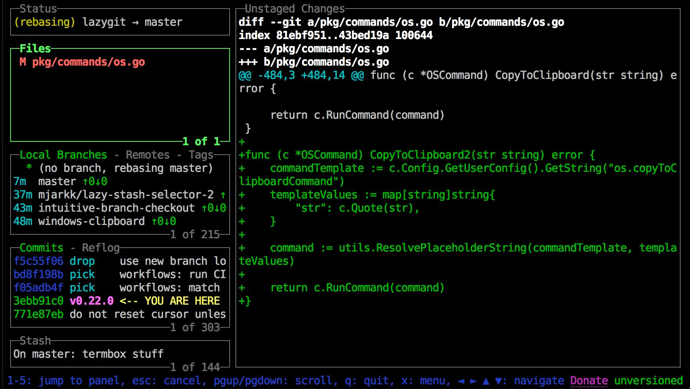

## Visualization Tools
### TUI:Lazy Git

## IDE Plugins

### Git Graph

commit提交/切换分支/图解分支detach状态
 分支推送/分支的增删改查/误删恢复
分支的定基合并/冲突解决/fast-forward时机
工作区与暂存区的实用场景区分
stash 暂存操作

rebase实操/重复历史现象解答

 更复杂的rebase情况
 rebase时如何简化分支图的
git pull --rebase 的使用场景和效果
 cherry-pick单独摘取某节点操作
 使用rebase在链条中插入节点
交互式变基剔除链条中的某些节点
 软重置压缩链条/交互式变基压缩链条

### Git Lens

## Git Worktrees

