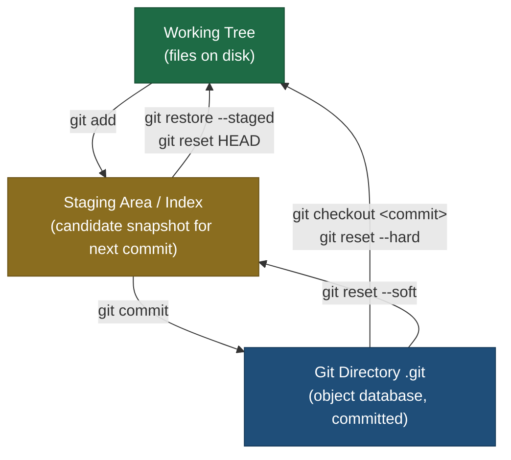
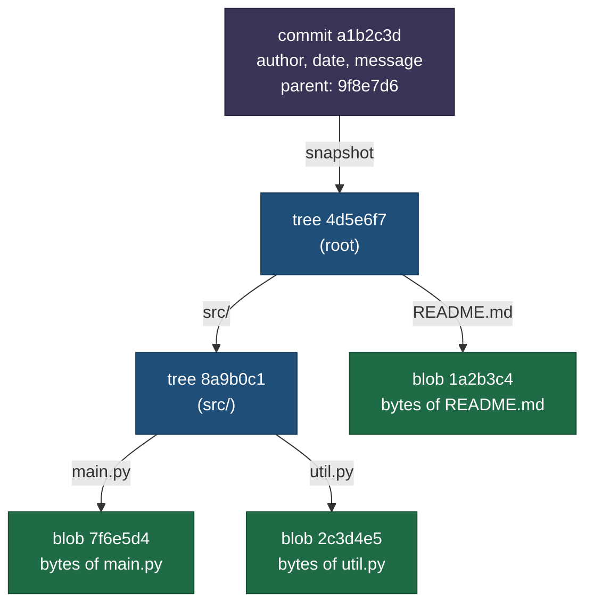
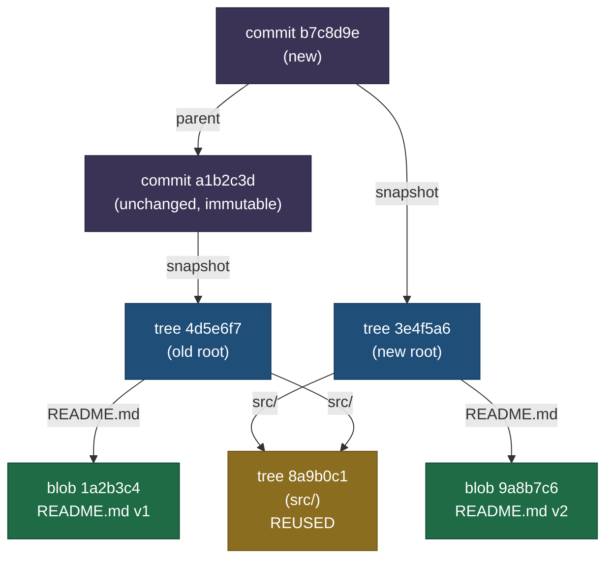
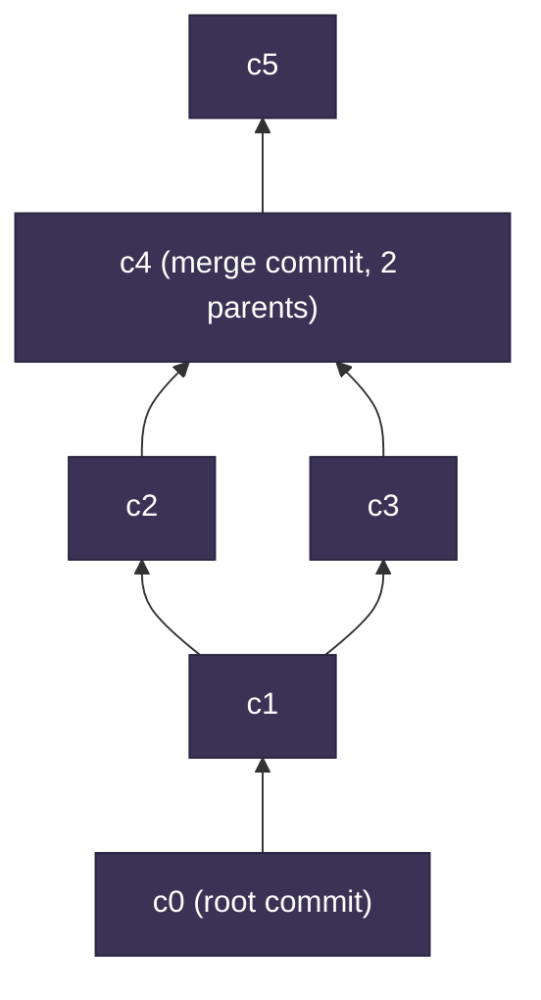
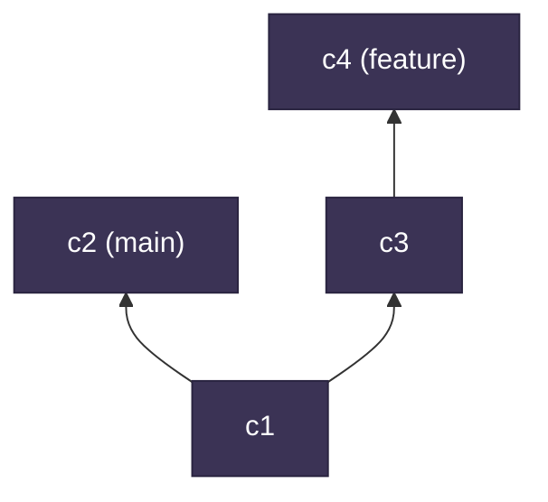
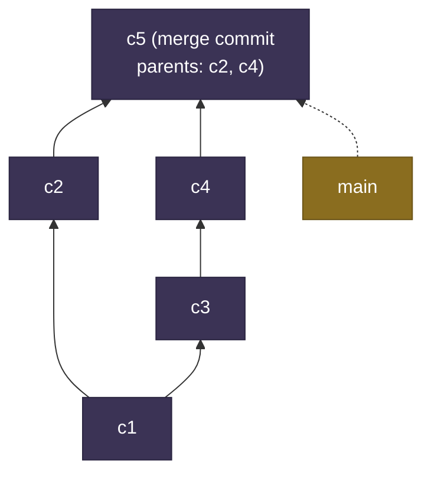
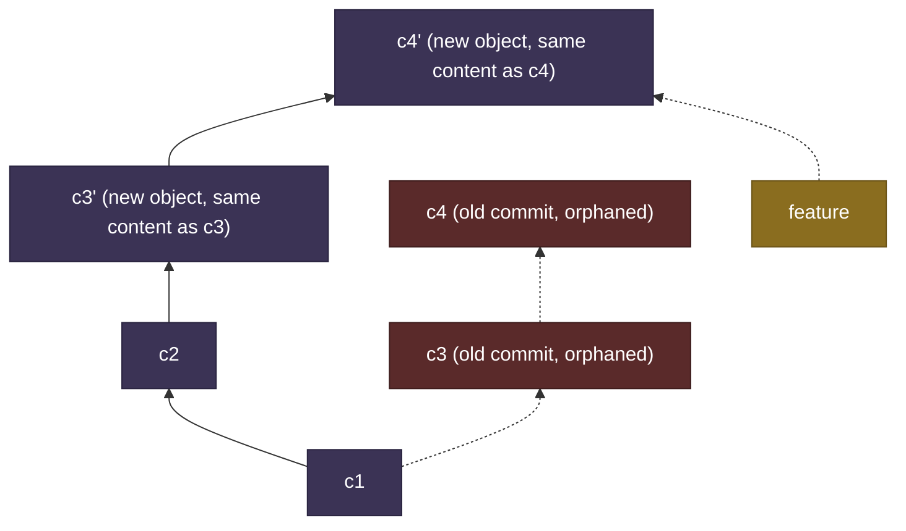

Last updated: 2026-08-01

Status: Active

Tags: [[Software Engineering]],[[Backend Development]]

# Git — Version Control System

> Primary reference: [Pro Git](https://git-scm.com/book/en/v2). Chapters 1–5 cover almost everything needed for proficient daily use.

Git's command-line interface is famously unintuitive. The reason is historical: the commands were built up around the data model rather than designed as a coherent UI. So the fastest path to competence is backwards from how most tutorials go — **learn the data model first, and the commands become obvious consequences of it** rather than a list to memorize.

## Table of Contents

- [What Is Git](#what-is-git)
- [Why Git Works: The Data Model](#why-git-works-the-data-model)
- [Setup](#setup)
- [Everyday Workflow](#everyday-workflow)
- [Branching and Merging](#branching-and-merging)
- [Remote Repositories](#remote-repositories)
- [Advanced Git](#advanced-git)
- [Best Practices](#best-practices)
- [Practice](#practice)
- [Resources](#resources)

## What Is Git

### Version Control, and What It Buys You

A version control system (VCS) records every change made to a set of files in chronological order, so you can return to any historical version, see who changed what and when, and inspect the difference between any two versions. It answers three questions that are otherwise unanswerable on a real codebase:

- **Who** edited this line?
- **When** was it changed?
- **Why** was it changed?

What follows from that: history is preserved rather than overwritten; work synchronizes across a team; mistakes are revertible; parallel development happens on branches and merges back safely; and changes can be reviewed before they land (pull requests).

### Three Generations of Version Control

The design of Git only makes sense against what came before it.

**Local VCS** — early tools like RCS stored patch sets on local disk to reconstruct any version of a file. Workable for one person on one machine; no collaboration.

**Centralized VCS (CVCS)** — CVS, Subversion, Perforce. A single central server holds all versioned files; clients check out working copies. This solved collaboration and administration, but introduced a single point of failure: if the server's disk dies without backups, the entire project history is gone.

**Distributed VCS (DVCS)** — Git, Mercurial. Clients don't check out a working copy — they **mirror the whole repository**, including full history. Every clone is a complete backup, so any client can restore a dead server. This also enables collaboration topologies (multiple remotes, hierarchical maintainer models) that a centralized system cannot express.

### Five Properties That Define Git

**1. Snapshots, not differences**

Traditional VCSs are *delta-based*: they treat data as a set of files and record the changes to each file over time. Git treats data as **a stream of snapshots of a miniature filesystem**. Every commit photographs the state of every file and stores a reference to that snapshot.

To avoid storing redundant copies, an unchanged file is not re-stored — Git stores a link to the identical file it already has. This is why Git behaves more like a small content-addressable filesystem than like a traditional VCS.

**2. Nearly every operation is local**

Browsing history reads the local database and completes essentially instantly — no server round trip. Diffing computes locally. And you remain fully functional offline: on a plane, on a train, or with the VPN down, you can keep committing (to your local repository) and push when connectivity returns. Under Perforce you can do almost nothing offline; under Subversion and CVS you can edit files but cannot commit.

**3. Everything is checksummed**

Every piece of content is checksummed with a **SHA-1 hash** before storage, and referenced by that checksum. The hash is 40 hexadecimal characters computed from the content of the file or directory structure:

```
24b9da6552252987aa493b52f8696cd6d3b00373
```

The consequence: **you cannot change any file or directory without Git knowing.** Corruption in transit or on disk is detectable. Note also that Git's database is keyed by content hash, not by filename.

**4. Git generally only adds data**

Almost every operation adds data to the database; it is hard to make Git do something irreversible or to erase data. Uncommitted changes can be lost, but once a snapshot is committed it is very hard to lose — especially if you regularly push to another repository. This is what makes Git safe to experiment in: you can try an aggressive operation knowing the old commits are still there.

**5. Three states, three areas**

A file in Git is in one of three states:

| State | Meaning |
| --- | --- |
| **Modified** | Changed on disk, not yet committed to the database |
| **Staged** | The current version of a modified file is marked to go into the next commit snapshot |
| **Committed** | Safely stored in the local database |

Which correspond to the three areas of a Git project:

| Area | Role |
| --- | --- |
| **Working tree** | A single checkout of one version of the project — files pulled out of the database onto disk for you to use and modify |
| **Staging area** (technically the *index*) | A file inside the Git directory storing what goes into the next commit |
| **Git directory** (`.git`) | Project metadata and the object database. This is what gets copied when you clone |

The basic Git workflow is therefore:

1. Modify files in the working tree.
2. **Selectively stage** just the changes you want in the next commit.
3. Commit — the staged snapshot is stored permanently in the Git directory.



## Why Git Works: The Data Model

Every Git command, in the end, does one of two things: **add objects to the database, or move references.** Once you can see that, the interface stops being arbitrary.

### Objects: blob, tree, commit

Git's storage model has three object types, and they're best read as a small recursive data structure:

```
blob   = array<byte>                    // a file is just bytes
tree   = map<string, tree | blob>       // a directory maps names to files and subdirectories
commit = struct {
    parents:  array<commit>,
    author:   string,
    message:  string,
    snapshot: tree,                     // the top-level tree being tracked
}
```

A snapshot is the top-level tree being tracked. Concretely, one commit over a project with `README.md` and a `src/` directory:



Read the arrows as hash references, not containment. A blob is **only bytes** — it does not know its own filename. The name `main.py` lives in the *edge*, i.e. in the tree that points at the blob. This is why renaming a file creates no new blob at all, and why Git can store one blob once even if it appears under five different names.

Now commit a change to `README.md` only:



Three things fall out of this picture, and together they explain most of Git's behavior:

- **A new blob and a new root tree were created, but `src/` was not touched.** The entire `src/` subtree — tree object and both blobs — is reused by hash. That is how "every commit is a full snapshot" costs about as much as storing a diff.
- **The root tree is new** even though only one of its two entries changed, because a tree's hash covers its whole name-to-hash mapping. Change anything below a directory and every tree on the path up to the root gets a new hash. Nothing else does.
- **Commit `a1b2c3d` was not modified.** It cannot be: its hash is its content. History rewriting builds new commits alongside the old ones, and the old ones survive until garbage collection — which is why `git reflog` can rescue a bad rebase.

### History as a DAG

Git models history as a **directed acyclic graph (DAG)** of commits, not a linear list. Each commit points to a set of parent commits:

- **One parent** — an ordinary commit.
- **Two or more parents** — a merge commit, joining parallel lines of development.
- **No parents** — the root commit.



Arrows point to parents, and the graph grows bottom-to-top (newer commits on top). `c1` forks into two lines (`c2`, `c3`), and `c4` stitches them back together into a single commit with two parents — exactly the point made in [Git for Computer Scientists](https://eagain.net/articles/git-for-computer-scientists/): this graph **only gets added to, and existing nodes can never be mutated**.

Commits are **immutable**. "Editing" history never mutates a commit; it creates new commits and updates references to point at them. The old commits remain in the database until garbage collection — which is exactly why history rewriting is recoverable (`git fsck --lost-found` can recover commits that briefly lost their references but haven't been collected yet).

### Content addressing

All objects are stored by the SHA-1 hash of their content:

```
objects = map<string, object>

store(object):  id = sha1(object); objects[id] = object
load(id):       return objects[id]
```

Objects never contain other objects — they **reference** them by hash. A commit holds the hash of its tree; a tree holds hashes of its blobs and subtrees. Identical content therefore has an identical hash and is stored exactly once, anywhere in history.

### References

Hashes are unusable by humans, so Git keeps **references**: human-readable names pointing at hashes.

- A reference is *mutable* — `main` is just a pointer that moves forward as you commit.
- **`HEAD`** is the special reference meaning "where I am right now." It usually points at a branch, which in turn points at a commit; when it points directly at a commit instead, you're in *detached HEAD* state.

A repository, completely, is: **objects + references.**

### The staging area is not part of the data model

The staging area is *orthogonal* to everything above — it's part of the interface for **creating** commits, not part of how history is stored. Its purpose is to let you choose what goes into the next snapshot instead of forcing the snapshot to be the entire current state of your working tree. Two cases where this earns its keep:

- Two unrelated changes sit in your working tree and you want them as two separate commits.
- You want to commit a bug fix without the debug print statements you added while finding it.

## Setup

### Configuration levels

`git config` manages configuration variables at three levels; **each level overrides the one above it.**

| Level | File | Scope |
| --- | --- | --- |
| `--system` | `[path]/etc/gitconfig` | Every user on the machine (needs admin rights) |
| `--global` | `~/.gitconfig` or `~/.config/git/config` | All repositories for the current user |
| `--local` | `.git/config` | The current repository only (the default) |

### Identity — required

Every commit embeds this information immutably, so set it before your first commit:

```bash
git config --global user.name "Your Name"
git config --global user.email "your@email.com"
```

### Useful optional settings

```bash
# Default editor for commit messages (Windows needs the full path)
git config --global core.editor emacs

# Name the initial branch "main" instead of "master" (Git 2.28+)
git config --global init.defaultBranch main
```

### Inspecting configuration

```bash
git config --list                  # every setting in effect
git config --show-origin <key>     # which file a given value came from
git help <command>                 # documentation for any command
```

### Getting a repository

There are exactly two ways.

**Initialize from an existing directory**

`git init` creates a `.git` subdirectory containing the repository skeleton. Nothing is tracked yet, so add and commit explicitly:

```bash
git init
git add *.c
git add LICENSE
git commit -m 'Initial project version'
```

**Clone an existing repository**

```bash
git clone https://github.com/libgit2/libgit2            # into ./libgit2
git clone https://github.com/libgit2/libgit2 mylibgit   # into ./mylibgit
```

Note that Git says *clone* where other systems say *checkout*, and the distinction is substantive: a clone pulls down **every version of every file in the entire history**, not a working copy. If the server's disk fails, almost any client clone can be used to restore it.

Several transport protocols are supported: `https://`, `git://`, and SSH (`user@server:path/to/repo.git`).

## Everyday Workflow

### Checking status

Every file in the working tree is either **tracked** or **untracked**. Tracked files are further unmodified, modified, or staged.

```bash
git status        # full status
git status -s     # short format (--short)
```

`git status` is the primary diagnostic tool. Immediately after a clone it reports `nothing to commit, working tree clean`. Otherwise it groups files into *Untracked files*, *Changes to be committed* (staged), and *Changes not staged for commit* (modified).

The short format uses two columns — **left is the staging area, right is the working tree**:

| Code | Meaning |
| --- | --- |
| `??` | Untracked |
| `A` | Newly added to the staging area |
| `M` | Modified |

### Tracking and staging

```bash
git add <file>     # track a new file, or stage a modified one
git add .          # stage everything in the current directory
git add -u         # stage updates to already-tracked files (incl. deletions)
git add -A         # . and -u combined
```

`git add` is multipurpose — it starts tracking new files, stages modified files, and marks merge conflicts as resolved. The mental model to hold is **"add exactly this content to the next commit,"** not "add this file to the project."

The detail that trips people up: `git add` records the file **as it was at that moment**. Modify the file again after staging and you must re-run `git add` for the newer version to be included. This is also why the same file can appear under both *Changes to be committed* and *Changes not staged for commit* simultaneously — not a bug, but the fine-grained control the staging area exists to provide.

### Viewing differences

```bash
git diff                       # working tree vs staging area — what is NOT staged
git diff --staged              # staging area vs last commit — what WILL be committed
git diff <commit1> <commit2>   # between two snapshots
git difftool                   # same comparisons in a graphical tool
```

`git diff` alone does **not** show all changes since the last commit — only the unstaged ones. That surprise accounts for a good share of accidental partial commits.

### Ignoring files

Create a `.gitignore` to keep logs, build artifacts, and temporary files out of the repository. Pattern rules:

| Pattern | Behavior |
| --- | --- |
| blank line, `#comment` | Ignored |
| standard glob | Applied recursively through the whole working tree |
| `/build` | Leading slash prevents recursive matching |
| `build/` | Trailing slash matches a directory |
| `!important.log` | Leading `!` negates — re-track this path |
| `doc/**/*.pdf` | `**` matches nested directories |

GitHub maintains a large collection of `.gitignore` templates covering dozens of languages and project types.

### Committing

```bash
git commit                  # opens the editor to write a message
git commit -m "message"     # inline message
git commit -a -m "message"  # auto-stage all TRACKED files, then commit
```

A commit records the snapshot **in the staging area**; anything unstaged stays modified in the working tree. The summary printed afterwards gives you the branch, the SHA-1, and the file/insertion/deletion counts.

`-a` skips the staging step entirely. Convenient, but it can sweep in changes you had not reviewed — use it deliberately, not reflexively.

### Viewing history

```bash
git log                              # reverse-chronological commits
git log -p                           # with the patch each commit introduced (--patch)
git log --stat                       # with per-file change statistics
git log --oneline                    # = --pretty=oneline --abbrev-commit
git log --graph                      # ASCII graph of branch/merge topology
git log --all --graph --decorate     # visualize the DAG
git log --pretty=format:"%h - %an, %ar : %s"   # custom format
```

Filtering the history is where `git log` earns its reputation:

| Option | Selects |
| --- | --- |
| `-<n>` | Only the last *n* commits |
| `--since` / `--after`, `--until` / `--before` | A time range |
| `--author` | Commits by an author |
| `--grep` | Commits whose *message* matches |
| `-S <string>` | Commits that **added or removed** that string (the "pickaxe") |
| `-- path/to/file` | Only commits touching that path |
| `--no-merges` | Hide merge commits |

`--grep` searches messages; `-S` searches the actual code change. The latter is how you find when a function was introduced or deleted.

### Removing and moving files

```bash
git rm <file>            # remove from tracking, staging area, and working tree
git rm --cached <file>    # untrack but KEEP the file on disk
git rm log/\*.log         # glob patterns are supported
git mv file_from file_to  # rename
```

`git rm --cached` is the fix for having committed something that belonged in `.gitignore`.

`git mv` is pure convenience — it's exactly `mv` + `git rm` + `git add`. Git does not store rename metadata at all; it **infers** renames after the fact by comparing content, which follows directly from the content-addressed model.

### Undoing things

```bash
# Redo the last commit with the current staging area
git commit --amend

# Unstage a file, keeping its changes
git reset HEAD <file>
git restore --staged <file>       # Git 2.23+

# Discard working-tree changes — DESTRUCTIVE
git checkout -- <file>
git restore <file>                # Git 2.23+

# Undo a commit by making a new one that inverts it — safe on shared history
git revert <commit>

# Move the branch pointer and discard everything after it — DESTRUCTIVE
git reset --hard <commit>
git reset --hard origin/main
```

Two things to internalize here.

`git commit --amend` **replaces** the previous commit rather than patching it — the old commit is abandoned and a new one with a new SHA takes its place. Use it for a forgotten file or a bad message, and **only on commits you have not pushed**.

`git restore <file>` / `git checkout -- <file>` permanently discards local modifications; there is no copy of them anywhere. The governing principle: **anything committed to Git can almost always be recovered, and anything never committed is likely gone for good.**

## Branching and Merging

A branch is nothing more than a movable reference into the commit DAG, which is why branching in Git is cheap and why it's used so freely.

```bash
# Manage branches
git branch                    # list
git branch <name>             # create (does not switch)
git branch -D <name>          # delete

# Switch
git switch <name>             # switch (modern, unambiguous)
git checkout <branch>         # switch (legacy, overloaded)
git checkout -b <name>        # create and switch
git checkout <revision>       # move HEAD to any commit (detached HEAD)

# Integrate
git merge <revision>          # merge into the current branch
git mergetool                 # resolve conflicts with a graphical tool
git rebase <branch>           # replay this branch's commits onto a new base
```

### Merge vs rebase: two different operations on the DAG

Once two branches diverge, there are exactly two ways to bring them back together — **merge** or **rebase**. The difference isn't stylistic; they perform **two different operations on the DAG**: one is pure addition, the other replaces nodes.

Say `main` and `feature` fork from `c1` and each move forward independently:



**merge**: running `git merge feature` on `main` **creates one new commit**, `c5`, with two parents (`c2` and `c4`). Every existing node is untouched — a new node is added that stitches the two lines together:



`c3` and `c4` stay exactly as they were, and `c5` faithfully records that parallel development happened and was reconciled. This fits the DAG's **append-only** model perfectly — no existing object is ever touched.

**rebase**: running `git rebase main` on `feature` makes Git **replay** the changes from `c3` and `c4` on top of `c2`, generating new commits `c3'` and `c4'` with new hashes one at a time, then moves `feature` to point at `c4'`:



`c3'` and `c4'` are **entirely new objects** — the parent changed, so the hash changed, even though the file content is identical. The old `c3` and `c4` don't disappear immediately: as long as any reference (e.g. the reflog) still points at them, they stay in the database until garbage collection — which is why a botched rebase can usually be rescued with `git reflog`. But once `feature` points at `c4'`, the history reachable from `main`/`feature` is a straight line, as if development had never been parallel.

**Which to use**:

| Situation | Recommendation |
| --- | --- |
| Commits already pushed to a shared branch that others may have built on | **Merge only** — rebasing would leave your history and theirs pointing at different objects for the same work, producing a confusing split |
| A personal, unpushed local feature branch you want to clean up before it lands | **Rebase is better** — nobody ever sees the intermediate `c3`/`c4` once `c3'`/`c4'` replace them |
| You want a faithful record that development was parallel and got reconciled at a point in time | **Merge** — it's the only option that honestly records the fork and the join |
| You want a history with no merge commits, reading like sequential development in `git log --oneline` | **Rebase** — at the cost of losing the original timeline |

The essential difference in one line: merge **adds one new node** to the DAG to stitch two existing lines together; rebase **manufactures a batch of new nodes** to take the place of the old ones on a line. The former rewrites nothing and only adds; the latter creates new objects while the old ones linger until garbage collection — which is exactly why rebase is dangerous on pushed, shared history and safe on a purely local branch.

`git switch` and `git restore` (Git 2.23+) exist because `git checkout` was doing two unrelated jobs — moving `HEAD` and overwriting files in the working tree. Prefer the newer pair; the ambiguity of `checkout` is a genuine source of accidents.

## Remote Repositories

```bash
# Manage remotes
git remote                                    # list
git remote add origin <url>                   # add

# Retrieve
git fetch                                     # download objects and refs — touches nothing local
git pull                                      # = git fetch; git merge

# Publish
git push
git push -u origin <branch>                   # set upstream, then push
git push <remote> <local branch>:<remote branch>
git branch --set-upstream-to=<remote>/<branch>
```

`fetch` and `pull` differ in a way worth being deliberate about: `fetch` only updates your remote-tracking references, leaving your branches and working tree untouched, so it's always safe. `pull` is `fetch` followed by a merge into your current branch. Fetching first and looking at what arrived before integrating is the habit that avoids surprise merge commits.

## Advanced Git

### Interactive staging

```bash
git add -p        # stage individual hunks within a file
```

Splitting one file's changes into separate commits — the new feature in one, the formatting fix in another. This is the main tool for making commits atomic.

### Rewriting history

```bash
git rebase -i <base>     # reorder, edit, squash, split, or drop commits
```

Interactive rebase opens an editor listing the commits to be replayed; changing `pick` to `edit`, `squash`, or `drop`, or simply reordering the lines, restructures them. **Only for commits not yet pushed to a shared branch.** Before any rebase or hard reset, `git branch temp` costs nothing and gives you a reference to get back to.

### Stashing

```bash
git stash          # save working-tree changes and revert to a clean tree
git stash list     # view the stack
git stash apply    # re-apply the most recent stash, keeping it on the stack
git stash pop      # re-apply and remove it
```

### Investigation

```bash
git blame <file>   # who last modified each line, and in which commit
git bisect         # binary search history for the commit that introduced a regression
```

`git bisect` is the highest-leverage command most people never learn. Given a known-good and known-bad commit, it finds the culprit in log₂(n) checkouts — roughly 10 steps over a thousand commits.

### Other

```bash
git cherry-pick <commit>   # apply one specific commit onto the current branch
git worktree add <path>    # check out multiple branches simultaneously
git clone --depth=1 <url>  # shallow clone, no full history
```

`git worktree` is the clean answer to "I need to look at another branch but don't want to stash": a second working tree backed by the same object database, no duplicated history.

### Aliases

```bash
git config --global alias.graph "log --all --graph --decorate --oneline"
git config --global alias.st "status"
git config --global alias.co "checkout"
```

## Best Practices

### Commit messages

- Imperative mood, present tense — "Add feature", not "Added feature".
- Subject line under 50 characters.
- Body paragraph explaining *why* for any non-obvious change; the diff already shows *what*.

### Committing

- Commit early and often; keep each commit focused on one logical change.
- Review with `git diff --staged` before committing.
- Never rewrite history that has been pushed to a shared branch.
- Create a `git branch temp` backup before destructive operations.

### Collaboration

- Develop on branches, not directly on the shared mainline.
- `fetch` before you push, and keep long-lived branches rebased or merged up to date to keep conflicts small.
- Use pull requests for review.
- Test before pushing to a shared branch, and announce breaking changes explicitly.

## Practice

1. Initialize a local repository and run through the full status → add → commit → log cycle.
2. Explore a large open-source repository's history with `git log --all --graph --decorate`, `--grep`, and `-S`.
3. Create conflicting changes on two branches deliberately, then resolve the merge.
4. Do the same conflict with `rebase` instead of `merge` and compare the resulting history.
5. Use `git add -p` to split one messy working tree into three clean commits.
6. Use `git bisect` to find an intentionally introduced regression.
7. Configure a global `.gitignore` and a set of aliases you'll actually use.
8. Submit a pull request to an open-source project.

## Resources

- [Pro Git](https://git-scm.com/book/en/v2) — the official book. Chapters 1–5 cover most of what proficient use requires; later chapters are advanced material.
- [Git for Computer Scientists](https://eagain.net/articles/git-for-computer-scientists/) — concise explanation of the data model, heavy on diagrams.
- [Git from the Bottom Up](https://jwiegley.github.io/git-from-the-bottom-up/) — implementation details beyond the data model.
- [Learn Git Branching](https://learngitbranching.js.org/) — browser-based interactive game; the fastest way to build intuition for branching and rebasing.
- [Oh Shit, Git!?!](https://ohshitgit.com/) — short recipes for recovering from common mistakes.
- [How to explain git in simple words](https://smusamashah.github.io/blog/2017/10/14/explain-git-in-simple-words) — plain-language introduction.
- [git-scm.com](https://git-scm.com) — official site and reference documentation.

**Hosting and related systems:** [GitHub](https://github.com) · [GitLab](https://about.gitlab.com) · [Subversion](https://subversion.apache.org) (centralized, for contrast)
