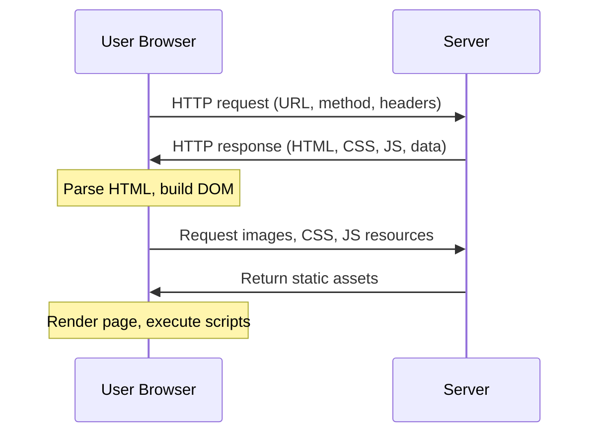
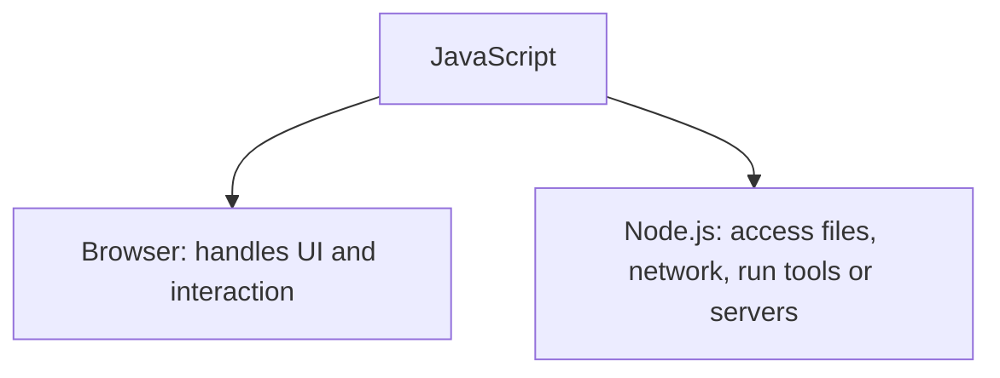
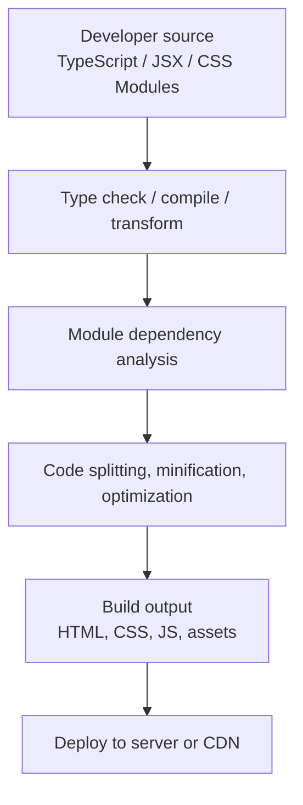
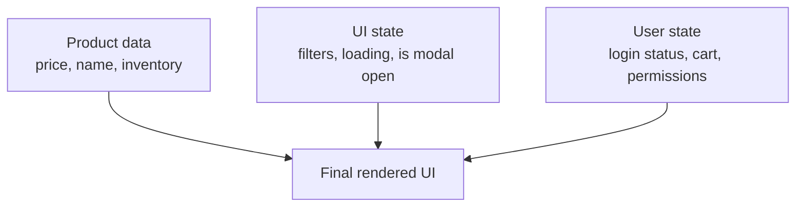
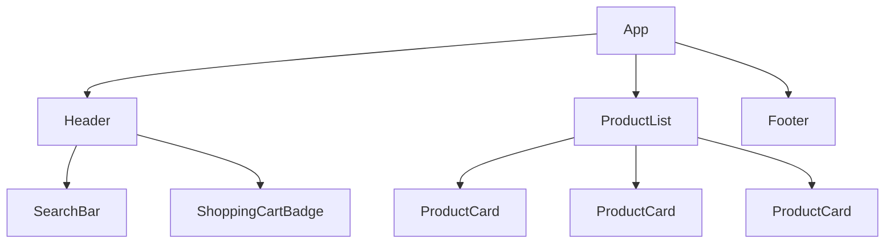
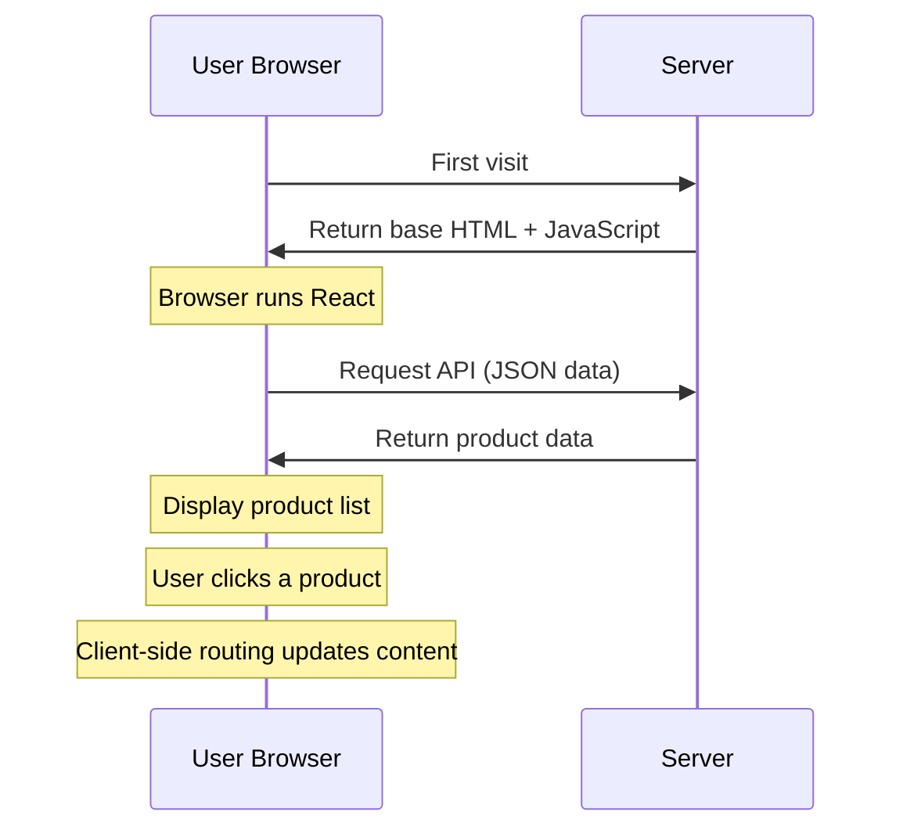
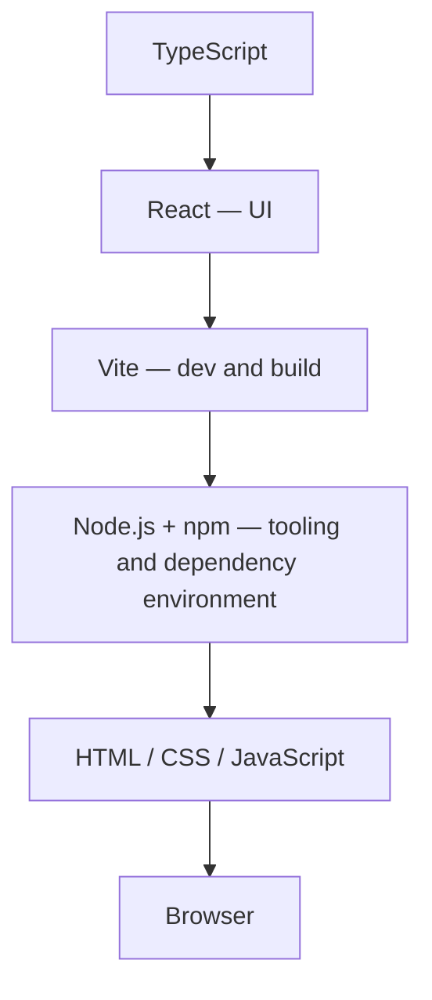
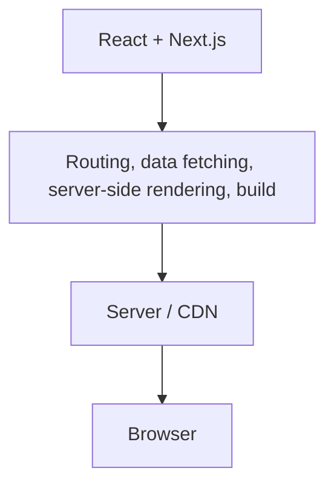
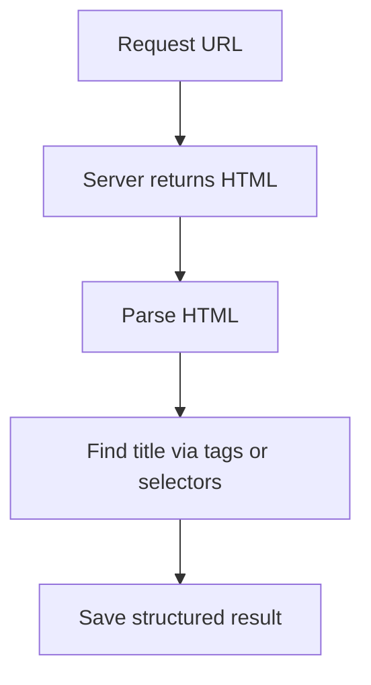

# Twenty Years of Frontend: From HTML to Modern Web Applications

Last updated: 2026-10-18

Today, all it takes is installing Node.js and running a few commands to have a React site up in minutes. With AI assistance, you can generate a surprisingly professional-looking interface without knowing much about frontend at all.

But if you look closely at a modern frontend project, something feels off. You're just trying to display some text, images, and buttons in a browser — yet you need Node.js, npm, Vite, React, sometimes Next.js and TypeScript, and then a whole build-and-deploy pipeline.

**Why did frontend evolve from writing a few HTML files into this sprawling software engineering system?**

The best way to understand this isn't to learn each framework one by one. It's to go back to the history of how frontend technology developed: browsers started as tools for displaying documents, then gradually became a computing platform capable of running complex applications. That's the story this article tells.

If you're new to frontend and that list of names (Node.js, npm, Vite, React, Next.js, TypeScript) feels overwhelming — that's completely normal. This article isn't asking you to learn them right now. It's giving you a rough map: what each one is responsible for, and why it exists. You don't need to memorize every detail. By the time these names come up again in later chapters, you'll have enough context to follow along.

## Part 1: What Is Frontend? What Is Backend?

### 1. A Website Is Two Computers Working Together

To understand frontend, start with a basic fact: **visiting a website is fundamentally two computers collaborating.** One is in front of you; the other is in a data center somewhere remote.

When you open an e-commerce site, here's roughly what happens behind the scenes:



The browser runs on the user's own device; the server runs on a remote machine. They communicate over HTTP/HTTPS.

Frontend refers to the side the user directly interacts with. Backend refers to the business logic, data, and system capabilities living on the server.

For example, when a user buys something on an e-commerce site:

| Step | Frontend does | Backend does |
|---|---|---|
| Browsing products | Display images, prices, product list | Query product and inventory data |
| Searching | Input field, filters, results display | Search, rank, recommend |
| Adding to cart | Update UI, confirm the action | Save cart data |
| Checkout | Show order, collect payment info | Validate order, process payment, update status |
| Login | Login form and interaction | Authentication, authorization, session management |

One important thing to note: **what the frontend displays doesn't mean it controls what's real.**

A frontend can render a product price as $1, but the server cannot trust that the product actually costs $1. The browser runs on the user's device, and users can modify JavaScript, requests, and page content. That's why critical rules like prices, permissions, and payment amounts must be validated by the trusted server side.

### 2. What Are the Different Challenges for Frontend vs. Backend Engineers?

Many beginners assume frontend means pretty pages and backend means complex logic. That's an oversimplification.

Modern frontend engineers work in a uniquely constrained environment: the browser.

First, every user has a different device, browser, and screen size. Code has to work across phones, tablets, and desktops, and also handle touchscreens, keyboards, and accessibility tools.

Second, the frontend is a highly asynchronous system. Users might close the page before a network request returns, click a button twice, switch accounts, or navigate elsewhere mid-operation. The UI has to stay consistent throughout.

Third, browsers have limited compute resources. Code that loads slowly, JavaScript that runs too long, or excessive repaints all hurt the user experience directly.

Backend engineering tends to focus on data and systems-level complexity: high concurrency, database transactions, data consistency, access control, fault tolerance, scaling, and security.

To summarize:

- **Frontend's main challenge:** delivering correct, fast, and usable interactions in an unstable, diverse client environment.
- **Backend's main challenge:** reliably, securely, and consistently processing data and business logic under heavy concurrent load and complex constraints.

That said, the line isn't rigid. Frontend has complex computation and business logic; backend often handles page rendering. With modern full-stack frameworks, the technical boundary keeps shifting.

Now that you have a sense of each side's responsibilities, let's look at how this whole system was built from scratch.

## Part 2: 1990–2010 — From Electronic Documents to Interactive Web Pages

### 1. HTML: The Internet Started as a Document System Connected by Hyperlinks

The World Wide Web emerged around 1990, but its original purpose wasn't running applications — it was reading and linking documents. That starting point shaped the entire logic of frontend's evolution over the next thirty years.

HTML (HyperText Markup Language) is the language for describing those documents:

```html
<h1>My First Blog Post</h1>
<p>Welcome to my website.</p>
<a href="/about.html">About Me</a>
```

This expresses three things: a top-level heading, a paragraph, and a link to another page.

HTML's core isn't programming — it's **describing the structure and semantics of content**.

When a browser reads HTML, it parses it into a tree structure called the DOM (Document Object Model) — think of it as a tree where each "leaf" represents a page element: a heading, a paragraph, an image, a button. JavaScript can then manipulate the page through the DOM. Understanding the DOM is foundational to frontend, because it's the core interface the browser exposes to JavaScript.

### 2. CSS: Separating Content from Presentation

Early HTML pages could include some style information, but mixing all layout details into HTML made them hard to maintain. In 1996, CSS (Cascading Style Sheets) became a core part of the web standard, letting developers separate content structure from visual presentation:

```css
h1 {
  color: orange;
  font-size: 32px;
}

p {
  line-height: 1.8;
}
```

HTML answers "what is this?" CSS answers "what does it look like?"

CSS later grew to include Flexbox, Grid, responsive layouts, animations, and more — becoming a complex declarative layout system. The "cascading" part is important: CSS doesn't simply apply styles line by line. It calculates each element's final style based on source, specificity, selectors, and inheritance. This is exactly why beginners often run into the classic problem of "I wrote the CSS, but it's not working."

### 3. JavaScript: Web Pages Get Behavior for the First Time

In 1995, JavaScript was born. At first it was mainly used to add simple interactivity to pages — form validation, button clicks, image swaps:

```html
<button onclick="alert('Hello!')">
  Click me
</button>
```

Web pages were no longer just static documents; they could respond to user actions. HTML, CSS, and JavaScript became the three foundational pillars of frontend:

| Technology | Role | Analogy |
|---|---|---|
| HTML | Content and structure | A building's framework |
| CSS | Style and layout | Interior design and appearance |
| JavaScript | Behavior and logic | Control systems |

Even so, JavaScript's true potential wasn't fully tapped for a long time. Most pages were still generated by the server. When a user clicked a link, the browser requested a completely new page from the server. Early PHP, ASP, and JSP sites all used this pattern.

### 4. Around 2005: AJAX Changed How Web Pages Handle Interaction

A pivotal shift happened in the mid-2000s. AJAX (Asynchronous JavaScript and XML) let browsers request data from a server and update part of a page — without reloading the whole thing.

For example, a user types a character in a search box and immediately sees suggestions, with no full-page reload. Google Maps, Gmail, and similar apps made people realize: **a website doesn't have to behave like a book you keep flipping through — it can run like a continuously operating piece of software.**

AJAX is a technique, not a library. Despite the XML in the name, JSON later became the far more common data format.

Around the same time, jQuery (2006) became wildly popular by solving cross-browser compatibility issues, cumbersome DOM manipulation, and inconsistent AJAX APIs:

```javascript
// Updating a page with jQuery
$("#title").text("New Title");
```

During this period, frontend development mainly meant layering dynamic behavior onto existing HTML pages. But new problems were emerging: the more complex the page, the more DOM nodes, events, and state you had to manage manually, and the code was getting hard to maintain.

At this point, web pages had evolved from static documents to dynamic interfaces that could respond to interaction. Next, we'll look at how frontend developed into a complete software engineering discipline as pages took on greater engineering complexity.

## Part 3: 2010–2020 — Why Did Frontend Become a Software Engineering Discipline?

The post-2010 story of frontend can be summarized in one sentence: **when web pages became large-scale software, building them had to evolve from writing pages to constructing software systems.**

This shift drove simultaneous advances in the JavaScript language, engineering tooling, and UI frameworks. A lot of new terms are about to come up — don't worry about memorizing them now. Just build a sense of "what problem does each of these solve?"

### 1. Modernizing the JavaScript Language: ES6

You may have seen terms like ES, ES5, ES6, ES2015 and found them confusing. ES stands for ECMAScript, the core language specification for JavaScript — think of it as JavaScript's "specification document," which browsers and Node.js implement. ECMAScript 2015 (commonly called ES6) was a major upgrade to JavaScript. It introduced or standardized features that modern developers now take for granted:

- `let`, `const`: block-scoped variable declarations
- Arrow functions: `(x) => x * 2`
- Template literals: `` `Hello ${name}` ``
- Classes: a more convenient syntax for prototype-based object structures
- Promises: a standardized way to handle async operations
- Destructuring assignment
- Standard module syntax: `import` and `export`

```javascript
// Older style
var double = function(x) {
  return x * 2;
};

// ES6 style
const double = (x) => x * 2;
```

ES6 wasn't just about cleaner syntax. More importantly, JavaScript gained a standardized set of capabilities to support large-scale engineering.

But when a new standard arrives, older browsers may not support it. Developers want to write modern syntax while still targeting older environments. That's why transpilers like Babel became a key part of frontend tooling — they convert newer JavaScript syntax into a form the target environment understands. Note that transpiling syntax and polyfilling missing runtime APIs are two different things; the latter sometimes requires separate polyfills.

### 2. CommonJS and ES Modules: Why Do We Need import/export?

Early JavaScript programs were a few hundred lines — keeping everything in one file was fine. But when an application grows to thousands of files and dozens of developers, you need a solution for modularity.

The core idea of modules: each file is responsible for a relatively independent piece of functionality and exposes a clear interface to other modules.

Before ES module syntax was widely adopted, the Node.js ecosystem relied heavily on CommonJS:

```javascript
// math.js
const add = (a, b) => a + b;
module.exports = { add };

// app.js
const { add } = require("./math");
```

ES6 standardized ES Modules (ESM):

```javascript
// math.js
export const add = (a, b) => a + b;

// app.js
import { add } from "./math.js";
```

The ideas are similar, but the mechanisms differ:

| Dimension | CommonJS | ES Modules |
|---|---|---|
| Typical syntax | `require`, `module.exports` | `import`, `export` |
| Origin | Early Node.js ecosystem | ECMAScript standard |
| Dependency analysis | Tends toward runtime loading | Static imports can be analyzed before execution |
| Native browser support | Generally not direct | Supported |
| Typical use | Legacy projects, some Node.js packages | Modern frontend and backend JavaScript |

ESM's static dependency structure lets tools analyze module relationships and perform Tree Shaking — essentially "removing code from the final bundle that was never actually used," keeping the output smaller.

One common point of confusion: **ES6 is a version of the JavaScript standard. ESM is a module system. CommonJS is a different module specification. They are not three competing frameworks.**

ESM also supports dynamic loading via `import()`. Node.js today supports both ESM and CommonJS, but they're not always directly interchangeable — file extensions, the `type` field in `package.json`, and interop rules all affect actual behavior.

### 3. Node.js: JavaScript Runs Outside the Browser for the First Time

In 2009, Node.js appeared. Its most important contribution: JavaScript could run outside the browser.



Node.js is built on the V8 JavaScript engine and provides file system access, network communication, process management, and more. This meant JavaScript could not only build web pages, but also build servers and the tooling that powers the frontend development workflow.

For example, a developer could write a Node.js tool to automatically:

1. Read hundreds of source files
2. Check for syntax errors
3. Compile TypeScript and modern syntax
4. Process CSS and images
5. Minify code
6. Output final files ready to deploy

Frontend now had a complete automated engineering toolchain.

Keep in mind: **Node.js is not a frontend framework and it's not part of the browser.** A typical frontend project built with Vite uses Node.js during development and build, but the resulting static files don't necessarily need a Node.js server to run. Conversely, some server-side rendering features in frameworks like Next.js do require a server-side runtime.

### 4. npm: Software Doesn't Have to Be Written from Scratch Anymore

If Node.js let JavaScript run on servers, npm made JavaScript software reuse systematic. npm includes a package registry, a command-line tool, and related web services.

```bash
npm install react
```

This command installs React along with its required dependencies. A typical modern project looks like:

```text
my-project/
├── package.json
├── package-lock.json
├── node_modules/
├── src/
│   └── main.jsx
└── index.html
```

- `package.json` describes the project's dependencies, scripts, and metadata
- `package-lock.json` records the exact resolved dependency versions, enabling reproducible installs
- `node_modules` is where installed packages typically live
- `src` is where the developer's source code lives

What npm really changed is the economics of software development. Things that once required custom implementations — date handling, form validation, chart components, routing — can now be pulled in as mature open-source packages. The tradeoff is dependency management, security vulnerabilities, version conflicts, supply chain risk, and complex build pipelines. This is why a modern frontend project often ends up with hundreds of transitive dependencies even when you only installed a handful yourself.

### 5. From Webpack to Vite: Why Does Frontend Need Build Tools?

If browsers can already run JavaScript, why do we need build tools like Webpack or Vite?

The reason: **the code that's easiest for developers to write isn't always the code best suited for browsers to load directly.** A modern project might include TypeScript, JSX, CSS Modules, image assets, and a large number of third-party dependencies. Browsers can't necessarily run all source files as-is, and production environments aren't well suited to loading thousands of scattered files.

So there needs to be a transformation pipeline from source to deployable output:



Webpack appeared in 2012 and became the go-to bundler for large frontend projects, converting complex module dependency graphs into assets browsers could load efficiently. But as projects grew, dev server startup and rebuilds could get slow.

Vite emerged around 2020. One of its key early innovations was using the browser's native ES Modules during development — serving source modules on demand rather than pre-bundling the entire project on every startup:

```bash
npm create vite@latest my-app
cd my-app
npm install
npm run dev
```

The `npm run dev` command runs the project's defined dev script, which typically starts Vite's development server. When you edit a file, Vite can use HMR (Hot Module Replacement — swapping just the changed piece without reloading the whole page) to update only the affected parts. Production builds still require minification, code splitting, caching, and asset optimization.

These tools operate at different layers and each has its own job:

- Node.js is a JavaScript runtime environment
- npm is a package management and distribution ecosystem
- Vite is a development and build tool
- React is a library for building UI

They exist at different levels. None of them replaces another.

Now you understand why tooling exists — it solves "how to organize and deliver code." Next comes an equally important question: how do you continuously manage a user interface that keeps growing in size and complexity?

## Part 4: Components — What Do React, Vue, and Angular Actually Solve?

Componentization addresses one core problem: **how do you keep managing a user interface that keeps growing in size and interaction complexity?**

### 1. From Manual DOM Manipulation to Data-Driven UI

Say we want to build a simple counter: starts at 0, increments when a button is clicked. With traditional JavaScript:

```javascript
let count = 0;

document.querySelector("button").onclick = () => {
  count++;
  document.querySelector("#count").textContent = count;
};
```

The code is simple, but it hides two separate objects: the data state (`count`) and the page state (the number shown in the DOM). The developer is responsible for keeping them in sync.

When a page has hundreds of controls, multiple data sources, and complex interactions, this manual sync becomes very difficult. For example: when the number of items in a cart changes, you might need to update the badge in the header, the item totals, the discount text, the checkout button, and the stock indicator — all at once. Do this manually and it's easy to miss something.

The key insight of modern frameworks like React and Vue is to flip this around: **instead of telling the browser how to modify the page step by step, describe what the page should look like given a particular data state.**

In React:

```jsx
import { useState } from "react";

export default function Counter() {
  const [count, setCount] = useState(0);

  return (
    <button onClick={() => setCount(c => c + 1)}>
      Current count: {count}
    </button>
  );
}
```

This code only declares two things: there is a piece of state called `count`; the button should display the current state and update it on click. React handles the actual DOM updates.

This can be expressed as an abstract formula: **UI = f(State)** — the UI is a function of state. This is declarative programming: it shifts the developer's job from "manipulate the interface" to "define the relationship between the interface and state."

### 2. State-Driven UI vs. Data-Driven UI — What's the Difference?

These two terms are often used interchangeably, but there's a useful distinction.

Data-driven UI emphasizes that page content is determined by data — for example, mapping a product array from the server into a product list.

State-driven UI goes further: in addition to business data, the entire interface is also shaped by interaction state:



The product data hasn't changed, but switching a filter changes the page. In the broadest sense, data is itself a form of state, so the two concepts aren't strictly opposed.

This architecture shifts the difficulty to state management:

- Which state belongs to a single component?
- Which state needs to be shared across components?
- Which state comes from the server?
- How do you handle race conditions from async requests?
- How do you prevent unnecessary re-renders?
- How do you ensure state is consistent after a page refresh?

So what modern frontend engineers struggle with often isn't how to render a button — it's how to maintain the state model of a complex application.

### 3. What Is a Component?

A component is a reusable, composable, independently maintainable unit of UI. An e-commerce page might be organized like this:



Each `ProductCard` receives different product data but reuses the same UI logic. Compared to copying and pasting HTML, components make it much easier to keep styles consistent, control complexity, write tests, and collaborate as a team.

That said, smaller isn't always better. Deciding where to draw component boundaries, how to design public interfaces, and how to handle data flow between components are all genuine software design questions.

### 4. React, Vue, Angular — What's the Difference?

The 2010s saw several major frontend technology systems emerge:

| Technology | Key moment | Core characteristics |
|---|---|---|
| AngularJS / Angular | 2010 / 2016 | A more complete, opinionated application framework |
| React | 2013 | Emphasis on components, declarative UI, state-driven rendering |
| Vue | 2014 | Progressive design, template syntax, reactive state system |

React is more accurately a UI library — you typically need to pair it with other solutions for routing, data loading, and server-side rendering. Vue provides reactivity, templates, and a component system, and works alongside Vue Router, Pinia, Nuxt, and similar tools. Angular leans toward providing a more complete application architecture, including dependency injection, routing, and forms.

They all solve the problem of managing complex UIs, but they make different choices around developer experience, architectural organization, and state update mechanisms. Historically, React's Virtual DOM, Vue's reactive dependency tracking, and Angular's change detection each represented a different implementation approach.

Don't think of the Virtual DOM as a requirement for frontend frameworks. It's a UI update mechanism that React and others have used — not the only way to implement declarative UI. Today, frameworks like Svelte and Solid are exploring compile-time approaches and fine-grained reactivity to reduce update overhead.

Don't worry about memorizing these concepts right now — just let them register. The hands-on React and Vue chapters later will bring them to life, and by then a lot of these names will click into place.

Now you understand how componentization manages complex interfaces. Next comes an interesting plot twist in the story: frontend eventually came back to the server.

## Part 5: Next.js — Why Did Frontend Come Back to the Server?

Here the story takes an interesting turn.

In the 2000s, most websites generated HTML on the server. In the 2010s, React and similar frameworks moved more and more page logic into the browser. In the 2020s, modern web frameworks started emphasizing server-side rendering again. Why?

### 1. SPAs: Websites That Run Like Desktop Software

React, Vue, and similar technologies drove the rise of Single Page Applications (SPAs). In traditional multi-page sites, clicking a link usually loads a new HTML page from the server. An SPA typically fetches just a base HTML page on the first load, then uses JavaScript to control all subsequent UI changes, pulling JSON data from the server as needed:



This approach delivers smooth interactions, but it comes with a few problems.

First, the initial load may require downloading, parsing, and executing a significant amount of JavaScript before the user sees meaningful content and can interact.

Second, content generated entirely by browser JavaScript can be harder for some search engines or crawlers to process.

Third, some data that only needs a single server-side query instead becomes: browser downloads the app, then sends an extra request for the data.

This led developers to ask: should all UI really be generated in the browser?

### 2. CSR, SSR, SSG — What Are the Actual Differences?

Three important concepts to know here. Glance at the table to get a feel for them — don't worry about memorizing them now; the hands-on chapters later will make these concrete.

| Mode | Full name | When is HTML primarily generated? | Typical use case |
|---|---|---|---|
| CSR | Client-Side Rendering | When the browser runs JS | Highly interactive dashboards, pure client-side apps |
| SSR | Server-Side Rendering | When the server handles a request | Personalized, dynamic content pages |
| SSG | Static Site Generation | At build time, pre-generated | Blogs, documentation, content sites |

A blog post whose content rarely changes doesn't need server logic re-running on every visit — it can be generated at build time and served straight from a CDN. But a highly personalized user homepage may need the server to dynamically generate content based on who's currently logged in. A complex data analytics platform might still need heavy client-side interaction.

These rendering modes aren't mutually exclusive. A single site can use different strategies on different pages, or even different sections of the same page.

### 3. What Problems Does Next.js Solve?

Next.js was released in 2016 as a React-based web application framework. It addresses many of the concerns you'd otherwise have to handle yourself when building a complete site with React alone.

**First, routing.** Routing determines which page corresponds to which URL:

```text
/              → Home
/blog          → Blog list
/blog/hello    → Blog post
/products/123  → Product detail
```

In Next.js's App Router, you organize routes using folder and file conventions — for example, `app/blog/page.tsx`.

**Second, prerendering and server-side rendering.** Developers don't have to hand all HTML generation to the browser. Next.js can pre-generate content at build time or generate dynamic content when a request arrives. Newer mechanisms like Server Components, Streaming, and Partial Prerendering make the division of work between server and browser more flexible.

**Third, SEO (Search Engine Optimization).** Search engines need to discover, crawl, understand, and index page content. When a page's key content arrives directly in the server-returned HTML, it's generally easier for all kinds of crawlers to process. That said — using Next.js doesn't automatically mean good SEO, and CSR doesn't mean search engines can't crawl the page at all. Google and others can execute some JavaScript. SEO also depends on content quality, URL structure, metadata, link structure, accessibility, and performance.

**Fourth, a complete application platform.** Next.js also provides data fetching, caching, Server Actions/Functions, and Route Handlers — meaning a single project can include React UI, some server-side business code, and API endpoints. That doesn't mean everything should live in Next.js. Large systems still often need independent Java, Go, Python, or other backend services.

### 4. Hydration: Why Does the Server-Generated HTML Still Need JavaScript?

This is a key detail for understanding modern frontend — just get the broad picture for now. Suppose the server already generated:

```html
<button>Current count: 0</button>
```

The browser can display the button without running React. But with just that HTML, the button won't execute the counting logic React defined. So the browser also needs to load the relevant JavaScript and connect the client components to the existing HTML. This process is usually called Hydration — think of it as "the server provides the visible skeleton; the client injects interactive capability."

**The server provides the visible page first; the client then takes over behavior for the parts that need interactivity.**

This approach balances initial content display with interactive capability, but it also creates the requirement that server and client rendering results must stay consistent. One ongoing direction in modern frameworks is minimizing the JavaScript the client has to download and execute. React Server Components, for example, let certain components run only on the server. Astro's Islands Architecture goes further, loading client-side logic only for regions that need interaction. These concepts don't need deep study right now — dedicated chapters will cover them later.

## Part 6: 2026 — What Technology Are Most Websites Actually Using?

After all that history, it's easy to form a mistaken impression: since everyone talks about React, Vite, and Next.js, most websites on the internet must use them. That's not actually true.

Three very different questions need to be distinguished here:

1. What technologies do websites already on the internet mostly use?
2. What do professional frontend developers mostly use now?
3. If you're starting a new website today, what should you choose?

These have different answers.

### 1. By Real Usage Across the Web: Traditional Technology Still Matters

According to W3Techs data from October 2026, WordPress was detected on roughly four in ten websites. WordPress is a content management system (CMS) built on PHP and a database, with a huge plugin and theme ecosystem. Shopify, Wix, Squarespace, and similar site-building platforms also account for a meaningful share.

This means a large portion of websites aren't built from scratch with React — they're based on existing CMSs, themes, and commercial website builders.

HTTP Archive's 2024 Web Almanac, which tracks page technologies, shows a similar legacy effect: about 74% of mobile pages detected jQuery, and about 10% detected React. The unit here is sampled pages, not all websites or market share for modern new projects; the same page may use multiple libraries.

But it tells us something important: **advanced technologies discussed by the community don't replace the huge volume of existing websites overnight.** Plenty of content sites, company sites, and e-commerce sites have no reason to keep rebuilding when their current solution already meets the need.

### 2. By Developer Ecosystem: React, Vite, and Others Have Become Mainstream Choices

In the 2025 State of JavaScript survey, React, Vite, Webpack, and Next.js all had high usage rates among developers. For example, React was around 83.6%, Vite around 84.4%, and Next.js around 58.6%.

Note: these numbers represent how many surveyed developers have used these technologies — not the share of websites on the internet, nor anyone's exclusive technology choice. The survey also carries respondent-group bias.

This result isn't in conflict with the web-wide statistics. The new software products professional developers create and the long-accumulated stock of websites across the whole internet are not the same population.

A typical React frontend project today has roughly this layering:



A React site that needs server-side rendering looks like:



These diagrams describe responsibilities and collaboration between technologies, not a fixed installation order.

### 3. How Should a New Project Choose Its Tech?

Rather than chasing the newest framework, it's better to pick a solution that fits the project and stays simple enough:

| Scenario | Worth considering | Main reason |
|---|---|---|
| Personal blog, docs site | Astro, static site generators, WordPress | Mostly content display, little interaction |
| Simple promo page | HTML/CSS/JS, lightweight framework | Doesn't need a complex runtime |
| Dashboards, project management tools | React/Vue + Vite | Heavy interaction, complex state, component reuse |
| Site mixing content and interaction | Next.js, Nuxt | Needs routing, SSR, and data loading |
| Large enterprise systems | Frontend framework + independent backend services | Complex permissions, business logic, team division |

For beginners, it's usually more effective to learn to build a complete page with HTML, CSS, and JavaScript first, then move to React and Vite — rather than starting by memorizing framework concepts.

## Part 7: What Is a Crawler, and Why Can't Some Pages Be Scraped?

Once you understand frontend technology, web crawlers aren't mysterious at all. A regular user visits a site through a browser: the browser requests the page, runs the code, and displays the result. A crawler (web crawler) tries to automate parts of that process: visit pages, discover links, extract information, and save data.

### 1. The Simplest Crawler: Request HTML, Then Parse It

Say we want to fetch the title of a public news page. The basic process:



For example, in Python:

```python
import requests
from bs4 import BeautifulSoup

url = "https://example.com"

response = requests.get(url, timeout=10)
response.raise_for_status()

soup = BeautifulSoup(response.text, "html.parser")

print(soup.title.get_text(strip=True))
```

`requests` sends the HTTP request; BeautifulSoup parses the HTML. If you need to scrape large numbers of pages, a crawler usually also has to handle URL queues, link discovery, deduplication, retry on failure, data storage, and incremental updates. Search engines are a large-scale application of this idea, but they also need complex systems for rendering, indexing, ranking, and anti-spam.

### 2. Why Can a Crawler Miss Content That's Clearly on the Page?

Consider a React site using CSR. The HTML the server returns on first load might only be:

```html
<div id="root"></div>
<script src="/assets/app.js"></script>
```

Then the browser runs the JavaScript, which in turn requests the API and finally renders the product data onto the page. What you see in the browser includes products, prices, and reviews. But if a Python crawler only requests the raw HTML, it sees nothing but an empty `div`.

The reason: **the raw HTML returned by the server isn't necessarily the same as the final DOM the browser produces after running JavaScript.**

This is the most direct connection between modern frontend architecture and crawler technology.

### 3. Three Main Ways to Scrape Modern Sites

**Method 1: Parse the HTML directly.** If the target page already contains the full content, this is usually the simplest and fastest approach. Works well for static sites, many server-rendered pages, and public-content sites.

**Method 2: Use the site's public data API.** Through the Network panel in browser Developer Tools, you can observe the requests a page makes while loading. Sometimes a page fetches JSON data, for example:

```text
GET /api/products?page=1

{
  "products": [
    {"name": "Product A", "price": 199},
    {"name": "Product B", "price": 299}
  ]
}
```

If a site explicitly offers a documented public API, using it is usually the more stable choice. But observing a request in the browser doesn't mean you're authorized to call it without limits. You still need to respect access permissions and usage rules.

**Method 3: Use a real browser via automation.** Tools like Playwright and Selenium can drive a browser, execute JavaScript, wait for the page to load, and read the rendered DOM. This approach is closer to how a real user browses and handles some dynamically rendered pages. But it's more expensive: starting a browser, executing scripts, and waiting for requests all consume compute and time.

Large-scale scraping may also run into rate limiting, captchas, or login requirements. Don't bypass access controls to get non-public content.

### 4. Crawlers and Search Engine SEO

Crawling, rendering, and indexing are different processes. A search engine typically discovers a URL, fetches its content, runs JavaScript if necessary, and then decides whether to add the content to its index.

Sites can also provide crawling rules through `robots.txt`, URL hints through Sitemaps, and indexing preferences through page metadata. This is why server-side pre-rendering is valuable for content sites: it reduces the work a crawler needs to do to understand the page's core content.

It's worth noting that `robots.txt` is a behavioral convention for crawlers, not an authentication or data-protection security mechanism. When collecting data, you also need to consider copyright, personal information, site terms, request frequency, and the resource cost to the target site.

## Part 8: Where Is Frontend Technology Headed Next?

This section is forward-looking and involves more judgment and speculation. As a beginner, you don't need to take a position now — just knowing what the industry is discussing is enough.

Looking back over these two decades, frontend's evolution wasn't a simple progression from HTML to React to Next.js. It went through several shifts of focus:

**Phase one: document display.** Solving how to organize information into pages and link them together.

**Phase two: dynamic interaction.** Solving how to make pages respond to actions without reloading every time.

**Phase three: application engineering.** Solving how large teams maintain complex, long-running web applications.

**Phase four: render and execution optimization.** Solving what work belongs on the server, what belongs in the browser, and how to reduce unnecessary compute and network cost.

Going forward, a few directions are worth watching.

### 1. Framework Competition Will Continue, but Underlying Web Standards Will Matter More

Many tasks once handled by JavaScript frameworks are gradually being supported natively by the browser — native ES Modules, Web Components, increasingly powerful CSS, and richer caching and network APIs.

That doesn't mean React or Vue will disappear. But a healthy technology ecosystem should let simple problems be solved directly with web standards, and reserve more advanced abstractions for complex applications. A framework's value should come from the problem it genuinely solves, not from how many new concepts it introduces.

### 2. The Division of Work Between Server and Browser Will Keep Being Redistributed

The past trend was to push as much as possible to the client. The current trend is to decide where to run each task based on its nature:

- Static content generated and cached ahead of time
- Data queries and sensitive logic on the server
- Interaction-heavy parts kept in the browser
- Non-critical content loaded lazily
- Components that don't need interaction ship less client-side JavaScript

Server Components, Streaming, Islands, and Partial Prerendering are all different practices following this thinking. Don't worry about memorizing these now — just let them register; the hands-on chapters will cover them. The future goal isn't "all SSR" or "all CSR," but a more precise allocation of compute, network, and rendering cost.

### 3. AI Will Lower the Cost of Building Interfaces, but Won't Eliminate Frontend Complexity

AI coding tools can already generate pages, components, styles, and basic business logic quickly. Many repetitive tasks that once required manual developer work may gradually become natural-language descriptions and auto-generated code.

But as a system grows, the hard problems remain: is the state consistent? Do user actions follow business rules? Are data and permissions secure? Is the page fast enough? Is the design consistent? How does the system recover from errors? Is the code maintainable over the long term?

In fact, as AI makes feature development cheaper, systems may add features faster — and complexity may accumulate even more quickly. So AI is more likely to change the division of labor in frontend development than to make software architecture problems disappear. Going forward, a developer's value will lie more in system design, requirements understanding, quality assurance, and technical judgment.

## Part 9: How Should a Beginner Actually Understand and Learn Frontend?

From this history, you can extract a relatively stable learning path:

1. **Understand the browser first.** Get clear on URL, HTTP, HTML, CSS, JavaScript, the DOM, and the basic flow of a page load.
2. **Learn plain JavaScript.** Variables, functions, objects, arrays, modules, async operations, Promises, `fetch`, and event handling.
3. **Understand the tooling.** Know what Node.js, npm, and Vite each do, and the difference between development and production builds.
4. **Learn a UI framework.** Pick React or Vue, and understand components, props, state, data flow, and lifecycle.
5. **Understand the complete web application.** Frontend routing, APIs, authentication, caching, CSR, SSR, and deployment.
6. **Focus on engineering quality last.** Performance, accessibility, security, testing, monitoring, and complex system architecture.

What matters most isn't memorizing each tool's commands, but placing tools in the correct technical layer. For example:

- `import/export` is module syntax — not something React invented
- TypeScript is a language-level extension of JavaScript with a type system; it's not a completely separate runtime in the browser
- Vite handles development and build — not business state management
- React describes and updates UI; it's not a complete backend system
- Next.js adds more complete web application capabilities on top of React
- Node.js can run JavaScript, but it isn't a browser
- Whether a crawler can fetch content depends heavily on how the site delivers and renders content

Once these boundaries are clear, the many seemingly overwhelming names in modern frontend form a pretty clear technical map.

## Conclusion: The Essence of Frontend Is Turning Information Into Interactive Software

Looking back over the whole history, one thing stands out.

The internet originally wanted to solve a simple problem: letting people easily publish, read, and link documents. But as browsers became more powerful, people started using web pages for shopping, office work, programming, video conferencing, data analysis, even running AI applications. The browser went from a document reader to a cross-platform software runtime. And modern frontend technology is, at its core, the engineering system that gradually formed to support that shift.

**HTML, CSS, and JavaScript remain the foundation of the browser world. React, Vue, Vite, and Next.js are abstractions formed at different historical stages to deal with complexity, development efficiency, and runtime performance.**

Once you understand this underlying logic, there's no need to treat every new framework as a revolution. The real questions to ask are: what problem did it solve that wasn't solved well before? Where does it move the complexity? Are the gains worth the cost?

That matters far more than memorizing any one frontend framework's API.

---

### Further Reading

- [MDN Web Docs: HTML](https://developer.mozilla.org/en-US/docs/Glossary/HTML) — the history and core concepts of HTML.
- [MDN: JavaScript Modules](https://developer.mozilla.org/en-US/docs/Web/JavaScript/Guide/Modules) — understanding JavaScript modularity and native ESM.
- [Node.js official docs](https://nodejs.org/learn/getting-started/introduction-to-nodejs) — how JavaScript runs outside the browser.
- [Vite official docs: Why Vite](https://vite.dev/guide/why) — the design thinking behind a modern frontend build tool.
- [React official docs: State as a Snapshot](https://react.dev/learn/state-as-a-snapshot) — understanding state-driven UI.
- [Next.js official docs](https://nextjs.org/docs) — routing, server-side rendering, Server Components, and prerendering.
- [HTTP Archive Web Almanac](https://almanac.httparchive.org/en/2025/) — observing the real-world technology makeup of the web.
- [State of JavaScript 2025](https://2025.stateofjs.com/en-US/libraries/) — frontend developers' framework and tool usage.
- [Google Search Central: JavaScript SEO](https://developers.google.com/search/docs/crawling-indexing/javascript/fix-search-javascript) — understanding crawling and rendering issues on modern JavaScript sites.
