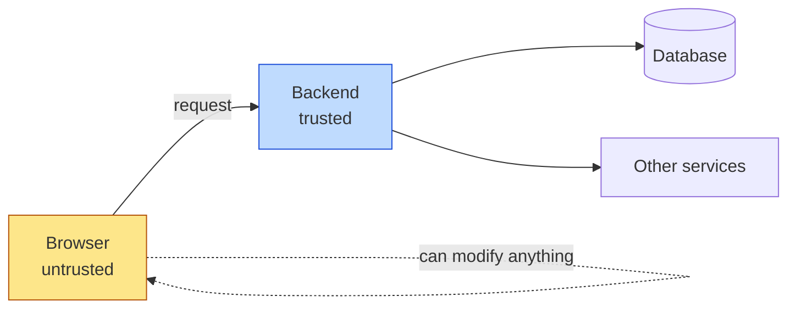
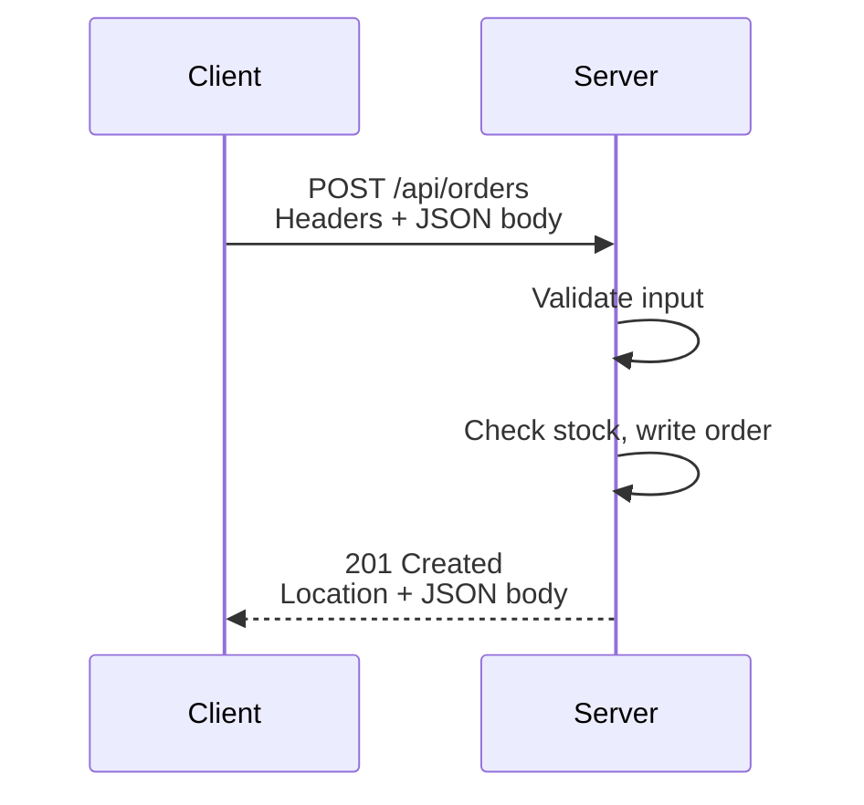
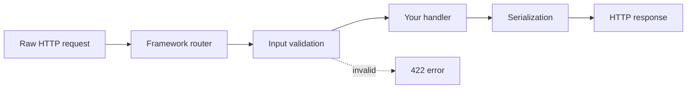
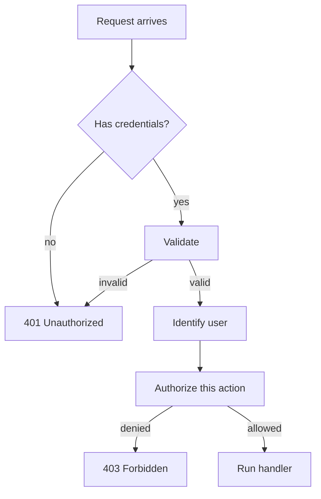
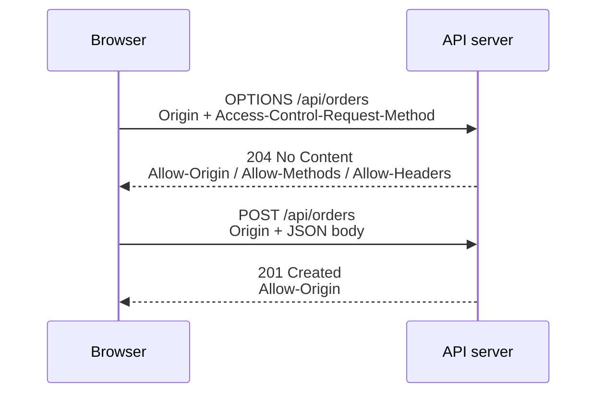
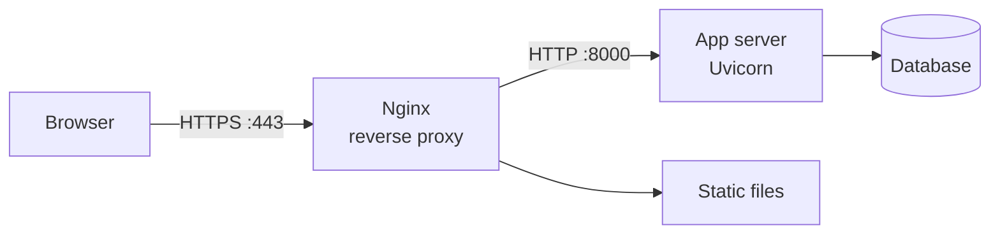

# Twenty Years of Backend: From CGI Scripts to Modern Services

Last updated: 2026-10-19

Today, deploying a backend can feel almost trivial. Install a framework, write a few functions, run one command, and you have an API. With AI assistance, you can generate a working CRUD service before you have finished describing what you want.

But look at a real production backend and the picture changes. A single endpoint may involve a web framework, a database, a cache, a message queue, an identity provider, a reverse proxy, a container orchestrator, monitoring, and an on-call rotation. The code for the endpoint might be ten lines. The system around it is thousands.

**Why did backend development evolve from a script that handles a form into this distributed engineering discipline?**

The fastest way to understand it is not to learn framework after framework. It is to follow what the backend has always been responsible for — storing data, enforcing rules, and answering requests — and watch how each of those responsibilities grew harder as software moved from one server to millions of users.

This article builds that map. If names like Nginx, Redis, JWT, CORS, Kubernetes, or "middleware" feel like noise right now, that is expected. The goal is not to memorize them. The goal is to know what problem each one exists to solve.

## Part 1: What Does a Backend Engineer Actually Do?

### 1. A Website Is Two Computers — and One of Them Cannot Be Trusted

Visiting a website is two computers collaborating. One sits in front of the user; the other lives in a data center. The browser and the server exchange messages over HTTP.

The frontend runs on hardware the user controls. That single fact shapes everything the backend does.

A browser can change the JavaScript it runs. It can edit a request before sending it. It can set a price field to `1`, claim to be an administrator, or replay a request a hundred times. None of that means the request is legitimate.

**The backend's first job is therefore not computation. It is verification.** Every rule that matters — who you are, what you may do, how much money is involved, whether stock exists — has to be enforced on a machine the user does not control.

This is why the backend is often called the **trust boundary**. Everything on the user's side is a suggestion. Everything on the server's side is a decision.



### 2. What Backend Engineers Actually Own

Strip away the tool names and the backend owns four things:

| Responsibility | What it means in practice |
|---|---|
| **Data** | Where it lives, how it is shaped, how it stays correct over time |
| **Rules** | Business logic — pricing, permissions, inventory, workflow |
| **Interfaces** | APIs that other software (not humans) calls |
| **Reliability** | The service keeps working when disks fail, traffic spikes, or a dependency goes down |

Frontend engineers optimize for interaction: latency perceived by a person, visual consistency, state across screens. Backend engineers optimize for correctness and throughput: does the data stay consistent, does the service survive, does it cost a reasonable amount per request.

A useful comparison:

| Dimension | Frontend | Backend |
|---|---|---|
| Runs on | User's device, many configurations | Servers you control |
| Main risk | Inconsistent UI, slow rendering | Wrong data, security holes, downtime |
| Success is measured by | User experience | Correctness, availability, cost |
| Typical failure | A broken layout on one browser | A race condition that corrupts an order |
| Debugging tool | Browser DevTools | Logs, metrics, traces, database queries |

The split is not absolute. Frontend code can be complex, and backend code can render pages. But the *center of gravity* is different, and the tools differ for that reason.

### 3. Why the Backend's Problems Are Different

Three properties make backend work distinctive.

**Concurrency.** A web server handles many requests at the same time. Two users can buy the last item in stock in the same millisecond. Two workers can process the same job. The backend has to define what happens when operations overlap — that is what transactions, locks, and idempotency are for.

**Partial failure.** In a single machine, a function either returns or throws. In a distributed system, a database query might succeed while the response is lost, or a payment might go through while your service crashes before recording it. The backend lives with uncertainty and has to design around it.

**Longevity.** Frontend code is replaced when the interface changes. Backend data outlives every framework that touches it. A schema decision made in 2015 may still shape how the product works in 2030.

### 4. The Contract Between the Two Sides

Frontend and backend meet at an API. That API is a contract: the frontend says "I will send this shape of request"; the backend says "I will return this shape of response or this error."

Most integration pain comes from treating that contract as informal.

- A field is renamed and the frontend silently breaks.
- An error returns HTML instead of JSON, and the client cannot parse it.
- A list endpoint changes from an array to `{ "items": [...] }` without a version bump.
- A nullable field becomes required, and old clients fail.

A mature team writes the contract down, versions it, and tests both sides against it. We will return to this in Part 6.

Now that the responsibilities are clear, we need to look at the language both sides speak.

## Part 2: HTTP — The Protocol Everything Runs On

### 1. A Request Is a Structured Message

HTTP is a text-based request/response protocol. Every interaction has the same shape:

```http
POST /api/orders HTTP/1.1
Host: shop.example.com
Content-Type: application/json
Authorization: Bearer eyJhbGciOi...

{
  "product_id": 42,
  "quantity": 2
}
```

The server replies:

```http
HTTP/1.1 201 Created
Content-Type: application/json
Location: /api/orders/1001

{
  "id": 1001,
  "status": "pending"
}
```

Four parts of the request matter:

- **Method** — the intent (`POST` = create)
- **Path** — the resource (`/api/orders`)
- **Headers** — metadata (content type, credentials, client hints)
- **Body** — the payload

The response mirrors it: status, headers, body.



### 2. Methods Say What You Intend to Do

The method is a semantic hint, not a security mechanism. A server still has to check permissions regardless of the verb.

| Method | Intent | Safe? | Idempotent? |
|---|---|---|---|
| `GET` | Read a resource | Yes | Yes |
| `HEAD` | Read headers only | Yes | Yes |
| `POST` | Create or trigger an action | No | No |
| `PUT` | Replace a resource entirely | No | Yes |
| `PATCH` | Partially update a resource | No | Not necessarily |
| `DELETE` | Remove a resource | No | Yes |

*Safe* means it should not change server state. *Idempotent* means repeating it produces the same result — critical for retries. If a payment request times out, the client does not know whether it succeeded; an idempotent design lets it retry safely.

### 3. Status Codes Are a Shared Vocabulary

Status codes let clients act without parsing prose.

| Range | Meaning | Examples |
|---|---|---|
| `2xx` | Success | `200 OK`, `201 Created`, `204 No Content` |
| `3xx` | Redirect | `301 Moved Permanently`, `304 Not Modified` |
| `4xx` | Client error | `400 Bad Request`, `401 Unauthorized`, `403 Forbidden`, `404 Not Found`, `409 Conflict`, `422 Unprocessable Content`, `429 Too Many Requests` |
| `5xx` | Server error | `500 Internal Server Error`, `502 Bad Gateway`, `503 Service Unavailable`, `504 Gateway Timeout` |

The distinction between `401` and `403` is a common source of confusion. `401` means "I do not know who you are" — authenticate. `403` means "I know who you are, and you may not do this" — authorize.

Returning `200` with `{"error": "..."}` for a failure is a design smell. It breaks caching, monitoring, and every client that trusts status codes.

### 4. Headers Carry the Context

Headers describe things the URL and body do not. A few matter constantly:

- `Content-Type` — what format the body is in (`application/json`, `multipart/form-data`, `text/html`)
- `Authorization` — credentials (`Bearer <token>`, `Basic <base64>`)
- `Accept` — what response formats the client can handle
- `Cache-Control` / `ETag` — caching rules and validators
- `Cookie` / `Set-Cookie` — session state (see Part 5)
- `Origin` — where a cross-site request came from (see Part 6)
- `X-Request-ID` — a correlation identifier for tracing one request across services

### 5. HTTP Is Stateless — and That Is a Feature

HTTP itself has no memory. Each request stands alone. The server is not required to remember that the previous request came from the same user.

This feels like a limitation until you consider scale. Stateless servers can be replicated freely: any instance can serve any request, so you can add capacity by adding machines. State, by contrast, is expensive to replicate and hard to keep consistent.

So the architecture of a web backend is essentially this: **keep the request path stateless, and push all state into explicit stores** — databases, caches, object storage, or tokens carried by the client.

That principle explains a lot of design decisions later in this chapter:

- Sessions live in a shared store, not in one server's memory.
- Uploaded files go to object storage, not the local disk.
- Any server instance can handle any request, because nothing important is local.

### 6. HTTPS Is Not a Different Protocol

HTTPS is HTTP carried inside TLS. The messages look identical; the transport is encrypted and authenticated. Today HTTPS is the default, and browsers increasingly refuse to treat plain HTTP as secure context.

From the backend engineer's perspective, TLS termination usually happens at a proxy or load balancer, not in the application code. That means the application often sees plain HTTP on an internal network, while users see HTTPS. This is normal — the security boundary is the network edge.

## Part 3: APIs — How Backends Expose Capabilities

### 1. An API Is a Promise

An API (Application Programming Interface) is a defined way for one piece of software to call another. In web backends it usually means an HTTP interface with a documented shape.

The word "interface" is doing real work here. An API is not an implementation detail leaking out; it is the part you commit to keeping stable. You can rewrite the database, change languages, split the service — as long as the API keeps its promises, clients do not care.

### 2. From RPC to REST

Early distributed systems used **RPC** (remote procedure call): call `createOrder(productId, quantity)` as if it were a local function. The appeal is obvious — it matches how programmers already think. The problem is that it hides the network. Remote calls are slow, can fail midway, and can be retried; a local function call is none of those things.

In 2000, Roy Fielding described **REST** (Representational State Transfer) in his doctoral dissertation. REST treats the web's existing primitives — URLs, HTTP methods, status codes — as the interface:

- **Resources** are nouns identified by URLs (`/orders/1001`)
- **Methods** are the verbs (`GET`, `POST`, `DELETE`)
- **Representations** carry the data (usually JSON)
- **Statelessness** keeps each request self-contained

REST is not a protocol and not a standard you can be certified against. It is an architectural style — a set of constraints. Most "RESTful" APIs satisfy some of them and ignore others.

Later styles responded to REST's weaknesses:

| Style | Strength | Typical weakness |
|---|---|---|
| RPC (gRPC, JSON-RPC) | Precise contracts, efficient binary transport | Ties clients to generated code; less browser-friendly |
| REST | Simple, cacheable, universally understood | Over-fetching and under-fetching; many round trips |
| GraphQL | Client specifies exactly the fields it needs | Complex server-side cost control and caching |
| Event-driven / messaging | Decouples producers from consumers | Harder to reason about; eventual consistency |

None replaced the others. Most production systems use several at once: REST for public APIs, gRPC between internal services, events for asynchronous work.

### 3. What "RESTful" Actually Means

A practical REST design looks like this:

```text
GET    /api/products?limit=20&cursor=abc
GET    /api/products/42
POST   /api/orders
GET    /api/orders/1001
PATCH  /api/orders/1001
DELETE /api/orders/1001
```

Notice the pattern: **nouns in the path, verbs in the method.** Compare it to an RPC-style design many beginners write:

```text
GET  /api/getProducts
POST /api/createOrder
POST /api/updateOrderStatus
POST /api/deleteProduct
```

Both can work. The second is not wrong so much as harder to keep consistent. Once you start encoding actions in paths, every new operation invents a new URL shape, and clients cannot guess how the API behaves.

A few REST conventions worth knowing:

- Use plural nouns for collections: `/orders`, not `/order`
- Nest only when ownership is real: `/users/7/orders`, but not `/users/7/orders/1001/items/3/reviews`
- Use query parameters for filtering, sorting, and pagination — not for resources
- Return `201 Created` with a `Location` header when creating
- Use `409 Conflict` for state conflicts (e.g., duplicate email)
- Prefer cursor pagination for large, changing collections

### 4. A Framework Is a Request Pipeline You Do Not Have to Write

You could implement an API with Python's standard library, as the next chapter does. You would then have to handle routing, parsing JSON, validating types, serializing responses, and writing error pages — for every endpoint.

A framework bundles those into a pipeline:

```python
from fastapi import FastAPI
from pydantic import BaseModel

app = FastAPI()

class OrderIn(BaseModel):
    product_id: int
    quantity: int

@app.post("/api/orders", status_code=201)
def create_order(order: OrderIn) -> dict[str, int]:
    # The framework has already parsed JSON and validated types.
    order_id = save_order(order.product_id, order.quantity)
    return {"id": order_id}
```

The function contains only business logic. Everything else — HTTP parsing, validation, the 422 response for bad input, the OpenAPI schema — is generated by the framework.

That is the trade: a framework gives you convention and leverage, at the cost of learning its abstractions and inheriting its bugs.



### 5. The Same Idea in Other Languages

The concepts do not change with the language. Only the names do.

| Language | Common frameworks | Server model |
|---|---|---|
| Python | FastAPI, Django, Flask | ASGI / WSGI, often with Uvicorn or Gunicorn |
| JavaScript / TypeScript | Express, Fastify, NestJS | Node.js event loop |
| Java / Kotlin | Spring Boot, Quarkus | Thread-per-request or reactive |
| Go | Gin, Echo, Chi | Goroutines, compiled binary |
| Rust | Axum, Actix | Async runtime, compiled binary |
| Ruby | Rails | Threaded or process-based |

A backend engineer who understands routing, validation, serialization, and error handling can move between these in weeks. The framework API is the shallow part.

### 6. API Design Is Interface Design

Because an API is a promise, changing it is expensive. Two practices reduce that cost.

**Version the interface, not the implementation.** Put `/v1` in the path, or version through headers. Old clients keep working while new ones migrate.

**Design errors as carefully as successes.** A consistent error shape lets clients handle failure generically:

```json
{
  "error": {
    "code": "OUT_OF_STOCK",
    "message": "Product 42 has 0 units available",
    "request_id": "req_8f2c"
  }
}
```

Include a machine-readable code, a human-readable message, and a correlation id. The client should not have to parse English to decide what to do.

## Part 4: Databases — Where State Lives

### 1. Why Files Were Not Enough

The earliest web applications stored data in files or simple key-value stores. That works until three things happen at once:

- **Multiple users read and write concurrently**
- **Queries become complex** ("orders over $100 from customers in Zhejiang in the last 30 days")
- **The data must survive crashes and partial writes**

Files do not provide atomic updates across related records, indexes for fast lookup, or a way to enforce constraints. The database exists to solve those problems.

### 2. The Relational Model and SQL

In 1970, Edgar Codd proposed organizing data as relations — tables of rows and columns — with operations defined by set theory. This became the relational model.

Its central idea is **separation of logical structure from physical storage**. You describe the data declaratively; the database decides how to store it, index it, and execute the query.

```sql
CREATE TABLE orders (
  id          INTEGER PRIMARY KEY,
  user_id     INTEGER NOT NULL REFERENCES users(id),
  status      TEXT NOT NULL DEFAULT 'pending',
  total_cents INTEGER NOT NULL CHECK (total_cents >= 0),
  created_at  TIMESTAMP NOT NULL DEFAULT CURRENT_TIMESTAMP
);

SELECT user_id, SUM(total_cents) AS spent
FROM orders
WHERE status = 'paid' AND created_at >= '2026-01-01'
GROUP BY user_id
ORDER BY spent DESC
LIMIT 10;
```

SQL became the standard language for relational databases. Its enduring advantage is that it describes *what* to retrieve, not *how* to retrieve it — so the database can choose a better execution plan as data grows or hardware changes.

Relational databases also brought **transactions**, which we will look at shortly. That single feature is why they remain the default choice for money, inventory, accounts, and anything where correctness matters more than raw throughput.

### 3. When Relational Was Not Enough: NoSQL

From the mid-2000s, web companies faced volumes and access patterns that relational databases struggled with at the time: billions of rows, writes spread across data centers, flexible documents, and horizontal scaling on commodity machines.

The response was a family of non-relational systems, later grouped under the loose label **NoSQL** ("not only SQL" or "non-relational"):

| Model | Shape | Typical use |
|---|---|---|
| **Document** | JSON-like documents (MongoDB, CouchDB) | Content, catalogs, evolving schemas |
| **Key-value** | Map from key to opaque value (Redis, DynamoDB) | Caches, sessions, counters |
| **Wide-column** | Sparse rows keyed by row and column family (Cassandra, HBase) | Time-series, high write throughput |
| **Graph** | Nodes and edges (Neo4j) | Relationships, recommendations, fraud detection |
| **Vector** | Embeddings with similarity search (pgvector, Qdrant, Milvus) | Semantic search, RAG, recommendations |

The tradeoff is consistent across them: by relaxing guarantees or query flexibility, they gain scale, availability, or a better fit for a specific data shape.

Most systems do not replace a relational database with a document store. They add one alongside it — a relational database for orders, Redis for sessions, a vector index for semantic search.

### 4. Transactions: The Thing That Makes Databases Hard

A transaction groups operations so they either all happen or none do. The classic guarantees are summarized as **ACID**:

| Property | Meaning |
|---|---|
| **Atomicity** | All operations succeed, or none are applied |
| **Consistency** | The database moves from one valid state to another |
| **Isolation** | Concurrent transactions do not corrupt each other |
| **Durability** | Committed data survives a crash |

The classic example is a transfer: subtract from one account, add to another. Without atomicity, a crash between the two leaves money missing.

Isolation is where most real-world subtlety lives. Perfect isolation (serializability) costs performance, so databases offer levels — read committed, repeatable read, serializable — and each allows different anomalies (dirty reads, phantom reads, write skew). Choosing the level is a backend engineering decision, not a configuration afterthought.

At scale, strict consistency across many machines becomes expensive. Distributed databases often offer **eventual consistency**: replicas converge over time, but a read may briefly see stale data. This is a tradeoff, not a defect — but it changes what the application must tolerate.

### 5. Embedded vs. Server Databases

Not every database is a server.

| | Embedded | Server |
|---|---|---|
| Examples | SQLite, DuckDB | PostgreSQL, MySQL, MongoDB |
| Runs | Inside your process | Separate process, usually another machine |
| Connection | A file path | Network protocol |
| Concurrency | Limited writers | Many concurrent clients |
| Operations | Almost none | Backups, replication, failover, monitoring |
| Good for | Tests, prototypes, desktop apps, single-node analytics | Production services, shared data |

A useful mental model: **SQLite is a file with a query engine; PostgreSQL is a service with a file behind it.** Choosing between them is about deployment and concurrency, not features.

### 6. How Backend Engineers Work With Data Engineers

In larger organizations, backend engineers and data engineers touch the same data from different directions.

| Backend engineer | Data engineer |
|---|---|
| Serves the live product | Builds analytics, pipelines, and reports |
| Optimizes request latency | Optimizes batch throughput and storage cost |
| Writes transactional workloads (OLTP) | Writes analytical workloads (OLAP) |
| Cares about schema stability for APIs | Cares about schema evolution across history |

The collaboration works when the boundary is explicit: backend systems produce events or tables with a defined schema; data pipelines consume them. Problems start when analytics queries run directly against the production database, or when a pipeline depends on a column nobody agreed to keep.

### 7. The Cloud and AI Eras

Managed databases moved the operational burden — backups, patching, failover, read replicas — to the provider. This is why a small team today can run a production system that would have required specialists in 2010.

Two recent shifts are worth noting.

**Serverless and separation of storage and compute.** Databases can now scale compute and storage independently, which changes cost models for spiky workloads.

**Vector search as a first-class feature.** With AI applications, similarity search over embeddings became a common query type. Rather than adding a separate vector database, many teams enabled an extension (such as `pgvector`) on the relational database they already run. The lesson repeats: new data shapes often arrive as an addition, not a replacement.

## Part 5: Request Lifecycle — Sessions, Auth, and Middleware

### 1. Stateless HTTP Meets Stateful Users

HTTP forgets. Users do not. A user logs in once and expects every later request to be recognized.

The backend resolves this gap in one of two ways: **store the state on the server** (sessions) or **carry it with the client** (tokens).



### 2. Sessions and Cookies

A session works like this:

1. The user logs in with credentials.
2. The server creates a random session id and stores session data server-side (memory, Redis, a database).
3. The server sends the id in a `Set-Cookie` header.
4. The browser sends it back automatically on every request to the same origin.

```http
Set-Cookie: session_id=8f2c9a...; HttpOnly; Secure; SameSite=Lax; Path=/
```

The flags matter:

- `HttpOnly` — JavaScript cannot read it, reducing the impact of XSS
- `Secure` — only sent over HTTPS
- `SameSite` — limits cross-site sending, reducing CSRF exposure

Because the session lives server-side, revoking access is immediate: delete the session. That is the main advantage over tokens.

### 3. Tokens and JWT

An alternative is to encode the user's identity into a signed token the client carries.

A JWT (JSON Web Token) has three parts — header, payload, signature — separated by dots. The server verifies the signature instead of querying a session store.

```text
eyJhbGciOiJIUzI1NiJ9.eyJzdWIiOiI0MiIsImV4cCI6MTc2MDAwMDAwMH0.signature
```

| | Session | JWT |
|---|---|---|
| State lives | Server | Client |
| Revocation | Immediate | Hard until expiry |
| Scales across services | Needs shared store | Naturally |
| Payload size | Small id | Larger token |
| Typical use | Traditional web apps | APIs, mobile, service-to-service |

A common practical design is a **hybrid**: a short-lived access token plus a long-lived refresh token stored server-side. This gets most of the scaling benefit while preserving the ability to revoke.

Neither approach is inherently more secure. The security comes from correct implementation: HTTPS, proper signing keys, expiry, rotation, and never putting secrets in the payload.

### 4. Authentication vs. Authorization

These two words are frequently conflated.

| | Authentication | Authorization |
|---|---|---|
| Question | Who are you? | What may you do? |
| Failure code | `401 Unauthorized` | `403 Forbidden` |
| Common mechanisms | Password, OAuth, SSO, passkeys | Roles, permissions, policies, ownership checks |
| Where it happens | Login endpoint, middleware | Every protected handler |

A service can authenticate every request correctly and still be insecure, because authorization is where mistakes hide: missing an ownership check, trusting a role from the client, allowing a user to fetch another user's record by changing an id (an **IDOR** — insecure direct object reference).

**Never authorize based on client-supplied claims you did not verify.** The rule "check ownership on every object access" prevents an entire class of vulnerabilities.

### 5. Middleware: The Pipeline Around Every Request

Most cross-cutting concerns do not belong in individual handlers. Logging, authentication, rate limiting, request tracing, CORS, compression, and error formatting apply to every endpoint.

Middleware is the mechanism: a chain of functions that wrap the handler.

```python
@app.middleware("http")
async def add_request_id(request, call_next):
    request_id = request.headers.get("X-Request-ID") or new_id()
    response = await call_next(request)
    response.headers["X-Request-ID"] = request_id
    return response
```


The order is part of the design. Authentication should run before expensive work but after request-id assignment. Error handling must wrap everything so exceptions become structured responses. CORS headers often need to be applied even to errors, or the browser will hide the real failure.

Middleware also explains why a framework can feel magical: much of what it does is a fixed pipeline you did not write.

## Part 6: The Frontend–Backend Contract

### 1. The Same-Origin Policy

Browsers enforce a rule that a page from one origin cannot freely read responses from another. An **origin** is the combination of scheme, host, and port.

```text
https://shop.example.com:443/page
  ^       ^               ^
scheme   host            port
```

`https://shop.example.com` and `https://api.example.com` are different origins. So are `http://localhost:5173` (the Vite dev server) and `http://localhost:8000` (the FastAPI server).

The rule exists because browsers carry credentials automatically. Without it, a malicious site could make requests to your bank while you are logged in and read the results.

Note what the policy does *not* do: it does not prevent requests from being sent. It prevents JavaScript from reading cross-origin responses. Simple requests may still reach the server — which is why CSRF exists as a separate problem.

### 2. CORS: A Browser Rule, Not a Server Lock

**CORS** (Cross-Origin Resource Sharing) is how a server opts in to cross-origin reads. The server sends headers such as:

```http
Access-Control-Allow-Origin: https://shop.example.com
Access-Control-Allow-Methods: GET, POST, PATCH
Access-Control-Allow-Headers: Content-Type, Authorization
Access-Control-Max-Age: 600
```

If the browser does not see a matching header, it blocks the JavaScript from reading the response.

This is the single most misunderstood part of web development. **CORS is enforced by the browser, not by the server.** `curl`, a mobile app, or a backend service can call the same endpoint with no CORS involvement at all. Enabling CORS does not open your API to attackers, and misconfiguring it does not protect you.

### 3. Preflight Requests

For requests that are not "simple" — a `PUT`, a custom `Authorization` header, a JSON content type in some cases — the browser first sends an `OPTIONS` request to ask permission.



Two practical consequences:

- The preflight must succeed, or the real request is never sent.
- `Access-Control-Allow-Origin: *` cannot be combined with credentials. If cookies or `Authorization` are needed, the server must echo the specific origin.

A common development error is a CORS failure that is actually a server error: the browser collapses the response because the error page lacks CORS headers. Check the server logs before changing CORS config.

### 4. Debugging Across the Boundary

When a request fails, the most useful question is: *which side failed?* A repeatable workflow:

1. **Reproduce in the browser.** Open the Network tab, inspect the request: method, URL, headers, body, status, response.
2. **Reproduce outside the browser.** Run the same request with `curl`. If it works there but not in the browser, the problem is likely CORS or credentials, not the endpoint.
3. **Read the server logs.** Match the `X-Request-ID` from the browser to the log line.
4. **Narrow the layer.** Check whether the request reached the proxy, the application, and the database.

```bash
curl -i -X POST http://localhost:8000/api/orders \
  -H "Content-Type: application/json" \
  -d '{"product_id": 42, "quantity": 2}'
```

Two different error surfaces, two different answers:

| Symptom | Likely cause |
|---|---|
| `TypeError: Failed to fetch` in the browser, request missing from server logs | CORS preflight rejected, network blocked, or wrong host |
| Request appears in logs, response is `500` | Server-side exception — read the traceback |
| `401` with a valid token | Header name, parsing, expiry, or clock skew |
| Response is `200` in `curl` but blocked in browser | Missing `Access-Control-Allow-Origin` on an error response |

### 5. Contracts That Survive Change

A contract is only useful if it is testable. Three practices make that real:

**Schema-first design.** Define request and response shapes in a schema (OpenAPI, JSON Schema, protobuf). Generate docs and client types from it rather than hand-writing both.

**Contract tests.** Verify that the server's actual responses match the schema, and that clients handle the documented error cases. This catches the drift that documentation cannot.

**Backward-compatible evolution.** Add fields instead of renaming them. Make new fields optional. Never change a status code's meaning in place. Deprecate, then remove after a stated period.

## Part 7: Third-Party Libraries and the Package Ecosystem

### 1. Software Is Assembled, Not Just Written

Almost no production backend implements everything itself. Hashing, HTTP parsing, database drivers, JSON handling, date arithmetic, retries, observability — all arrive as dependencies.

The consequence is that "writing a backend" is partly an exercise in supply chain management. A typical service depends on dozens of direct packages and hundreds of transitive ones.

### 2. Package Managers by Language

| Language | Package manager | Registry | Environment isolation |
|---|---|---|---|
| Python | pip, uv, poetry | PyPI | venv, uv environments |
| JavaScript | npm, pnpm, yarn | npm registry | node_modules |
| Go | `go mod` | Go module proxy | Global module cache |
| Java | Maven, Gradle | Maven Central | Per-project (no global) |
| Rust | Cargo | crates.io | Per-project target |
| Ruby | Bundler | RubyGems | Per-project gems |

The commands differ; the concepts are the same: declare dependencies, resolve versions, download, and record what you got.

### 3. How to Evaluate a Library

Not every package deserves to be in your dependency tree. A practical checklist:

| Signal | What to check |
|---|---|
| **Maintenance** | Recent commits, releases, and responses to issues |
| **Adoption** | Downloads, dependents, use by projects you trust |
| **Documentation** | Clear setup, examples, and error guidance |
| **License** | Compatible with your product's distribution model |
| **Security history** | Known CVEs, how quickly they were patched |
| **Dependency weight** | How many transitive packages it drags in |
| **API stability** | Is it pre-1.0? Does it promise semver? |

A useful habit: before adopting a library, reproduce its core example in a REPL or a scratch script. Ten minutes of validation beats a week of untangling a bad fit.

### 4. Environments and Lockfiles

Two ideas keep environments reproducible.

**Isolation.** Each project gets its own dependency set, so upgrading one project cannot break another. In Python, `uv` creates a project-local environment; in Node, dependencies live in `node_modules`.

**Lockfiles.** A lockfile records the exact resolved versions and hashes. `package-lock.json`, `uv.lock`, `go.sum`, and `Cargo.lock` all serve this purpose. Without one, two installs of the same `requirements.txt` can produce different code.

```bash
uv init --bare --python 3.12
uv add "fastapi>=0.115,<1" "uvicorn>=0.30,<1"
uv sync          # installs exactly what the lockfile records
```

### 5. Supply Chain Risk

Dependencies are code written by strangers and executed inside your trust boundary. This is a real threat model, not a theoretical one:

- A malicious package version exfiltrates environment variables on import.
- A compromised maintainer account publishes a backdoored release.
- A typosquatted package name (`reqeusts`) gets installed by mistake.

Practical mitigations: pin versions, review lockfile diffs, enable automated vulnerability scanning, avoid packages you cannot explain, and keep secrets out of the process environment when possible.

## Part 8: Deployment — Getting Code to a Server

### 1. What Deployment Actually Solves

Running code on your laptop is not a service. Deployment answers four questions:

1. **Where does it run?** A machine, a container, a managed platform.
2. **How is it reached?** An address, a port, a DNS name, TLS.
3. **How does it keep running?** Restart on crash, start on boot, health checks.
4. **How is it configured?** Per-environment settings and secrets, without changing code.

### 2. Addresses, Ports, and DNS

A process listens on an address and port. `127.0.0.1:8000` is reachable only from the same machine; `0.0.0.0:8000` listens on all interfaces. Binding to localhost by default is a safety measure: a development server should not be exposed to the internet by accident.

DNS maps a human-readable name to an IP address. A production request usually flows through several hops:



### 3. Reverse Proxies

Nginx (or Caddy, Traefik, or a cloud load balancer) sits in front of the application and handles concerns the app should not:

- **TLS termination** — certificates and encryption
- **Static files** — serve CSS, JS, and images efficiently
- **Compression and caching headers**
- **Request limits** — body size, timeouts, rate limits
- **Routing** — send `/api/*` to one service, `/` to another
- **Health checks and failover**

A minimal configuration:

```nginx
server {
    listen 443 ssl;
    server_name api.example.com;

    location /api/ {
        proxy_pass http://127.0.0.1:8000;
        proxy_set_header Host $host;
        proxy_set_header X-Request-ID $request_id;
    }

    location / {
        root /var/www/site;
        try_files $uri $uri/ /index.html;
    }
}
```

### 4. Keeping the Process Alive

A process started in a terminal dies when the terminal closes or the machine reboots. Production needs supervision.

**systemd** is the common Linux answer for long-running services:

```ini
[Unit]
Description=Shop API
After=network.target

[Service]
User=shop
WorkingDirectory=/srv/shop
ExecStart=/srv/shop/.venv/bin/uvicorn app:app --host 127.0.0.1 --port 8000
Restart=on-failure
EnvironmentFile=/etc/shop/api.env

[Install]
WantedBy=multi-user.target
```

This defines the command, the user, the restart policy, and where configuration comes from. `Restart=on-failure` is the difference between a crash and an outage.

### 5. Configuration and Secrets

Code should be identical across environments; configuration should not. The **twelve-factor** idea is to read configuration from the environment rather than from files committed to the repository.

```python
import os

DATABASE_URL = os.environ["DATABASE_URL"]
REDIS_URL = os.environ.get("REDIS_URL", "redis://localhost:6379/0")
```

Rules that prevent most incidents:

- Never commit secrets. Not in a config file, not in a default value, not in a test.
- Fail loudly at startup if a required variable is missing.
- Keep separate credentials per environment.
- Rotate secrets without redeploying code.

### 6. Environments

Most teams maintain at least three:

| Environment | Purpose | Data |
|---|---|---|
| Development | Local iteration | Synthetic |
| Staging | Production-like verification | Anonymized or synthetic |
| Production | Real users | Real |

The point of staging is not ceremony. It is to catch the class of problems that only appear with a real proxy, real TLS, real configuration, and production-like data — which is exactly where deployments fail.

This section is a map, not a tutorial. The deployment chapter covers service configuration, logs, and restart behavior hands-on.

## Part 9: Why Are There So Many Backend Languages?

### 1. No Silver Bullet

A backend language is a bundle of tradeoffs: execution model, memory management, ecosystem, operational profile, and hiring pool. No language is best at all of them, so the industry keeps several alive.

The choice is usually driven by:

- **The shape of the workload** — I/O-bound, CPU-bound, or bursty
- **The team** — existing skills and hiring market
- **The ecosystem** — libraries for your domain
- **Operational cost** — memory, startup time, binary size
- **Correctness needs** — type system strength, concurrency safety

### 2. A Rough Map of the Major Languages

| Language | Strengths | Common domains | Costs |
|---|---|---|---|
| **Python** | Readability, libraries, rapid development, AI ecosystem | Data services, APIs, automation, ML | GIL limits CPU parallelism; slower per-request |
| **JavaScript / TypeScript** | One language across front and back; huge ecosystem | Real-time apps, APIs, full-stack teams | Runtime ergonomics; dependency churn |
| **Java / Kotlin** | Mature JVM, strong typing, enterprise tooling | Large enterprise systems, financial services | Verbosity, memory footprint, slower iteration |
| **Go** | Simple concurrency, fast compile, small static binaries | Infrastructure, network services, CLIs | Weaker expressiveness; explicit error handling |
| **Rust** | Memory safety without GC, predictable performance | High-performance services, systems, safety-critical | Steep learning curve, slower iteration |
| **C# / .NET** | Strong tooling, cross-platform now | Enterprise, games, Windows ecosystems | Historically Windows-centric |

The practical answer for most beginners is: **pick one, learn the concepts, and stay portable.** Routing, validation, transactions, authentication, and deployment are the same everywhere. The language is the least durable part of your knowledge.

### 3. Why Software Is Still Hard

Fred Brooks distinguished **essential complexity** — inherent in the problem — from **accidental complexity** — caused by our tools. Better languages, frameworks, and AI reduce the accidental kind. They do not reduce the essential kind.

The essential problems of a backend are:

- **Requirements are ambiguous and change.** The system must be correct for rules that are not fully written down.
- **State is shared and concurrent.** Correctness must hold when operations overlap.
- **Failures are partial.** You never know everything at once; you design for uncertainty.
- **Systems are socio-technical.** People deploy at midnight, forget a migration, or misunderstand a contract.
- **Security is adversarial.** Someone is actively trying to break it.

This is why backend engineers are paid well: the work combines design judgment, operational responsibility, and consequences that are expensive when wrong. It is not because the syntax is difficult.

### 4. AI and the Backend Engineer

AI coding tools are genuinely good at the accidental complexity: scaffolding a CRUD endpoint, writing a migration, generating a Dockerfile, converting a schema into types. That work is real and it is getting cheaper.

What AI does not remove:

- Deciding what the system should do, and which tradeoffs are acceptable
- Designing data models that survive years of change
- Reasoning about concurrency, consistency, and failure modes
- Taking responsibility when production breaks
- Judging whether generated code is correct, secure, and maintainable

A useful prediction: as generation gets cheaper, systems will grow faster, and the demand for people who can keep complex systems correct may rise rather than fall. The bottleneck moves from typing code to knowing what to build and how to verify it.

## Part 10: How Should a Beginner Actually Understand and Learn Backend?

From this history, a relatively stable learning path emerges:

1. **Understand the protocol.** HTTP methods, status codes, headers, and requests/responses. Be able to inspect one in DevTools and reproduce it with `curl`.
2. **Build an API without a framework.** Implement routing, JSON, and status codes by hand once — then you will understand what frameworks abstract.
3. **Learn a framework properly.** One language, one framework (FastAPI for Python, Express for Node, Spring Boot for Java). Learn routing, validation, dependency injection, and error handling.
4. **Learn a database.** Relational first: schema design, indexes, joins, transactions. Then a key-value store for caching.
5. **Understand the request lifecycle.** Sessions, tokens, authentication, authorization, and middleware. Build a login flow end to end.
6. **Deploy something real.** A reverse proxy, a supervised process, configuration from the environment, and logs you can read. Then do it again on a clean machine.

What matters most is placing each tool in the correct layer:

- **HTTP** is the transport — not a framework, not a library
- **REST** is a convention on top of HTTP — not a protocol
- **A framework** handles routing, validation, and serialization — it is not your business logic
- **A database** stores state and enforces constraints — it is not a cache
- **Redis** is a data structure server — it is not a database of record
- **Nginx** is a proxy — it is not your application
- **Docker** packages a runtime — it does not fix a bad design
- **Kubernetes** schedules containers — it does not make a monolith correct
- **AI** generates code — it does not take responsibility for the system

Once these boundaries are clear, the backend landscape stops being a list of names to memorize and becomes a set of problems with known solutions.

## Conclusion: The Essence of Backend Is Turning Rules Into Reliable Systems

Looking back over the whole history, a pattern repeats.

Every generation of backend technology solved the same underlying problem with a new set of constraints:

1. **Scripts (1990s).** CGI let a server run a program per request. Simple and honest, but slow and hard to organize.
2. **Application servers (2000s).** Frameworks kept a process running, pooled database connections, and standardized request handling.
3. **Services (2010s).** Systems split into independently deployed services, each with its own API and data.
4. **Cloud-native (2020s).** Containers, orchestration, and managed infrastructure made deployment a configuration problem rather than an operations project.
5. **AI-assisted development (now).** Generation is cheap; judgment and verification are the scarce resources.

**The constants are HTTP, data, and trust.** Frameworks, languages, and platforms come and go. What remains is the discipline of defining an interface, storing state correctly, enforcing rules on the trusted side, and keeping the system running when something fails.

Once you see that, the enormous list of backend tools becomes a map rather than a wall.

---

### Further Reading

- [MDN: HTTP overview](https://developer.mozilla.org/en-US/docs/Web/HTTP/Overview) — methods, status codes, headers, and the message model.
- [RFC 9110: HTTP Semantics](https://www.rfc-editor.org/rfc/rfc9110) — the authoritative definition of HTTP semantics.
- [Roy Fielding, Architectural Styles and the Design of Network-based Software Architectures](https://www.ics.uci.edu/~fielding/pubs/dissertation/top.htm) — the original REST dissertation.
- [FastAPI documentation](https://fastapi.tiangolo.com/) — request handling, validation, and automatic API documentation.
- [PostgreSQL documentation](https://www.postgresql.org/docs/current/) — relational modelling, indexes, transactions, and concurrency control.
- [SQLite documentation](https://www.sqlite.org/docs.html) — an embedded database and a clear explanation of its design choices.
- [MDN: Cross-Origin Resource Sharing (CORS)](https://developer.mozilla.org/en-US/docs/Web/HTTP/CORS) — the browser rules and preflight behavior.
- [OWASP Top Ten](https://owasp.org/www-project-top-ten/) — the most common web application security risks.
- [The Twelve-Factor App](https://12factor.net/) — configuration, processes, and deployment discipline.
- [Nginx documentation](https://nginx.org/en/docs/) — reverse proxy configuration and TLS termination.
