# From HTTP to HTTPS to Real-Time Streaming: 35 Years of Internet Protocol Evolution

Last updated: 2026-10-18

HTTP covers nearly all application-layer communication on the modern internet — web page loading, API calls, AI inference output, real-time messaging. Each generation of protocol evolution was a response to the engineering bottlenecks of its era, but every new design also brought its own complexity. A few questions run through this entire article:

- Why did early browsers need to open multiple TCP connections simultaneously, while modern browsers can usually reuse one?
- HTTP/2 already supports multiplexing — so why do we need HTTP/3?
- Why does HTTPS need both asymmetric and symmetric encryption? And why does modern TLS no longer use RSA to transport the session key?
- HTTP started as a request–response protocol. How can today's AI applications stream answers word by word, or run tasks for tens of minutes?
- SSE, WebSocket, HTTP/2 Server Push, and WebTransport all carry real-time data — what actually distinguishes them?

**Every generation of protocol exists to solve the bottleneck the previous generation exposed in its era, but every new design brings its own complexity.**

Article structure:

1. **HTTP Evolution**: From HTTP/0.9 to HTTP/3 — how network transfer efficiency improved step by step.
2. **The HTTPS Security Model**: TLS, certificates, encryption, authentication, and the trust infrastructure.
3. **Server Push and Real-Time Communication**: Polling, Long Polling, Streaming, SSE, WebSocket, WebRTC, and WebTransport.
4. **Practice in 2026**: AI Streaming, long-running Agent tasks, and architectural patterns for modern networked systems.

---

# Part 1: HTTP — From Serving Web Pages to Powering the Internet

## 1. What is HTTP, really?

The core of HTTP is not its syntax but a division of responsibility: the client describes "what I want," the server describes "here is the result," and neither party needs to know the other's internal implementation. That contract has barely changed in 35 years; what has changed is the efficiency of the transport underneath.

HTTP (Hypertext Transfer Protocol) was born in the early days of the World Wide Web, with an extremely simple original goal: **let one computer request a hypertext document from another.**

For example, accessing `https://example.com/articles/123` requires the browser to do several things in sequence:

1. Look up the server address for the domain via DNS.
2. Establish a network connection to the target server.
3. If using HTTPS, complete the secure handshake.
4. Send the HTTP request.
5. Receive the HTTP response.
6. Parse the HTML, then continue requesting CSS, JavaScript, images, and other resources.
7. Render the page.

HTTP is primarily responsible for steps 4 and 5: it specifies how clients and servers express requests, responses, and their associated semantics.

An HTTP/1.1 request:

```http
GET /articles/123 HTTP/1.1
Host: example.com
Accept: text/html
User-Agent: MyBrowser/1.0

```

Server response:

```http
HTTP/1.1 200 OK
Content-Type: text/html; charset=utf-8
Content-Length: 31

<html><body>Hello</body></html>
```

`Content-Length` must match the actual byte length of the response body.

The basic HTTP model:

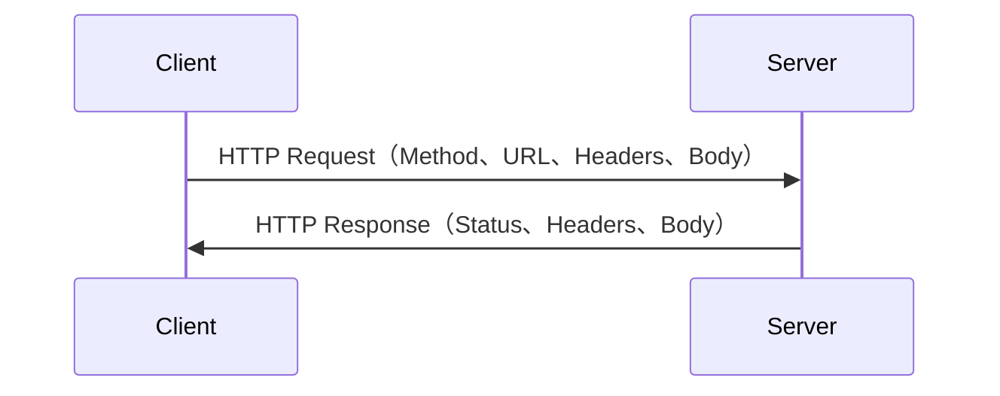

A request typically consists of:

| Component | Role |
|---|---|
| Method | Operational intent, e.g. GET, POST, PUT, DELETE |
| URL / Path | The resource being requested |
| Headers | Metadata: content format, authentication, cache conditions |
| Body | Optional payload, e.g. JSON, form data, files |

**HTTP defines interaction semantics, not how applications implement their business logic.** HTTP has no idea whether `/articles/123` is a blog post, a database record, or an AI inference result — it only specifies how the two parties exchange information. That is the fundamental reason HTTP became a universal protocol.

## 2. How does HTTP relate to TCP, TLS, and QUIC?

Thinking of the protocol stack as a division of responsibilities makes it clearer: IP finds addresses, TCP/QUIC guarantees delivery, TLS encrypts, HTTP defines semantics.

The three most common protocol stacks in 2026:

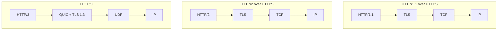

TCP provides reliable, ordered byte delivery; TLS handles encryption and authentication; HTTP defines requests and responses.

HTTP/3 is the special case: it uses QUIC, which integrates TLS 1.3 handshake mechanics and provides reliable streams, multiplexing, flow control, and congestion control.

Although QUIC runs over UDP at the network layer, that does not mean "HTTP/3 is unreliable." QUIC reimplements reliable transport on top of UDP.

Real-world protocol stacks do not map cleanly onto the textbook OSI seven-layer model. QUIC in particular integrates capabilities that traditionally lived at separate layers.

## 3. HTTP/0.9: A protocol in one line (1990–1991)

Around 1990, the World Wide Web had just been invented. The earliest HTTP was so simple it was later called the *One-line Protocol*.

The client simply sent:

```http
GET /index.html
```

The server returned HTML content directly — no status code, no headers, no explicit protocol version, no POST support. The server signaled end-of-response by closing the connection.

That was entirely reasonable at the time, because web pages were typically just simple hypertext documents. As pages started carrying images, forms, file downloads, and more complex content, the one-line protocol could no longer express enough information.

## 4. HTTP/1.0: HTTP becomes a general-purpose application protocol (1996)

In 1996, HTTP/1.0 was formally described in RFC 1945. The most important change was introducing a fuller message structure:

```http
GET /index.html HTTP/1.0
User-Agent: MyBrowser

```

Responses now included status codes and headers:

```http
HTTP/1.0 200 OK
Content-Type: text/html
Content-Length: 5

Hello
```

This let HTTP carry arbitrary formats beyond HTML — images, audio, files — and let clients know whether a request had succeeded:

- `200 OK`: request succeeded.
- `301 Moved Permanently`: resource permanently moved.
- `404 Not Found`: resource does not exist.
- `500 Internal Server Error`: server-side failure.

### 4.1 HTTP/1.0's biggest performance problem

The typical pattern in HTTP/1.0 was one TCP connection per request-response pair.

A page with 30 images required 30 TCP connections. On high-latency networks, that cost was significant.

Understanding why requires the concept of RTT (Round Trip Time). Assume 100ms RTT between client and server: just completing the TCP three-way handshake takes roughly 1 RTT. If every resource re-establishes a connection, that handshake overhead repeats constantly.

This is what drove one of HTTP/1.1's most important optimizations.

## 5. HTTP/1.1: Connection reuse and streaming (1997–1999)

HTTP/1.1 was standardized in RFC 2068 in 1997 and revised by RFC 2616 in 1999. It is one of the longest-lived and most influential protocols in internet history.

Two capabilities in HTTP/1.1 stand out: **Persistent Connections and Chunked Transfer Encoding.**

### 5.1 Keep-Alive: why can't TCP connections be reused indefinitely?

HTTP/1.1 enables persistent connections by default, so a single TCP connection can carry multiple HTTP request-response pairs:

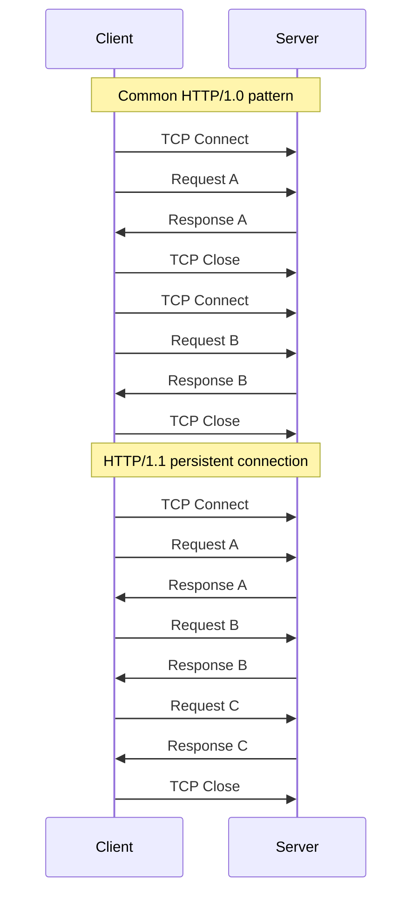

A common misconception worth correcting: HTTP/1.1 **enables persistent connections by default** — you do not need to send `Connection: keep-alive` to activate it. That header is mainly for compatibility with older connection management behavior. To opt out of reuse, send `Connection: close`.

But Keep-Alive still has a fundamental limitation: **connection reuse is not the same as multiplexing.**

HTTP/1.1 did define Pipelining, which lets a client send subsequent requests without waiting for the previous response. However, responses must still be returned in request order, so if an earlier request is slow, it can block later responses. This is Head-of-Line (HOL) Blocking.

### 5.2 Chunked Transfer: sending data when you don't know the total length

When a server begins generating a response, it sometimes doesn't know how large the final output will be. The traditional approach required generating the entire content first, computing `Content-Length`, and sending it all at once — increasing time to first byte.

HTTP/1.1's Chunked Transfer Encoding solves this:

```http
HTTP/1.1 200 OK
Content-Type: text/plain
Transfer-Encoding: chunked

5
Hello
6
 World
0

```

In the actual protocol, each line is separated by CRLF (`\r\n`). `5` and `6` are chunk lengths in hexadecimal; the trailing `0` marks the end of the body, after which optional Trailer fields may appear. The client reassembles the chunks into `Hello World` transparently.

An important distinction: **Chunked Transfer is HTTP/1.1's message framing mechanism — it is not SSE, and it is not an application-layer event protocol.** HTTP/2 and HTTP/3 have their own binary framing formats and do not use `Transfer-Encoding: chunked`.

### 5.3 What else did HTTP/1.1 solve?

**Caching** lets browsers and CDNs avoid re-fetching the same resource from the origin server every time:

```http
Cache-Control: public, max-age=3600
ETag: "version-42"
```

When a cached response expires, a conditional request can ask whether the resource has changed; the server can respond `304 Not Modified`.

**Content negotiation** lets a client declare what formats it can accept:

```http
Accept: application/json
Accept-Encoding: gzip, br
Accept-Language: zh-CN
```

**The Host header** allows a single server to serve different websites based on the domain name, which became the foundation for virtual hosting.

## 6. HTTP/2: True multiplexing (2015)

By the 2010s, a modern web page could contain dozens or hundreds of resources. Browsers worked around the concurrency problem by opening multiple TCP connections — HTTP/2's goal was to solve this with a single connection. HTTP/2 was standardized in 2015 and updated by RFC 9113 in 2022.

### 6.1 Multiplexing: one connection, multiple concurrent streams

HTTP/2 introduces a Binary Framing Layer. HTTP messages are broken into Frames; each Frame can belong to a different Stream, allowing multiple requests and responses to be interleaved on the same connection:

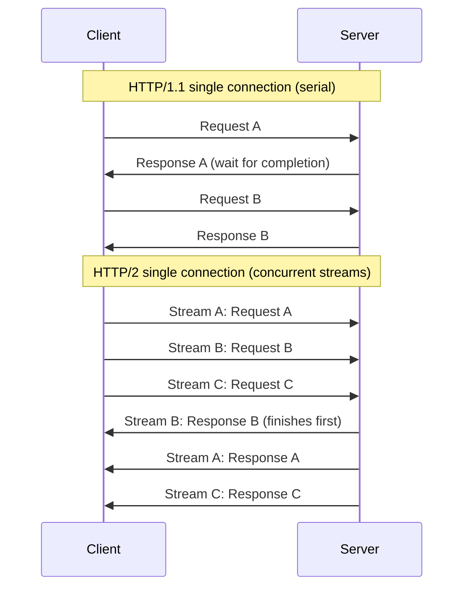

HTTP/2 also has independent flow control, allowing the receiver to limit how much data can be sent per stream and across the entire connection.

### 6.2 Header Compression: HPACK

HTTP requests tend to repeat many of the same headers:

```http
Authorization: Bearer ...
Accept: application/json
Cookie: session=...
User-Agent: ...
```

HTTP/2 uses HPACK for header compression, reducing the overhead of repeated headers via static tables, dynamic tables, and efficient encoding. This is distinct from gzip compression of the HTTP body.

### 6.3 ALPN: how do client and server agree to use HTTP/2?

HTTP/2 in browsers typically runs over TLS. The client uses TLS's ALPN (Application-Layer Protocol Negotiation) extension to advertise supported protocols:

```text
ClientHello:
  ALPN: h2, http/1.1

Server:
  ALPN: h2
```

The application-layer protocol is then negotiated. When you visit `https://example.com`, which version of HTTP the browser actually uses is not determined by the URL itself.

Note that HTTP/2 does not mandate TLS — the spec defines a cleartext mode — but in practice, HTTP/2 over HTTPS in browsers is the dominant form.

### 6.4 Why isn't HTTP/2 enough?

HTTP/2 eliminated head-of-line blocking at the HTTP application layer, but not at the TCP layer.

TCP provides a reliable, ordered byte stream. Suppose three HTTP/2 streams are in flight over one TCP connection. If an early TCP packet is lost, TCP cannot deliver subsequent bytes to the application — because TCP doesn't understand HTTP/2 stream boundaries. A single dropped packet at the transport layer can simultaneously block multiple HTTP/2 requests that have nothing to do with each other.

That is one of the core problems HTTP/3 was designed to solve.

## 7. HTTP/3: Why rebuild the transport layer? (2022–2026)

HTTP/3 was standardized in RFC 9114 in 2022. Its most significant change is not a new HTTP method — it's switching the underlying transport from TCP to QUIC. QUIC runs over UDP but provides its own reliable delivery, congestion control, connection management, and multiplexing.

### 7.1 QUIC streams are truly independent reliable streams

In HTTP/3, each HTTP request typically maps to one QUIC Stream. If a packet in Stream A is lost, only the affected data within A needs retransmission — other streams can continue delivering data that has already arrived intact:

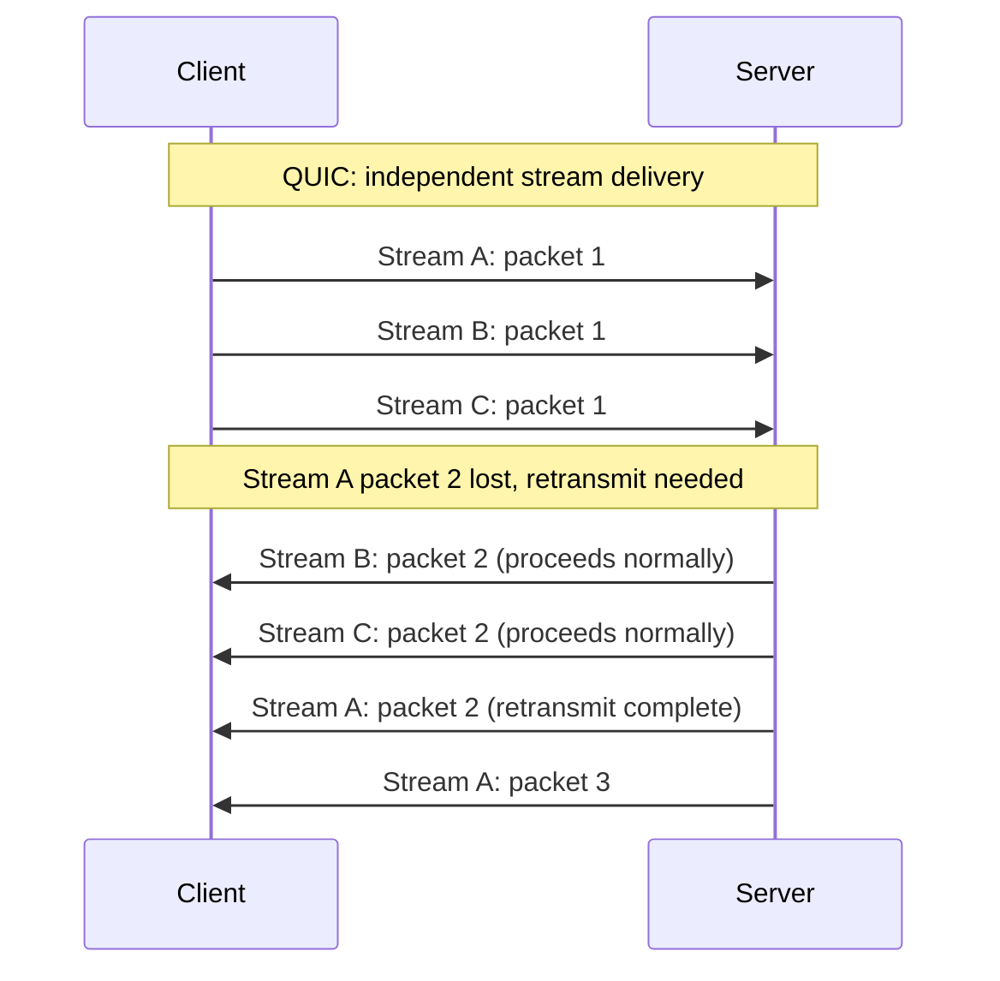

This doesn't mean different QUIC streams have zero interaction. They still share connection-level congestion control and network bandwidth, so resource contention is still possible. What QUIC eliminates is **cross-stream transport-layer head-of-line blocking** — not all queuing, loss, and delay in the network.

### 7.2 Faster connection establishment

QUIC tightly integrates TLS 1.3 handshaking with connection setup. For a normal first-time QUIC connection, authenticated application data can typically flow after roughly 1 RTT. On eligible resumption connections, 0-RTT Early Data can reduce the wait further.

0-RTT data carries replay risk. Operations with side effects — payments, order creation — need careful handling.

### 7.3 Connection Migration: switching networks without reconnecting

Traditional TCP connections are tightly coupled to the IP address and port pair that identifies them. When a phone switches from Wi-Fi to 5G, its network address changes. QUIC introduces a Connection ID, allowing a connection to migrate to a new network path — without tearing down and rebuilding the logical connection — provided the protocol and implementation support it. Connection migration doesn't mean every network switch goes unnoticed: server policy, network constraints, and path validation can still affect the outcome.

### 7.4 HTTP/3 still has header compression and multiplexing

HTTP/3 uses QPACK instead of HTTP/2's HPACK. The reason: HPACK's dynamic table update mechanism depends on ordered delivery, but QUIC allows streams to be delivered independently. QPACK separates dynamic table updates from ordinary request header transmission, reducing the risk of cross-stream blocking. HTTP/3 is not simply "HTTP/2 over UDP" — it's a coordinated rebuild of both the transport layer and parts of the HTTP encoding mechanism.

### 7.5 Is HTTP/3 always faster than HTTP/2?

Not necessarily. In high-latency environments with packet loss or frequent network switching, HTTP/3 can show a clear advantage. But if a connection is already established, the network is stable with low latency, and you're mainly transferring one large file, HTTP/3 may not be meaningfully faster than a well-tuned HTTP/2 stack.

QUIC's encryption, congestion control, user-space implementation, and network device compatibility all carry overhead. For example, UDP/443 may be blocked in some enterprise networks, causing browsers to fall back to HTTP/2 or other protocols.

**HTTP/3 provides a better transport mechanism, but final performance still depends on the entire system.**

### 7.6 How widely deployed is HTTP/3 by 2026?

It's in real production, but far from universal.

Data from the HTTP Archive *2025 Web Almanac* shows that for its mobile HTML request sample served by CDNs, approximately:

- 29% used HTTP/3
- 69% used HTTP/2
- 2% used HTTP/1.1

These numbers reflect a specific test sample and CDN service conditions, and cannot be extrapolated directly to all global internet traffic.

**HTTP/3 adoption has largely been driven by browsers and CDN infrastructure, not by requiring all backend services to upgrade to HTTP/3.** A typical production system looks like:

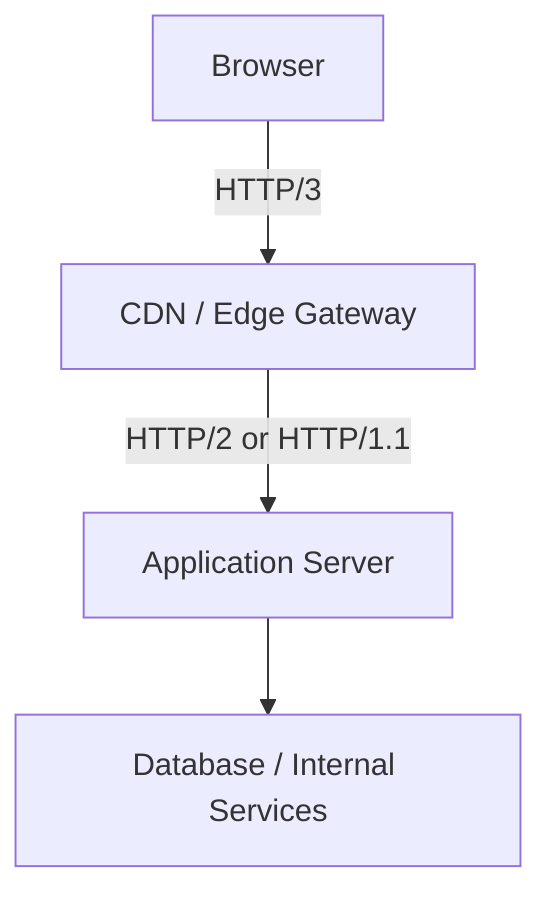

Each segment can use a different protocol. A site advertising HTTP/3 support does not imply its microservices are all running QUIC.

## 8. HTTP evolution at a glance

| Protocol | Signature capability | Main problem solved | Remaining limitations |
|---|---|---|---|
| HTTP/0.9 | Single-line GET | Retrieving hypertext documents | No status codes, no headers |
| HTTP/1.0 | Status codes, headers, multiple content types | General content transfer | Typical implementations re-established connections for each request |
| HTTP/1.1 | Persistent connections, Chunked Transfer, caching | Connection overhead, dynamic responses | No true multiplexing per connection |
| HTTP/2 | Binary framing, HPACK, multiplexing | Concurrent request efficiency | TCP-layer head-of-line blocking |
| HTTP/3 | QUIC, QPACK, connection migration | Transport-layer blocking and connection latency | Deployment, compatibility, and implementation complexity |

From HTTP/0.9 to HTTP/3, one trend runs throughout: **eliminate unnecessary waiting and let more information travel earlier and more independently.**

Beyond efficiency, the internet has another unavoidable requirement: security. That's where HTTPS comes in.

---

# Part 2: HTTPS — How the Internet Builds Security and Trust

## 9. Why is plain HTTP insecure?

One serious problem with traditional cleartext HTTP is that intermediate devices on the network can read or modify data. An attacker on the path can eavesdrop on request content, modify what the server returns, or impersonate the target server.

HTTPS provides three core security properties:

**Confidentiality**: third parties cannot readily read the transmitted content.

**Integrity**: unauthorized modification of data in transit can be detected.

**Authentication**: the client can verify that the server it's connected to has the expected identity.

HTTPS typically implements these properties using TLS. Worth emphasizing: TLS does not automatically guarantee business-level non-repudiation, nor does it prevent the server itself from leaking data, XSS vulnerabilities in the site, or users being phished.

## 10. Why does HTTPS need two kinds of encryption?

**Symmetric encryption**: both parties use a shared key to encrypt and decrypt, e.g. AES. Fast, suitable for bulk data transfer. Problem: how do two parties who've never met safely arrive at the same key?

**Asymmetric cryptography**: uses a public/private key pair, applicable to key agreement, encryption, or digital signatures. It solves many key distribution and authentication problems, but is generally not suitable for directly encrypting large volumes of HTTP content.

Modern TLS composes different cryptographic primitives: authentication (certificate + digital signature) → key agreement (ECDHE and similar) → key derivation (HKDF and similar) → actual data encryption (AES-GCM / ChaCha20-Poly1305).

A particularly important correction to outdated mental models: **modern TLS 1.3 does not work by having the browser generate a random session key and encrypt it with the server's RSA public key.** TLS 1.3 has removed that static RSA key transport mode entirely, using key establishment mechanisms based on ephemeral key exchange or other supported modes instead.

## 11. What is the TLS 1.3 handshake actually doing?

TLS 1.3 was standardized in RFC 8446 in 2018 and is one of the core foundations of modern HTTPS.

The TLS 1.3 handshake solves three problems simultaneously: how to negotiate a shared key, how to verify the other party's identity, and how to confirm the handshake hasn't been tampered with. These three things must happen in the same exchange, and the order matters.

Simplified first-time full handshake:

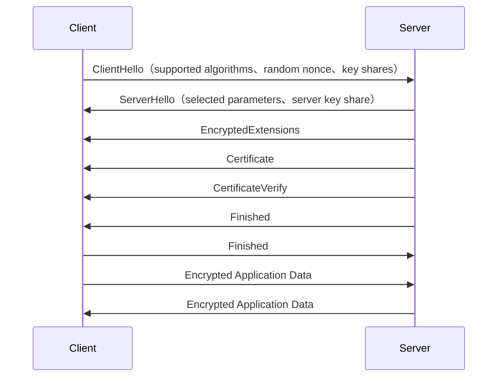

### First: how do both parties negotiate a shared key?

A common TLS 1.3 configuration uses ECDHE (Elliptic Curve Diffie-Hellman Ephemeral). Client and server each generate a temporary private key and exchange their corresponding public key material. Each side uses its own private key and the other's public key to independently compute the same shared secret. A network observer who sees the exchanged public keys should not be able to derive the shared secret at reasonable computational cost. TLS then uses key derivation to produce the actual encryption keys from the shared secret and handshake context.

### Second: how do you know the other party isn't an attacker?

The client needs to confirm that the server's certificate is valid for the domain being accessed and is vouched for by a trusted certificate chain. The server must also prove it holds the private key corresponding to the public key in its certificate. In TLS 1.3, the server does this via `CertificateVerify` — a digital signature over the handshake context.

Diffie-Hellman key exchange alone isn't enough: it lets both parties agree on a secret, but without reliable authentication it's vulnerable to man-in-the-middle attacks.

### Third: how do you confirm the handshake wasn't tampered with?

TLS 1.3 uses `Finished` messages to verify the integrity of the entire handshake. Once both parties complete their verification, they can safely exchange application data.

The core design of modern TLS is to bind authentication, key agreement, handshake integrity, and application data encryption together.

## 12. The certificate chain: why does a browser trust a site it's never seen?

If the server could just say "here's my public key, trust me," any attacker could do the same. So the internet introduced the CA (Certificate Authority) system:

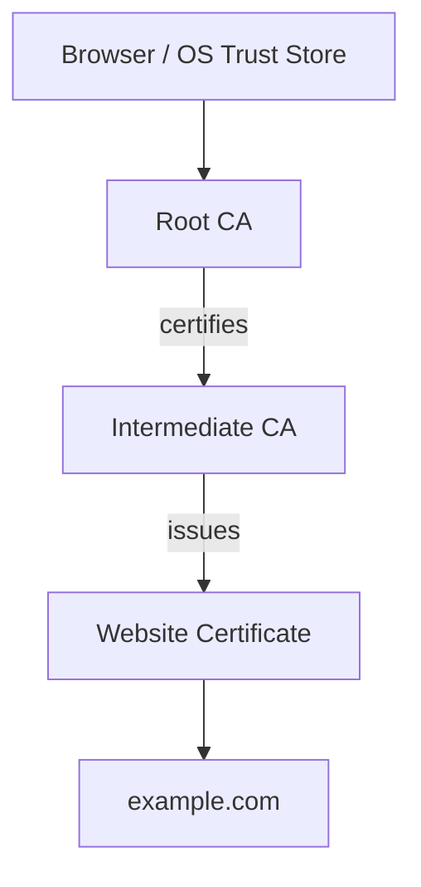

When a browser validates a certificate, it checks at minimum: whether the signatures in the certificate chain are valid; whether the certificate covers the domain being visited; whether the certificate is within its allowed validity period; whether the validation path connects to a trusted root; and relevant browser policies and certificate status requirements.

A CA represents an institutionalized trust infrastructure — not an infallible one. The modern browser ecosystem also introduces mechanisms like Certificate Transparency to improve the auditability of certificate issuance.

## 13. HTTPS developments from 2018 to 2026

### 13.1 TLS 1.3: fewer round trips, stricter cryptographic design

TLS 1.3 significantly simplified cipher suite selection, removed many legacy or discouraged mechanisms, improved handshake efficiency, and made forward secrecy available for normal full handshakes.

Forward Secrecy means: even if the server's long-term identity private key is compromised in the future, an attacker generally cannot use that key alone to decrypt past sessions that were established using appropriate ephemeral key exchange. It doesn't mean keys never leak, and it doesn't guarantee that historical application data is safe if the host is compromised.

### 13.2 Automated certificate management

Certificate request, renewal, and installation used to be manual operations. The ACME protocol and infrastructure like Let's Encrypt have made domain validation, certificate issuance, and renewal fully automatable. HTTPS is no longer an optional extra for high-security use cases — it's the baseline expectation for public web services.

### 13.3 ECH: further hiding the connection target (2026)

Traditional HTTPS encrypts the HTTP body, request path, and most headers, but the SNI (Server Name Indication) in the TLS handshake can expose the target domain name in plaintext under older configurations.

In March 2026, IETF published RFC 9849, standardizing ECH (Encrypted Client Hello). ECH encrypts sensitive fields in the TLS ClientHello — including the real SNI — reducing the opportunity for observers to learn the target domain.

This does not mean full anonymity: the target IP, traffic characteristics, DNS query behavior, and other metadata can still leak information. The actual effect depends on network deployment.

### 13.4 Post-quantum hybrid key exchange (2026)

In August 2026, RFC 10024 defined three hybrid key establishment mechanisms for TLS 1.3 combining classical and post-quantum algorithms, including:

`X25519MLKEM768`

It combines classical elliptic-curve key exchange with post-quantum ML-KEM to reduce risk from future quantum computing capabilities. This reflects a pragmatic protocol evolution strategy: rather than immediately abandoning mature cryptography, use a hybrid design to enable gradual migration.

Post-quantum hybrid key exchange does not mean the entire TLS certificate and signature ecosystem has completed its post-quantum migration.

---

# Part 3: Server Push — How Can HTTP Become "Real-Time"?

## 14. From Pull to Push: what's the actual problem?

HTTP originally used a Request-Response model: the client sends a request, the server returns a response within that request context. When applications became real-time chat, stock tickers, message notifications, or collaborative editing, a fundamental problem emerged: **the server has new data but has no mechanism to proactively notify the client.**

The most obvious solution is for the client to ask repeatedly — that's Polling:

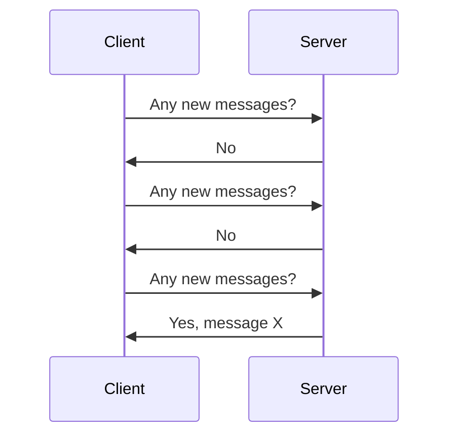

Polling every 10 seconds generates 360 requests per hour. Even if only one new message arrives, the vast majority of requests get no new data — and if a message arrives just after a poll, you might wait nearly 10 seconds to see it.

**Pull** lets the client decide when to fetch data; **Push** means the server can send data promptly to clients that have established a receiving relationship when new events occur.

That said, Push and Pull are not mutually exclusive protocol properties. A client can initiate an HTTP request, and the server can then stream events continuously within that response — achieving a server-push experience at the application level.

## 15. Long Polling: let the server answer late

Long Polling's core technique: after the client sends a request, if the server has no new events, it holds the response — rather than returning immediately — until a new event occurs or the request times out, then completes the response. The client immediately fires another request upon receipt:

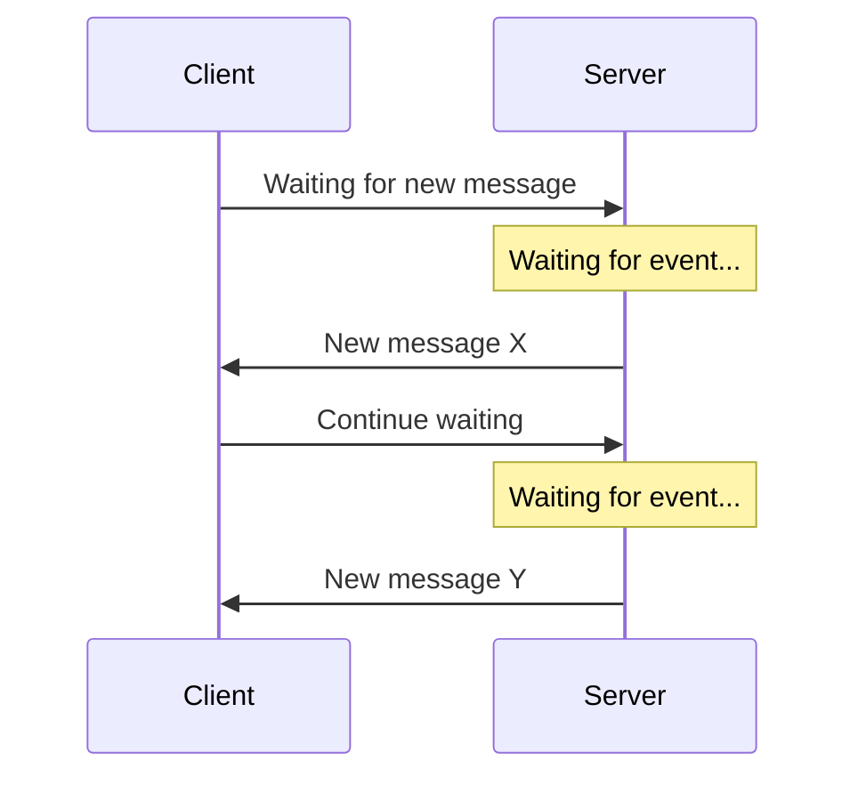

Long Polling was an important technique in the Comet family and played a significant role in early instant messaging and notification systems.

Two concepts are easy to conflate here: **Long Polling delays the completion of one response; HTTP Streaming continuously delivers multiple chunks of data within one response.** They are different mechanisms. Long Polling also doesn't require HTTP/1.1 Chunked Transfer — the server can simply wait for an event and then return an ordinary complete response.

## 16. HTTP Streaming: one request, continuous events

HTTP Streaming's idea: the client opens one request, the server begins returning a response but doesn't close the response body. Whenever new data is ready, it writes more data into the same response stream:

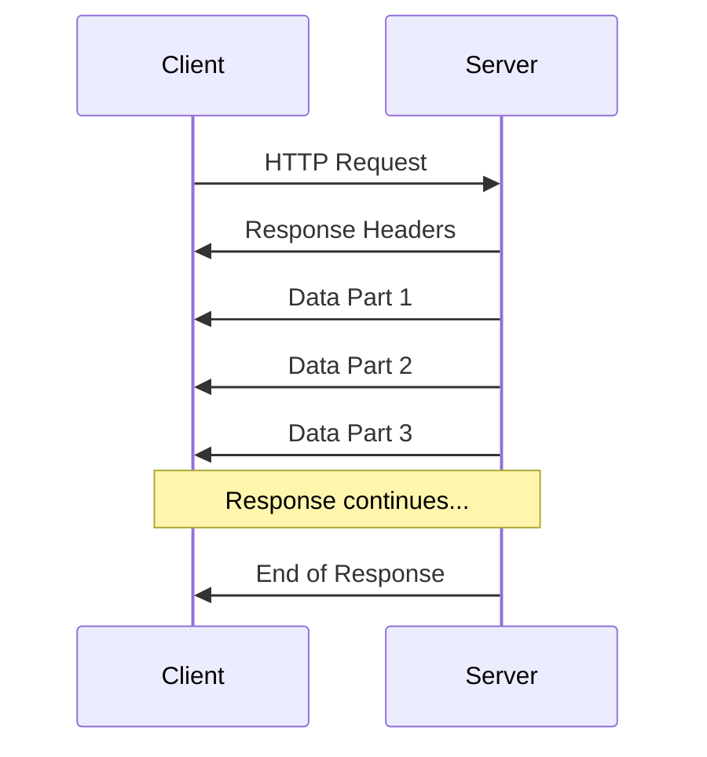

For HTTP/1.1, Chunked Transfer Encoding enables streaming responses of unknown length. For HTTP/2 and HTTP/3, the respective DATA Frame and Stream mechanisms deliver body content continuously.

Just sending a continuous byte stream still leaves a problem: how does the client know where one complete event ends and the next begins? TCP only provides a byte stream. Even if the server performs three writes, the client may read those bytes in multiple reads, one read, or with different boundaries. An application-layer message format is required. SSE is a clean, standardized solution to this.

## 17. SSE: why do modern AI products use it so heavily?

SSE (Server-Sent Events) is a server-side event push format built on HTTP response streaming. The browser's native interface for it is `EventSource`.

The server returns:

```http
HTTP/1.1 200 OK
Content-Type: text/event-stream
Cache-Control: no-cache

event: message
id: 101
data: {"text":"Hello"}

event: message
id: 102
data: {"text":" World"}

```

Where:

- `event` specifies the event type.
- `id` specifies the event identifier.
- `data` contains the event payload.
- A blank line marks the end of one event.

The browser can consume events with:

```javascript
const source = new EventSource("/events");

source.addEventListener("message", (event) => {
  const data = JSON.parse(event.data);
  console.log(data.text);
});
```

SSE builds directly on the existing HTTP stack without upgrading to a completely different application protocol. It's naturally suited for delivering text events from server to client, and the native `EventSource` provides automatic reconnection and resumption based on the last event ID.

"Automatic reconnection" does not mean the server automatically persists historical messages. If you want to catch up on missed events after a disconnect, the server must implement event retention, cursors, and replay logic.

### 17.1 SSE is an application format, not just a network connection type

SSE's core is the `text/event-stream` format. The browser's `EventSource` typically establishes an SSE connection with a GET request. But you can also use the Fetch API to make a POST request, then read the response as a `ReadableStream` and parse the SSE format manually:

```javascript
const response = await fetch("/api/chat", {
  method: "POST",
  headers: {
    "Content-Type": "application/json"
  },
  body: JSON.stringify({
    message: "Explain HTTP/3"
  })
});

const reader = response.body.getReader();
const decoder = new TextDecoder();

while (true) {
  const { value, done } = await reader.read();

  if (done) break;

  const text = decoder.decode(value, {
    stream: true
  });

  console.log(text);
}
```

The code above only shows how to read an HTTP response incrementally — it is not a complete SSE parser. Production code must handle UTF-8 characters split across chunk boundaries, SSE event boundaries, field parsing, and similar edge cases. You cannot assume one `read()` call corresponds to one complete event.

SSE is not obsoleted by HTTP/3. It operates at the HTTP response body level, so it can run over HTTP/1.1, HTTP/2, or HTTP/3 as the underlying transport.

### 17.2 SSE's limitations

SSE is a unidirectional stream from server to client. If the client needs to send new instructions to the server, it typically makes a separate HTTP request. The native `EventSource` is also not suited for scenarios that require a custom POST body or arbitrary custom authentication headers — Fetch Streaming or other approaches work better there.

Without HTTP/2 multiplexing, the browser's per-origin concurrent connection limit can become a bottleneck.

## 18. WebSocket: why do we still need a bidirectional protocol?

SSE handles "server continuously tells the client what happened" very well. But in an online game, the client constantly uploads player coordinates while the server pushes other players' positions. Using plain HTTP requests plus SSE would require stitching together multiple communication channels.

WebSocket takes a more direct approach: **establish a persistent bidirectional communication channel where both parties can send messages at will.**

The WebSocket protocol was standardized in RFC 6455 in 2011. In a classic HTTP/1.1 handshake, the client sends:

```http
GET /chat HTTP/1.1
Host: example.com
Upgrade: websocket
Connection: Upgrade
Sec-WebSocket-Version: 13
Sec-WebSocket-Key: ...

```

If the server accepts the upgrade, it returns:

```http
HTTP/1.1 101 Switching Protocols
Upgrade: websocket
Connection: Upgrade
Sec-WebSocket-Accept: ...
```

The connection then enters WebSocket protocol communication. WebSocket uses its own frame structure, supports text and binary messages, and includes control mechanisms like Ping/Pong and connection close:

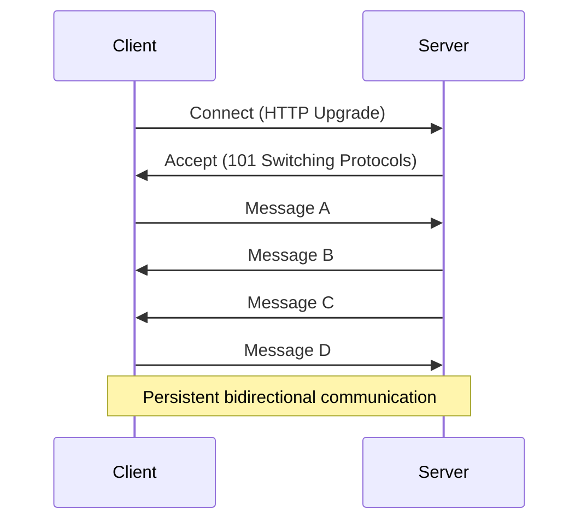

### 18.1 2018–2026: WebSocket is no longer limited to HTTP/1.1 Upgrade

Introductory articles often describe WebSocket as "first do an HTTP Upgrade, then switch protocols." That's the correct classic model for HTTP/1.1. But with HTTP/2 and HTTP/3, the protocol evolved to support an Extended CONNECT approach:

- RFC 8441 defines how WebSocket runs over an HTTP/2 connection.
- RFC 9220 adapts that mechanism to HTTP/3.

So it's no longer accurate to assume all WebSocket connections look like an HTTP/1.1 `101 Switching Protocols` handshake. Which establishment method is actually used depends on browser, server, and intermediate network infrastructure support.

### 18.2 Why WebSocket isn't the best choice for every real-time system

WebSocket is more capable, but it requires the application to manage more details: how to restore state after a disconnect, how to acknowledge messages, how to rate-limit slow clients, how to distribute connections across service nodes, how to authenticate business messages, and how to handle duplicate and out-of-order events at the application layer.

The classic browser WebSocket API also doesn't provide a built-in backpressure model fully consistent with the Streams API.

Additionally, WebSocket is not subject to the browser's traditional HTTP same-origin policy, but that doesn't make security concerns disappear. Servers must validate the `Origin` header and properly handle user identity and authorization.

If the use case is simply streaming out an AI-generated answer, WebSocket is usually unnecessary. But for multiplayer collaboration, real-time games, interactive terminals, and frequent bidirectional control, WebSocket is still an excellent fit.

## 19. HTTP/2 Server Push: a very successful failure

HTTP/2 Server Push was never designed to push chat messages or AI-generated text. Its purpose was optimizing web resource loading.

When a client requests `GET /index.html`, the server knows the browser will likely also need `/style.css` and `/app.js`, so it uses `PUSH_PROMISE` and related mechanisms to proactively send those resources without waiting for the browser to parse the HTML and request them.

In theory, this is clever. In practice, it exposed many problems: servers struggled to know which resources the browser had already cached; pre-pushed resources might not be needed at all; and pushed resources could consume bandwidth that should have been used to prioritize critical content like HTML.

Actual deployment was limited, and in some cases it degraded performance. Chrome removed HTTP/2 Server Push support by default starting with version 106. The HTTP/3 spec retains push-related mechanisms, but that doesn't mean it has become a mainstream web optimization technique.

### 19.1 The replacement: 103 Early Hints

Modern web performance optimization focuses on letting the browser know in advance what critical resources it might need, rather than having the server push entire resources unilaterally:

```http
HTTP/1.1 103 Early Hints
Link: </style.css>; rel=preload; as=style

HTTP/1.1 200 OK
Content-Type: text/html

<html>...</html>
```

`103 Early Hints` lets the server provide resource hints to the browser before the final response is ready. The browser can still decide whether to request them. The key difference from HTTP/2 Server Push is returning resource scheduling decisions to the client.

**The server knowing more doesn't mean the server should make all decisions for the client.**

Don't conflate these techniques:

| Technique | What gets pushed |
|---|---|
| HTTP/2 Server Push | HTTP resources the server predicts the browser may need |
| SSE | Continuous application-layer events |
| WebSocket | Application-layer messages in both directions |
| Web Push | Notifications to browsers or devices via push infrastructure |

They share the word "push" but solve fundamentally different problems.

## 20. Web Push, WebRTC, and WebTransport

### Web Push: receive notifications even when the page isn't open

SSE and WebSocket generally require the application to maintain an active communication relationship. Web Push combines the Push API, Service Workers, and the browser's push service to let applications receive push events given appropriate permissions and platform conditions. It's particularly suited for notifications, reminders, and marketing messages, but it depends on browser permissions, system policies, and push services — it's not a substitute for high-frequency real-time data.

### WebRTC: low-latency audio/video and peer-to-peer communication

WebRTC is designed for real-time audio/video and data communication. It involves a range of network mechanisms: ICE, STUN, TURN, DTLS, SRTP, SCTP, and more. WebRTC can establish peer-to-peer paths or route through relay servers depending on network conditions. Video conferencing, real-time voice AI, and inter-browser data channels are typical use cases.

The key distinction from WebSocket is not just bidirectionality — WebRTC is specifically designed around real-time media transport, network traversal, latency, and packet loss behavior.

### WebTransport: a new option for the HTTP/3 era

WebTransport provides bidirectional communication over HTTP/3 transport. It supports multiple reliable Streams as well as unreliable Datagrams suited for low-latency scenarios. In an online game, a player's critical actions need reliable delivery, but high-frequency position updates may prioritize the freshest state over retransmitting every historical one. WebTransport lets an application choose different reliability models for different message types.

As of 2026, WebTransport has browser implementations, but cross-browser compatibility, server-side support, and standardization progress still require verification against actual deployment needs. Its HTTP/3 binding spec was still in IETF Internet-Draft status in 2026 — it cannot be treated as a full replacement for WebSocket.

---

# Part 4: Practice in 2026 — Why AI Made HTTP Streaming Matter Again

## 21. Why doesn't ChatGPT typically need WebSocket to stream output word by word?

For generative language models, a complete response can take tens of seconds or even minutes. Waiting for all tokens to be generated before responding would be terrible UX. The better approach: as the model produces new output fragments, the server sends them to the client immediately:

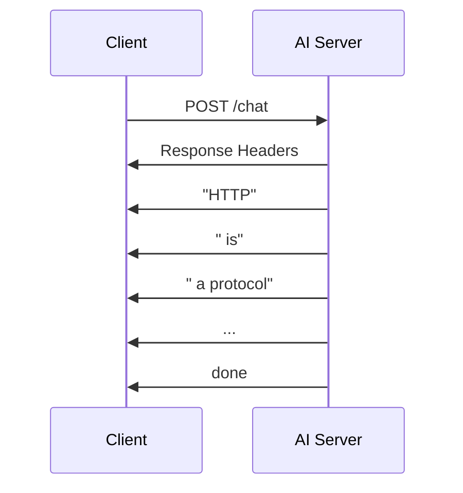

HTTP Streaming is well-suited for this scenario. If the response uses SSE event format, the application can also distinguish text generation from model run status, tool calls, error information, and so on:

```text
event: message.delta
data: {"text":"HTTP"}

event: message.delta
data: {"text":" is a protocol"}

event: message.completed
data: {"finish_reason":"stop"}
```

An important caveat: model services typically produce text fragments as they generate, but there's no guarantee at the network level that "one token equals one network packet or one SSE event." In practice, server-side buffering, batching, proxy buffering, and client-side chunked reads all affect the actual delivery granularity.

### 21.1 Why SSE is a natural fit for AI

Ordinary text generation has three characteristics:

First, after the user sends a request, the primary data direction is server to client.

Second, the response may take a long time, and showing partial results earlier has clear value.

Third, the returned content may include different types of structured events alongside plain text.

These characteristics align naturally with HTTP Streaming + SSE. It also reuses the existing HTTP authentication, load balancing, monitoring, gateway, and developer tooling ecosystem. For most text chat applications, SSE or plain HTTP streaming is simpler than a custom WebSocket protocol.

## 22. AI Agents make the problem more complex

A typical chatbot interaction is: User → Model → Streaming Answer.

A complex Agent may require: User → Task Planning → Tool Call → External API → Human Approval → More Tool Calls → Final Result. Tasks can run for minutes or hours.

The question is no longer just "how to stream text output" but: **how to reliably synchronize the state of a long-running task to the client?**

The communication protocol and the business task need to be decoupled. A common design pattern:

```mermaid
flowchart TD
    A[Client] -->|POST /runs| B[API Gateway]
    B --> C[Task Orchestrator]
    C --> D[Queue]
    D --> E[Workers]
    E --> F[Task Events]
    F --> G[Event Store]
    G -->|GET /runs/{id}/events SSE Stream| A
```

The client submits a task. The server creates a task ID, executes asynchronously, and writes state changes into an event system. The client subscribes to task events via SSE:

```text
event: run.started
data: {"run_id":"r123"}

event: tool.started
data: {"tool":"search"}

event: tool.completed
data: {"tool":"search","count":5}

event: approval.required
data: {"approval_id":"a1"}

event: run.completed
data: {"run_id":"r123"}
```

If user approval is required for an action, a separate request handles it:

```http
POST /runs/r123/approvals/a1
Content-Type: application/json

{"approved":true}
```

**Business-level bidirectional interaction does not imply the transport layer must use WebSocket.** HTTP requests can carry commands; SSE can carry state changes. WebSocket or other bidirectional transports only become attractive when you need frequent, continuous, low-latency interaction in both directions simultaneously.

## 23. MCP's evolution confirms this direction

MCP (Model Context Protocol) defines a standardized interaction pattern between AI applications and external tools. Its early remote transport design widely used the HTTP+SSE pattern. In March 2025, MCP introduced Streamable HTTP to further unify remote interaction.

As of October 2026, the latest MCP specification — version 2026-07-28 — made important changes. According to the official spec, the current Streamable HTTP transport uses a single HTTP POST endpoint; each JSON-RPC message is sent via an independent request, and the response can be either plain JSON or an SSE stream associated with that request.

The 2026-07-28 revision removed the separate GET event stream endpoint and protocol-level session mechanism from the earlier design. Continuous change subscriptions are obtained through specific POST requests that yield long-lived SSE responses.

This reflects a trend in AI communication protocol design toward prioritizing request boundaries, cancellation semantics, state ownership, observability, and compatibility with existing HTTP infrastructure.

That said, not all existing MCP SDKs and servers have upgraded to the latest spec. Real compatibility gaps exist between the 2025 and 2026 versions, and explicit version negotiation is required.

## 24. Building real streaming systems: the hard part isn't the protocol

Protocols solve transport capability, not all business reliability problems.

### 24.1 A dropped network connection should not automatically terminate the task

An Agent task might run for 30 minutes. If the browser refreshes and the SSE connection drops, should the server cancel the task? That depends on product semantics. If the task has already created an order, called an external system, or triggered a background approval process, a client disconnect should not automatically roll back all those actions.

**Business task lifecycle must be explicitly separated from HTTP connection lifecycle.**

### 24.2 How to resume from a checkpoint

SSE supports event IDs, but the resume mechanism requires server-side support. One approach: assign monotonically increasing sequence numbers to persisted business events:

```text
Event 1001: run.started
Event 1002: tool.started
Event 1003: tool.completed
Event 1004: approval.required
```

After a disconnect, the client reconnects carrying the last received event ID. The server reads subsequent events from its event store and replays them. But this mechanism must be explicitly implemented by the application. For AI's high-frequency token output, you don't necessarily need to persist every fragment — you can selectively persist key state events, periodic output snapshots, and final results based on actual requirements.

### 24.3 Handling duplicate messages

Reconnections and retries can cause events to be delivered more than once. Production systems typically need event IDs, idempotent operations, deduplication logic, and a well-defined event ordering model.

**SSE, WebSocket, and HTTP/3 do not automatically provide Exactly-Once Processing at the business layer.**

### 24.4 Slow clients

Suppose a client can consume 10 messages per second but the server produces 1,000 events per second. Data accumulates — backpressure must be addressed. Common approaches include rate-limiting sends, aggregating state updates, dropping replaceable intermediate progress, using bounded queues, and closing overloaded connections when necessary.

For example, real-time task progress ticking from 31% to 32% to 33% to 34% probably doesn't need every intermediate state transmitted in full. But approval results, task completion status, and transaction confirmations are critical events that cannot be arbitrarily dropped.

### 24.5 Can you still return a 500 after the response has started streaming?

No. You cannot treat a streaming response whose headers have already been sent as an unsent response. Once the server has returned:

```http
HTTP/1.1 200 OK
Content-Type: text/event-stream
```

...it cannot retroactively change that initial HTTP status code to `500` if something fails later. Streaming protocols therefore typically need application-layer error events:

```text
event: run.failed
data: {"code":"TOOL_TIMEOUT"}
```

This is a boundary that many developers miss when first implementing a Streaming API.

### 24.6 Why does streaming work locally but display all at once in production?

A common cause is response buffering in a reverse proxy or gateway. The application server may be streaming incrementally, but an intermediate device is buffering multiple chunks before flushing them to the client.

In NGINX and similar environments, check Proxy Buffering settings, timeouts, and related configuration; `X-Accel-Buffering: no` can instruct NGINX to disable response buffering. Also verify that the server is flushing promptly, that content compression isn't introducing buffering, and that the client is genuinely reading the response incrementally. These issues can occur with HTTP/1.1, HTTP/2, or HTTP/3 — don't attribute them to the protocol version.

---

# Part 5: Choosing a Real-Time Communication Technology

| Technology | Direction | Best-fit scenarios | Primary cost |
|---|---|---|---|
| Short Polling | Client polls periodically | Low-frequency status checks | Wasteful requests, event latency |
| Long Polling | Request waits for event | Simple message notification, legacy system compatibility | Request re-establishment and timeout management |
| HTTP Streaming | Response returns continuously | File streams, AI output, long requests | Must design your own message boundaries |
| SSE | Server → Client | AI Streaming, task progress, event notifications | Native EventSource is unidirectional and text-only |
| WebSocket | Bidirectional | Chat, collaboration, terminals, real-time interaction | Connection state, backpressure, and reconnection management |
| Web Push | Push service → Device | Offline notifications, background alerts | Permission and platform dependencies |
| WebRTC | Bidirectional media/data | Real-time audio/video, voice AI | Network traversal, media and connection management |
| WebTransport | Multi-stream bidirectional + Datagram | Games, specialized low-latency applications | Ecosystem compatibility and deployment complexity |

In practice, what matters most is not "which technology is newer" but identifying exactly what capabilities the application actually needs.

A pure-text AI chat application can typically use POST + SSE. A real-time AI system that handles voice input and output might be better served by WebRTC. A remote terminal with frequent bidirectional control is a natural fit for WebSocket. And for an Agent that runs for hours, the most important consideration might not be WebSocket vs. SSE at all — it's task persistence, event logs, cancellation, and resumption.

---

# Part 6: Hands-On — Actually Observing HTTP and Streaming

Understanding network protocols is most effective when you send requests yourself, capture packets, and observe what happens.

## Experiment 1: Send an HTTP request by hand, without a browser

Start a simple HTTP server in a terminal:

```bash
python3 -m http.server 8080
```

Then in another terminal:

```bash
printf 'GET / HTTP/1.1\r\nHost: localhost\r\nConnection: close\r\n\r\n' \
  | nc 127.0.0.1 8080
```

You can observe the raw HTTP response that comes back.

Python's built-in `http.server` may return HTTP/1.0-format responses even when the client sends an HTTP/1.1 request. This is a convenient introductory experiment but not a suitable tool for testing the full capabilities of HTTP/1.1.

Pay particular attention to `\r\n\r\n`. It signals the end of the header section; everything after it is the body.

## Experiment 2: Check HTTP protocol versions with curl

Try:

```bash
curl -v --http1.1 https://example.com
```

Then:

```bash
curl -v --http2 https://example.com
```

If curl was compiled with the appropriate support, also try:

```bash
curl -v --http3-only https://example.com
```

Not all curl builds support HTTP/2 and HTTP/3. First check with:

```bash
curl -V
```

Key things to observe: TLS handshake, ALPN negotiation, HTTP protocol version, response headers, and the timing of the request/response. You can also open browser developer tools, enable the Protocol column in the Network tab, and observe which protocol carries different resources.

## Experiment 3: Observe TLS 1.3 with OpenSSL

Run:

```bash
openssl s_client \
  -connect example.com:443 \
  -servername example.com \
  -tls1_3 \
  -alpn h2 \
  -showcerts
```

This command shows TLS connection details, including the certificate chain, negotiated protocol, and cipher parameters. Key things to observe:

- The certificate(s) the server sends.
- TLS version.
- Negotiated cipher suite.
- ALPN result.

Note that displaying the certificate chain is not the same as the application completing all certificate validation per browser policy. `openssl s_client` verification options and error handling should be checked separately.

## Experiment 4: Build your own SSE server

This experiment uses only the Python standard library. Create `sse_server.py`:

```python
from http.server import BaseHTTPRequestHandler, ThreadingHTTPServer
import json
import time

class Handler(BaseHTTPRequestHandler):
    protocol_version = "HTTP/1.1"

    def do_GET(self):
        if self.path == "/":
            html = """
            <h2>SSE Demo</h2>
            <pre id="output"></pre>
            <script>
              const es = new EventSource("/events");

              es.addEventListener("tick", e => {
                const data = JSON.parse(e.data);
                document.querySelector("#output")
                  .textContent += data.message + "\\n";

                if (e.lastEventId === "10") es.close();
              });
            </script>
            """

            body = html.encode()
            self.send_response(200)
            self.send_header(
                "Content-Type", "text/html; charset=utf-8"
            )
            self.send_header("Content-Length", str(len(body)))
            self.end_headers()
            self.wfile.write(body)
            return

        if self.path != "/events":
            self.send_error(404)
            return

        self.send_response(200)
        self.send_header("Content-Type", "text/event-stream")
        self.send_header("Cache-Control", "no-cache")
        self.send_header("X-Accel-Buffering", "no")
        self.end_headers()

        try:
            for i in range(1, 11):
                payload = json.dumps({
                    "message": f"Event {i}"
                })

                event = (
                    f"id: {i}\n"
                    f"event: tick\n"
                    f"data: {payload}\n\n"
                )

                self.wfile.write(event.encode())
                self.wfile.flush()
                time.sleep(1)
        except (BrokenPipeError, ConnectionResetError):
            pass
        finally:
            self.close_connection = True

server = ThreadingHTTPServer(
    ("127.0.0.1", 8765), Handler
)

server.serve_forever()
```

Run it:

```bash
python3 sse_server.py
```

Then open a browser: `http://127.0.0.1:8765`

You'll see events appearing one per second:

```text
Event 1
Event 2
Event 3
...
Event 10
```

You can also observe it via curl:

```bash
curl -N http://127.0.0.1:8765/events
```

The `-N` flag disables curl's output buffering.

From here, try variations: add different `event` types; disconnect in the browser after the 5th event; simulate a server error; or make the server produce events faster than the client can consume them, and observe buffering and reliability behavior in streaming communication.

This is a single-machine teaching implementation, without the event persistence, replay-on-reconnect, authentication, rate limiting, heartbeats, and robust timeout management that a production system needs.

## Experiment 5: Capture packets to understand the transport layer

On macOS:

```bash
sudo tcpdump -i lo0 -nn 'tcp port 8765'
```

Linux typically uses `lo` as the loopback interface name. To save the capture:

```bash
sudo tcpdump -i lo0 -w demo.pcap 'tcp port 8765'
```

Then open the file in Wireshark.

For local cleartext HTTP, you can inspect the HTTP content directly inside TCP packets. For HTTPS, tcpdump alone usually cannot view the decrypted HTTP body.

To analyze application data inside a TLS connection, you can — in a controlled lab environment — use the browser or client's TLS Key Log feature to record session keys, then decrypt in Wireshark.

For HTTP/3, focus on QUIC traffic over UDP/443 rather than looking for traditional TCP HTTP packets.

Do not casually record TLS session keys in production environments or share capture files containing sensitive information.

---

# Part 7: Summary — What Design Principles Does HTTP's Evolution Reveal?

Looking back at more than 35 years of HTTP development, each generation of the protocol corresponds almost exactly to a shift in how internet applications are built.

In the 1990s, the internet mainly delivered static documents — HTTP/0.9 and HTTP/1.0 were sufficient. As page content grew complex, HTTP/1.1 introduced persistent connections, chunked transfer, and caching. As pages evolved from simple documents into complex applications, HTTP/2 improved concurrent request efficiency with multiplexing and header compression. As mobile internet demanded lower latency and resilience to unstable networks, HTTP/3 rebuilt the transport layer on top of QUIC.

In parallel, HTTPS evolved from a relatively expensive optional security measure into the baseline security requirement for the internet. TLS 1.3, ECH, certificate automation, and post-quantum key exchange represent a continuous improvement in privacy, security, and efficiency.

Server push technology took a different evolutionary path: from periodic Polling to Long Polling, HTTP Streaming, SSE, WebSocket, and on to WebRTC and WebTransport, the internet gradually moved from "download a resource" to "sustain an interaction."

The AI era amplified these demands further. In the past, we wanted the server to return a complete answer quickly. Now we care more about whether the server can return partial results early, continuously report execution state, accept mid-stream control, and reliably resume tasks after a client disconnect.

But the most worth sitting with may not be "new protocols are increasingly powerful."

**HTTP's success fundamentally comes from the separation between stable abstractions and continuously evolving implementations.**

GET, POST, headers, status codes, and resource semantics have maintained remarkable continuity over decades; the underlying transport has continuously evolved from short-lived connections to persistent ones, from single-path to multiplexed, from TCP to QUIC. This has allowed countless applications worldwide to upgrade incrementally rather than rewriting the whole internet every decade.

A second conclusion: **increased protocol capability does not always mean system design should become more complex.**

HTTP/2 Server Push's retirement is a good example. In theory, servers proactively sending resources reduces latency; in practice, complex caching and resource scheduling problems eroded its advantage. Meanwhile, the simple mechanism of SSE has demonstrated enormous value in the AI Streaming era.

Ultimately, designing a good networked system is not about maximizing protocol features — it's about understanding the problem, identifying the constraints, and choosing the simplest communication model that satisfies the reliability, performance, and security requirements.

**The history of protocols is the history of engineers searching for better abstraction boundaries.**

---

## Further Reading: Recommended authoritative sources

For deeper protocol detail, prioritize RFCs and official standards over secondary blog posts.

**HTTP fundamentals and transport protocols**

- [RFC 9110 — HTTP Semantics](https://www.rfc-editor.org/rfc/rfc9110.html): Unified HTTP semantics, including Methods, Status codes, and Headers.
- [RFC 9112 — HTTP/1.1](https://www.rfc-editor.org/rfc/rfc9112.html): HTTP/1.1 message format and connection management.
- [RFC 9113 — HTTP/2](https://www.rfc-editor.org/rfc/rfc9113.html): Binary framing, multiplexing, and flow control.
- [RFC 9114 — HTTP/3](https://www.rfc-editor.org/rfc/rfc9114.html): How HTTP runs over QUIC.
- [RFC 9000 — QUIC](https://www.rfc-editor.org/rfc/rfc9000.html): Core design of the QUIC transport layer.

**HTTPS and security**

- [RFC 8446 — TLS 1.3](https://www.rfc-editor.org/rfc/rfc8446.html)
- [RFC 9849 — TLS Encrypted Client Hello](https://www.rfc-editor.org/rfc/rfc9849.html)
- [RFC 10024 — Post-Quantum Hybrid TLS](https://www.rfc-editor.org/rfc/rfc10024.html)
- [How HTTPS Works](https://howhttps.works/): An accessible visual introduction.

**Real-time communication and modern web**

- [RFC 6455 — WebSocket](https://www.rfc-editor.org/rfc/rfc6455.html)
- [RFC 9220 — WebSocket over HTTP/3](https://www.rfc-editor.org/rfc/rfc9220.html)
- [MDN — Server-Sent Events](https://developer.mozilla.org/en-US/docs/Web/API/Server-sent_events)
- [MDN — WebTransport API](https://developer.mozilla.org/en-US/docs/Web/API/WebTransport_API)
- [Chrome — Remove HTTP/2 Server Push](https://developer.chrome.com/blog/removing-push)
- [MCP — Streamable HTTP 2026-07-28](https://modelcontextprotocol.io/specification/2026-07-28/basic/transports/streamable-http)

**Real-world internet deployment data**

- [HTTP Archive — 2025 Web Almanac CDN](https://almanac.httparchive.org/en/2025/cdn)
- [HTTP Archive — 2025 Web Almanac Security](https://almanac.httparchive.org/en/2025/security)
