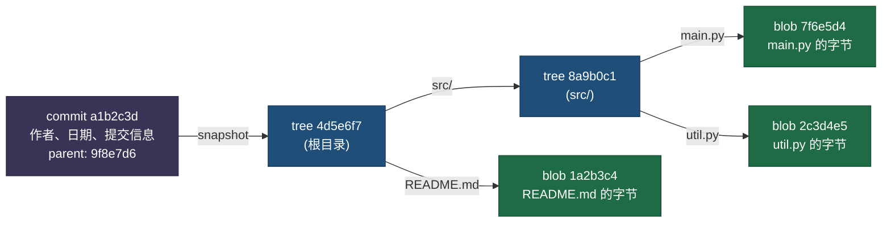
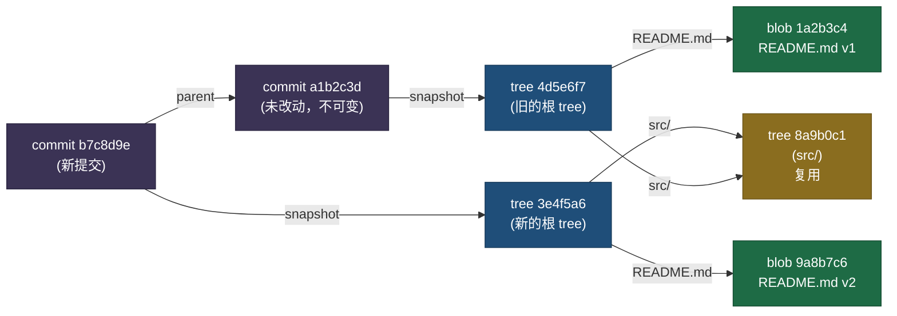

Last updated: 2026-07-27

Status: Active

Tags: [[Software Engineering]],[[Backend Development]]

# Git —— 版本控制系统

> 主要参考：[Pro Git](https://git-scm.com/book/zh/v2)。第 1–5 章几乎覆盖了熟练日常使用所需的全部内容。

Git 的命令行界面以反直觉著称。原因是历史性的：这些命令是围绕数据模型逐渐堆积出来的，而不是作为一套连贯的界面设计出来的。因此，掌握 Git 最快的路径与大多数教程的顺序相反——**先学数据模型，命令就会变成数据模型的自然推论**，而不是一堆需要死记硬背的条目。

## 目录

- [什么是 Git](#什么是-git)
- [Git 为何如此设计：数据模型](#git-为何如此设计数据模型)
- [环境配置](#环境配置)
- [日常工作流](#日常工作流)
- [分支与合并](#分支与合并)
- [远程仓库](#远程仓库)
- [进阶 Git](#进阶-git)
- [最佳实践](#最佳实践)
- [练习](#练习)
- [资源](#资源)

## 什么是 Git

### 版本控制，以及它带来了什么

版本控制系统（VCS）按时间顺序记录你对一组文件所做的全部修改，让你可以回退到任意历史版本、查看谁在什么时候改了什么，以及比较任意两个版本之间的差异。在真实的代码库上，它回答了三个原本无法回答的问题：

- **谁**改了这一行？
- 它是**什么时候**被改的？
- 它**为什么**被改？

由此带来的结果是：历史被保留而不是被覆盖；工作能在团队间同步；错误可以撤销；并行开发在分支上进行并安全地合并回来；变更在落地前可以被审查（Pull Request）。

### 版本控制的三代演进

只有对照 Git 之前的方案，它的设计才讲得通。

**本地版本控制（Local VCS）** —— 像 RCS 这样的早期工具，在本地磁盘上保存补丁集（patches）来重建文件的任意版本。单人单机可用，但无法协作。

**集中式版本控制（CVCS）** —— CVS、Subversion、Perforce。由单一中央服务器保存所有受版本控制的文件，客户端从中检出工作副本。这解决了协作与管理问题，但引入了单点故障：如果服务器磁盘损坏且没有备份，整个项目历史就全部丢失了。

**分布式版本控制（DVCS）** —— Git、Mercurial。客户端不是检出工作副本，而是**镜像整个仓库**，包含完整历史。每个克隆都是一份完整备份，因此任何一个客户端都能恢复一台报废的服务器。这也使得集中式系统无法表达的协作拓扑成为可能（多远程、分层维护者模型）。

### 定义 Git 的五个特性

**1. 快照，而非差异**

传统 VCS 是**基于差异（delta-based）**的：它们把数据看作一组文件，记录每个文件随时间发生的变化。Git 则把数据看作**一个微型文件系统的一系列快照（stream of snapshots）**。每次提交都会为每个文件的状态拍一张照，并存储指向该快照的引用。

为了避免存储冗余副本，未发生变化的文件不会被重复存储——Git 会存一个链接，指向它已经保存过的那份完全相同的文件。这就是为什么 Git 的行为更像一个小型的内容寻址文件系统，而不像传统的 VCS。

**2. 几乎所有操作都在本地完成**

浏览历史读取的是本地数据库，基本瞬间完成，不需要任何服务器往返。计算差异也在本地。而且你在离线状态下依然完整可用：在飞机上、火车上，或者 VPN 断开时，你仍然可以继续提交（提交到本地仓库），等到有网络时再推送。在 Perforce 下离线几乎什么都做不了；在 Subversion 和 CVS 下你可以编辑文件，但无法提交。

**3. 一切都有校验和**

所有内容在存储之前都会用 **SHA-1 哈希**计算校验和，并以该校验和作为引用。这个哈希是由文件内容或目录结构计算得出的 40 个十六进制字符：

```
24b9da6552252987aa493b52f8696cd6d3b00373
```

由此带来的结果是：**你无法在 Git 不知情的情况下改动任何文件或目录。** 传输过程中的信息丢失、磁盘上的数据损坏，都是可检测的。另外要注意，Git 的数据库是按内容哈希索引的，而不是按文件名。

**4. Git 通常只添加数据**

几乎所有操作都只是向数据库添加数据；很难让 Git 做出不可逆的事情，或者擦除数据。未提交的修改可能丢失，但一旦一个快照被提交，就极难丢失——尤其是在你定期推送到另一个仓库的情况下。

这正是 Git 可以放心实验的原因：你可以尝试一个激进的操作，因为知道旧的提交仍然在那里。

**5. 三种状态，三个区域**

Git 中的文件处于以下三种状态之一：

| 状态 | 含义 |
| --- | --- |
| **已修改（Modified）** | 在磁盘上被改动过，但尚未提交到数据库 |
| **已暂存（Staged）** | 已修改文件的当前版本被标记为要进入下一次提交的快照 |
| **已提交（Committed）** | 已安全地存储在本地数据库中 |

它们对应 Git 项目的三个区域：

| 区域 | 作用 |
| --- | --- |
| **工作目录（Working tree）** | 项目某个版本的一次检出——文件从数据库中取出放到磁盘上，供你使用和修改 |
| **暂存区（Staging area，技术名称为 *index*）** | Git 目录中的一个文件，保存下一次提交的内容 |
| **Git 目录（`.git`）** | 项目的元数据和对象数据库。克隆时复制的就是它 |

因此，Git 的基本工作流是：

1. 在工作目录中修改文件。
2. **选择性地暂存**你想放进下一次提交的那些改动。
3. 提交——暂存的快照被永久存入 Git 目录。


## Git 为何如此设计：数据模型

归根结底，每条 Git 命令做的只有两件事之一：**向数据库添加对象，或者移动引用。** 一旦你能看清这一点，这套界面就不再显得随意了。

### 对象：blob、tree、commit

Git 的存储模型有三种对象类型，最好把它们读作一个小小的递归数据结构：

```
blob   = array<byte>                    // 文件就是一串字节
tree   = map<string, tree | blob>       // 目录把名字映射到文件和子目录
commit = struct {
    parents:  array<commit>,
    author:   string,
    message:  string,
    snapshot: tree,                     // 被跟踪的顶层 tree
}
```

快照就是被跟踪的顶层 tree。具体来说，一个包含 `README.md` 和 `src/` 目录的项目，其中一个提交是这样的：



把箭头读作哈希引用，而不是包含关系。blob **只是字节**——它并不知道自己的文件名。`main.py` 这个名字存在于**边**上，也就是存在于指向该 blob 的 tree 里。这就是为什么重命名一个文件根本不会产生新的 blob，也是为什么同一个 blob 即使以五个不同的名字出现，Git 也只存一份。

现在只修改 `README.md` 并提交：



从这张图里可以推出三件事，它们合起来解释了 Git 的大部分行为：

- **产生了一个新 blob 和一个新的根 tree，但 `src/` 完全没有被碰过。** 整个 `src/` 子树——tree 对象和它下面两个 blob——都按哈希被复用了。这就是"每次提交都是完整快照"却几乎和存差异一样便宜的原因。
- **根 tree 是新的**，尽管它两个条目里只有一个变了，因为 tree 的哈希覆盖了它完整的"名字到哈希"映射。改动一个目录之下的任何东西，从它到根这条路径上的每个 tree 都会得到新哈希。其他的都不会。
- **提交 `a1b2c3d` 没有被修改。** 它也不可能被修改：它的哈希就是它的内容。改写历史是在旧提交旁边构建新提交，而旧提交会一直存活到垃圾回收——这就是 `git reflog` 能救回一次失败 rebase 的原因。

### 历史是一个 DAG

Git 用**有向无环图（DAG）**而非线性列表来建模历史。每个提交指向一组父提交：

- **一个父提交** —— 普通提交。
- **两个或更多父提交** —— 合并提交，连接了并行的开发线。
- **没有父提交** —— 根提交。

提交是**不可变的**。"编辑"历史从不修改某个提交，而是创建新提交并更新引用指向它们。旧提交会留在数据库里直到垃圾回收——这正是历史改写可恢复的原因。

### 内容寻址

所有对象都按其内容的 SHA-1 哈希存储：

```
objects = map<string, object>

store(object):  id = sha1(object); objects[id] = object
load(id):       return objects[id]
```

对象从不包含其他对象——它们通过哈希**引用**其他对象。commit 保存它的 tree 的哈希；tree 保存它的 blob 和子 tree 的哈希。因此内容相同就意味着哈希相同，在整个历史中的任何位置都只会被存储一次。

### 引用

哈希对人类不友好，所以 Git 维护了**引用（references）**：指向哈希的人类可读名字。

- 引用是*可变的*——`main` 只是一个随着你提交而向前移动的指针。
- **`HEAD`** 是一个特殊引用，含义是"我现在在哪里"。它通常指向一个分支，而该分支再指向一个提交；当它直接指向一个提交时，你就处于*分离 HEAD（detached HEAD）*状态。

一个仓库，完整地说，就是：**对象 + 引用。**

### 暂存区不属于数据模型

暂存区与上面所有内容是*正交*的——它属于**创建**提交的界面，不属于历史的存储方式。它的目的是让你选择进入下一个快照的内容，而不是强迫快照必须等于工作目录的当前完整状态。两个能体现其价值的场景：

- 工作目录里有两个互不相关的改动，而你想把它们变成两个独立的提交。
- 你想提交一个 bug 修复，但不带上你在定位问题时加的调试打印语句。

## 环境配置

### 配置的三个层级

`git config` 管理配置变量，分三个层级；**下层覆盖上层。**

| 层级 | 文件 | 作用范围 |
| --- | --- | --- |
| `--system` | `[path]/etc/gitconfig` | 机器上的每个用户（需管理员权限） |
| `--global` | `~/.gitconfig` 或 `~/.config/git/config` | 当前用户的所有仓库 |
| `--local` | `.git/config` | 仅当前仓库（默认） |

### 身份信息 —— 必须配置

每次提交都会不可变地嵌入这些信息，所以在第一次提交前就设置好：

```bash
git config --global user.name "Your Name"
git config --global user.email "your@email.com"
```

### 有用的可选配置

```bash
# 撰写提交信息使用的默认编辑器（Windows 需要写完整路径）
git config --global core.editor emacs

# 把初始分支命名为 main 而不是 master（Git 2.28+）
git config --global init.defaultBranch main
```

### 查看配置

```bash
git config --list                  # 当前生效的所有设置
git config --show-origin <key>     # 某个值来自哪个文件
git help <command>                 # 任意命令的文档
```

### 获取一个仓库

只有两种方式。

**在现有目录中初始化**

`git init` 会创建一个 `.git` 子目录，里面是仓库骨架。此时还没有任何文件被跟踪，需要显式添加并提交：

```bash
git init
git add *.c
git add LICENSE
git commit -m 'Initial project version'
```

**克隆一个已有仓库**

```bash
git clone https://github.com/libgit2/libgit2            # 克隆到 ./libgit2
git clone https://github.com/libgit2/libgit2 mylibgit   # 克隆到 ./mylibgit
```

注意 Git 用的词是 *clone*，而其他系统用的是 *checkout*，这个区别是实质性的：克隆会把**整个历史中每个文件的每个版本**都拉下来，而不是一份工作副本。如果服务器磁盘损坏，几乎任何一个客户端的克隆都可以用来恢复它。

支持多种传输协议：`https://`、`git://`，以及 SSH（`user@server:path/to/repo.git`）。

## 日常工作流

### 查看状态

工作目录中的每个文件要么**已跟踪（tracked）**，要么**未跟踪（untracked）**。已跟踪的文件进一步分为未修改、已修改、已暂存。

```bash
git status        # 完整状态
git status -s     # 简短格式（--short）
```

`git status` 是首要的诊断工具。刚克隆完它会报告 `nothing to commit, working tree clean`。否则它会把文件分组为 *Untracked files*、*Changes to be committed*（已暂存）和 *Changes not staged for commit*（已修改）。

简短格式用两列——**左列是暂存区，右列是工作目录**：

| 代码 | 含义 |
| --- | --- |
| `??` | 未跟踪 |
| `A` | 新添加到暂存区 |
| `M` | 已修改 |

### 跟踪与暂存

```bash
git add <file>     # 开始跟踪新文件，或暂存已修改的文件
git add .          # 暂存当前目录下的一切
git add -u         # 暂存已跟踪文件的更新（含删除）
git add -A         # . 与 -u 的组合
```

`git add` 是一个多用途命令——它既开始跟踪新文件，也暂存已修改的文件，还标记合并冲突已解决。应该建立的心智模型是**"把恰好这些内容添加到下一次提交中"**，而不是"把这个文件添加到项目里"。

容易让人踩坑的细节是：`git add` 记录的是文件**在那一刻的样子**。暂存之后再修改文件，就必须重新运行 `git add`，更新后的版本才会被包含进去。这也是为什么同一个文件可以同时出现在 *Changes to be committed* 和 *Changes not staged for commit* 之下——这不是 bug，而是暂存区之所以存在的那种细粒度控制。

### 查看差异

```bash
git diff                       # 工作目录 vs 暂存区 —— 尚未暂存的内容
git diff --staged              # 暂存区 vs 上次提交 —— 将会被提交的内容
git diff <commit1> <commit2>   # 两个快照之间
git difftool                   # 用图形化工具做同样的比较
```

单独的 `git diff` **不会**显示自上次提交以来的所有改动——只显示未暂存的那部分。这个意外要为相当一部分"不小心只提交了一半"负责。

### 忽略文件

创建 `.gitignore`，把日志、构建产物和临时文件挡在仓库之外。模式规则：

| 模式 | 行为 |
| --- | --- |
| 空行、`#注释` | 被忽略 |
| 标准 glob | 递归应用于整个工作树 |
| `/build` | 开头的斜杠阻止递归匹配 |
| `build/` | 结尾的斜杠匹配目录 |
| `!important.log` | 开头的 `!` 取反——重新跟踪该路径 |
| `doc/**/*.pdf` | `**` 匹配嵌套目录 |

GitHub 维护了一个很大的 `.gitignore` 模板集合，覆盖数十种语言和项目类型。

### 提交

```bash
git commit                  # 打开编辑器撰写提交信息
git commit -m "message"     # 内联提交信息
git commit -a -m "message"  # 自动暂存所有「已跟踪」文件后提交
```

提交记录的是**暂存区中的**快照；未暂存的内容仍以已修改状态留在工作目录里。提交后打印的摘要会给出分支、SHA-1，以及文件数与增删行数。

`-a` 完全跳过暂存这一步。它很方便，但可能把你还没审查过的改动一起卷进来——要有意识地用，而不是条件反射地用。

### 查看历史

```bash
git log                              # 按时间倒序列出提交
git log -p                           # 带上每次提交引入的补丁（--patch）
git log --stat                       # 带上每个文件的变更统计
git log --oneline                    # = --pretty=oneline --abbrev-commit
git log --graph                      # 分支/合并拓扑的 ASCII 图
git log --all --graph --decorate     # 可视化整个 DAG
git log --pretty=format:"%h - %an, %ar : %s"   # 自定义格式
```

而 `git log` 真正的威力在于过滤历史：

| 选项 | 筛选出 |
| --- | --- |
| `-<n>` | 仅最近 *n* 次提交 |
| `--since` / `--after`、`--until` / `--before` | 一个时间范围 |
| `--author` | 某位作者的提交 |
| `--grep` | *提交信息*匹配的提交 |
| `-S <string>` | **增加或删除**了该字符串的提交（"pickaxe"） |
| `-- path/to/file` | 仅涉及该路径的提交 |
| `--no-merges` | 隐藏合并提交 |

`--grep` 搜索的是提交信息，`-S` 搜索的是实际的代码变更。后者才是你用来定位某个函数何时被引入或删除的工具。

### 删除与移动文件

```bash
git rm <file>            # 从跟踪、暂存区和工作目录中移除
git rm --cached <file>    # 取消跟踪，但「保留」磁盘上的文件
git rm log/\*.log         # 支持 glob 模式
git mv file_from file_to  # 重命名
```

`git rm --cached` 正是"提交了本该被 `.gitignore` 挡掉的东西"的补救办法。

`git mv` 纯粹是便利封装——它就等于 `mv` + `git rm` + `git add`。Git 根本不存储重命名元数据；它是通过比较内容在事后**推断**出重命名的，这一点直接来自内容寻址模型。

### 撤销操作

```bash
# 用当前暂存区重做上一次提交
git commit --amend

# 取消暂存某个文件，保留其改动
git reset HEAD <file>
git restore --staged <file>       # Git 2.23+

# 丢弃工作目录中的改动 —— 破坏性操作
git checkout -- <file>
git restore <file>                # Git 2.23+

# 通过新建一个反向提交来撤销 —— 对已共享的历史是安全的
git revert <commit>

# 移动分支指针并丢弃其后的一切 —— 破坏性操作
git reset --hard <commit>
git reset --hard origin/main
```

这里有两件事需要真正内化。

`git commit --amend` 是**替换**上一个提交，而不是给它打补丁——旧提交被弃用，一个带有新 SHA 的新提交取代了它。用它来补一个漏掉的文件或修一条糟糕的提交信息，并且**只用在你还没推送的提交上**。

`git restore <file>` / `git checkout -- <file>` 会永久丢弃本地修改；这些修改在任何地方都没有副本。总的原则是：**提交给 Git 的东西几乎总能恢复，而从未提交过的东西很可能就永远没了。**

## 分支与合并

分支不过是指向提交 DAG 的一个可移动引用，这就是 Git 中分支为何如此廉价、也为何被如此随意地使用的原因。

```bash
# 管理分支
git branch                    # 列出
git branch <name>             # 创建（不切换）
git branch -D <name>          # 删除

# 切换
git switch <name>             # 切换（现代、语义明确）
git checkout <branch>         # 切换（旧的、职责过载的方式）
git checkout -b <name>        # 创建并切换
git checkout <revision>       # 把 HEAD 移到任意提交（分离 HEAD）

# 集成
git merge <revision>          # 合并进当前分支
git mergetool                 # 用图形化工具解决冲突
git rebase <branch>           # 把本分支的提交重放到新基底上
```

**merge 与 rebase 的取舍**才是真正重要的决定。`merge` 创建一个有两个父提交的提交，精确保留了实际发生的事情，包括"开发是并行的"这个事实。`rebase` 把你的提交重写到一个新基底上，产生读起来更干净的线性历史，但它不再反映事件的真实顺序——而且因为它创建的是新提交，所以绝不能对已经推送到共享分支的东西做。

`git switch` 和 `git restore`（Git 2.23+）之所以存在，是因为 `git checkout` 在做两件互不相关的事——移动 `HEAD`，以及覆写工作目录里的文件。优先用这对较新的命令；`checkout` 的这种含混确实是事故的来源。

## 远程仓库

```bash
# 管理远程
git remote                                    # 列出
git remote add origin <url>                   # 添加

# 获取
git fetch                                     # 下载对象和引用 —— 不改动任何本地内容
git pull                                      # = git fetch; git merge

# 发布
git push
git push -u origin <branch>                   # 设置上游，然后推送
git push <remote> <local branch>:<remote branch>
git branch --set-upstream-to=<remote>/<branch>
```

`fetch` 和 `pull` 的区别值得你有意识地对待：`fetch` 只更新你的远程跟踪引用，不动你的分支和工作目录，所以它永远是安全的。`pull` 则是 `fetch` 之后紧跟一次合并进当前分支。先 fetch、看清拉下来了什么、再决定如何集成——这个习惯能避免意外产生的合并提交。

## 进阶 Git

### 交互式暂存

```bash
git add -p        # 在一个文件内逐块（hunk）暂存
```

用来把一个文件的改动拆进不同提交——新功能进一个，格式修复进另一个。这是让提交保持原子性的主要工具。

### 改写历史

```bash
git rebase -i <base>     # 重排、编辑、压缩、拆分或丢弃提交
```

交互式 rebase 会打开编辑器，列出将被重放的提交；把 `pick` 改成 `edit`、`squash` 或 `drop`，或者干脆重排这些行，就能重构它们。**只适用于尚未推送到共享分支的提交。** 在任何 rebase 或 hard reset 之前，`git branch temp` 不花任何成本，却给了你一个可以回来的引用。

### 贮藏（stash）

```bash
git stash          # 保存工作目录改动，并回到干净状态
git stash list     # 查看栈
git stash apply    # 重新应用最近的 stash，并保留在栈上
git stash pop      # 重新应用并从栈上移除
```

### 排查问题

```bash
git blame <file>   # 每一行最后被谁改的，以及在哪个提交里
git bisect         # 二分查找引入回归的那个提交
```

`git bisect` 是大多数人从未学过、但杠杆率最高的命令。给定一个已知正常和一个已知有问题的提交，它用 log₂(n) 次检出就能找到罪魁祸首——一千个提交大约只需 10 步。

### 其他

```bash
git cherry-pick <commit>   # 把某一个特定提交应用到当前分支
git worktree add <path>    # 同时检出多个分支
git clone --depth=1 <url>  # 浅克隆，不带完整历史
```

`git worktree` 是"我需要看另一个分支，但不想 stash"的干净答案：第二个工作目录，共用同一个对象数据库，历史不会被复制一份。

### 别名

```bash
git config --global alias.graph "log --all --graph --decorate --oneline"
git config --global alias.st "status"
git config --global alias.co "checkout"
```

## 最佳实践

### 提交信息

- 用祈使句、现在时——写 "Add feature"，不要写 "Added feature"。
- 标题行控制在 50 个字符以内。
- 任何不显而易见的改动，都用正文段落解释*为什么*；diff 已经说明了*是什么*。

### 提交

- 尽早、频繁地提交；让每个提交聚焦于一个逻辑改动。
- 提交前用 `git diff --staged` 审查一遍。
- 绝不改写已经推送到共享分支的历史。
- 破坏性操作之前先 `git branch temp` 做备份。

### 协作

- 在分支上开发，不要直接在共享主干上开发。
- push 之前先 `fetch`，并让长期分支保持 rebase 或 merge 到最新，以把冲突控制在小范围。
- 用 Pull Request 做代码审查。
- 推送到共享分支前先测试，破坏性变更要显式通知。

## 练习

1. 初始化一个本地仓库，完整走一遍 status → add → commit → log 的循环。
2. 用 `git log --all --graph --decorate`、`--grep` 和 `-S` 探索一个大型开源仓库的历史。
3. 故意在两个分支上制造冲突改动，然后解决这次合并。
4. 对同一个冲突改用 `rebase` 而非 `merge`，比较两者产生的历史。
5. 用 `git add -p` 把一个混乱的工作目录拆成三个干净的提交。
6. 用 `git bisect` 找出一个故意引入的回归。
7. 配置一个全局 `.gitignore`，以及一组你真的会用的别名。
8. 向一个开源项目提交 Pull Request。

## 资源

- [Pro Git](https://git-scm.com/book/zh/v2) —— 官方书籍。第 1–5 章覆盖了熟练使用所需的大部分内容；后面的章节是进阶材料。
- [Git for Computer Scientists](https://eagain.net/articles/git-for-computer-scientists/) —— 对数据模型的简洁解释，图多。
- [Git from the Bottom Up](https://jwiegley.github.io/git-from-the-bottom-up/) —— 超出数据模型的实现细节。
- [Learn Git Branching](https://learngitbranching.js.org/) —— 浏览器中的交互式游戏；建立分支与 rebase 直觉最快的方式。
- [Oh Shit, Git!?!](https://ohshitgit.com/) —— 从常见错误中恢复的简短食谱。
- [How to explain git in simple words](https://smusamashah.github.io/blog/2017/10/14/explain-git-in-simple-words) —— 用平实语言写的入门。
- [git-scm.com](https://git-scm.com) —— 官方站点与参考文档。

**代码托管与相关系统：** [GitHub](https://github.com) · [GitLab](https://about.gitlab.com) · [Subversion](https://subversion.apache.org)（集中式，用作对照）
