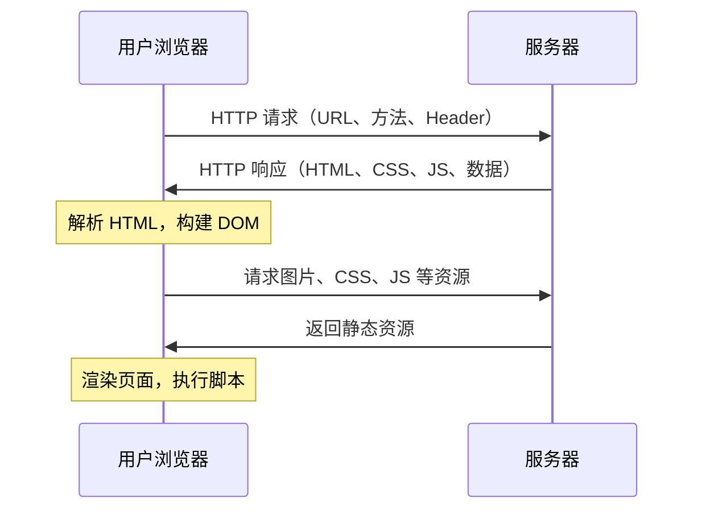
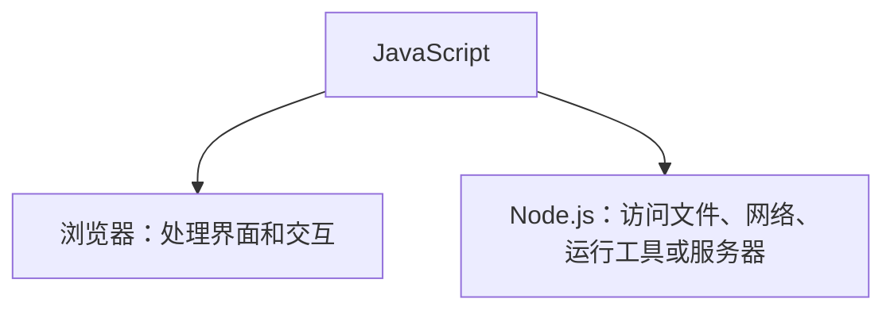
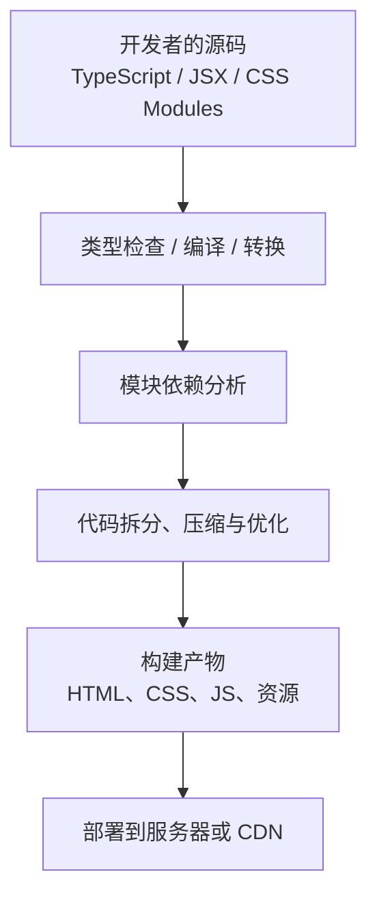
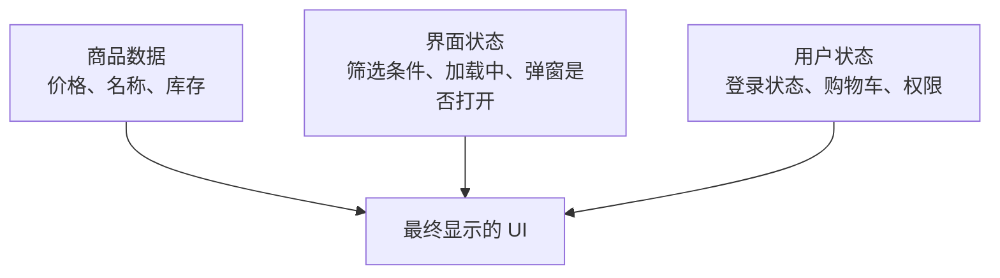
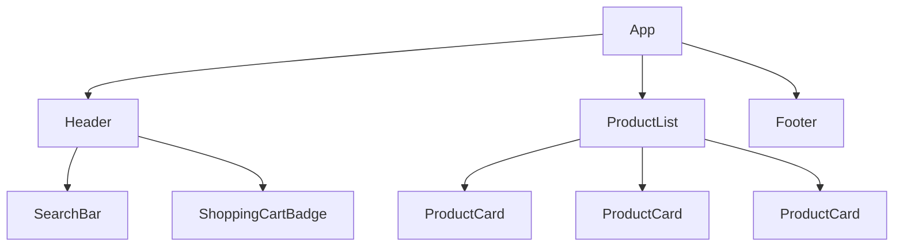
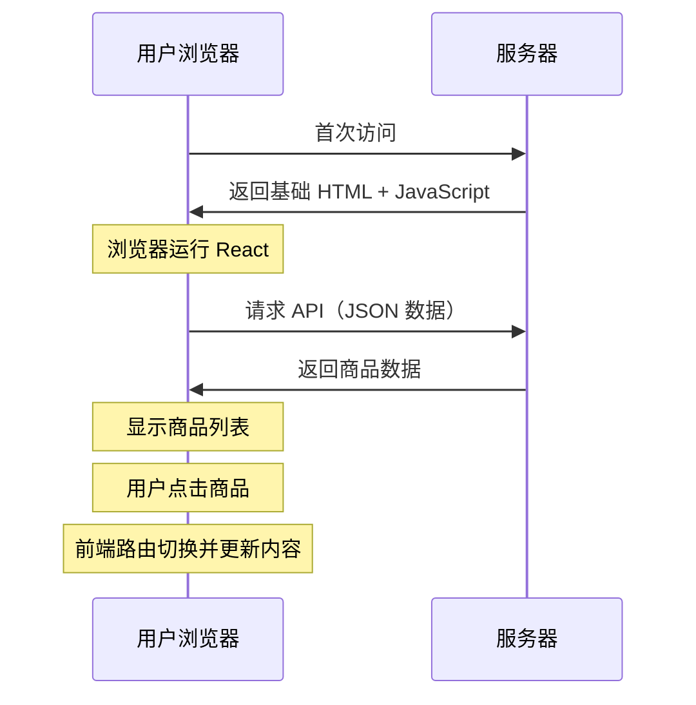
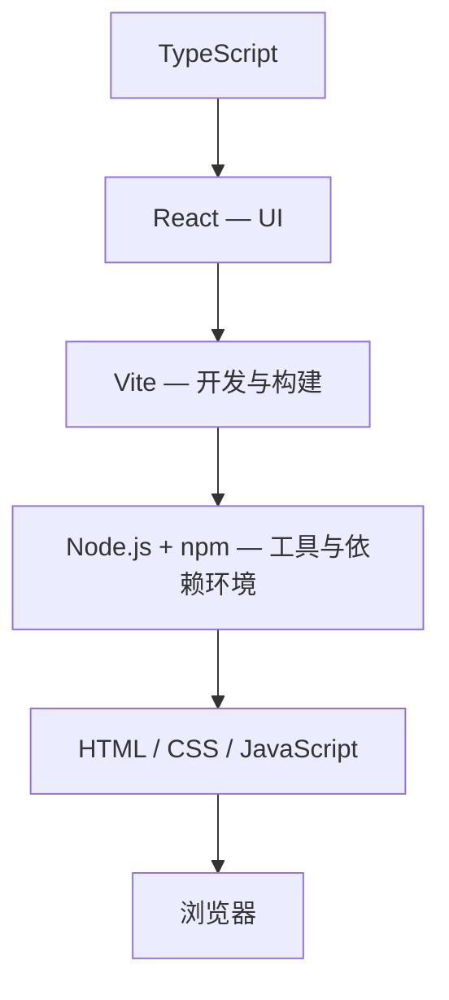
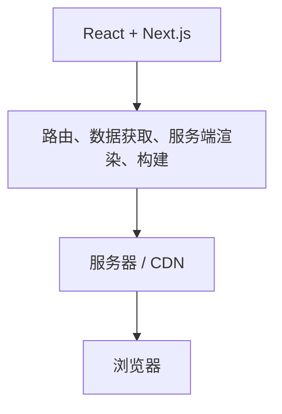
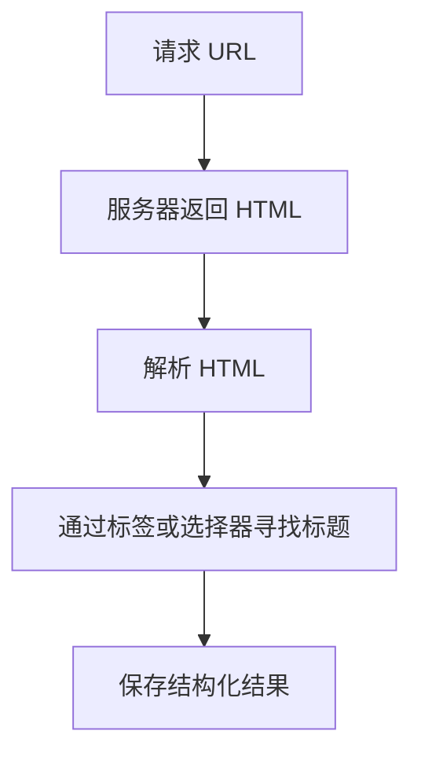

# 前端二十年：从 HTML 网页到现代 Web 应用，浏览器里究竟发生了什么？

Last updated: 2026-10-18

今天，只需要安装 Node.js，运行几条命令，几分钟就可以启动一个 React 网站。再借助 AI，甚至不需要掌握太多前端知识，就能生成一套看起来相当专业的界面。

但如果仔细看看现代前端项目，会发现一个奇怪的现象：明明只是要在浏览器里显示一些文字、图片和按钮，却需要安装 Node.js、npm、Vite、React，有时还要用 Next.js、TypeScript，最后还要经过复杂的构建和部署流程。

**为什么前端从写几个 HTML 文件，发展成了今天这样一套庞大的软件工程体系？**

理解这个问题，最好的方法不是逐个学习框架，而是回到前端技术发展的历史：浏览器最初是用来展示文档的，后来变成了可以运行复杂应用程序的计算平台。这篇文章就从这个变化说起。

如果你刚开始接触前端，看到上面这一串名词（Node.js、npm、Vite、React、Next.js、TypeScript）觉得有点慌，完全正常。这篇文章的目的不是要你立刻学会它们，而是帮你建立一张大致的地图：它们各自负责什么、为什么会出现。读完之后，你不需要记住每一个细节，只要在后面的章节再听到这些名字时，心里有数就行。

## 一、什么是前端？什么是后端？

### 1. 网站本质上是两台计算机的协作

理解前端，先要建立一个基础认知：**访问一个网站，本质上是两台计算机在协作。** 一台在你面前，一台在远端的数据中心里。

你平时打开一个电商平台，背后发生的事情大致如下：



浏览器运行在用户自己的电脑或手机上，服务器则运行在远端的计算机上，两者通过 HTTP/HTTPS 协议通信。

所谓前端（Frontend），主要负责用户直接接触的这一侧；后端（Backend），主要负责服务器上的业务逻辑、数据与系统能力。

例如，一个用户在电商网站上购买商品：

| 环节 | 前端负责什么 | 后端负责什么 |
|---|---|---|
| 浏览商品 | 展示图片、价格、商品列表 | 查询商品与库存数据 |
| 搜索 | 输入框、筛选器、结果展示 | 搜索、排序、推荐 |
| 加入购物车 | 更新界面、反馈操作结果 | 保存购物车数据 |
| 支付 | 展示订单、收集支付信息 | 校验订单、处理支付、更新状态 |
| 用户登录 | 登录表单和交互 | 身份认证、权限校验、会话管理 |

注意：**前端显示什么，并不意味着它能够决定什么。**

例如，前端可以把一件商品的价格显示为 1 元，但服务器不能因此相信商品真的只值 1 元。

浏览器运行在用户设备上，用户可以修改其中的 JavaScript、请求和页面内容。因此，价格、权限、支付金额等关键规则必须由可信的服务端校验。

### 2. 前后端程序员的挑战有什么不同？

很多初学者认为，前端负责做漂亮页面，后端负责写复杂逻辑。这种理解过于简单。

现代前端工程师面对的，是一个非常特殊的运行环境：浏览器。

首先，不同用户的设备、浏览器和屏幕尺寸各不相同。程序需要兼容手机、平板、电脑，还要照顾触屏、键盘、无障碍阅读等交互方式。

其次，前端是一个高度异步的系统。用户可能在网络请求还没有返回时就关闭页面、重复点击按钮、切换账号或跳到其他页面。前端必须让界面始终保持一致。

另外，浏览器的计算资源相对有限。代码加载太慢、JavaScript 执行时间太长、页面重绘过多，都会直接影响用户体验。

后端则往往更关心数据与系统层面的复杂性，例如高并发、数据库事务、数据一致性、权限控制、容错、服务扩容和安全。

可以概括为：

- **前端的主要挑战：** 如何在不稳定且多样的客户端环境中，持续提供正确、快速、易用的交互。
- **后端的主要挑战：** 如何在大量并发请求和复杂业务约束下，可靠、安全、一致地处理数据与业务。

当然，这不是严格边界。前端也有复杂的计算和业务逻辑，后端也会负责页面渲染。随着现代全栈框架出现，两者的技术边界还在不断变化。

到这里你理解了前后端各自的职责。下面来看这套体系是怎么从零建立起来的。

## 二、1990—2010：从电子文档到交互式网页

### 1. HTML：互联网最初只是一个由超链接连接的文档系统

万维网诞生于 1990 年前后，但它最初的定位不是运行应用程序，而是阅读和链接文档。这个起点决定了接下来三十年前端技术演化的基本逻辑。

HTML（HyperText Markup Language，超文本标记语言）就是描述这些文档的语言：

```html
<h1>我的第一篇博客</h1>
<p>欢迎来到我的网站。</p>
<a href="/about.html">关于我</a>
```

这段代码表达了三个意思：这里有一个一级标题、一个段落、一个指向其他页面的链接。

HTML 的核心不是编程，而是**描述内容的结构与语义**。

浏览器读取 HTML 后，把它解析成一个树状结构，称为 DOM（Document Object Model，文档对象模型）——可以把它想象成一棵树，每片"叶子"代表一个页面元素，比如标题、段落、图片或按钮。后来的 JavaScript 就可以通过 DOM 操纵网页。理解 DOM 是学习前端的基础，因为这是浏览器暴露给 JavaScript 的核心接口。

### 2. CSS：内容和表现开始分离

早期的 HTML 页面可以包含一些样式信息，但把所有排版细节都放在 HTML 中，很难维护。1996 年，CSS（Cascading Style Sheets，层叠样式表）成为 Web 标准的重要组成部分，让开发者能够把内容结构和视觉表现分开：

```css
h1 {
  color: orange;
  font-size: 32px;
}

p {
  line-height: 1.8;
}
```

HTML 负责表达"这是什么"，CSS 负责表达"它看起来怎么样"。

CSS 后来又发展出了 Flexbox、Grid、响应式布局、动画等能力，逐渐成为一套复杂的声明式布局系统。其中"层叠"（Cascade）非常重要：CSS 不是简单地逐行执行样式，而是根据来源、优先级、选择器、继承关系等规则计算元素的最终样式。这也是为什么前端初学者经常遇到"明明写了 CSS，却没有生效"的问题。

### 3. JavaScript：网页第一次拥有了行为

1995 年，JavaScript 诞生。最初，它主要用来给网页增加一些简单交互，例如表单验证、按钮点击和图片切换：

```html
<button onclick="alert('Hello!')">
  点击我
</button>
```

这意味着网页不再只是静态文档，而是能够响应用户操作。HTML、CSS 和 JavaScript 从此构成前端的三个基本支柱：

| 技术 | 职责 | 类比 |
|---|---|---|
| HTML | 内容和结构 | 建筑的结构 |
| CSS | 样式和布局 | 装修和外观 |
| JavaScript | 行为和逻辑 | 控制系统 |

不过，JavaScript 的真正潜力最初还没有被充分发挥。很长时间内，网站的大部分页面仍然由服务器生成。用户点击一个链接，浏览器便向服务器重新请求一个完整的新页面。早期的 PHP、ASP、JSP 网站都常采用这种模式。

### 4. 2005 年前后：AJAX 改变了网页的交互方式

一个重要转折发生在 2000 年代中期。AJAX（Asynchronous JavaScript and XML）让浏览器可以在不刷新整个页面的情况下，向服务器请求数据并更新部分内容。

例如，用户在搜索框输入一个字，网页就能立刻显示相关搜索建议，而不用重新加载整页。Google Maps、Gmail 等应用让人们逐渐意识到：**网站不一定要像一本需要不断翻页的书，也可以像一个持续运行的软件。**

AJAX 是一种技术模式，而不只是某个库。虽然名字里有 XML，但后来 JSON 成为了更加常见的数据交换格式。

同一时期，jQuery（2006 年）等库广泛流行，解决了早期浏览器兼容性差、DOM 操作繁琐、AJAX 编程不统一等问题：

```javascript
// 使用 jQuery 修改页面
$("#title").text("新的标题");
```

这一时期，前端主要是在已有 HTML 页面上不断增加动态行为。但新的问题也开始出现：页面越复杂，需要手动控制的 DOM、事件和状态越多，代码逐渐变得难以维护。

到这里，网页已经从静态文档变成了可以响应交互的动态界面。下面来看，当网页开始承担更大的工程复杂度时，前端是如何演化出一套完整的软件工程体系的。

## 三、2010—2020：为什么前端变成了一门软件工程？

2010 年后的前端发展，可以用一句话概括：**当网页变成大型软件，开发网页的方式就必须从编写页面升级为构建软件系统。**

这场变化同时推动了 JavaScript 语言、工程工具和 UI 框架的发展。接下来出现了很多新名词——你不需要现在就全部记住，先建立一个"这些东西是用来解决什么问题的"的印象就够了。

### 1. JavaScript 语言本身的现代化：ES6

你可能会看到 ES、ES5、ES6、ES2015 等术语，觉得有点乱。这里的 ES 指的是 ECMAScript，它是 JavaScript 的核心语言标准——可以理解为 JavaScript 的"规范书"，浏览器和 Node.js 按照这个规范来实现 JavaScript 引擎。

2015 年发布的 ECMAScript 2015（通常称为 ES6）是 JavaScript 历史上的一次重大升级。它引入或标准化了一批现代开发者非常熟悉的特性：

- `let`、`const`：块级作用域变量声明
- 箭头函数：`(x) => x * 2`
- 模板字符串：`` `Hello ${name}` ``
- Class：更方便地表达基于原型的对象结构
- Promise：规范异步操作
- 解构赋值
- 标准化模块语法：`import` 和 `export`

```javascript
// 较早的写法
var double = function(x) {
  return x * 2;
};

// ES6 写法
const double = (x) => x * 2;
```

ES6 的意义不只是让语法简洁了一点。更重要的是，JavaScript 开始具备支撑大型工程所需要的一系列标准化能力。

但新标准出现后，旧浏览器未必支持。开发者希望使用新语法，却仍然需要让旧环境能够执行程序。Babel 等转译工具因此成为前端工程化的重要组成部分——它们可以把较新的 JavaScript 语法转换为目标运行环境能够理解的形式。需要注意，转译语法与补齐缺失的运行时 API 是两回事：后者有时还需要 Polyfill。

### 2. CommonJS 和 ES Modules：为什么需要 import/export？

早期 JavaScript 程序只有几百行代码，把逻辑都放在一个文件中还可以接受。但当一个应用拥有几千个文件和大量开发者时，就必须解决模块化问题。

模块化的核心思想是：每个文件或模块负责相对独立的功能，通过明确的接口向其他模块提供能力。

在 ECMAScript 模块标准广泛使用之前，Node.js 生态大量采用 CommonJS：

```javascript
// math.js
const add = (a, b) => a + b;
module.exports = { add };

// app.js
const { add } = require("./math");
```

ES6 则标准化了 ES Modules（ESM）：

```javascript
// math.js
export const add = (a, b) => a + b;

// app.js
import { add } from "./math.js";
```

两者的思想相似，但机制并不完全相同：

| 维度 | CommonJS | ES Modules |
|---|---|---|
| 典型语法 | `require`、`module.exports` | `import`、`export` |
| 主要来源 | Node.js 早期生态 | ECMAScript 标准 |
| 模块依赖分析 | 更偏向运行时加载 | 静态 import 可在执行前分析 |
| 现代浏览器原生支持 | 通常不直接支持 | 支持 |
| 典型用途 | 老项目、部分 Node.js 包 | 现代前后端 JavaScript |

ESM 的静态依赖结构，有利于工具分析模块之间的关系，从而进行 Tree Shaking（摇树优化）——简单说就是"去掉最终程序中没有被用到的代码"，让打包产物更小。

这里有一个容易混淆的点：**ES6 是 JavaScript 的一个标准版本，ESM 是一种模块系统，CommonJS 则是另一套模块规范。它们不是三个相互竞争的框架。**

另外，ESM 也支持通过 `import()` 动态加载模块。今天的 Node.js 同时支持 ESM 和 CommonJS，但两者并不是在所有情况下都能直接互换。文件扩展名、`package.json` 中的 `type`、加载机制和互操作规则都可能影响实际行为。

### 3. Node.js：JavaScript 第一次大规模走出浏览器

2009 年，Node.js 出现。它最重要的意义是：让 JavaScript 可以在浏览器之外运行。



Node.js 基于 V8 JavaScript 引擎，并提供文件系统、网络通信、进程管理等运行能力。于是 JavaScript 不仅能写网页，也能写服务器，以及支撑前端开发流程的各种工具。

例如，开发者可以通过 Node.js 编写一个工具，自动完成：

1. 读取上百个源代码文件
2. 检查语法错误
3. 编译 TypeScript 和新语法
4. 处理 CSS 和图片
5. 压缩代码
6. 输出可以部署到服务器的最终文件

前端从此拥有了完整的自动化工程工具链。

注意，**Node.js 不是前端框架，也不是浏览器的一部分。** 一个用 Vite 构建的普通前端项目，开发和构建时可能需要 Node.js，但构建后的静态页面并不一定需要 Node.js 服务器才能运行。反过来，Next.js 等框架的一些服务端渲染功能则确实需要相应的服务端运行环境。

### 4. npm：软件不再需要全部从头编写

如果说 Node.js 让 JavaScript 可以运行在服务器上，那么 npm 则让 JavaScript 的软件复用变得系统化。npm 主要包括软件包仓库、命令行工具和相关网站服务。

```bash
npm install react
```

这条命令会安装 React，以及需要的相关依赖。一个现代项目通常包含：

```text
my-project/
├── package.json
├── package-lock.json
├── node_modules/
├── src/
│   └── main.jsx
└── index.html
```

- `package.json` 描述项目的依赖、脚本和元信息
- `package-lock.json` 记录 npm 解析后的具体依赖版本信息，帮助实现可重复安装
- `node_modules` 通常存放安装好的软件包
- `src` 存放开发者编写的源代码

npm 真正改变的，是软件开发的经济性。以前需要自己实现日期处理、表单验证、图表组件、路由等功能，现在可以直接复用成熟的开源包。但代价是依赖管理、安全漏洞、版本冲突、供应链风险和复杂的构建流程。这也是为什么现代前端项目经常会看到成百上千个间接依赖，即使开发者自己只安装了几个包。

### 5. Webpack 到 Vite：为什么前端需要构建工具？

既然浏览器能够运行 JavaScript，为什么还需要 Webpack、Vite 这样的构建工具？

原因是：**开发者最方便编写的代码，不一定是最适合浏览器直接加载的代码。** 一个现代项目可能包含 TypeScript、JSX、CSS Modules、图片资源以及大量第三方依赖。浏览器未必能够直接运行全部源文件，生产环境也不适合加载成千上万个零散文件。

因此，需要一个从源码到可部署产物的转换流程：



Webpack 于 2012 年出现，此后成为大型前端工程的代表性打包工具，把复杂的模块依赖图转换为浏览器能够高效加载的资源。但随着项目越来越大，开发服务器启动和重新构建可能变慢。

Vite 于 2020 年前后兴起，最初的一个重要创新是利用浏览器原生的 ES Modules，在开发期间按需提供源码模块，而不是每次启动都提前打包整个项目：

```bash
npm create vite@latest my-app
cd my-app
npm install
npm run dev
```

这里的 `npm run dev` 会执行项目定义的开发脚本，通常启动 Vite 开发服务器。编辑文件后，Vite 可以利用 HMR（Hot Module Replacement，热模块替换——也就是在不刷新整个网页的前提下，只替换你改动的那一块代码）快速更新受影响的部分。生产构建则仍然需要考虑压缩、代码拆分、缓存和资源优化。

需要理解的是，这几层工具各司其职：

- Node.js 是 JavaScript 运行环境
- npm 是包管理及软件分发生态
- Vite 是开发与构建工具
- React 是构建 UI 的库

它们属于不同层次，并不存在谁替代谁的问题。

到这里你理解了工程化为什么存在——它解决了"如何组织和交付代码"的问题。下面来看另一个同样重要的问题：如何持续管理一个规模越来越大的用户界面？

## 四、组件化：React、Vue、Angular 真正解决了什么？

组件化主要解决一个问题：**如何持续管理一个规模越来越大、交互越来越复杂的用户界面？**

### 1. 从手动操作 DOM 到数据驱动 UI

假设我们要制作一个简单计数器，初始显示 0，点击按钮后数字加一。使用传统 JavaScript，可以这样写：

```javascript
let count = 0;

document.querySelector("button").onclick = () => {
  count++;
  document.querySelector("#count").textContent = count;
};
```

代码很简单，但它隐含了两个独立对象：数据状态（`count`）和页面状态（DOM 中显示的数字）。开发者需要负责让它们保持同步。

当一个页面包含成百上千个控件、多个数据来源以及复杂交互时，这种手动同步会变得很困难。例如，购物车商品数量变化后，可能需要同时更新顶部角标、商品金额、优惠提示、结算按钮和库存信息。如果每次都手动修改 DOM，很容易漏掉某个地方。

React、Vue 等现代框架的重要思想，就是把这个过程反过来：**不要告诉浏览器每一步应该如何修改页面，而是描述在某个数据状态下，页面应该是什么样子。**

用 React 可以写成：

```jsx
import { useState } from "react";

export default function Counter() {
  const [count, setCount] = useState(0);

  return (
    <button onClick={() => setCount(c => c + 1)}>
      当前计数：{count}
    </button>
  );
}
```

这段代码只描述了两件事：存在一个名为 `count` 的状态；按钮应该显示当前状态，并在点击后更新它。至于具体怎样更新 DOM，则由 React 负责。

可以用一个抽象公式表达：**UI = f(State)**，UI 是状态的函数。这一思想属于声明式编程，它把开发者的主要任务从"操作界面"转变成了"定义界面与状态之间的关系"。

### 2. 状态驱动 UI 与数据驱动 UI 有什么区别？

这两个概念经常混用，但可以做一个有用的区分。

数据驱动 UI 更强调：页面内容由数据决定。例如，把服务器返回的商品数组映射成一个商品列表。

状态驱动 UI 则进一步强调：除了业务数据，整个界面还受到交互状态影响：



商品数据本身没有变，用户只要切换筛选条件，页面也会改变。从广义上讲，数据也可以视为状态的一部分，因此二者并不是严格对立的概念。

这种架构的难点，随即转向了状态管理：

- 哪些状态属于单个组件？
- 哪些状态需要多个组件共享？
- 哪些状态来自服务器？
- 如何处理异步请求产生的竞态条件？
- 如何避免无意义的重复渲染？
- 如何保证刷新页面后状态一致？

所以现代前端工程师面对的难题，往往已经不是如何画出一个按钮，而是如何维护复杂应用的状态模型。

### 3. 什么是组件？

组件（Component）是可以复用、组合和独立维护的 UI 单元。例如一个电商页面，可以组织成：



每个 `ProductCard` 都可以接收不同商品数据，但复用相同的界面逻辑。与过去复制粘贴 HTML 的方式相比，组件化更有利于统一样式、控制复杂度、测试和团队协作。

但组件并不是越小越好。如何划分组件边界、如何设计公共接口、如何处理组件之间的数据传递，本身就是软件设计问题。

### 4. React、Vue、Angular 有什么区别？

2010 年代出现了几套重要的前端技术体系：

| 技术 | 发展节点 | 核心特点 |
|---|---|---|
| AngularJS / Angular | 2010 / 2016 | 更完整、约束更强的应用框架体系 |
| React | 2013 | 强调组件化、声明式 UI、状态驱动 |
| Vue | 2014 | 渐进式设计、模板语法、响应式状态系统 |

React 更准确地说是一个 UI 库，通常需要搭配其他方案完成路由、数据加载和服务端渲染等工作。Vue 提供了响应式、模板和组件体系，并可与 Vue Router、Pinia、Nuxt 等工具组合。Angular 则更偏向提供较完整的应用架构，包括依赖注入、路由、表单等能力。

它们都在解决复杂 UI 管理的问题，但对开发体验、架构组织和状态更新机制做出了不同选择。历史上，React 的 Virtual DOM、Vue 的响应式依赖追踪，以及 Angular 的变化检测，分别代表了不同的实现思路。

不要把 Virtual DOM 理解成前端框架的必要条件。它是 React 等技术采用过的一种 UI 更新机制，而不是声明式 UI 唯一的实现方法。今天，Svelte、Solid 等框架还在探索通过编译器、细粒度响应式等方式减少更新开销。

这些概念现在记不住没关系，先有个印象就好——后面的 React/Vue 章节会带你动手实践，到时候再回过头来，这里的很多名词就会豁然开朗。

到这里你理解了组件化如何管理复杂界面。下面来看故事里一个有意思的反转：前端后来又回到了服务器。

## 五、Next.js：为什么前端后来又回到了服务器？

到这里，故事出现了一个有意思的反转。

2000 年代，网站主要由服务器生成 HTML。2010 年代，React 等框架让越来越多的页面逻辑转移到了浏览器。而 2020 年代，现代 Web 框架又开始强调在服务器上渲染页面。为什么？

### 1. SPA：像桌面软件一样运行的网站

React、Vue 等技术推动了单页应用（Single Page Application，SPA）的流行。传统多页网站中，点击链接通常需要请求一个新的 HTML 页面。SPA 则经常只在首次加载时获取一个基础 HTML 页面，随后通过 JavaScript 控制界面变化，并从服务器请求 JSON 等数据：



这种方式能够提供流畅的交互体验，但也有几个问题。

首先，首次加载可能需要下载、解析和执行较多 JavaScript，用户才能看到完整内容并进行交互。

其次，单纯依赖浏览器 JavaScript 生成内容，对部分搜索引擎或爬虫不够友好。

第三，某些数据本来只需要在服务器端查询一次，却变成了浏览器先下载程序、再发送额外请求。

这让开发者重新思考：是不是所有 UI 都应该交给浏览器生成？

### 2. CSR、SSR、SSG 到底有什么区别？

这里需要认识三个重要概念。先看一眼表格，建立印象就好——这些概念现在记不住没关系，后面的章节会动手实践，到时候自然就清楚了。

| 模式 | 全称 | HTML 主要什么时候生成 | 典型场景 |
|---|---|---|---|
| CSR | Client-Side Rendering | 浏览器运行 JS 时 | 强交互后台、纯客户端应用 |
| SSR | Server-Side Rendering | 服务端处理请求时 | 个性化、动态内容页面 |
| SSG | Static Site Generation | 构建时预先生成 | 博客、文档、内容网站 |

例如，一篇内容长期不变的博客文章，没有必要每次访问都重新运行服务器逻辑生成，可以在构建时生成 HTML，然后直接从 CDN 分发。但如果是一个高度个性化的用户首页，服务器可能需要根据当前用户信息动态生成内容。如果是一个复杂数据分析平台，大量交互可能仍然适合放在客户端完成。

这些渲染方式并非互斥。一套网站完全可以在不同页面、甚至同一个页面的不同区域使用不同策略。

### 3. Next.js 解决了哪些问题？

Next.js 于 2016 年发布，是基于 React 的 Web 应用框架。它补充了单独使用 React 构建完整网站时还需要处理的很多问题。

**第一，路由（Routing）。** 路由决定不同 URL 对应什么页面：

```text
/              → 首页
/blog          → 博客列表
/blog/hello    → 博客文章
/products/123  → 商品详情
```

在 Next.js 的 App Router 中，可以通过文件夹和特殊文件约定组织路由，例如 `app/blog/page.tsx`。

**第二，预渲染（Prerendering）和服务端渲染。** 开发者不必把全部 HTML 生成工作都交给浏览器。Next.js 可以在构建阶段预先生成内容，也可以在请求到来时生成动态内容。新的 Server Components、Streaming 和部分预渲染等机制，让服务器与浏览器之间的任务划分更灵活。

**第三，SEO（Search Engine Optimization）。** 搜索引擎需要发现、抓取、理解和索引网页内容。如果页面的关键内容直接存在于服务端返回的 HTML 中，通常更容易被不同类型的爬虫处理。但要强调：使用 Next.js 并不自动意味着 SEO 好，CSR 也不等于完全不能被搜索引擎抓取。Google 等搜索引擎能够执行部分 JavaScript。SEO 还取决于内容、URL、元信息、链接结构、可访问性和网站性能等因素。

**第四，完整的应用能力。** Next.js 还提供数据获取、缓存、Server Actions/Functions、Route Handlers 等能力。这意味着一个项目可以同时包含 React UI、部分服务端业务代码以及 API 接口。不过，这不意味着所有业务都应该写在 Next.js 中。大型系统仍然可能需要独立的 Java、Go、Python 或其他后端服务。

### 4. Hydration：为什么服务端生成 HTML 后还需要 JavaScript？

这是理解现代前端的一个关键细节，现在先建立一个大致印象就好。假设服务器已经生成：

```html
<button>当前计数：0</button>
```

浏览器不需要运行 React，也能把按钮显示出来。但是，仅有这段 HTML，按钮还不能自动执行 React 定义的计数逻辑。因此浏览器还需要加载相关 JavaScript，让客户端组件与已有 HTML 建立交互关系。这一过程通常称为 Hydration（注水或水合）——可以理解为"服务端先提供可见的骨架，客户端再注入交互能力"。

可以理解为：**服务端先提供可见的页面，客户端再为需要交互的部分接管行为。**

这种方式兼顾了初始内容展示和交互能力，但也带来了服务端与客户端渲染结果必须协调一致的问题。现代框架不断探索的一个方向，就是尽量减少客户端必须下载和执行的 JavaScript。例如，React Server Components 可以让部分组件只在服务端运行，而 Astro 的 Islands Architecture 则强调只对需要交互的区域加载客户端逻辑。这些概念现在不需要深究，后面的章节会有专门介绍。

## 六、2026 年，大部分网站到底是用什么技术写的？

看完前面的历史，很容易产生一个误解：既然现在大家都讨论 React、Vite 和 Next.js，那么互联网上绝大多数网站应该也采用这些技术。实际上并不是。

这里需要区分三个完全不同的问题：

1. 互联网上已经存在的网站主要使用什么？
2. 专业前端开发者现在主要使用什么？
3. 如果今天新开发一个网站，应该选择什么？

它们的答案并不一样。

### 1. 从全网实际使用情况看：传统技术仍然很重要

根据 W3Techs 2026 年 10 月的统计，WordPress 仍被检测到应用于大约四成的网站。WordPress 是一套以 PHP 和数据库为基础、拥有庞大插件和主题生态的内容管理系统（CMS）。此外，Shopify、Wix、Squarespace 等建站平台也占据一定比例。

这意味着大量网站并不是开发者从零编写 React 应用，而是基于已有 CMS、主题和商业建站工具生成。

HTTP Archive 的 2024 年 Web Almanac 对网页技术的检测也显示了类似的历史积累现象：约 74% 的移动端页面检测到了 jQuery，约 10% 的移动端页面检测到了 React。这里的统计单位是抽样检测的页面，不等于全体网站或现代新项目的市场份额；同一个页面也可能同时使用多个库。

但它说明了一个重要事实：**技术社区讨论的先进技术，并不会在短时间内取代互联网上已经存在的大量网站。** 很多内容网站、企业官网、电子商务网站，在现有方案已经足够满足需求时，并没有必要不断重构。

### 2. 从开发者生态看：React、Vite 等已经成为主流选择

2025 年 State of JavaScript 调查中，React、Vite、Webpack 和 Next.js 都拥有很高的开发者使用经历占比。例如，React 约为 83.6%，Vite 约为 84.4%，Next.js 约为 58.6%。

注意，这表示参与调查的开发者中有多少人使用过这些技术，既不是全网网站占比，也不是当前项目的唯一技术选择；调查还存在受访者群体偏差。

这一结果与全网网站统计并不矛盾。专业开发者所创造的新软件产品，与整个互联网长期积累的存量网站，不是同一个总体。

今天的一个典型 React 前端项目，技术层次大致如下：



而一个需要服务端渲染的 React 网站，则是：



这两张图表达的不是固定安装顺序，而是不同技术的职责与协作关系。

### 3. 新项目应该怎么选技术？

与其追求最新的框架，不如根据项目需求选择足够简单的方案：

| 场景 | 可考虑的技术方案 | 主要原因 |
|---|---|---|
| 个人博客、文档网站 | Astro、静态站点生成器、WordPress | 内容展示为主，交互较少 |
| 简单活动页 | HTML/CSS/JS、轻量框架 | 不需要复杂运行时 |
| 数据看板、项目管理系统 | React/Vue + Vite | 强交互、复杂状态和组件复用 |
| 内容与交互兼顾的网站 | Next.js、Nuxt | 需要路由、服务端渲染和数据加载 |
| 大型企业系统 | 前端框架 + 独立后端服务 | 复杂权限、业务逻辑和团队分工 |

对于初学者而言，先学会使用 HTML、CSS、JavaScript 制作一个完整网页，再学习 React 和 Vite，通常比一开始就背诵各种框架概念更有效。

## 七、爬虫是什么？为什么有些网页抓不到内容？

理解了前端技术之后，爬虫（Web Crawler）其实就不神秘了。普通用户用浏览器访问网站，浏览器负责请求网页、执行代码、显示页面。爬虫通常希望自动完成其中的一部分过程：访问页面、发现链接、提取信息并保存数据。

### 1. 最简单的爬虫：请求 HTML，然后解析

假设我们希望获取一个公开新闻网页的标题，基本过程是：



例如，使用 Python：

```python
import requests
from bs4 import BeautifulSoup

url = "https://example.com"

response = requests.get(url, timeout=10)
response.raise_for_status()

soup = BeautifulSoup(response.text, "html.parser")

print(soup.title.get_text(strip=True))
```

`requests` 负责发送 HTTP 请求，BeautifulSoup 负责解析 HTML。如果需要抓取大量页面，爬虫通常还需要处理 URL 队列、链接发现、去重、失败重试、数据存储和增量更新。搜索引擎就是这种思想的大规模应用，但还需要更复杂的网页渲染、索引、排序和反垃圾系统。

### 2. 为什么网页明明有内容，爬虫却抓不到？

考虑一个采用 CSR 的 React 网站。服务器第一次返回的 HTML 可能只有：

```html
<div id="root"></div>
<script src="/assets/app.js"></script>
```

随后浏览器执行 JavaScript，JavaScript 再请求 API，最后把商品数据渲染到页面上。你在浏览器里看到的页面包含商品、价格和评价。但是，如果 Python 爬虫只是请求原始 HTML，就只能看到一个空的 `div`。

原因是：**服务器返回的原始 HTML，不一定等于浏览器执行 JavaScript 后最终形成的 DOM。**

这也是现代前端架构与爬虫技术之间最直接的联系。

### 3. 抓取现代网站主要有三种办法

**方法一：直接解析 HTML。** 如果目标页面本来就包含完整内容，这通常是最简单、速度最快的方法。适合静态网站、很多服务端渲染页面和公开内容网站。

**方法二：获取公开的数据接口。** 通过浏览器开发者工具（Developer Tools）的 Network 面板，可以观察浏览器加载页面时发送的网络请求。有时页面会请求 JSON 数据，例如：

```text
GET /api/products?page=1

{
  "products": [
    {"name": "商品A", "price": 199},
    {"name": "商品B", "price": 299}
  ]
}
```

若站点明确提供可用的公开 API，优先使用其文档化接口通常更稳定。但浏览器中能观察到一个请求，并不意味着就获得了无限制调用它的授权。还需要遵守接口访问权限与使用规则。

**方法三：使用真实浏览器自动化。** Playwright、Selenium 等工具可以控制浏览器，执行 JavaScript、等待页面加载，并读取渲染后的 DOM。这种方式更接近真实用户浏览网页的过程，也能应对某些动态渲染页面。但它的成本更高：启动浏览器、执行脚本、等待请求，都消耗计算与时间资源。

大量网页抓取还可能遇到限流、验证码、登录要求等限制，不应通过绕过访问控制的方式获取非公开内容。

### 4. 爬虫与搜索引擎 SEO 的关系

爬虫、渲染和索引是不同的过程。搜索引擎通常要先发现一个 URL，然后抓取内容，必要时执行 JavaScript，最后决定是否将内容加入索引。

网站也可以通过 `robots.txt` 提供爬取规则，通过 Sitemap 提供 URL 线索，通过页面元信息表达索引偏好。这就是为什么服务端预渲染对内容网站很有价值：它降低了爬虫理解页面核心内容所需要的工作量。

值得注意的是，`robots.txt` 是面向爬虫的行为约定，不是身份认证或保护私密数据的安全机制。进行数据采集时，还需要考虑版权、个人信息、网站条款、请求频率和目标站点的资源成本。

## 八、前端技术接下来会怎么发展？

这一节是对未来的展望，带有更多判断和推测。作为初学者，你不需要现在就形成立场，只要知道业界在讨论什么方向就够了。

回顾这二十多年的历史，前端技术的发展并不是简单地从 HTML 走向 React，再走向 Next.js。它主要经历了几次重心变化：

**第一阶段：文档展示。** 解决怎样把信息组织成网页并链接起来。

**第二阶段：动态交互。** 解决怎样让网页不必每次操作都重新加载。

**第三阶段：应用工程化。** 解决怎样让大型团队维护复杂、长期运行的 Web 应用。

**第四阶段：渲染与执行优化。** 解决哪些工作应当放在服务器，哪些应当放在浏览器，以及如何减少不必要的计算与网络成本。

接下来，有几个值得关注的方向。

### 1. 框架竞争会继续，但底层 Web 标准会更重要

过去很多 JavaScript 框架承担的任务，正在逐渐得到浏览器原生能力的支持，例如原生 ES Modules、Web Components、越来越强大的 CSS、浏览器缓存和网络 API。

这并不意味着 React、Vue 会消失。但一个健康的技术生态，应该尽量让简单问题可以直接通过 Web 标准解决，而复杂应用再使用更高级的抽象。框架的价值应当来自它真正解决的问题，而不是它引入了多少新概念。

### 2. 服务器和浏览器之间的职责会继续重新分配

过去流行把尽可能多的工作放到客户端，现在则更倾向于按任务特点决定在哪里执行：

- 静态内容提前生成并缓存
- 数据查询和敏感逻辑放在服务器
- 交互密集的部分保留在浏览器
- 非关键内容可以延迟加载
- 不需要交互的组件减少客户端 JavaScript

Server Components、Streaming、Islands、部分预渲染都是这种思路的不同实践。这些概念现在记不住没关系，先有个印象，后面的章节会动手实践。未来的重要目标不是"全部 SSR"或"全部 CSR"，而是更精准地分配计算、网络与渲染成本。

### 3. AI 会降低实现界面的成本，但不会消除前端的复杂性

AI 编程工具已经能够快速生成网页、组件、样式和基础业务逻辑。原本需要开发者手动完成的许多重复性工作，未来可能逐渐变成自然语言描述和自动生成代码。

但当一个系统规模越来越大，难点依旧存在：状态是否一致？用户操作是否符合业务规则？数据和权限是否安全？页面是否足够快？设计是否具备一致性？出错后如何恢复？代码是否便于长期维护？

甚至当 AI 让功能开发更加便宜时，系统可能以更快速度增加功能，反而使复杂度更快积累。因此，AI 更可能改变前端开发的劳动分工，而不是让软件架构问题消失。未来开发者的价值，会更多体现在系统设计、需求理解、质量保证与技术判断上。

## 九、初学者究竟应该怎样理解和学习前端？

从这段技术史中，可以提炼出一条相对稳定的学习路线。

1. **先理解浏览器。** 弄清 URL、HTTP、HTML、CSS、JavaScript、DOM，以及一次页面加载的基本过程。
2. **学会原生 JavaScript。** 掌握变量、函数、对象、数组、模块、异步操作、Promise、`fetch` 和事件处理。
3. **理解工程化工具。** 知道 Node.js、npm、Vite 各自负责什么，理解开发环境与生产构建的区别。
4. **学习一种 UI 框架。** 选择 React 或 Vue，理解组件、Props、State、数据流和生命周期。
5. **理解完整 Web 应用。** 掌握前端路由、API、认证、缓存、CSR、SSR 和部署。
6. **最后关注工程质量。** 性能、可访问性、安全性、测试、监控和复杂系统架构。

其中最重要的不是记住每个工具的命令，而是能够把工具放在正确的技术层次里。例如：

- `import/export` 是模块语法，不是 React 发明的
- TypeScript 是扩展了类型系统的 JavaScript 语言层工具，不是浏览器里一种完全独立的运行时
- Vite 负责开发和构建，不负责业务状态管理
- React 负责描述和更新 UI，不等于完整后端系统
- Next.js 在 React 基础上提供更完整的 Web 应用能力
- Node.js 能运行 JavaScript，但它并不是浏览器
- 爬虫能否抓到内容，很大程度上取决于网站如何交付和渲染内容

这些边界一旦理解清楚，现代前端那些看似繁杂的名词，就会形成一张相当清晰的技术地图。

## 结语：前端的本质，是把信息变成可以交互的软件

回顾整个历史，有一个特别有意思的现象。

互联网最初想解决的问题，是让人们能够方便地发布、阅读和链接文档。但随着浏览器越来越强大，人们开始在网页上完成购物、办公、编程、视频会议、数据分析，甚至运行 AI 应用。浏览器逐渐从文档阅读器，变成了一个跨平台的软件运行环境。而现代前端技术，本质上就是为了支撑这个变化而逐渐形成的工程体系。

**HTML、CSS 和 JavaScript 始终是浏览器世界的基础。React、Vue、Vite、Next.js 则是不同历史阶段，为了解决复杂度、开发效率和运行性能而形成的抽象。**

理解了这个底层逻辑，就没有必要把每一个新框架都当作一次技术革命。真正应该追问的是：它解决了过去什么没有解决好的问题？它把复杂性转移到了哪里？它的收益是否值得付出相应的成本？

这比记住任何一个前端框架的 API，都更加重要。

---

### 延伸阅读

- [MDN Web Docs：HTML](https://developer.mozilla.org/en-US/docs/Glossary/HTML)：HTML 发展历史与核心概念。
- [MDN：JavaScript Modules](https://developer.mozilla.org/en-US/docs/Web/JavaScript/Guide/Modules)：理解 JavaScript 模块化与原生 ESM。
- [Node.js 官方文档](https://nodejs.org/learn/getting-started/introduction-to-nodejs)：JavaScript 如何在浏览器之外运行。
- [Vite 官方文档：Why Vite](https://vite.dev/guide/why)：现代前端构建工具的设计思路。
- [React 官方文档：State as a Snapshot](https://react.dev/learn/state-as-a-snapshot)：理解状态驱动 UI。
- [Next.js 官方文档](https://nextjs.org/docs)：路由、服务端渲染、Server Components 与预渲染。
- [HTTP Archive Web Almanac](https://almanac.httparchive.org/en/2025/)：观察真实互联网网站的技术构成。
- [State of JavaScript 2025](https://2025.stateofjs.com/en-US/libraries/)：前端开发者的框架与工具使用情况。
- [Google Search Central：JavaScript SEO](https://developers.google.com/search/docs/crawling-indexing/javascript/fix-search-javascript)：了解现代 JavaScript 网站的爬取与渲染问题。
