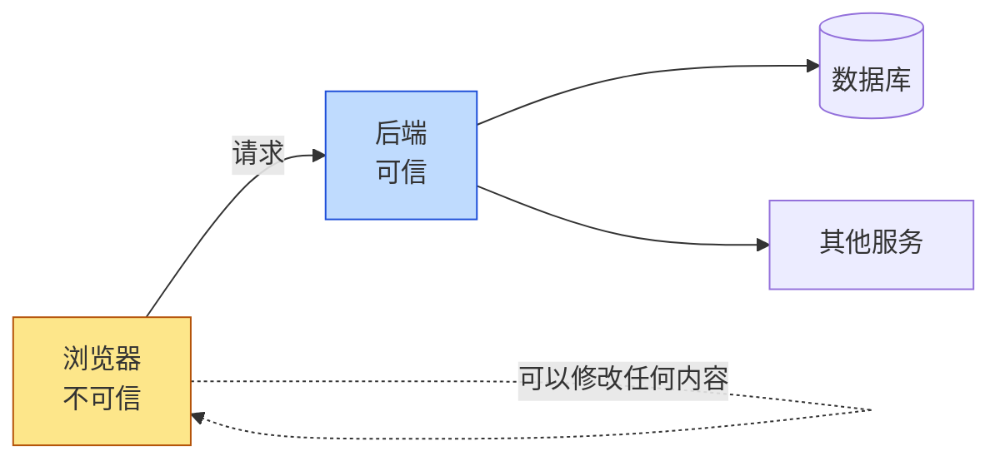
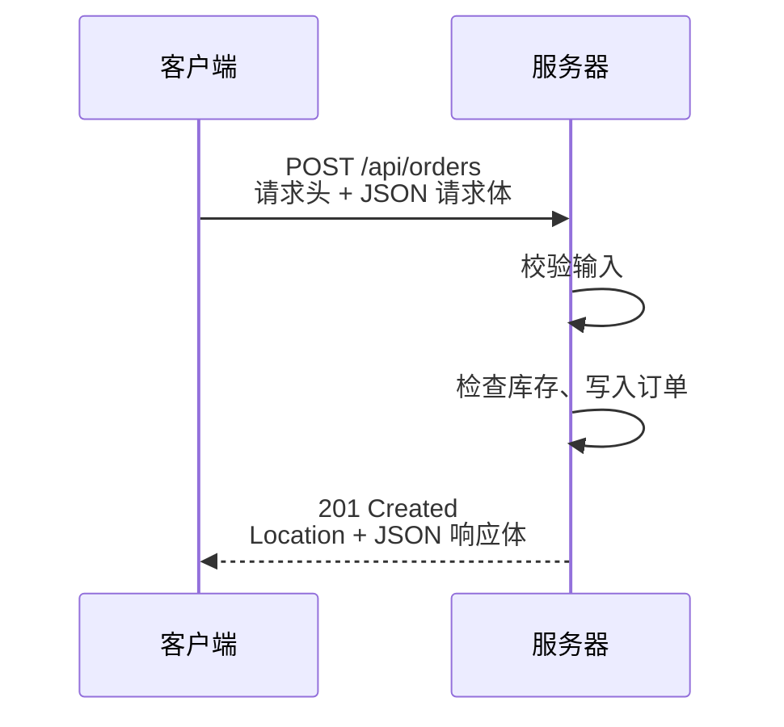
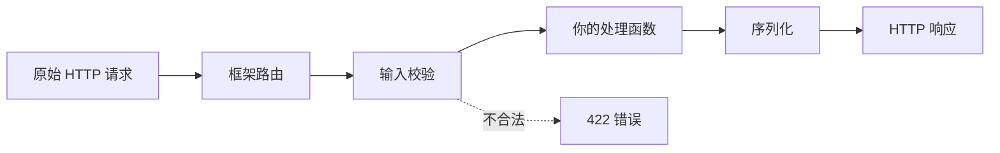
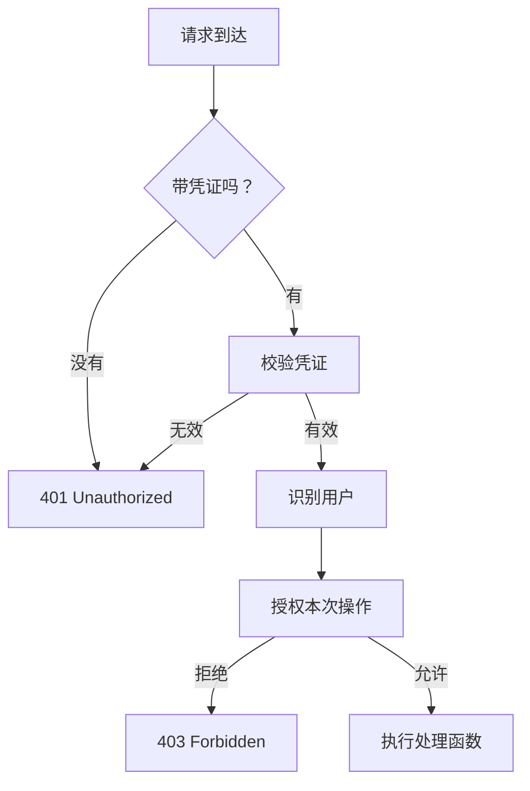
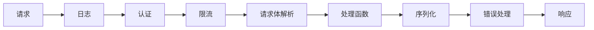
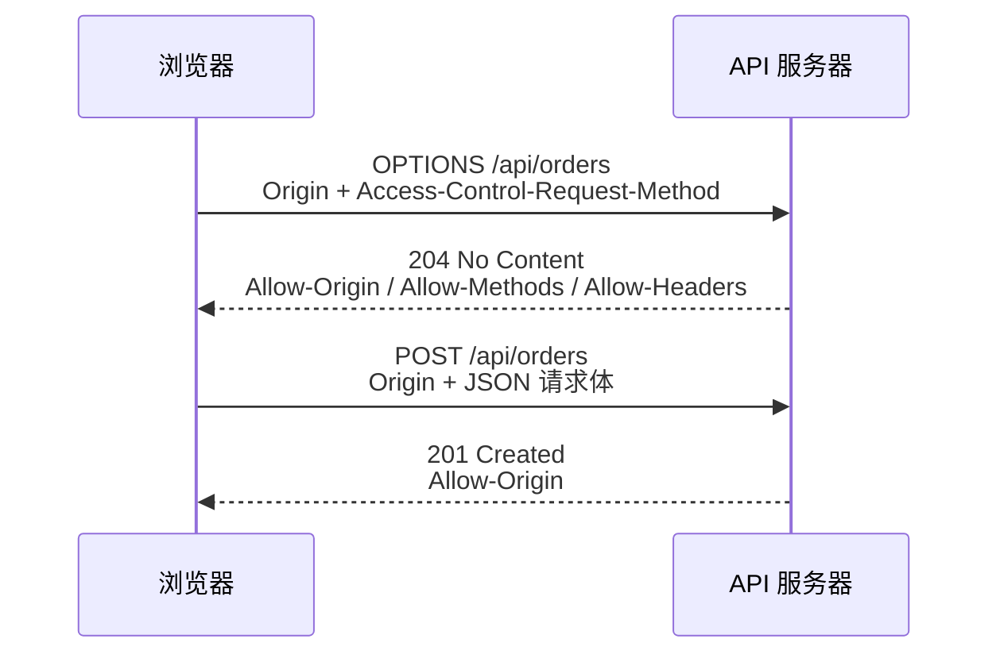
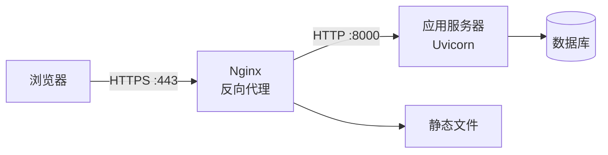

# 后端二十年：从 CGI 脚本到现代服务，服务器上究竟发生了什么？

Last updated: 2026-10-19

今天，部署一个后端服务似乎非常简单。装一个框架，写几个函数，运行一条命令，一个 API 就跑起来了。再借助 AI，甚至还没把需求描述清楚，一个能用的 CRUD 服务就已经生成好了。

但如果去看一个真正的生产后端，画面会完全不同。一个接口背后，可能同时涉及 Web 框架、数据库、缓存、消息队列、身份服务、反向代理、容器编排、监控系统，以及随时待命的运维值班。接口本身的代码可能只有十行，围绕它的系统却有上千行。

**为什么后端开发会从一个处理表单的脚本，演变成今天这样一套分布式工程体系？**

理解这个问题，最好的方法不是逐个学习框架，而是回到后端始终要承担的三件事：存储数据、执行规则、响应请求。然后看这三件事随着用户规模从一台服务器增长到千万级，是如何一步步变难的。

这篇文章要建立的就是这张地图。如果你现在看到 Nginx、Redis、JWT、CORS、Kubernetes、"中间件"这些名词觉得一头雾水，完全正常。文章的目的不是让你记住它们，而是让你知道每一个名词是为了解决什么问题而存在的。

## 一、后端工程师到底在做什么？

### 1. 网站是两台计算机的协作，而其中一台不可信

访问一个网站，本质上是两台计算机在协作。一台在用户面前，一台在远端的数据中心。浏览器和服务器通过 HTTP 交换消息。

前端运行在用户自己控制的设备上。这个事实决定了后端的一切。

浏览器可以修改自己执行的 JavaScript。它可以在发送请求前修改请求内容。它可以把价格字段改成 `1`，声称自己是管理员，或者把同一个请求重放一百次。这些操作都不代表请求是合法的。

**因此，后端的第一职责不是计算，而是校验。** 所有真正重要的规则——你是谁、你能做什么、涉及多少钱、库存是否充足——都必须由用户无法控制的机器来执行。

这也是为什么后端常被称为**信任边界**。用户这边的一切都只是"声明"，服务器这边的一切才是"决定"。



### 2. 后端真正负责的四件事

抛开工具名称，后端负责的是四件事：

| 职责 | 具体含义 |
|---|---|
| **数据** | 数据存在哪里、结构如何、如何长期保持正确 |
| **规则** | 业务逻辑——计价、权限、库存、流程 |
| **接口** | 供其他软件（而不是人）调用的 API |
| **可靠性** | 磁盘损坏、流量激增、依赖服务故障时，服务仍然可用 |

前端工程师优化的是交互：人感知到的延迟、视觉一致性、跨页面的状态。后端工程师优化的是正确性和吞吐：数据是否一致、服务能否存活、每个请求的成本是否合理。

两者的差别可以这样对比：

| 维度 | 前端 | 后端 |
|---|---|---|
| 运行在 | 用户设备，配置千差万别 | 自己控制的服务器 |
| 主要风险 | 界面不一致、渲染缓慢 | 数据错误、安全漏洞、服务中断 |
| 衡量标准 | 用户体验 | 正确性、可用性、成本 |
| 典型故障 | 某个浏览器上的布局错乱 | 一个竞态条件导致订单数据损坏 |
| 调试工具 | 浏览器开发者工具 | 日志、指标、链路追踪、数据库查询 |

这种划分不是绝对的。前端代码也可以很复杂，后端也会负责页面渲染。但两者的**重心**不同，工具链也因此不同。

### 3. 后端问题的独特之处

有三个性质让后端工作与众不同。

**并发。** 一台 Web 服务器会同时处理许多请求。两个用户可能在同一毫秒抢购最后一件库存。两个工作进程可能处理同一个任务。后端必须定义操作重叠时会发生什么——事务、锁和幂等性就是为此而生的。

**部分失败。** 在单机上，一个函数要么返回、要么抛异常。在分布式系统中，数据库查询可能成功了但响应丢失；支付可能已经扣款，而你的服务在记录之前崩溃。后端要在不确定性中做设计。

**长寿命。** 前端代码会随着界面改版被替换。后端数据却会活得比所有碰过它的框架都久。2015 年做的一个表结构决策，可能到 2030 年仍在影响产品的运作方式。

### 4. 前后端之间的契约

前后端在 API 处相遇。这个 API 就是一份契约：前端说"我会发送这种形状的请求"，后端说"我会返回这种形状的响应，或者这种错误"。

大多数联调问题，都源于把这份契约当成口头约定。

- 字段被改名，前端悄无声息地坏掉。
- 出错时返回的是 HTML 而不是 JSON，客户端无法解析。
- 列表接口从数组变成 `{ "items": [...] }`，却没有升版本。
- 一个原本可空的字段变成必填，旧客户端全部失败。

成熟的团队会把契约写下来、做版本管理，并让双方都针对它测试。这一点我们会在第六部分展开。

职责已经清楚了，接下来要看双方使用的共同语言。

## 二、HTTP：一切运行其上的协议

### 1. 请求是一条结构化的消息

HTTP 是基于文本的请求/响应协议。每一次交互都遵循同样的形状：

```http
POST /api/orders HTTP/1.1
Host: shop.example.com
Content-Type: application/json
Authorization: Bearer eyJhbGciOi...

{
  "product_id": 42,
  "quantity": 2
}
```

服务器回复：

```http
HTTP/1.1 201 Created
Content-Type: application/json
Location: /api/orders/1001

{
  "id": 1001,
  "status": "pending"
}
```

请求中有四个部分值得注意：

- **方法**——意图（`POST` 表示创建）
- **路径**——资源（`/api/orders`）
- **请求头**——元数据（内容类型、凭证、客户端信息）
- **请求体**——负载

响应与之对应：状态码、响应头、响应体。



### 2. 方法表达你的意图

方法是一种语义提示，不是安全机制。无论用哪个动词，服务器都必须校验权限。

| 方法 | 意图 | 安全？ | 幂等？ |
|---|---|---|---|
| `GET` | 读取资源 | 是 | 是 |
| `HEAD` | 只读取响应头 | 是 | 是 |
| `POST` | 创建资源或触发动作 | 否 | 否 |
| `PUT` | 整体替换资源 | 否 | 是 |
| `PATCH` | 部分更新资源 | 否 | 不一定 |
| `DELETE` | 删除资源 | 否 | 是 |

*安全*意味着不应改变服务器状态。*幂等*意味着重复执行产生相同结果——这对重试至关重要。如果一个支付请求超时，客户端并不知道它是否成功；幂等的设计让重试变得安全。

### 3. 状态码是共享的词汇

状态码让客户端不必解析文字就能做出反应。

| 范围 | 含义 | 示例 |
|---|---|---|
| `2xx` | 成功 | `200 OK`、`201 Created`、`204 No Content` |
| `3xx` | 重定向 | `301 Moved Permanently`、`304 Not Modified` |
| `4xx` | 客户端错误 | `400 Bad Request`、`401 Unauthorized`、`403 Forbidden`、`404 Not Found`、`409 Conflict`、`422 Unprocessable Content`、`429 Too Many Requests` |
| `5xx` | 服务器错误 | `500 Internal Server Error`、`502 Bad Gateway`、`503 Service Unavailable`、`504 Gateway Timeout` |

`401` 和 `403` 的区别最容易被搞混。`401` 的意思是"我不知道你是谁"——去认证。`403` 的意思是"我知道你是谁，但你不能做这件事"——是授权问题。

失败时返回 `200` 加 `{"error": "..."}` 是一种设计上的坏味道。它会破坏缓存、监控，以及所有信任状态码的客户端。

### 4. 请求头承载上下文

请求头描述的是 URL 和请求体之外的信息。有几个几乎每次都会用到：

- `Content-Type`——请求体的格式（`application/json`、`multipart/form-data`、`text/html`）
- `Authorization`——凭证（`Bearer <token>`、`Basic <base64>`）
- `Accept`——客户端能接受的响应格式
- `Cache-Control` / `ETag`——缓存规则与校验器
- `Cookie` / `Set-Cookie`——会话状态（见第五部分）
- `Origin`——跨站请求的来源（见第六部分）
- `X-Request-ID`——用于跨服务追踪同一个请求的关联标识

### 5. HTTP 是无状态的——而这是一件好事

HTTP 本身没有记忆。每个请求独立存在，服务器没有被要求记住上一个请求来自同一个用户。

这看起来像缺陷，直到你考虑规模问题。无状态的服务器可以自由复制：任何一个实例都能处理任何请求，因此扩容就是加机器。相比之下，状态既难以复制，又难以保持一致。

所以 Web 后端的架构本质上是这样一句话：**让请求路径保持无状态，把所有状态推进显式的存储**——数据库、缓存、对象存储，或者由客户端携带的令牌。

这条原则解释了本章后面的许多设计决策：

- 会话保存在共享存储里，而不是某一台服务器的内存里。
- 上传的文件放进对象存储，而不是本地磁盘。
- 任何一台服务器实例都能处理任何请求，因为本地没有重要的东西。

### 6. HTTPS 不是另一个协议

HTTPS 是装在 TLS 里的 HTTP。消息看起来完全一样，只是传输过程被加密并完成身份认证。如今 HTTPS 已是默认选择，浏览器也越来越不把明文 HTTP 视为安全上下文。

从后端工程师的角度看，TLS 通常由代理或负载均衡器终止，而不是在应用代码里处理。这意味着应用在内网中看到的往往是明文 HTTP，而用户看到的是 HTTPS。这很正常——安全边界位于网络边缘。

## 三、API：后端如何暴露能力

### 1. API 是一份承诺

API（Application Programming Interface，应用程序编程接口）是一个软件调用另一个软件的既定方式。在 Web 后端里，它通常指一个有文档、有固定形状的 HTTP 接口。

"接口"这个词在这里是实打实的。API 不是泄露出去的实现细节，而是你承诺要保持稳定的那部分。你可以重写数据库、更换语言、拆分服务——只要 API 守住承诺，调用方就不受影响。

### 2. 从 RPC 到 REST

早期的分布式系统使用 **RPC**（远程过程调用）：像调用本地函数一样调用 `createOrder(productId, quantity)`。这种吸引力很直接——它符合程序员既有的思维方式。问题在于它隐藏了网络。远程调用很慢、可能中途失败、可能被重试；本地函数调用则不会。

2000 年，Roy Fielding 在博士论文中描述了 **REST**（Representational State Transfer，表述性状态转移）。REST 把 Web 已有的基础构件——URL、HTTP 方法、状态码——当作接口本身：

- **资源**是由 URL 标识的名词（`/orders/1001`）
- **方法**是动词（`GET`、`POST`、`DELETE`）
- **表述**承载数据（通常是 JSON）
- **无状态**让每个请求自包含

REST 不是协议，也不是可以拿去认证的标准。它是一种架构风格——一组约束。大多数"RESTful" API 只满足其中一部分，忽略另一部分。

后来的风格则回应了 REST 的弱点：

| 风格 | 优势 | 典型弱点 |
|---|---|---|
| RPC（gRPC、JSON-RPC） | 契约精确、二进制传输高效 | 客户端依赖生成的代码；浏览器支持较弱 |
| REST | 简单、可缓存、广为理解 | 过度获取或获取不足；往返次数多 |
| GraphQL | 客户端精确指定所需字段 | 服务端成本控制和缓存复杂 |
| 事件驱动 / 消息 | 生产者和消费者解耦 | 更难推理；最终一致性 |

没有一种风格取代了其他风格。多数生产系统会同时使用多种：对外用 REST，内部服务之间用 gRPC，异步任务用事件。

### 3. "RESTful"到底意味着什么

一个实用的 REST 设计长这样：

```text
GET    /api/products?limit=20&cursor=abc
GET    /api/products/42
POST   /api/orders
GET    /api/orders/1001
PATCH  /api/orders/1001
DELETE /api/orders/1001
```

注意其中的模式：**路径里放名词，方法里放动词。** 对比很多初学者会写出的 RPC 风格设计：

```text
GET  /api/getProducts
POST /api/createOrder
POST /api/updateOrderStatus
POST /api/deleteProduct
```

两种都能用。第二种与其说是错，不如说是更难保持一致。一旦开始把动作编码进路径，每个新操作都会发明一种新的 URL 形状，客户端也就无法推断 API 的行为方式。

几个值得记住的 REST 约定：

- 集合用复数名词：`/orders`，而不是 `/order`
- 只在确实存在归属关系时嵌套：`/users/7/orders` 可以，`/users/7/orders/1001/items/3/reviews` 就过了
- 过滤、排序、分页用查询参数，不要用路径
- 创建成功时返回 `201 Created` 并带上 `Location` 响应头
- 状态冲突用 `409 Conflict`（例如邮箱重复）
- 数据量大且不断变化的集合，优先使用游标分页

### 4. 框架是一条你不需要自己写的请求流水线

你可以像下一章那样，用 Python 标准库手写一个 API。那你就要自己处理路由、解析 JSON、校验类型、序列化响应、编写错误页——而且每个接口都要来一遍。

框架把这些打包成一条流水线：

```python
from fastapi import FastAPI
from pydantic import BaseModel

app = FastAPI()

class OrderIn(BaseModel):
    product_id: int
    quantity: int

@app.post("/api/orders", status_code=201)
def create_order(order: OrderIn) -> dict[str, int]:
    # 框架已经解析了 JSON 并校验了类型。
    order_id = save_order(order.product_id, order.quantity)
    return {"id": order_id}
```

这个函数里只剩下业务逻辑。其他所有事情——HTTP 解析、输入校验、参数不合法时返回 422、生成 OpenAPI 文档——都由框架完成。

这就是取舍：框架给你约定和杠杆，代价是你要学习它的抽象，并继承它的缺陷。



### 5. 其他语言里的同一件事

概念不会随语言改变，改变的只是名字。

| 语言 | 常见框架 | 服务模型 |
|---|---|---|
| Python | FastAPI、Django、Flask | ASGI / WSGI，常配合 Uvicorn 或 Gunicorn |
| JavaScript / TypeScript | Express、Fastify、NestJS | Node.js 事件循环 |
| Java / Kotlin | Spring Boot、Quarkus | 线程 per-request 或响应式 |
| Go | Gin、Echo、Chi | Goroutine，编译为单一二进制 |
| Rust | Axum、Actix | 异步运行时，编译为单一二进制 |
| Ruby | Rails | 多线程或多进程 |

一个理解了路由、校验、序列化和错误处理的后端工程师，可以在几周内切换到这些框架。框架 API 是最浅的那一层。

### 6. API 设计就是接口设计

因为 API 是一份承诺，修改它的成本很高。有两种做法可以降低这个成本。

**给接口做版本，而不是给实现做版本。** 在路径里放 `/v1`，或通过请求头传递版本。旧客户端继续工作，新客户端逐步迁移。

**把错误设计得和成功一样认真。** 统一的错误结构让客户端可以通用地处理失败：

```json
{
  "error": {
    "code": "OUT_OF_STOCK",
    "message": "Product 42 has 0 units available",
    "request_id": "req_8f2c"
  }
}
```

包含一个机器可读的错误码、一段人类可读的消息、一个关联 id。客户端不应该为了决定怎么做而去解析英文句子。

## 四、数据库：状态住在哪里

### 1. 为什么文件不够用

最早的 Web 应用把数据存在文件或简单的键值存储里。直到三件事同时发生，这种做法才失效：

- **多个用户并发读写**
- **查询变得复杂**（"浙江地区客户最近 30 天超过 100 元的订单"）
- **数据必须在崩溃和部分写入中存活**

文件无法提供跨多条关联记录的原子更新、用于快速查找的索引，也无法强制约束。数据库的存在就是为了解决这些问题。

### 2. 关系模型与 SQL

1970 年，Edgar Codd 提出把数据组织成关系——由行和列构成的表——并用集合论定义操作。这就是关系模型。

它的核心思想是**把逻辑结构与物理存储分开**。你用声明式的方式描述数据；数据库决定如何存储、如何建索引、如何执行查询。

```sql
CREATE TABLE orders (
  id          INTEGER PRIMARY KEY,
  user_id     INTEGER NOT NULL REFERENCES users(id),
  status      TEXT NOT NULL DEFAULT 'pending',
  total_cents INTEGER NOT NULL CHECK (total_cents >= 0),
  created_at  TIMESTAMP NOT NULL DEFAULT CURRENT_TIMESTAMP
);

SELECT user_id, SUM(total_cents) AS spent
FROM orders
WHERE status = 'paid' AND created_at >= '2026-01-01'
GROUP BY user_id
ORDER BY spent DESC
LIMIT 10;
```

SQL 成为关系数据库的标准语言。它持久的优势在于：它描述的是*要取什么*，而不是*怎么取*——因此随着数据增长或硬件变化，数据库可以选择更好的执行计划。

关系数据库还带来了**事务**，我们很快会讲到。正是这一个特性，让它们至今仍是金额、库存、账户，以及一切"正确性比原始吞吐更重要"的场景的默认选择。

### 3. 关系模型不够用时：NoSQL

从 2000 年代中期开始，互联网公司面对的数据量和访问模式，是当时的关系数据库难以承受的：数十亿行数据、跨数据中心写入、灵活文档、以及在廉价机器上横向扩展。

回应这一需求的是随后被笼统称为 **NoSQL**（"not only SQL"或"非关系型"）的一类系统：

| 模型 | 形状 | 典型用途 |
|---|---|---|
| **文档** | 类 JSON 文档（MongoDB、CouchDB） | 内容、商品目录、结构易变的场景 |
| **键值** | 从键映射到不透明的值（Redis、DynamoDB） | 缓存、会话、计数器 |
| **宽列** | 按行键和列族组织的稀疏行（Cassandra、HBase） | 时序数据、高写入吞吐 |
| **图** | 节点和边（Neo4j） | 关系、推荐、反欺诈 |
| **向量** | 带相似度搜索的嵌入（pgvector、Qdrant、Milvus） | 语义搜索、RAG、推荐 |

它们之间的取舍是一致的：通过放宽某些保证或查询灵活性，换来规模、可用性，或对特定数据形状更好的适配。

大多数系统并不是用一个文档库替换关系库，而是在旁边增加一个——关系库存订单，Redis 存会话，向量索引做语义搜索。

### 4. 事务：让数据库变难的那件事

事务把多个操作组合在一起，要么全部发生，要么全部不发生。经典的保证被概括为 **ACID**：

| 特性 | 含义 |
|---|---|
| **原子性**（Atomicity） | 所有操作都成功，或者都不生效 |
| **一致性**（Consistency） | 数据库从一个合法状态转移到另一个合法状态 |
| **隔离性**（Isolation） | 并发事务之间不会互相污染 |
| **持久性**（Durability） | 已提交的数据在崩溃后仍然存在 |

经典例子是转账：从一个账户扣减，向另一个账户增加。没有原子性，两步之间一次崩溃就会让钱凭空消失。

隔离性是现实中最微妙的部分。完美隔离（可串行化）代价很高，因此数据库提供多个隔离级别——读已提交、可重复读、可串行化——每个级别允许不同的异常（脏读、幻读、写偏斜）。选择隔离级别是后端工程决策，不是事后随手填的配置。

在大规模场景下，跨多台机器保持严格一致性代价高昂。分布式数据库常常提供**最终一致性**：副本会随时间收敛，但一次读取可能短暂看到旧数据。这是取舍，不是缺陷——但它改变了应用必须容忍的行为。

### 5. 嵌入式数据库与服务型数据库

并不是所有数据库都是服务。

| | 嵌入式 | 服务型 |
|---|---|---|
| 例子 | SQLite、DuckDB | PostgreSQL、MySQL、MongoDB |
| 运行方式 | 在你的进程内 | 独立进程，通常还在另一台机器上 |
| 连接方式 | 一个文件路径 | 网络协议 |
| 并发 | 写入能力有限 | 大量并发客户端 |
| 运维 | 几乎没有 | 备份、复制、故障切换、监控 |
| 适用 | 测试、原型、桌面应用、单机分析 | 生产服务、共享数据 |

一个有用的心智模型：**SQLite 是一个带查询引擎的文件；PostgreSQL 是一个背后有文件的服务。** 在两者之间做选择，取决于部署方式和并发需求，而不是功能多少。

### 6. 后端工程师如何与数据工程师协作

在规模较大的组织里，后端工程师和数据工程师会从不同方向接触同一份数据。

| 后端工程师 | 数据工程师 |
|---|---|
| 服务线上产品 | 构建分析、管道和报表 |
| 优化请求延迟 | 优化批处理吞吐和存储成本 |
| 编写事务型负载（OLTP） | 编写分析型负载（OLAP） |
| 关心 API 所依赖的表结构稳定性 | 关心跨历史数据的表结构演进 |

协作顺畅的前提是边界明确：后端系统产生带有既定结构的事件或表，数据管道消费它们。问题往往始于直接拿生产库跑分析查询，或者某条管道依赖了一个没人承诺会保留的字段。

### 7. 云时代与 AI 时代

托管数据库把运维负担——备份、打补丁、故障切换、只读副本——转移给了云厂商。这就是为什么今天一个小团队也能运行一套在 2010 年需要专职团队才能维护的生产系统。

近来的两个变化值得注意。

**无服务器与存储计算分离。** 数据库的计算和存储可以独立扩展，这改变了波动型负载的成本模型。

**向量搜索成为一等公民。** 在 AI 应用中，对嵌入做相似度搜索成了常见的查询类型。与其专门引入一个向量数据库，很多团队选择在自己已经在用的关系库上启用扩展（例如 `pgvector`）。历史再次重演：新的数据形状往往以"增加"而非"替换"的方式到来。

## 五、请求生命周期：会话、认证与中间件

### 1. 无状态的 HTTP 遇上需要记忆的用户

HTTP 会遗忘，用户不会。用户只登录一次，却期望之后每个请求都被识别。

后端用两种方式弥合这个缺口：**把状态存在服务器上**（会话），或者**让状态跟随客户端**（令牌）。



### 2. 会话与 Cookie

会话的运作方式如下：

1. 用户用凭证登录。
2. 服务器生成一个随机会话 id，并把会话数据存在服务端（内存、Redis、数据库）。
3. 服务器通过 `Set-Cookie` 响应头把 id 发给浏览器。
4. 浏览器之后对同源请求自动带回这个 id。

```http
Set-Cookie: session_id=8f2c9a...; HttpOnly; Secure; SameSite=Lax; Path=/
```

这些标志很重要：

- `HttpOnly`——JavaScript 无法读取，降低 XSS 的影响
- `Secure`——只通过 HTTPS 发送
- `SameSite`——限制跨站发送，降低 CSRF 风险

因为会话存在服务端，撤销权限是即时的：删掉会话即可。这是它相对令牌的主要优势。

### 3. 令牌与 JWT

另一种做法是把用户身份编码进一个签名的令牌，由客户端携带。

JWT（JSON Web Token）由三部分组成——头部、负载、签名——用点分隔。服务器校验签名，而不必查询会话存储。

```text
eyJhbGciOiJIUzI1NiJ9.eyJzdWIiOiI0MiIsImV4cCI6MTc2MDAwMDAwMH0.signature
```

| | 会话 | JWT |
|---|---|---|
| 状态存放在 | 服务端 | 客户端 |
| 撤销 | 即时 | 到期前很难 |
| 跨服务扩展 | 需要共享存储 | 天然支持 |
| 负载大小 | 一个短 id | 较大的令牌 |
| 典型用途 | 传统 Web 应用 | API、移动端、服务间调用 |

一种常见的实用设计是**混合方案**：短期访问令牌加长期刷新令牌，刷新令牌存在服务端。这样既获得了大部分扩展性收益，又保留了撤销能力。

两种方式本身没有谁更安全。安全性来自正确的实现：HTTPS、妥善保管签名密钥、设置过期时间、轮换密钥，以及绝不把 `secrets`（密码、API 密钥、令牌等不能公开的凭证）放进负载里。

### 4. 认证与授权

这两个词经常被混用。

| | 认证（Authentication） | 授权（Authorization） |
|---|---|---|
| 问题 | 你是谁？ | 你能做什么？ |
| 失败状态码 | `401 Unauthorized` | `403 Forbidden` |
| 常见机制 | 密码、OAuth、SSO、通行密钥 | 角色、权限、策略、归属校验 |
| 发生位置 | 登录接口、中间件 | 每一个受保护的处理函数 |

一个服务可以正确认证每一个请求，却仍然不安全，因为授权才是错误高发的地方：漏掉归属校验、直接信任客户端传来的角色、允许用户通过修改 id 读取别人的记录（**IDOR**，不安全的直接对象引用）。

**永远不要基于未经校验的客户端声明做授权。** "每次访问对象都检查归属"这条规则可以阻止一整类漏洞。

### 5. 中间件：包裹每个请求的流水线

大多数横切关注点不属于某个具体的处理函数。日志、认证、限流、请求追踪、CORS、压缩、错误格式化，都作用于每一个接口。

中间件就是实现机制：一条包裹处理函数的函数链。

```python
@app.middleware("http")
async def add_request_id(request, call_next):
    request_id = request.headers.get("X-Request-ID") or new_id()
    response = await call_next(request)
    response.headers["X-Request-ID"] = request_id
    return response
```



顺序本身就是设计的一部分。认证应该在昂贵的处理之前、但在分配 request id 之后运行。错误处理必须包裹一切，才能把异常转成结构化响应。CORS 响应头往往连错误响应也要带上，否则浏览器会隐藏真正的失败原因。

中间件也解释了为什么框架有时显得"有魔法"：它做的很多事情，就是一条你没有亲手写过的固定流水线。

## 六、前后端契约

### 1. 同源策略

浏览器强制一条规则：来自一个源的页面，不能随意读取另一个源的响应。**源**（origin）由协议、主机和端口三部分组成。

```text
https://shop.example.com:443/page
  ^       ^               ^
 协议     主机            端口
```

`https://shop.example.com` 和 `https://api.example.com` 是不同的源。`http://localhost:5173`（Vite 开发服务器）和 `http://localhost:8000`（FastAPI 服务器）也是。

这条规则之所以存在，是因为浏览器会自动携带凭证。没有它，一个恶意网站可以在你登录银行的状态下向银行发请求并读取结果。

注意这条策略*不*做什么：它不阻止请求被发出，它阻止的是 JavaScript 读取跨源响应。简单请求依然可能到达服务器——这也是 CSRF 会作为一个独立问题存在的原因。

### 2. CORS：浏览器的规则，不是服务器的锁

**CORS**（Cross-Origin Resource Sharing，跨源资源共享）是服务器"允许"跨源读取的方式。服务器发送这样的响应头：

```http
Access-Control-Allow-Origin: https://shop.example.com
Access-Control-Allow-Methods: GET, POST, PATCH
Access-Control-Allow-Headers: Content-Type, Authorization
Access-Control-Max-Age: 600
```

如果浏览器没有看到匹配的响应头，它就会阻止 JavaScript 读取该响应。

这是 Web 开发中最容易被误解的一点。**CORS 由浏览器执行，而不是由服务器执行。** `curl`、移动应用或后端服务都可以在不涉及 CORS 的情况下调用同一个接口。启用 CORS 不会把 API 暴露给攻击者，配置错误也不会保护你。

### 3. 预检请求

对于"简单请求"之外的请求——`PUT`、自定义 `Authorization` 头，某些情况下的 JSON 内容类型——浏览器会先发一个 `OPTIONS` 请求来问权限。



两个实际后果：

- 预检必须成功，否则真正的请求根本不会发出。
- `Access-Control-Allow-Origin: *` 不能与凭证同时使用。如果需要 Cookie 或 `Authorization`，服务器必须回显具体的源。

一个常见的开发期错误是：CORS 报错，实际原因却是服务器错误——错误页没有带上 CORS 头，于是浏览器把整个响应当作失败。改 CORS 配置之前，先看服务器日志。

### 4. 跨越边界的调试

当请求失败时，最有价值的问题是：*是哪一侧失败了？* 一套可重复的流程：

1. **在浏览器中复现。** 打开 Network 面板，检查请求：方法、URL、请求头、请求体、状态码、响应体。
2. **在浏览器外复现。** 用 `curl` 发送同样的请求。如果在 `curl` 里正常而在浏览器里失败，问题多半在 CORS 或凭证，而不是接口本身。
3. **读服务器日志。** 用浏览器里的 `X-Request-ID` 去匹配日志行。
4. **逐层缩小范围。** 确认请求是否到达了代理、应用和数据库。

```bash
curl -i -X POST http://localhost:8000/api/orders \
  -H "Content-Type: application/json" \
  -d '{"product_id": 42, "quantity": 2}'
```

两种不同的错误现场，对应两种不同的答案：

| 现象 | 可能原因 |
|---|---|
| 浏览器报 `TypeError: Failed to fetch`，服务器日志里没有这个请求 | 预检被拒、网络被阻断，或主机地址错误 |
| 日志里有请求，响应是 `500` | 服务端异常——去看 traceback |
| 带着有效令牌却返回 `401` | 请求头名称、解析、过期时间或时钟偏差 |
| `curl` 返回 `200`，浏览器却拦截 | 错误响应缺少 `Access-Control-Allow-Origin` |

### 5. 能经受变化的契约

契约只有在可测试时才有用。三种做法让这件事落地：

**Schema 优先设计。** 用 schema（OpenAPI、JSON Schema、protobuf）定义请求和响应的形状。文档和客户端类型都从它生成，而不是两边各写一遍。

**契约测试。** 验证服务器实际返回符合 schema，并验证客户端能处理文档中列出的错误情况。这能抓住文档无法发现的漂移。

**向后兼容的演进。** 增加字段而不是重命名字段。新字段设为可选。不要原地改变某个状态码的含义。先标记废弃，过了公示期再移除。

## 七、第三方库与包生态

### 1. 软件是组装出来的，不只是写出来的

几乎没有生产后端会自己实现所有东西。哈希、HTTP 解析、数据库驱动、JSON 处理、日期运算、重试、可观测性——这些都来自依赖。

结果是，"写一个后端"在某种程度上是供应链管理。一个典型服务会依赖几十个直接包和数百个间接包。

### 2. 各语言的包管理器

| 语言 | 包管理器 | 仓库 | 环境隔离方式 |
|---|---|---|---|
| Python | pip、uv、poetry | PyPI | venv、uv 环境 |
| JavaScript | npm、pnpm、yarn | npm registry | node_modules |
| Go | `go mod` | Go 模块代理 | 全局模块缓存 |
| Java | Maven、Gradle | Maven Central | 项目级（无全局） |
| Rust | Cargo | crates.io | 项目级 target |
| Ruby | Bundler | RubyGems | 项目级 gems |

命令各不相同，概念是一样的：声明依赖、解析版本、下载、记录你实际拿到了什么。

### 3. 如何评估一个库

不是每个包都值得进入你的依赖树。一份实用的检查清单：

| 信号 | 看什么 |
|---|---|
| **维护情况** | 最近的提交、发布，以及对 issue 的响应 |
| **采用程度** | 下载量、依赖它的项目、你信任的项目是否在用 |
| **文档** | 安装说明、示例、错误指引是否清晰 |
| **许可证** | 是否与你的产品分发方式兼容 |
| **安全历史** | 是否有已知 CVE，修复速度如何 |
| **依赖重量** | 它拖进来多少个间接包 |
| **API 稳定性** | 是否还在 1.0 之前？是否遵守语义化版本？ |

一个好习惯：引入一个库之前，先在 REPL 或临时脚本里跑通它的核心示例。十分钟的验证胜过一周的排错。

### 4. 环境与锁文件

两个概念让环境可复现。

**隔离。** 每个项目拥有自己的依赖集合，升级一个项目不会弄坏另一个。在 Python 里，`uv` 会创建项目级环境；在 Node 里，依赖放在 `node_modules`。

**锁文件。** 锁文件记录解析后的精确版本和哈希。`package-lock.json`、`uv.lock`、`go.sum`、`Cargo.lock` 都是这个作用。没有锁文件，同一份 `requirements.txt` 两次安装可能得到不同的代码。

```bash
uv init --bare --python 3.12
uv add "fastapi>=0.115,<1" "uvicorn>=0.30,<1"
uv sync          # 严格按照锁文件安装
```

### 5. 供应链风险

依赖是陌生人写的代码，却在你信任的边界内执行。这是真实的威胁模型，不是理论问题：

- 某个恶意版本一被 import 就外泄环境变量。
- 某个维护者账号被攻破，发布了一个带后门的版本。
- 一个拼写相近的包名（`reqeusts`）被误装。

实用的缓解手段：锁定版本、审查锁文件差异、启用自动化漏洞扫描、不要引入你解释不清的包，并尽量不把 `secrets` 放在进程环境里。

## 八、部署：把代码送上服务器

### 1. 部署到底解决什么

在笔记本上跑通代码，不等于提供服务。部署要回答四个问题：

1. **在哪里运行？** 一台机器、一个容器，还是一个托管平台。
2. **如何被访问？** 地址、端口、DNS 名称、TLS。
3. **如何持续运行？** 崩溃后重启、开机自启、健康检查。
4. **如何配置？** 每个环境的设置和 `secrets`，且不需要改代码。

### 2. 地址、端口与 DNS

进程监听一个地址和端口。`127.0.0.1:8000` 只能从本机访问；`0.0.0.0:8000` 监听所有网卡。默认绑定到 localhost 是一种安全措施：开发服务器不应该因为疏忽被暴露到公网。

DNS 把人类可读的名字映射到 IP 地址。一个生产请求通常要经过几跳：



### 3. 反向代理

Nginx（或 Caddy、Traefik、云负载均衡器）位于应用之前，处理应用不该操心的事：

- **TLS 终止**——证书与加密
- **静态文件**——高效地提供 CSS、JS 和图片
- **压缩与缓存头**
- **请求限制**——请求体大小、超时、限流
- **路由**——把 `/api/*` 发给一个服务，把 `/` 发给另一个
- **健康检查与故障转移**

一份最小配置：

```nginx
server {
    listen 443 ssl;
    server_name api.example.com;

    location /api/ {
        proxy_pass http://127.0.0.1:8000;
        proxy_set_header Host $host;
        proxy_set_header X-Request-ID $request_id;
    }

    location / {
        root /var/www/site;
        try_files $uri $uri/ /index.html;
    }
}
```

### 4. 让进程持续运行

在终端里启动的进程，会随着终端关闭或机器重启而消失。生产环境需要监督机制。

**systemd** 是 Linux 上管理长期服务的常见答案：

```ini
[Unit]
Description=Shop API
After=network.target

[Service]
User=shop
WorkingDirectory=/srv/shop
ExecStart=/srv/shop/.venv/bin/uvicorn app:app --host 127.0.0.1 --port 8000
Restart=on-failure
EnvironmentFile=/etc/shop/api.env

[Install]
WantedBy=multi-user.target
```

它定义了启动命令、运行用户、重启策略，以及配置从哪里来。`Restart=on-failure` 就是"一次崩溃"和"一次线上事故"之间的区别。

### 5. 配置与 `secrets`

代码在各环境之间应当一致，配置则不应如此。**十二要素**（twelve-factor）的思路是：从环境读取配置，而不是从提交进仓库的文件里读。

```python
import os

DATABASE_URL = os.environ["DATABASE_URL"]
REDIS_URL = os.environ.get("REDIS_URL", "redis://localhost:6379/0")
```

几条能避免大多数事故的规则：

- 永远不要提交 `secrets`。不要写在配置文件里，不要写在默认值里，不要写在测试里。
- 缺少必需变量时，在启动阶段就明确失败。
- 每个环境使用独立的凭证。
- 轮换 `secrets` 不需要重新部署代码。

### 6. 环境

多数团队至少维护三个环境：

| 环境 | 用途 | 数据 |
|---|---|---|
| 开发 | 本地迭代 | 合成数据 |
| 预发 | 类生产环境验证 | 脱敏或合成数据 |
| 生产 | 真实用户 | 真实数据 |

预发环境不是为了走过场。它是为了抓住只有在真实代理、真实 TLS、真实配置和类生产数据下才会出现的问题——而部署失败恰恰多发于此。

这一节是一张地图，不是教程。部署章节会动手覆盖服务配置、日志和重启行为。

## 九、为什么会有这么多后端语言？

### 1. 没有银弹

一门后端语言是一组取舍的合集：执行模型、内存管理、生态、运维特征、招聘市场。没有哪种语言在所有这些维度上都是最好的，所以行业里始终并存着好几种。

选择通常由以下因素驱动：

- **负载形状**——I/O 密集、CPU 密集，还是突发型
- **团队**——既有技能和招聘市场
- **生态**——你所处领域需要的库
- **运维成本**——内存、启动时间、二进制体积
- **正确性需求**——类型系统强度、并发安全

### 2. 主流语言的大致地图

| 语言 | 优势 | 常见领域 | 代价 |
|---|---|---|---|
| **Python** | 可读性、库丰富、开发快、AI 生态 | 数据服务、API、自动化、机器学习 | GIL 限制 CPU 并行；单请求更慢 |
| **JavaScript / TypeScript** | 前后端同一语言；生态庞大 | 实时应用、API、全栈团队 | 运行时特性；依赖变动频繁 |
| **Java / Kotlin** | 成熟的 JVM、强类型、企业级工具链 | 大型企业系统、金融服务 | 冗长、内存占用高、迭代较慢 |
| **Go** | 并发简单、编译快、静态小二进制 | 基础设施、网络服务、命令行工具 | 表达力较弱；显式错误处理繁琐 |
| **Rust** | 无 GC 的内存安全、可预测的性能 | 高性能服务、系统软件、安全关键场景 | 学习曲线陡峭、迭代较慢 |
| **C# / .NET** | 工具链强大、现已跨平台 | 企业应用、游戏、Windows 生态 | 历史上偏 Windows 中心 |

对多数初学者而言，实用的答案是：**选一门，学概念，保持可迁移。** 路由、校验、事务、认证、部署在任何语言里都一样。语言是知识里最不耐久的那部分。

### 3. 为什么软件依然很难

Fred Brooks 区分了**本质复杂度**（问题本身固有的）和**偶然复杂度**（由我们的工具造成的）。更好的语言、框架和 AI 降低的是偶然复杂度，不是本质复杂度。

后端的本质问题包括：

- **需求模糊且会变。** 系统必须对尚未完全写下来的规则保持正确。
- **状态是共享的、并发的。** 操作重叠时也必须保持正确。
- **失败是部分的。** 你永远无法同时知道全部情况，只能为不确定性做设计。
- **系统是社会的、技术的。** 有人会在半夜发布，会忘记跑迁移，会误解一份契约。
- **安全是对抗性的。** 总有人在主动试图攻破它。

这就是后端工程师薪水较高的原因：这份工作结合了设计判断、运维责任，以及一旦出错就代价高昂的后果。并不是因为语法难。

### 4. AI 与后端工程师

AI 编程工具确实擅长处理偶然复杂度：搭一个 CRUD 接口、写一次迁移、生成 Dockerfile、把 schema 转成类型。这些工作是真实存在的，而且正在变便宜。

AI 不会消除的是：

- 决定系统应该做什么，以及哪些取舍可以接受
- 设计能经受多年变化的数据模型
- 推理并发、一致性和失败模式
- 当生产出问题时承担责任
- 判断生成的代码是否正确、安全、可维护

一个有用的预测是：当生成变便宜，系统会增长得更快，而能让复杂系统保持正确的人，需求可能会上升而不是下降。瓶颈会从"敲代码"转向"知道该建什么，以及如何验证它"。

## 十、初学者应该怎样理解和学习后端？

顺着这段历史，可以提炼出一条相对稳定的学习路径：

1. **理解协议。** HTTP 方法、状态码、请求头，以及请求/响应。能在开发者工具里检查一个请求，并用 `curl` 复现它。
2. **不用框架写一个 API。** 亲手实现一次路由、JSON 和状态码，你才会理解框架抽象掉的是什么。
3. **认真学一个框架。** 一门语言、一个框架（Python 用 FastAPI，Node 用 Express，Java 用 Spring Boot）。掌握路由、校验、依赖注入和错误处理。
4. **学一个数据库。** 先学关系型：表结构设计、索引、连接、事务。然后再学一个键值存储用于缓存。
5. **理解请求生命周期。** 会话、令牌、认证、授权和中间件。端到端地做出一个登录流程。
6. **真正部署一次。** 反向代理、受监督的进程、从环境读取配置，以及你能读懂日志。然后在一台干净的机器上再做一次。

其中最重要的是把每个工具放在正确的层次里：

- **HTTP** 是传输协议——不是框架，也不是库
- **REST** 是建立在 HTTP 之上的约定——不是协议
- **框架** 负责路由、校验和序列化——它不是你的业务逻辑
- **数据库** 存储状态并强制约束——它不是缓存
- **Redis** 是数据结构服务器——它不是数据的权威来源
- **Nginx** 是代理——它不是你的应用
- **Docker** 打包运行时——它不能修复糟糕的设计
- **Kubernetes** 调度容器——它不能让单体架构变正确
- **AI** 生成代码——它不为系统承担责任

这些边界一旦理解清楚，后端世界就不再是一串需要背诵的名词，而是一组已经有已知解法的问题。

## 结语：后端的本质，是把规则变成可靠的系统

回顾整个历史，有一个模式在反复出现。

每一代后端技术，都在用一组新的约束解决同一个底层问题：

1. **脚本时代（1990 年代）。** CGI 让服务器为每个请求运行一个程序。简单而诚实，但慢且难以组织。
2. **应用服务器时代（2000 年代）。** 框架让进程一直运行，管理数据库连接池，并标准化请求处理。
3. **服务化时代（2010 年代）。** 系统拆分为独立部署的服务，每个服务有自己的 API 和数据。
4. **云原生时代（2020 年代）。** 容器、编排和托管基础设施让部署从运维项目变成配置问题。
5. **AI 辅助开发（当下）。** 生成变得便宜；判断和验证成为稀缺资源。

**不变的常量是 HTTP、数据和信任。** 框架、语言和平台来来去去。留下的是一套纪律：定义接口、正确存储状态、在可信一侧执行规则，并在出问题时让系统继续运行。

一旦看清这一点，后端那串长得吓人的工具列表，就会从一堵墙变成一张地图。

---

### 延伸阅读

- [MDN：HTTP 概述](https://developer.mozilla.org/zh-CN/docs/Web/HTTP/Overview)：方法、状态码、请求头与消息模型。
- [RFC 9110：HTTP Semantics](https://www.rfc-editor.org/rfc/rfc9110)：HTTP 语义的权威定义。
- [Roy Fielding：Architectural Styles and the Design of Network-based Software Architectures](https://www.ics.uci.edu/~fielding/pubs/dissertation/top.htm)：REST 的原始博士论文。
- [FastAPI 官方文档](https://fastapi.tiangolo.com/zh/)：请求处理、校验与自动 API 文档。
- [PostgreSQL 官方文档](https://www.postgresql.org/docs/current/)：关系建模、索引、事务与并发控制。
- [SQLite 官方文档](https://www.sqlite.org/docs.html)：嵌入式数据库及其设计取舍的清晰说明。
- [MDN：跨源资源共享（CORS）](https://developer.mozilla.org/zh-CN/docs/Web/HTTP/CORS)：浏览器规则与预检行为。
- [OWASP Top Ten](https://owasp.org/www-project-top-ten/)：最常见的 Web 应用安全风险。
- [The Twelve-Factor App](https://12factor.net/)：配置、进程与部署纪律。
- [Nginx 官方文档](https://nginx.org/en/docs/)：反向代理配置与 TLS 终止。
