# 从 HTTP 到 HTTPS，再到实时流式通信：互联网传输协议的 35 年进化史

Last updated: 2026-10-18

HTTP 覆盖了现代互联网几乎所有的应用层通信——网页加载、API 调用、AI 推理输出、实时消息。每一代协议演化都在回应特定时代的工程瓶颈，但每个新设计也会带来自己的复杂性。以下几个问题贯穿全文：

- 为什么早期浏览器需要同时建立多个 TCP 连接，而现代浏览器通常可以复用连接？
- HTTP/2 已经支持多路复用，为什么还需要 HTTP/3？
- HTTPS 为什么既需要非对称加密，又需要对称加密？为什么现代 TLS 已经不再通过 RSA 加密传递会话密钥？
- HTTP 最初是请求—响应协议，为什么今天的 AI 应用可以逐字输出答案，甚至持续执行几十分钟的任务？
- SSE、WebSocket、HTTP/2 Server Push、WebTransport 都能传输实时数据，它们到底有什么区别？

**每一代协议都是为了解决上一代在特定时代暴露出的瓶颈，但每个新设计也会带来自己的复杂性。**

文章结构：

1. **HTTP 的演化**：从 HTTP/0.9 到 HTTP/3，网络传输效率如何一步步提高。
2. **HTTPS 的安全模型**：TLS、证书、加密、身份认证与信任体系。
3. **服务端推送与实时通信**：Polling、Long Polling、Streaming、SSE、WebSocket、WebRTC 与 WebTransport。
4. **2026 年的实践**：AI Streaming、Agent 长任务，以及现代网络系统的架构设计。

---

# 一、HTTP：从传输网页到支撑整个互联网

## 1. HTTP 究竟是什么？

HTTP 的核心不是语法，而是一个分工约定：客户端描述"我想要什么"，服务端描述"结果如何"，双方都不必知道对方的内部实现。这个约定在 35 年里基本没变，变的只是下面的传输效率。

HTTP（Hypertext Transfer Protocol，超文本传输协议）诞生于万维网发展的早期，最初目标极其简单：**让一台计算机向另一台计算机请求一个超文本文档。**

例如访问 `https://example.com/articles/123`，浏览器需要完成一系列操作：

1. 通过 DNS 查询域名对应的服务器地址。
2. 与目标服务器建立网络连接。
3. 如果使用 HTTPS，完成安全连接建立。
4. 发送 HTTP 请求。
5. 接收 HTTP 响应。
6. 解析 HTML，并继续请求 CSS、JavaScript、图片等资源。
7. 渲染页面。

HTTP 主要负责第 4、5 步：规定客户端和服务端如何表达请求、响应以及相关语义。

一条 HTTP/1.1 请求：

```http
GET /articles/123 HTTP/1.1
Host: example.com
Accept: text/html
User-Agent: MyBrowser/1.0

```

服务端响应：

```http
HTTP/1.1 200 OK
Content-Type: text/html; charset=utf-8
Content-Length: 31

<html><body>Hello</body></html>
```

`Content-Length` 必须与响应正文的实际字节长度一致。

HTTP 的基本模型：

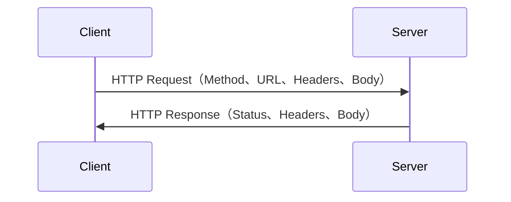

一条请求通常包含：

| 组成 | 作用 |
|---|---|
| Method | 操作意图，例如 GET、POST、PUT、DELETE |
| URL / Path | 希望访问的资源 |
| Headers | 元数据，例如内容格式、认证、缓存条件 |
| Body | 可选的实际数据，例如 JSON、表单、文件 |

**HTTP 定义的是交互语义，而不是应用如何实现业务。** HTTP 不知道 `/articles/123` 是博客、数据库记录还是 AI 推理结果——它只规定双方如何交换信息。这也是 HTTP 能成为通用协议的根本原因。

## 2. HTTP 与 TCP、TLS、QUIC 是什么关系？

把协议栈看成职责分工会清晰很多：IP 找地址，TCP/QUIC 保证送达，TLS 加密，HTTP 定义语义。

2026 年常见的三种协议栈如下：

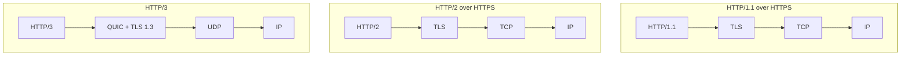

TCP 负责可靠、有序的字节传输；TLS 负责加密与身份认证；HTTP 则定义请求和响应。

HTTP/3 比较特殊：它采用 QUIC，而 QUIC 自身集成了 TLS 1.3 的握手机制，并提供可靠流、多路复用、流量控制和拥塞控制。

虽然 QUIC 使用 UDP 承载网络数据包，但它不意味着"HTTP/3 不可靠"。QUIC 在 UDP 之上重新实现了可靠传输机制。

现实的网络协议栈并不严格等同于教科书中的 OSI 七层模型。尤其是 QUIC，它将传统上位于不同层次的能力整合在了一起。

## 3. HTTP/0.9：一行文字就能组成协议（1990—1991）

1990 年前后，万维网刚刚诞生。最早的 HTTP 极其简单，以至于后来被称为 *One-line Protocol*。

客户端只需发送：

```http
GET /index.html
```

服务器直接返回 HTML 内容，没有状态码，没有 Header，没有显式协议版本，也不支持 POST。服务器通过关闭连接来标识响应结束。

这在当时完全合理，因为网页通常就是一个简单的超文本文档。随着网页开始承载图片、表单、文件下载及更复杂的内容，单行协议已经无法表达足够的信息。

## 4. HTTP/1.0：HTTP 开始成为通用应用协议（1996）

1996 年，HTTP/1.0 通过 RFC 1945 得到正式描述。最重要的变化，是引入了更完整的消息结构：

```http
GET /index.html HTTP/1.0
User-Agent: MyBrowser

```

响应包含状态码和 Header：

```http
HTTP/1.0 200 OK
Content-Type: text/html
Content-Length: 5

Hello
```

这使 HTTP 可以传输 HTML 之外的图片、音频、文件等任意格式的数据，也使客户端可以知道请求是否成功：

- `200 OK`：请求成功。
- `301 Moved Permanently`：资源永久迁移。
- `404 Not Found`：资源不存在。
- `500 Internal Server Error`：服务端内部错误。

### 4.1 HTTP/1.0 最大的性能问题

HTTP/1.0 的典型通信方式是：一次请求和响应使用一次 TCP 连接。

一个网页包含 30 张图片，每次都需要重新建立 TCP 连接。在高延迟网络里，这种成本十分昂贵。

理解这个问题需要引入 RTT（Round Trip Time，往返时间）。假设客户端和服务端之间 RTT 为 100 毫秒，仅仅完成一次 TCP 三次握手就需要大约 1 RTT。如果每个资源都重新建立连接，握手开销就会反复出现。

于是，HTTP/1.1 的核心优化之一便出现了。

## 5. HTTP/1.1：连接复用与流式传输（1997—1999）

HTTP/1.1 于 1997 年通过 RFC 2068 标准化，并于 1999 年由 RFC 2616 修订。它是互联网历史上寿命极长、影响极大的协议之一。

HTTP/1.1 有两项尤其重要的能力：**Persistent Connection（持久连接）和 Chunked Transfer Encoding（分块传输编码）。**

### 5.1 Keep-Alive：为什么不能一直复用 TCP 连接？

HTTP/1.1 默认支持持久连接，同一条 TCP 连接可以承载多个 HTTP 请求和响应：

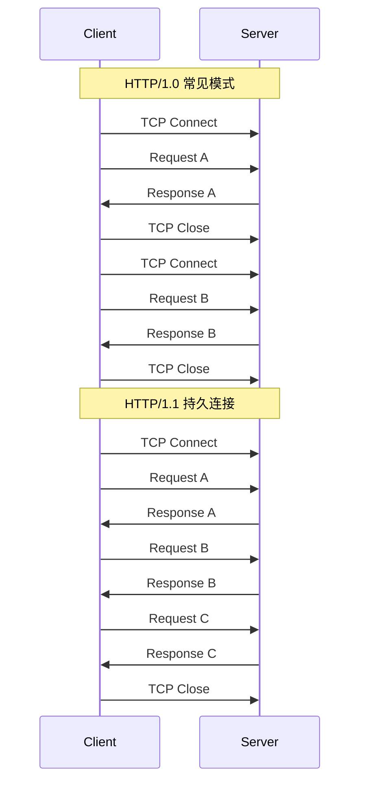

需要纠正一个常见误解：HTTP/1.1 **默认启用持久连接**，不需要主动发送 `Connection: keep-alive` 才能开启。后者主要用于兼容部分早期的连接管理方式。如果不想复用，可以发送 `Connection: close`。

但 Keep-Alive 仍然有一个局限：**连接复用不等于多路复用。**

HTTP/1.1 曾经设计过 Pipelining（管线化），允许客户端不等待上一条响应就发送后续请求。但响应仍需要按请求顺序返回，因此前面的请求一旦变慢，就可能拖住后面的响应。这叫做队头阻塞（Head-of-Line Blocking，HOL Blocking）。

### 5.2 Chunked Transfer：为什么不知道总长度，也能发送数据？

服务器在开始生成数据时，有时还不知道最终响应有多大。传统方式需要先把完整内容生成完，计算 `Content-Length`，再一次性发送，增加了首字节等待时间。

HTTP/1.1 引入的 Chunked Transfer Encoding 解决了这个问题：

```http
HTTP/1.1 200 OK
Content-Type: text/plain
Transfer-Encoding: chunked

5
Hello
6
 World
0

```

真实协议中每行使用 CRLF（`\r\n`）作为分隔。`5` 和 `6` 是十六进制块长度，最后的 `0` 表示正文结束，其后还可以存在 Trailer 字段。客户端会自动去掉分块格式，还原为 `Hello World`。

需要区分的是：**Chunked 是 HTTP/1.1 的消息分帧方式，不是 SSE，也不是应用层的事件协议。** HTTP/2 和 HTTP/3 已经使用自己的二进制帧格式，不再使用 `Transfer-Encoding: chunked`。

### 5.3 HTTP/1.1 还解决了什么？

**缓存机制**使浏览器与 CDN 不必每次都向原始服务器索取同一份资源：

```http
Cache-Control: public, max-age=3600
ETag: "version-42"
```

客户端可以在缓存过期时利用条件请求询问资源是否发生变化，服务器可以返回 `304 Not Modified`。

**内容协商**允许客户端说明自己希望接收的数据格式：

```http
Accept: application/json
Accept-Encoding: gzip, br
Accept-Language: zh-CN
```

**Host Header** 则使一台服务器可以根据域名提供不同网站，成为虚拟主机的重要基础。

## 6. HTTP/2：真正的多路复用（2015）

到 2010 年代，一个现代网页可能包含几十甚至数百个资源。浏览器过去经常通过建立多个 TCP 连接缓解并发问题——HTTP/2 的目标是用一条连接解决这个问题。HTTP/2 在 2015 年标准化，并在 2022 年由 RFC 9113 更新。

### 6.1 多路复用：一条连接，多个并发 Stream

HTTP/2 引入二进制分帧层（Binary Framing Layer）。HTTP 消息被拆成不同的 Frame，每个 Frame 可以归属于不同的 Stream，从而在同一个连接中交错传输多个请求和响应：

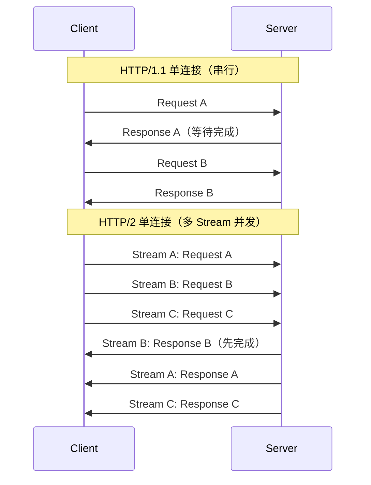

HTTP/2 还有独立的流量控制机制，使接收方能够限制每个 Stream 和整个连接的数据发送量。

### 6.2 Header Compression：HPACK

HTTP 请求通常有很多重复的 Header：

```http
Authorization: Bearer ...
Accept: application/json
Cookie: session=...
User-Agent: ...
```

HTTP/2 使用 HPACK 进行头部压缩，通过静态表、动态表和高效编码，减少重复 Header 的传输成本。这与 gzip 压缩 HTTP Body 不是一回事。

### 6.3 ALPN：客户端和服务端如何决定使用 HTTP/2？

HTTP/2 在浏览器中通常运行在 TLS 连接之上。客户端通过 TLS 的 ALPN（Application-Layer Protocol Negotiation）扩展向服务器声明支持的协议：

```text
ClientHello:
  ALPN: h2, http/1.1

Server:
  ALPN: h2
```

最终由双方协商确定应用层协议。访问同一个 `https://example.com`，浏览器实际使用哪个版本的 HTTP，并不是 URL 本身直接决定的。

另外，HTTP/2 本身并不强制要求 TLS，协议也定义了明文运行方式；只是现实浏览器中 HTTPS 上的 HTTP/2 才是主流。

### 6.4 HTTP/2 为什么还不够？

HTTP/2 解决了 HTTP 应用层的队头阻塞，却没有解决 TCP 层的队头阻塞。

TCP 提供可靠、有序的字节流。假设一个 TCP 连接中同时传输三个 HTTP/2 Stream，只要较早位置的 TCP 数据包丢失，TCP 就不能将后续字节交给应用层——因为 TCP 不理解 HTTP/2 的 Stream 边界。一个底层数据包丢失，可能同时影响多个本来互不相关的 HTTP/2 请求。

这就是 HTTP/3 想解决的核心问题之一。

## 7. HTTP/3：为什么要重新设计传输层？（2022—2026）

HTTP/3 于 2022 年通过 RFC 9114 标准化。它最重要的变化，并不是新增某个 HTTP Method，而是把底层传输从 TCP 切换到了 QUIC。QUIC 运行在 UDP 上，但提供了自己的可靠传输、拥塞控制、连接管理和多路复用能力。

### 7.1 QUIC 的 Stream 是真正独立的可靠流

在 HTTP/3 中，每个 HTTP 请求通常映射到一个 QUIC Stream。如果 Stream A 的一个数据包丢失，需要等待重传的是 A 内部受影响的数据，其他 Stream 可以继续交付已经完整到达的数据：

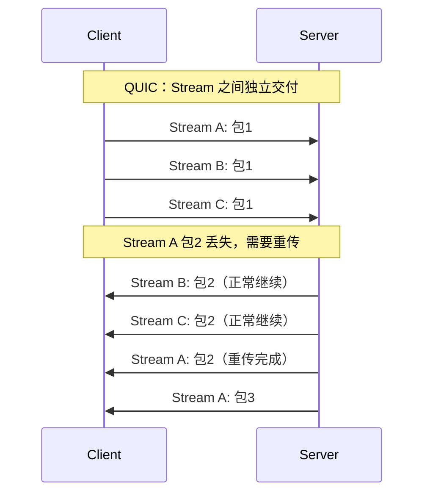

需要注意，这并不是说不同 QUIC Stream 之间毫无影响。它们仍然共享连接级拥塞控制和网络带宽，仍可能发生资源竞争。QUIC 解决的是**跨 Stream 的传输层有序交付阻塞**，而不是消除网络中的所有排队、丢包和延迟。

### 7.2 更快的连接建立

QUIC 将 TLS 1.3 握手与连接建立紧密结合。对于正常的首次 QUIC 连接，通常可以在约 1 RTT 后建立可认证的应用数据通信。在满足条件的恢复连接中，还可以使用 0-RTT Early Data，减少恢复连接时的等待。

0-RTT 数据存在重放风险，支付、创建订单等具有副作用的操作尤其需要谨慎。

### 7.3 Connection Migration：切换网络不一定需要重新建连

传统 TCP 连接与 IP 地址、端口构成的连接标识密切相关。手机从 Wi-Fi 切换至 5G，连接的网络地址可能变化。QUIC 引入 Connection ID，使连接在符合协议和实现要求的情况下可以迁移到新的网络路径，而不必完全重新建立逻辑连接。但连接迁移并不意味着任何网络切换都不会中断——服务端策略、网络限制和路径验证仍可能影响最终结果。

### 7.4 HTTP/3 仍然有头部压缩和多路复用

HTTP/3 使用 QPACK 替代 HTTP/2 的 HPACK。原因是 HPACK 的动态表更新机制依赖有序传输，而 QUIC 允许 Stream 独立交付。QPACK 将动态表更新与普通请求头的传输进行适当分离，减少跨 Stream 的阻塞风险。因此，HTTP/3 不是简单的"HTTP/2 放到 UDP 上"，而是传输层和部分 HTTP 编码机制的协同重构。

### 7.5 HTTP/3 一定比 HTTP/2 快吗？

不一定。在高延迟、存在一定丢包、频繁切换网络等环境下，HTTP/3 可能有明显优势。但如果连接已经建立，网络稳定、延迟很低，而且主要传输一个大文件，HTTP/3 未必显著快于经过充分优化的 HTTP/2。

QUIC 的加密、拥塞控制、用户态实现和网络设备兼容性也都有成本。例如 UDP/443 可能在部分企业网络中被阻断，浏览器就需要回退至 HTTP/2 等协议。

**HTTP/3 提供了更好的传输机制，但最终性能依然取决于整个系统。**

### 7.6 到了 2026 年，HTTP/3 普及了吗？

已经进入实际生产环境，但远远不是所有网站都使用 HTTP/3。

HTTP Archive 的《2025 Web Almanac》数据显示，在其移动端 HTML 请求样本中，由 CDN 提供服务的请求约有：

- 29% 使用 HTTP/3
- 69% 使用 HTTP/2
- 2% 使用 HTTP/1.1

这些数据主要反映特定测试样本和 CDN 服务情况，不能直接推导为全球全部互联网流量的占比。

**HTTP/3 的普及，很大程度由浏览器与 CDN 基础设施推动，而不是要求所有业务后端直接升级为 HTTP/3。** 一个典型生产系统可以是：

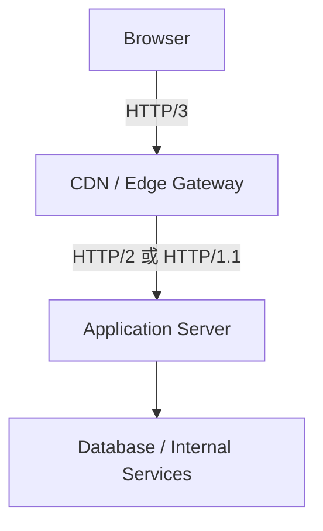

每一段通信都可以选择不同协议。外部用户看到网站支持 HTTP/3，并不代表该网站的所有微服务都改用了 QUIC。

## 8. 一张表看懂 HTTP 的演化

| 协议 | 标志性能力 | 解决的主要问题 | 仍然存在的局限 |
|---|---|---|---|
| HTTP/0.9 | 单行 GET | 获取超文本文档 | 没有状态码、Header |
| HTTP/1.0 | 状态码、Header、多种内容格式 | 通用内容传输 | 典型实现反复建立连接 |
| HTTP/1.1 | 持久连接、Chunked、缓存机制 | 连接成本、动态响应 | 单连接缺乏真正的多路复用 |
| HTTP/2 | 二进制分帧、HPACK、多路复用 | 并发请求效率 | TCP 层队头阻塞 |
| HTTP/3 | QUIC、QPACK、连接迁移 | 传输层阻塞与连接延迟 | 部署、兼容与实现复杂度 |

从 HTTP/0.9 到 HTTP/3，有一个贯穿始终的趋势：**尽可能减少不必要的等待，让更多信息能够更早、更独立地传输。**

效率之外，互联网还有另一项不可回避的要求：安全。这就是 HTTPS。

---

# 二、HTTPS：互联网如何建立安全与信任？

## 9. HTTP 为什么不安全？

传统明文 HTTP 的一个严重问题，是网络中的中间设备可能读取或修改数据。位于路径上的攻击者可能窃听请求内容，修改服务端返回的数据，或者冒充目标服务器。

HTTPS 提供三项核心安全属性：

**机密性（Confidentiality）**：第三方难以读取传输内容。

**完整性（Integrity）**：传输数据遭到未经授权的修改时，可以被检测出来。

**身份认证（Authentication）**：客户端能够验证连接的服务端是否拥有预期身份。

HTTPS 通常使用 TLS 来实现上述能力。需要强调的是，TLS 并不自动保证业务层面的不可抵赖性，也不能防止服务器自己泄露数据、网站存在 XSS 漏洞或用户被钓鱼。

## 10. HTTPS 为什么需要两种加密算法？

**对称加密**：通信双方使用共享密钥加密和解密，例如 AES。优势是速度快，适合大量数据传输。问题是：两个原本不认识的通信方，如何安全地获得相同的密钥？

**非对称密码学**：使用公钥与私钥组成的密钥对，可用于密钥协商、加密或数字签名等不同场景。它解决了很多密钥分发与身份认证问题，但一般不适合直接对大量 HTTP 内容进行加密。

现代 TLS 把不同密码学原语组合起来：身份认证（证书 + 数字签名）→ 密钥协商（ECDHE 等机制）→ 密钥派生（HKDF 等机制）→ 实际数据加密（AES-GCM / ChaCha20-Poly1305）。

这里有一个特别需要纠正的旧知识点：**现代 TLS 1.3 并不是由浏览器生成一个随机会话密钥，然后直接用服务器 RSA 公钥加密发送过去。** TLS 1.3 已经删除这种静态 RSA 密钥传输模式，使用基于临时密钥交换或其他受支持模式的密钥建立机制。

## 11. TLS 1.3 握手究竟在做什么？

TLS 1.3 于 2018 年通过 RFC 8446 标准化，是现代 HTTPS 的核心基础之一。

TLS 1.3 握手同时解决三个问题：如何协商共享密钥、如何确认对方身份、如何确保握手没有被篡改。这三件事必须在同一次交互中完成，而且顺序至关重要。

简化的首次完整握手：

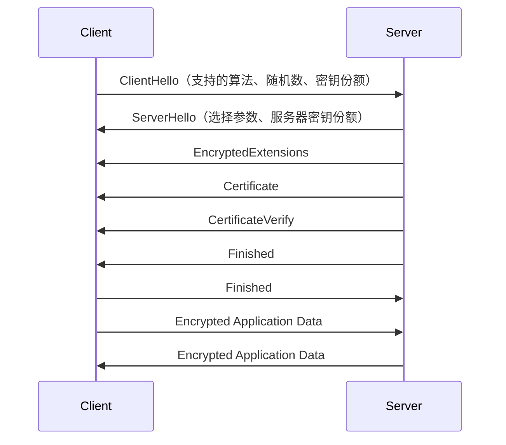

### 第一：双方如何协商共享密钥？

常见的 TLS 1.3 配置使用 ECDHE（Elliptic Curve Diffie-Hellman Ephemeral）。客户端与服务端分别生成临时私钥，并交换对应的公钥信息。双方利用自己的私钥和对方的公钥，分别计算得到相同的共享秘密。网络监听者即使观察到双方交换的公钥，也不应能够在合理的计算成本下推导出共享秘密。TLS 再使用密钥派生机制，从共享秘密以及握手上下文中生成实际加密使用的密钥。

### 第二：如何确保对方不是攻击者？

客户端需要确认服务器提供的证书确实适用于正在访问的域名，并通过可信的证书链获得验证。服务器还需要证明自己拥有与证书中公钥对应的私钥。在 TLS 1.3 中，服务器通过 `CertificateVerify` 对握手上下文进行数字签名，从而提供相应的拥有私钥证明。

单纯使用 Diffie-Hellman 密钥交换还不够：它能让双方协商秘密，但如果没有可靠身份认证，就可能受到中间人攻击。

### 第三：如何确认握手没有被篡改？

TLS 1.3 使用 `Finished` 消息验证握手过程的完整性。双方完成必要的验证后，便可以安全地交换应用数据。

现代 TLS 的核心设计，是将身份认证、密钥协商、握手完整性保护和应用数据加密结合起来。

## 12. HTTPS 的证书链：浏览器为什么信任一个陌生网站？

如果服务器直接告诉你"这是我的公钥，请相信我"，攻击者也可以这么做。于是，互联网引入了 CA（Certificate Authority，证书颁发机构）体系：

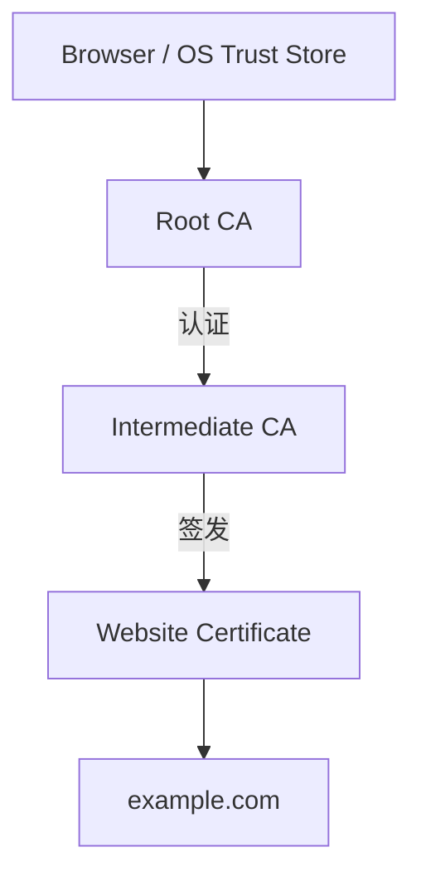

浏览器验证证书时，至少需要考虑：证书链中的签名是否有效；证书是否适用于访问的域名；证书是否处于允许的有效期；整个验证路径是否能够连接到可信的根；以及相关浏览器策略和证书状态要求。

CA 本身代表一种制度化的信任基础设施，不是绝对不会出错的。现代浏览器生态还引入了 Certificate Transparency（证书透明度）等机制，用于提高证书签发行为的可审计性。

## 13. 2018—2026：HTTPS 还有哪些重大变化？

### 13.1 TLS 1.3：更少握手、更严格的密码学设计

TLS 1.3 显著简化了密码套件选择，取消了许多旧式或不推荐的机制，提高握手效率，并让普通的完整握手支持前向保密性。

所谓前向保密（Forward Secrecy），意思是：即使服务器的长期身份私钥将来泄露，攻击者通常也不能仅凭该私钥解密过去录制的、使用合适临时密钥交换建立的会话。它不是说密钥永远不会泄露，也不意味着主机被入侵后历史业务数据就一定安全。

### 13.2 自动化证书管理

过去，证书申请、更新和安装往往是人工运维任务。ACME 协议和 Let's Encrypt 等基础设施，使域名验证、证书签发与续期可以自动化完成。如今，HTTPS 不再是某些高安全场景的额外配置，而是公共 Web 服务的默认期望。

### 13.3 ECH：进一步隐藏连接目标（2026）

传统 HTTPS 虽然加密 HTTP Body、请求路径和大部分 Header，但 TLS 握手中的 SNI（Server Name Indication）在常见旧配置下可能以明文暴露目标域名。

2026 年 3 月，IETF 发布 RFC 9849，将 ECH（Encrypted Client Hello）标准化。ECH 可以加密 TLS ClientHello 中包括真实 SNI 在内的敏感信息，从而减少旁观者获得目标域名信息的机会。

这不等于完全匿名：目标 IP、流量特征、DNS 查询方式及其他元数据仍可能泄露信息，具体效果取决于网络部署。

### 13.4 后量子混合密钥交换（2026）

2026 年 8 月，RFC 10024 定义了用于 TLS 1.3 的三种传统算法与后量子算法混合密钥建立机制，其中包括：

`X25519MLKEM768`

它把经典椭圆曲线密钥交换与后量子 ML-KEM 结合起来，以降低未来量子计算能力带来的风险。这体现了一种务实的协议演进策略：不是立刻丢弃成熟密码学体系，而是通过混合设计实现逐步迁移。

后量子混合密钥交换也不意味着整个 TLS 证书和签名体系都已经完成后量子迁移。

---

# 三、服务端推送：HTTP 为什么可以变得"实时"？

## 14. 从 Pull 到 Push：问题究竟出在哪里？

HTTP 最初采用 Request–Response 模型：客户端主动发请求，服务端在请求上下文中返回响应。如果应用变成在线聊天、股票行情、消息通知、多人协同，就出现了一个根本问题：**服务器有新数据，但没有机制主动通知客户端。**

最容易想到的办法是客户端反复询问——这就是 Polling（轮询）：

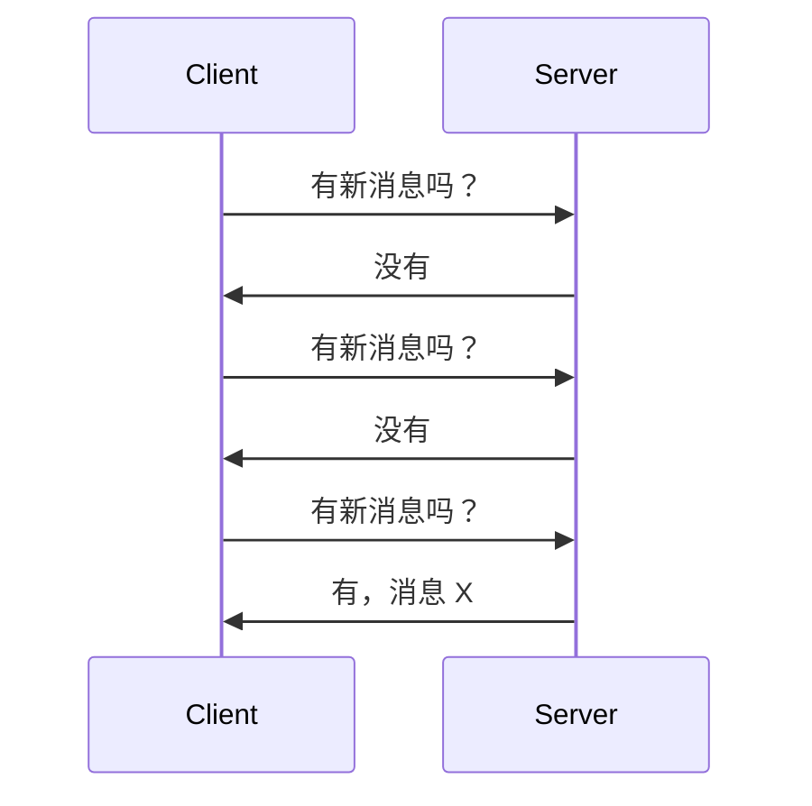

假设每 10 秒轮询一次，每小时将发送 360 次请求。即使期间只有一条新消息，大部分请求也没有获取到新的业务信息；而且如果消息刚好在一次轮询结束后到达，还可能需要再等接近 10 秒才能被发现。

**Pull** 由客户端决定何时获取数据；**Push** 则强调当有新事件产生时，服务端能够及时把数据发送给已建立接收关系的客户端。

不过，Push 与 Pull 并不是非此即彼的协议属性。客户端先发起 HTTP 请求，服务器随后在该响应中持续输出事件，也能在应用体验上实现服务端推送。

## 15. Long Polling：让服务器晚一点回答

Long Polling 的核心技巧：客户端发起请求后，如果服务端暂时没有新事件，就先不返回最终响应，直到发生新事件或者请求超时，才完成响应。客户端收到响应后立即发起下一次请求：

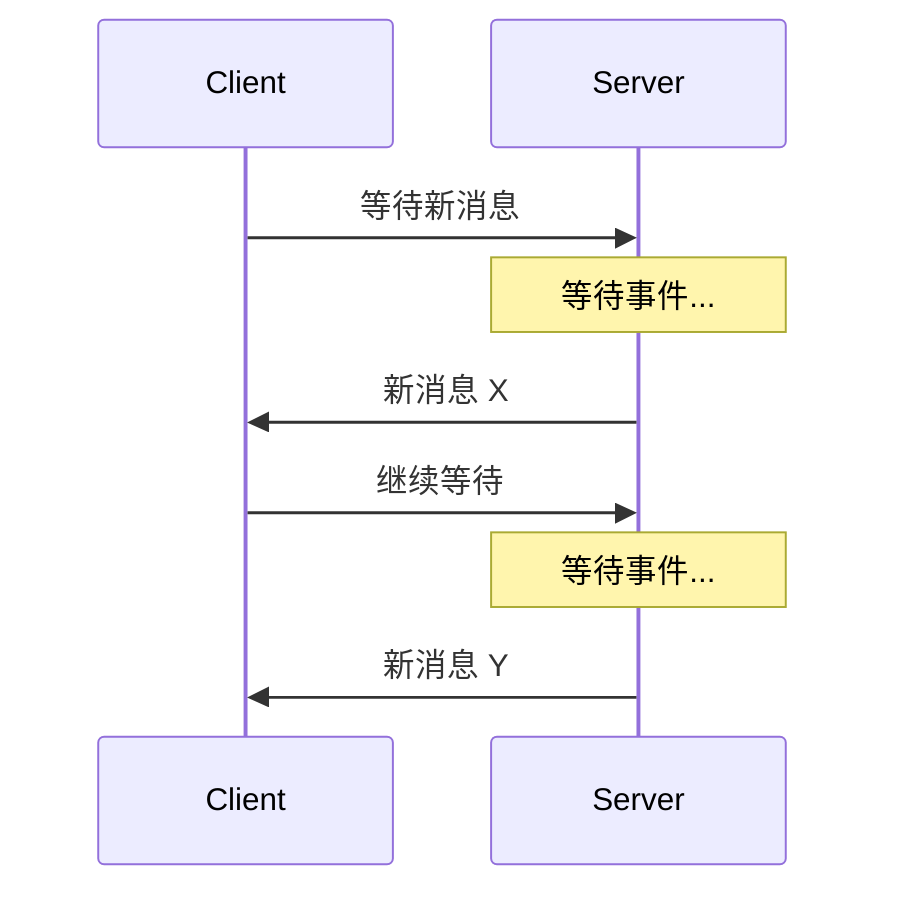

长轮询曾是 Comet 技术家族的重要实现方式，在即时通信和消息系统中发挥过重要作用。

要注意两个容易混淆的概念：**Long Polling 是延迟完成一次响应；HTTP Streaming 则是在一次响应中持续传输多段数据。** 它们不是同一个机制。Long Polling 本身也不要求 HTTP/1.1 的 Chunked Transfer Encoding——服务端可以等待事件出现后，返回一个普通的完整响应。

## 16. HTTP Streaming：一次请求，持续收到多个事件

HTTP Streaming 的思路是：客户端建立一次请求，服务端开始返回响应，但暂时不结束响应正文。每当有新数据，就继续向同一响应流写入数据：

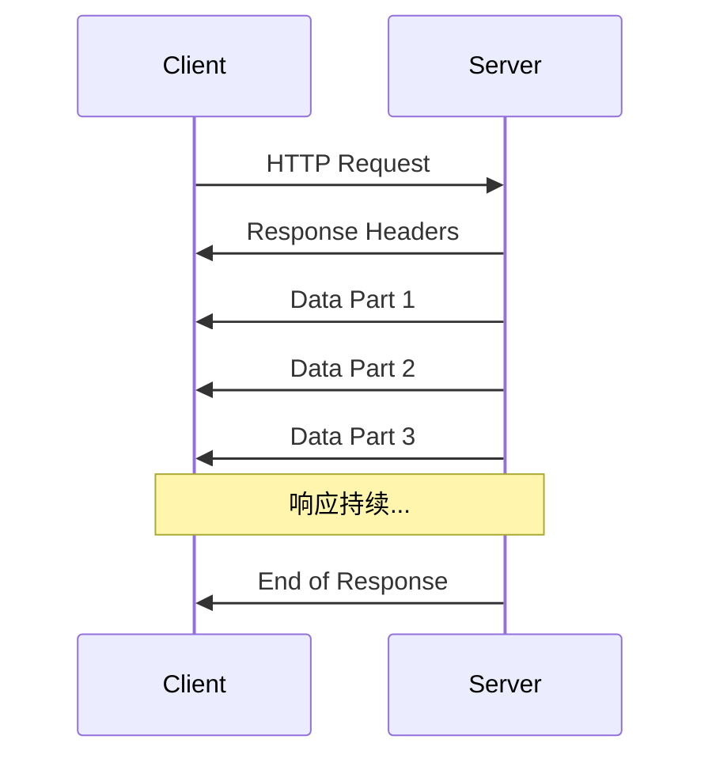

对于 HTTP/1.1，可以使用 Chunked Transfer Encoding 实现未知长度的流式响应。对于 HTTP/2 和 HTTP/3，则利用各自的 DATA Frame 和 Stream 机制持续交付正文内容。

仅仅持续发送字节还存在一个问题：客户端如何知道哪里是一个完整事件的边界？TCP 本身只提供字节流。即使服务端执行三次写入，客户端也可能分多次、一次或以不同边界读到这些数据。因此，还需要应用层消息格式。SSE 就是一种简洁的标准化解决方案。

## 17. SSE：为什么现代 AI 产品大量使用它？

SSE（Server-Sent Events）是一种基于 HTTP 响应流的服务端事件推送格式。其浏览器原生接口叫作 `EventSource`。

服务器返回：

```http
HTTP/1.1 200 OK
Content-Type: text/event-stream
Cache-Control: no-cache

event: message
id: 101
data: {"text":"Hello"}

event: message
id: 102
data: {"text":" World"}

```

其中：

- `event` 指定事件类型。
- `id` 指定事件标识。
- `data` 包含事件内容。
- 空行表示一个事件结束。

浏览器可以通过：

```javascript
const source = new EventSource("/events");

source.addEventListener("message", (event) => {
  const data = JSON.parse(event.data);
  console.log(data.text);
});
```

持续接收服务端产生的事件。

SSE 直接建立在现有 HTTP 体系上，不需要升级成一个完全不同的应用协议。它天然适合从服务端向客户端传输文本事件，而且原生 `EventSource` 提供自动重连和基于事件 ID 的恢复请求机制。

"自动重连"不意味着服务端自动保存了历史消息。如果希望断线后补齐遗漏事件，服务端必须提供事件保留、游标和重放逻辑。

### 17.1 SSE 是一种应用格式，而不仅是一种网络连接

SSE 的核心是 `text/event-stream` 格式。浏览器的 `EventSource` 通常通过 GET 请求建立 SSE 连接。但也可以使用 Fetch API 发起 POST 请求，然后用 `ReadableStream` 读取响应数据，并自行解析 SSE 格式：

```javascript
const response = await fetch("/api/chat", {
  method: "POST",
  headers: {
    "Content-Type": "application/json"
  },
  body: JSON.stringify({
    message: "Explain HTTP/3"
  })
});

const reader = response.body.getReader();
const decoder = new TextDecoder();

while (true) {
  const { value, done } = await reader.read();

  if (done) break;

  const text = decoder.decode(value, {
    stream: true
  });

  console.log(text);
}
```

上面代码仅展示了如何逐段读取 HTTP 响应，还不是一个完整的 SSE 解析器。实际生产代码必须处理 UTF-8 跨块字符、SSE 事件边界、字段解析等问题，不能假设一次 `read()` 就对应一个完整事件。

SSE 也没有被 HTTP/3 淘汰。它运行在 HTTP 的响应正文层面，因此可以使用 HTTP/1.1、HTTP/2 或 HTTP/3 作为底层传输。

### 17.2 SSE 的局限

SSE 是服务端到客户端的单向事件流。如果客户端需要向服务端发送新指令，通常需要再发起普通 HTTP 请求。原生 `EventSource` 也不适合要求自定义 POST 请求体或任意自定义认证 Header 的场景；这时可以使用 Fetch Streaming 或其他方式。

在没有 HTTP/2 多路复用的场景里，浏览器对同一来源的并发连接数量限制可能成为问题。

## 18. WebSocket：为什么还需要双向协议？

SSE 可以很好地处理"服务端持续告诉客户端发生了什么"。但在线游戏场景下，客户端需要不断上传玩家坐标，服务端也需要持续推送其他玩家的位置。如果使用普通 HTTP 请求加 SSE，就需要组合多条通信链路。

WebSocket 的思路更加直接：**建立一个持久化的双向通信通道，让双方都能够主动发送消息。**

WebSocket 协议在 2011 年通过 RFC 6455 标准化。在经典 HTTP/1.1 握手中，客户端发送：

```http
GET /chat HTTP/1.1
Host: example.com
Upgrade: websocket
Connection: Upgrade
Sec-WebSocket-Version: 13
Sec-WebSocket-Key: ...

```

如果服务器接受升级，返回：

```http
HTTP/1.1 101 Switching Protocols
Upgrade: websocket
Connection: Upgrade
Sec-WebSocket-Accept: ...

```

随后，连接进入 WebSocket 协议通信。WebSocket 使用自己的帧结构，支持文本和二进制消息，并具有 Ping/Pong、关闭连接等控制机制：

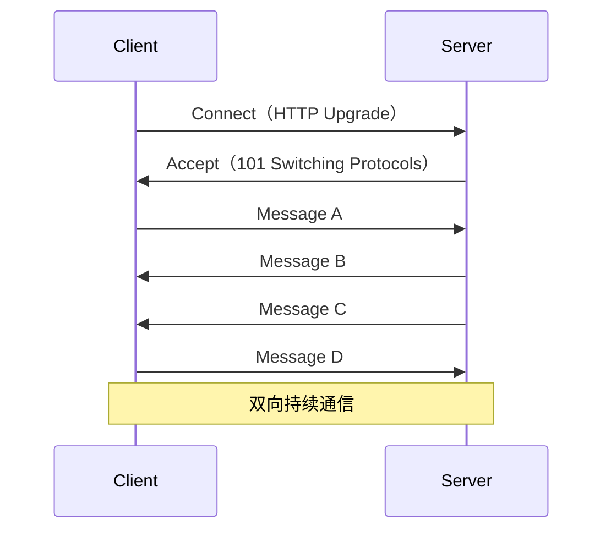

### 18.1 2018—2026：WebSocket 已经不局限于 HTTP/1.1 Upgrade

传统入门文章往往把 WebSocket 描述为"先通过 HTTP Upgrade，然后升级协议"。这对于 HTTP/1.1 是正确的经典模型。但在 HTTP/2 与 HTTP/3 中，协议演进出了 Extended CONNECT 方式：

- RFC 8441 定义了 WebSocket 如何在 HTTP/2 连接上运行。
- RFC 9220 将对应机制适配至 HTTP/3。

因此，不能再认为所有 WebSocket 连接都必须表现为 HTTP/1.1 的 `101 Switching Protocols` 握手。实际使用哪一种建连方式，还取决于浏览器、服务器和中间网络基础设施的支持情况。

### 18.2 WebSocket 为什么不是所有实时系统的最佳选择？

WebSocket 功能更强，但也要求应用管理更多细节：连接断开后如何恢复状态、消息如何确认、慢客户端如何限流、连接如何分布到不同服务节点、业务消息如何认证，以及应用层如何处理重复和乱序事件。

浏览器的经典 WebSocket API 也没有提供与 Streams API 完全一致的内置背压处理模型。

另外，WebSocket 不受浏览器传统 HTTP 同源策略的直接限制，但这并不意味着安全问题消失。服务端需要验证 `Origin`，并正确处理用户身份与授权。

如果需求只是持续输出一段 AI 回答，使用 WebSocket 往往没有必要。但对于多人协作、实时游戏、交互式终端、频繁双向控制等场景，WebSocket 依然十分合适。

## 19. HTTP/2 Server Push：一个非常成功的失败案例

HTTP/2 Server Push 的初衷不是推送聊天消息，也不是传输 AI 生成的文本，而是用于优化网页资源加载。

客户端请求 `GET /index.html` 时，服务端知道浏览器接下来可能还需要 `/style.css` 和 `/app.js`，于是通过 `PUSH_PROMISE` 等协议机制提前发送这些资源对应的响应，而不必等待浏览器解析 HTML 后再次请求。

从理论上看，这很聪明。但真实世界中暴露出了很多问题：服务器难以准确知道浏览器已经缓存了哪些资源；提前发送的资源可能根本不需要；推送资源还可能占用本应用来优先传输 HTML 等关键内容的带宽。

因此，这项技术实际部署有限，并且在一些情况下反而导致性能下降。Chrome 从 106 版本开始默认移除了 HTTP/2 Server Push 支持。HTTP/3 规范虽然保留了 Push 相关机制，但这并不意味着它已经重新成为网页优化的主流方案。

### 19.1 替代方案：103 Early Hints

现代 Web 性能优化更重视让浏览器提前知道可能需要哪些关键资源，而不是由服务端擅自把整个资源推过去：

```http
HTTP/1.1 103 Early Hints
Link: </style.css>; rel=preload; as=style

HTTP/1.1 200 OK
Content-Type: text/html

<html>...</html>
```

`103 Early Hints` 允许服务端在最终响应准备好之前，提前给浏览器提供资源提示。浏览器仍然可以自行判断是否需要发起请求。与 HTTP/2 Server Push 最大的不同，是将资源调度决策更多地交还给客户端。

**服务器知道得更多，不代表服务器应该替客户端作出所有决策。**

不要混淆这几种技术：

| 技术 | 推送的内容 |
|---|---|
| HTTP/2 Server Push | 预测浏览器可能需要的 HTTP 资源 |
| SSE | 持续发送应用层事件 |
| WebSocket | 双向发送应用层消息 |
| Web Push | 借助推送基础设施通知浏览器或设备 |

它们共享 Push 一词，但解决的根本不是同一个问题。

## 20. Web Push、WebRTC 与 WebTransport

### Web Push：页面没打开也可以收到通知

SSE 和 WebSocket 一般要求应用维持活跃的通信关系。Web Push 结合 Push API、Service Worker 和浏览器的推送服务，让应用能够在适当的权限与平台条件下接收推送事件。它特别适合通知、提醒、营销消息等场景，但依赖浏览器权限、系统策略和推送服务，不是高频实时数据传输的替代品。

### WebRTC：低延迟音视频与点对点通信

WebRTC 主要面向实时音视频和数据通信。它涉及 ICE、STUN、TURN、DTLS、SRTP、SCTP 等一系列网络机制。WebRTC 可以根据具体情况建立点对点路径，也可能通过中继服务器传输。例如视频会议、实时语音 AI、浏览器间数据通道，都可能使用 WebRTC。

WebRTC 与 WebSocket 最大的差异，不只是双向性，而是它专门针对实时媒体传输、网络穿透、时延和丢包进行了设计。

### WebTransport：HTTP/3 时代的新选择

WebTransport 提供基于 HTTP/3 传输的双向通信能力。它能够支持多个可靠 Stream，以及适合低延迟场景的不可靠 Datagram。例如在线游戏中，玩家的关键操作需要可靠送达，但高频位置更新可能更重视最新状态，而不是每一条历史状态都重传。WebTransport 能够帮助应用在不同消息之间选择不同的可靠性模型。

截至 2026 年，WebTransport 已有浏览器实现，但跨浏览器兼容性、服务端支持和标准化进度仍需要针对实际部署验证。其 HTTP/3 绑定规范在 2026 年仍处于 IETF Internet-Draft 阶段，不能简单认为它已经全面取代 WebSocket。

---

# 四、2026 年的技术实践：AI 为什么让 HTTP Streaming 再次重要？

## 21. 为什么 ChatGPT 一般不需要 WebSocket 就能逐字输出？

对于生成式语言模型，完整响应可能需要十几秒甚至几分钟。如果等待所有 Token 生成完成再返回，用户体验会很差。更合理的方式是：模型产生新的输出片段后，服务器就尽快将其发送给客户端：

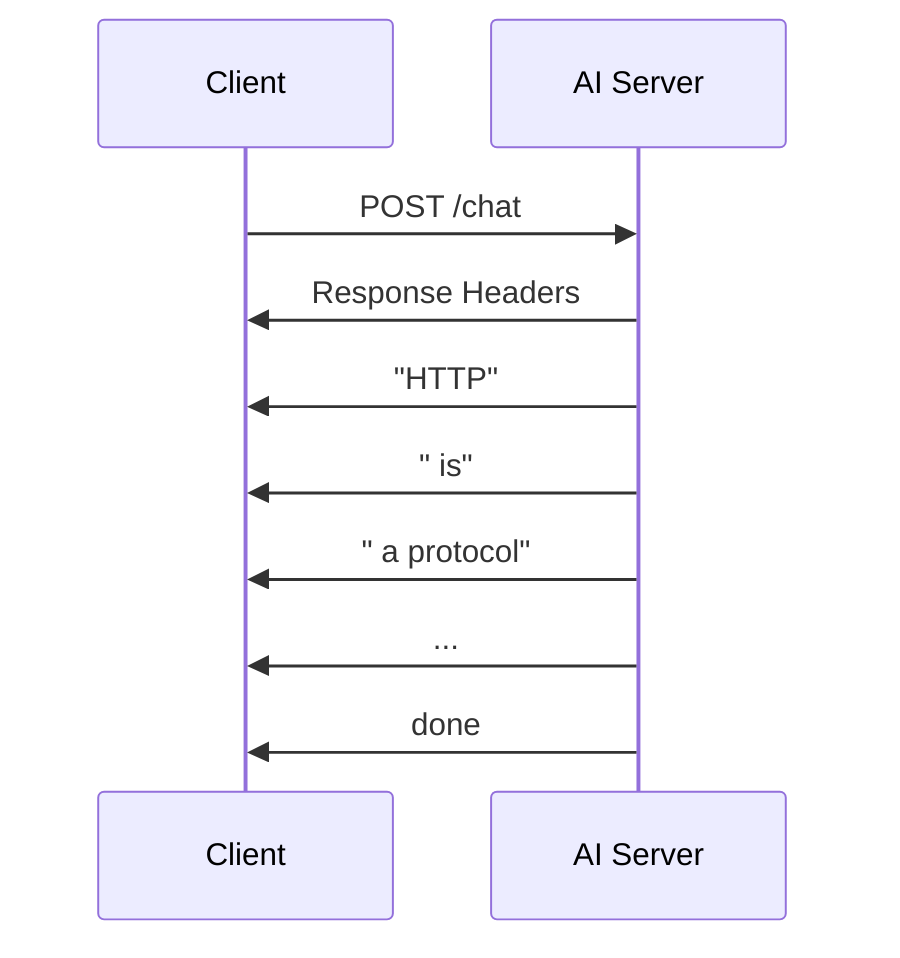

HTTP Streaming 非常适合这种场景。如果返回内容采用 SSE 事件格式，应用还能够把文本生成与模型运行状态、工具调用、错误信息等区分开来：

```text
event: message.delta
data: {"text":"HTTP"}

event: message.delta
data: {"text":" is a protocol"}

event: message.completed
data: {"finish_reason":"stop"}
```

需要强调：模型服务通常会按生成过程产生文本片段，但网络上不保证严格做到"一个 Token 对应一个网络数据包或一个 SSE 事件"。实际还可能存在服务端缓冲、批量发送、代理缓冲和客户端分块读取等行为。

### 21.1 为什么 SSE 对 AI 很合适？

普通文本生成具备三个特点：

第一，用户发起一个请求之后，主要数据方向是从服务端到客户端。

第二，响应可能持续较长时间，且更早展示部分结果具有明显价值。

第三，返回内容除了文本，还可能包含不同类型的结构化事件。

这些特点恰好符合 HTTP Streaming + SSE 的设计。而且，它可以复用现有 HTTP 身份认证、负载均衡、监控、网关与开发工具体系。对于大多数文本聊天应用，SSE 或普通 HTTP 流式响应往往比自定义 WebSocket 协议更简单。

## 22. AI Agent 的出现让问题进一步复杂化

普通 Chatbot 的交互通常是：User → Model → Streaming Answer。

而一个复杂 Agent 可能需要：User → Task Planning → Tool Call → External API → Human Approval → More Tool Calls → Final Result。任务可能持续几分钟，甚至几个小时。

问题已经不只是"如何流式输出文本"，而是：**如何将长时间运行的任务状态可靠地同步给客户端？**

通信协议和业务任务需要解耦。一种常见的设计是：

```mermaid
flowchart TD
    A[Client] -->|POST /runs| B[API Gateway]
    B --> C[Task Orchestrator]
    C --> D[Queue]
    D --> E[Workers]
    E --> F[Task Events]
    F --> G[Event Store]
    G -->|GET /runs/{id}/events SSE Stream| A
```

客户端首先提交任务。服务端创建任务 ID，然后异步执行任务，把状态变化写入事件系统。客户端通过 SSE 订阅任务事件：

```text
event: run.started
data: {"run_id":"r123"}

event: tool.started
data: {"tool":"search"}

event: tool.completed
data: {"tool":"search","count":5}

event: approval.required
data: {"approval_id":"a1"}

event: run.completed
data: {"run_id":"r123"}
```

如果需要用户批准某个操作，可以另外发送：

```http
POST /runs/r123/approvals/a1
Content-Type: application/json

{"approved":true}
```

**业务上的双向交互，并不意味着传输层必须使用 WebSocket。** HTTP 请求可以负责提交命令，SSE 可以负责传递状态变化。只有在需要频繁、持续、低延迟的双向交互时，WebSocket 或其他双向传输方案才更有吸引力。

## 23. MCP 的发展也验证了这个方向

MCP（Model Context Protocol）为 AI 应用和外部工具之间的通信定义了标准化交互方式。其早期远程传输设计曾广泛采用 HTTP+SSE 模式。2025 年 3 月，MCP 引入 Streamable HTTP，进一步统一远程交互方式。

截至 2026 年 10 月，MCP 最新的 2026-07-28 版本作出了重要调整。根据官方规范，当前的 Streamable HTTP 传输使用单一 HTTP POST 入口，每条 JSON-RPC 消息通过独立请求发送；响应可以是普通 JSON，也可以是与该请求关联的 SSE 流。

2026-07-28 修订移除了旧设计中的独立 GET 事件流入口与协议层会话机制。持续变更订阅通过特定的 POST 请求获得长时间运行的 SSE 响应。

这体现出 AI 通信协议设计逐渐更重视请求边界、取消语义、状态归属、可观测性以及与既有 HTTP 基础设施的兼容。

不过，这不意味着所有已有 MCP SDK 或服务器都已经升级到最新规范。2025 版与 2026 版之间存在实际兼容问题，需要明确版本协商。

## 24. 实际设计流式系统，最难的往往不是通信协议

协议解决的是传输能力，而不是所有业务可靠性问题。

### 24.1 网络连接断开，不代表任务应该终止

一个 Agent 任务可能运行 30 分钟。如果浏览器刷新，SSE 连接断开，服务端该不该取消任务？答案取决于产品语义。如果任务已经创建订单、调用外部系统或启动后台审批，客户端断线不应自动导致所有业务动作被撤销。

**业务任务生命周期应明确区分于 HTTP 连接生命周期。**

### 24.2 如何断点恢复？

SSE 支持事件 ID，但恢复机制需要服务端配合。一种方式是为持久化业务事件赋予单调递增的序号：

```text
Event 1001: run.started
Event 1002: tool.started
Event 1003: tool.completed
Event 1004: approval.required
```

客户端断线后，可以携带最后接收到的事件 ID。服务器再从事件存储中读取后续事件进行补发。但这个机制必须由应用明确实现。对于 AI 的高频 Token 输出，并不一定需要永久保存每个片段——可以根据需求选择持久化关键状态事件、阶段性输出快照以及最终结果。

### 24.3 如何处理重复消息？

重连或重试可能导致事件重复传递。生产级系统通常需要事件 ID、幂等操作、去重逻辑，以及明确的事件顺序模型。

**SSE、WebSocket 和 HTTP/3 本身都不会自动提供业务层面的 Exactly-Once Processing。**

### 24.4 慢客户端怎么办？

假设一个客户端每秒只能消费 10 条消息，服务端却每秒产生 1,000 条事件。数据就会不断累积，必须考虑 Backpressure（背压）。常见处理包括限制发送速率、聚合状态更新、丢弃可替代的中间进度、设置有界队列，以及在必要时关闭过载连接。

例如实时任务进度从 31% 到 32%、33%、34%，可能不需要每个中间状态都完整发送。但审批结果、任务完成状态、交易确认等关键事件不能随意丢弃。

### 24.5 HTTP 响应已经开始，后续还能返回 500 吗？

不能把一个已经发送响应头的流式响应，当成尚未发送的普通 HTTP 响应。服务端已经返回：

```http
HTTP/1.1 200 OK
Content-Type: text/event-stream
```

之后即使执行失败，也无法重新把最初的 HTTP 状态码修改为 `500`。因此，流式协议通常需要应用层错误事件：

```text
event: run.failed
data: {"code":"TOOL_TIMEOUT"}
```

这是很多初学者实现 Streaming API 时容易遗漏的边界。

### 24.6 为什么本地能流式输出，上线后却突然一次性显示？

一个常见原因是反向代理或网关的响应缓冲。应用服务器可能已经逐段输出，但中间设备把多个数据片段缓存后才一次性发给客户端。

在 NGINX 等环境下，需要检查 Proxy Buffering、超时和相关配置；某些方案可通过 `X-Accel-Buffering: no` 指示禁用响应缓冲。还应检查服务端是否及时 flush、内容压缩是否引入缓冲，以及客户端是否真正逐段读取响应。这类问题与 HTTP/1.1、HTTP/2 或 HTTP/3 都可能有关，不应简单归结为协议版本。

---

# 五、如何选择实时通信技术？

| 技术 | 方向 | 最合适的场景 | 主要代价 |
|---|---|---|---|
| Short Polling | 客户端定期请求 | 低频状态查询 | 无效请求、事件延迟 |
| Long Polling | 请求后等待事件 | 简单消息通知、兼容旧系统 | 请求重建与超时管理 |
| HTTP Streaming | 响应持续返回 | 文件流、AI 输出、长请求 | 需要自行设计消息边界 |
| SSE | 服务端 → 客户端 | AI Streaming、任务进度、事件通知 | 原生 EventSource 单向、文本格式 |
| WebSocket | 双向 | 聊天、协同、终端、实时交互 | 连接状态、背压和重连管理 |
| Web Push | 推送服务 → 设备 | 离线通知、后台提醒 | 权限与平台依赖 |
| WebRTC | 双向媒体 / 数据 | 实时音视频、语音 AI | 网络穿透、媒体与连接管理 |
| WebTransport | 多流双向 + Datagram | 游戏、特殊低延迟应用 | 生态兼容与部署复杂度 |

实践中，最重要的不是"哪项技术更新"，而是明确应用真正需要哪些能力。

一个纯文本 AI 聊天应用，通常可以使用 POST + SSE。一个需要实时语音输入与输出的 AI 系统，可能更适合 WebRTC。一个需要频繁双向控制的远程终端，WebSocket 非常自然。而一个持续运行数小时的 Agent，最重要的可能不是 WebSocket 还是 SSE，而是任务持久化、事件日志、取消和恢复机制。

---

# 六、动手实践：真正观察 HTTP 与 Streaming

理解网络协议，最有效的方式仍然是亲手发送请求、抓包和观察。

## 实验一：不用浏览器，手工发送 HTTP 请求

在终端启动一个简单的 HTTP 服务器：

```bash
python3 -m http.server 8080
```

然后在另一个终端输入：

```bash
printf 'GET / HTTP/1.1\r\nHost: localhost\r\nConnection: close\r\n\r\n' \
  | nc 127.0.0.1 8080
```

可以观察返回的原始 HTTP 响应。

Python 自带的 `http.server` 默认可能返回 HTTP/1.0 格式的响应，即使客户端发送的是 HTTP/1.1 请求。这是一个方便的入门实验，但不应把它当成 HTTP/1.1 的完整功能测试工具。

尤其值得观察 `\r\n\r\n`。它代表 Header 区域结束，后面的内容进入 Body。

## 实验二：通过 curl 检查 HTTP 协议版本

尝试：

```bash
curl -v --http1.1 https://example.com
```

然后：

```bash
curl -v --http2 https://example.com
```

如果 curl 编译时包含对应能力，还可以尝试：

```bash
curl -v --http3-only https://example.com
```

并不是所有 curl 构建版本都支持 HTTP/2 和 HTTP/3。可以先通过：

```bash
curl -V
```

检查当前支持的功能。观察重点包括：TLS 握手、ALPN 协商、HTTP 协议版本、响应 Header，以及请求和响应的时序。也可以打开浏览器开发者工具，在 Network 中启用 Protocol 列，观察不同资源的传输协议。

## 实验三：通过 OpenSSL 观察 TLS 1.3

运行：

```bash
openssl s_client \
  -connect example.com:443 \
  -servername example.com \
  -tls1_3 \
  -alpn h2 \
  -showcerts
```

这个命令可以展示 TLS 连接相关信息，包括证书链、协商协议及加密参数。重点观察：

- 服务器发送的证书。
- TLS 版本。
- 协商使用的密码套件。
- ALPN 结果。

需要注意，展示证书链不等于应用已经按浏览器策略完成所有证书验证。`openssl s_client` 的验证选项和错误处理应单独检查。

## 实验四：自己搭建一个 SSE 服务器

这个实验只需要 Python 标准库。新建 `sse_server.py`：

```python
from http.server import BaseHTTPRequestHandler, ThreadingHTTPServer
import json
import time

class Handler(BaseHTTPRequestHandler):
    protocol_version = "HTTP/1.1"

    def do_GET(self):
        if self.path == "/":
            html = """
            <h2>SSE Demo</h2>
            <pre id="output"></pre>
            <script>
              const es = new EventSource("/events");

              es.addEventListener("tick", e => {
                const data = JSON.parse(e.data);
                document.querySelector("#output")
                  .textContent += data.message + "\\n";

                if (e.lastEventId === "10") es.close();
              });
            </script>
            """

            body = html.encode()
            self.send_response(200)
            self.send_header(
                "Content-Type", "text/html; charset=utf-8"
            )
            self.send_header("Content-Length", str(len(body)))
            self.end_headers()
            self.wfile.write(body)
            return

        if self.path != "/events":
            self.send_error(404)
            return

        self.send_response(200)
        self.send_header("Content-Type", "text/event-stream")
        self.send_header("Cache-Control", "no-cache")
        self.send_header("X-Accel-Buffering", "no")
        self.end_headers()

        try:
            for i in range(1, 11):
                payload = json.dumps({
                    "message": f"Event {i}"
                })

                event = (
                    f"id: {i}\n"
                    f"event: tick\n"
                    f"data: {payload}\n\n"
                )

                self.wfile.write(event.encode())
                self.wfile.flush()
                time.sleep(1)
        except (BrokenPipeError, ConnectionResetError):
            pass
        finally:
            self.close_connection = True

server = ThreadingHTTPServer(
    ("127.0.0.1", 8765), Handler
)

server.serve_forever()
```

执行：

```bash
python3 sse_server.py
```

然后打开浏览器：`http://127.0.0.1:8765`

你会看到事件逐秒显示：

```text
Event 1
Event 2
Event 3
...
Event 10
```

这个实验也可以通过 curl 观察：

```bash
curl -N http://127.0.0.1:8765/events
```

其中 `-N` 用于关闭 curl 的输出缓冲。

接下来可以做几个变化：给事件增加不同的 `event` 类型；在浏览器收到第 5 条事件后断开连接；模拟服务器报错；或者让服务器生成速度快于客户端消费速度，观察流式通信中的缓冲与可靠性问题。

以上只是单机教学实现，没有增加生产环境所需的事件持久化、断线重放、认证、限流、心跳和完善的超时管理。

## 实验五：抓包理解传输层

在 macOS 上，可以尝试：

```bash
sudo tcpdump -i lo0 -nn 'tcp port 8765'
```

Linux 通常使用 `lo` 作为 loopback 接口名。如果希望保存抓包结果：

```bash
sudo tcpdump -i lo0 -w demo.pcap 'tcp port 8765'
```

然后用 Wireshark 打开。

对于本地明文 HTTP，可以直接查看 TCP 数据包中的 HTTP 内容。对于 HTTPS，仅使用 tcpdump 通常无法直接查看加密后的 HTTP 正文。

如果希望分析 TLS 连接内部的应用数据，可以在受控实验环境中，利用浏览器或客户端支持的 TLS Key Log 功能记录会话密钥，再通过 Wireshark 解密。

对于 HTTP/3，应关注 UDP/443 上的 QUIC 通信，而不是寻找传统 TCP HTTP 报文。

注意不要在生产环境中随意记录 TLS 会话密钥或分享含敏感信息的抓包文件。

---

# 七、总结：HTTP 的演化揭示了哪些技术设计规律？

回顾 HTTP 三十多年的发展，每一代协议几乎都对应互联网应用形态的变化。

1990 年代，互联网主要传输静态文档，HTTP/0.9 和 HTTP/1.0 已经足够有用。随着页面内容变得复杂，HTTP/1.1 引入持久连接、分块传输与缓存机制。随着网页从简单文档变成复杂应用，HTTP/2 通过多路复用和 Header Compression 提高并发效率。随着移动互联网对低延迟与不稳定网络的要求增加，HTTP/3 将传输层重新构建在 QUIC 之上。

与此同时，HTTPS 从一种相对昂贵的额外安全机制，发展为互联网的基本安全要求。TLS 1.3、ECH、证书自动化和后量子密钥交换，代表着隐私、安全与效率的持续改进。

而服务端推送技术则走了另一条演化路线：从周期性 Polling，到 Long Polling、HTTP Streaming、SSE、WebSocket，再到 WebRTC 与 WebTransport，互联网逐渐从"下载一个资源"，发展为"持续进行交互"。

AI 时代又把这种需求进一步放大。过去，我们希望服务器尽快返回完整答案。现在，我们更关心服务器能否尽早返回部分结果、持续报告执行状态、接受中途控制，并在客户端断线后可靠恢复任务。

但最值得思考的结论，可能不是"新协议越来越强大"。

**HTTP 的成功，本质上来自稳定的抽象与持续演化的实现之间的分离。**

GET、POST、Header、状态码和资源语义在几十年中保持了相当高的连续性；而底层传输则不断从短连接走向长连接、从单路传输走向多路复用、从 TCP 走向 QUIC。这使全球无数应用能够逐步升级，而不必每隔十年重写整个互联网。

另一个结论是：**协议能力的增强，并不总是意味着系统设计应当变得更复杂。**

HTTP/2 Server Push 的退场，是一个很好的例子。在理论上，服务器提前发送更多资源能够降低延迟；但在实践中，复杂的缓存与资源调度问题反而让它失去优势。相反，SSE 这样的简单方案，却在 AI Streaming 时代重新展现出巨大价值。

最终，设计一个优秀的网络系统，不是追求最多的协议特性，而是理解问题、识别约束，并选择最简单且能够满足可靠性、性能与安全要求的通信模型。

**协议的发展史，其实就是工程师不断寻找更好抽象边界的历史。**

---

## 延伸阅读：推荐的权威资料

如果希望继续深入协议细节，建议优先阅读 RFC 和官方标准，而不是仅依赖二手博客。

**HTTP 基础与传输协议**

- [RFC 9110 — HTTP Semantics](https://www.rfc-editor.org/rfc/rfc9110.html)：HTTP 的统一语义，包括 Method、Status、Headers。
- [RFC 9112 — HTTP/1.1](https://www.rfc-editor.org/rfc/rfc9112.html)：HTTP/1.1 消息格式与连接管理。
- [RFC 9113 — HTTP/2](https://www.rfc-editor.org/rfc/rfc9113.html)：二进制分帧、多路复用与流量控制。
- [RFC 9114 — HTTP/3](https://www.rfc-editor.org/rfc/rfc9114.html)：HTTP 如何运行在 QUIC 之上。
- [RFC 9000 — QUIC](https://www.rfc-editor.org/rfc/rfc9000.html)：QUIC 传输层的核心设计。

**HTTPS 与安全**

- [RFC 8446 — TLS 1.3](https://www.rfc-editor.org/rfc/rfc8446.html)
- [RFC 9849 — TLS Encrypted Client Hello](https://www.rfc-editor.org/rfc/rfc9849.html)
- [RFC 10024 — Post-Quantum Hybrid TLS](https://www.rfc-editor.org/rfc/rfc10024.html)
- [How HTTPS Works](https://howhttps.works/)：适合入门的可视化解释。

**实时通信与现代 Web**

- [RFC 6455 — WebSocket](https://www.rfc-editor.org/rfc/rfc6455.html)
- [RFC 9220 — WebSocket over HTTP/3](https://www.rfc-editor.org/rfc/rfc9220.html)
- [MDN — Server-Sent Events](https://developer.mozilla.org/en-US/docs/Web/API/Server-sent_events)
- [MDN — WebTransport API](https://developer.mozilla.org/en-US/docs/Web/API/WebTransport_API)
- [Chrome — Remove HTTP/2 Server Push](https://developer.chrome.com/blog/removing-push)
- [MCP — Streamable HTTP 2026-07-28](https://modelcontextprotocol.io/specification/2026-07-28/basic/transports/streamable-http)

**真实互联网部署数据**

- [HTTP Archive — 2025 Web Almanac CDN](https://almanac.httparchive.org/en/2025/cdn)
- [HTTP Archive — 2025 Web Almanac Security](https://almanac.httparchive.org/en/2025/security)

---


