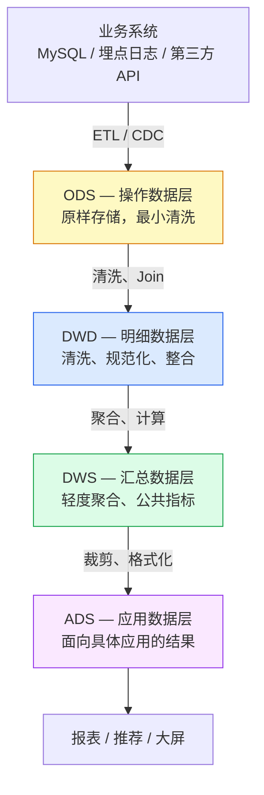
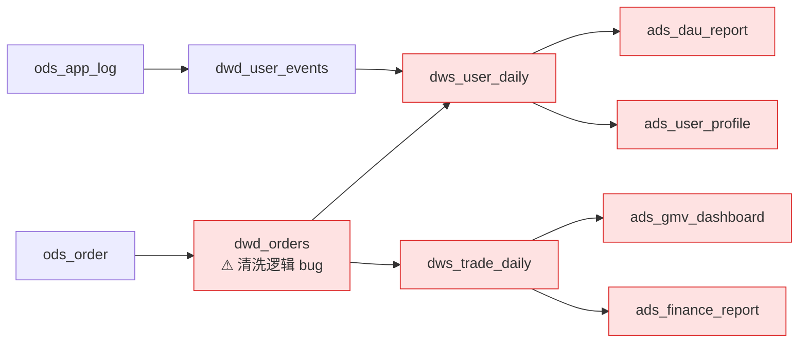
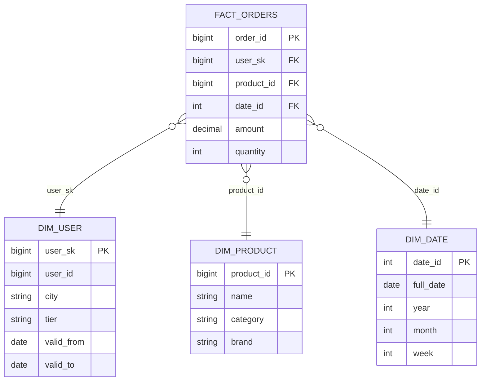
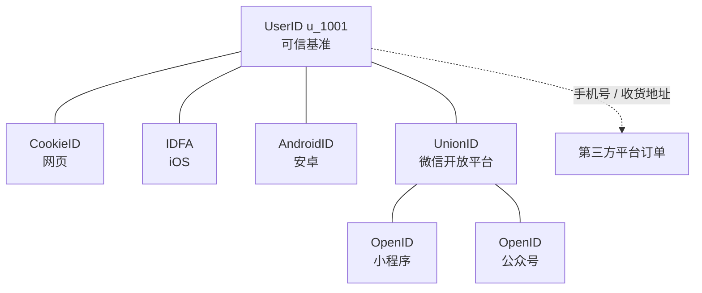
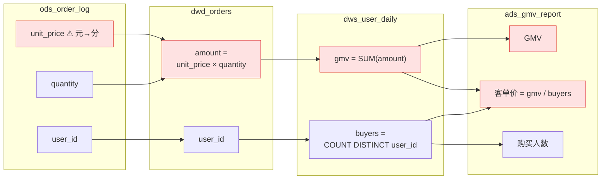
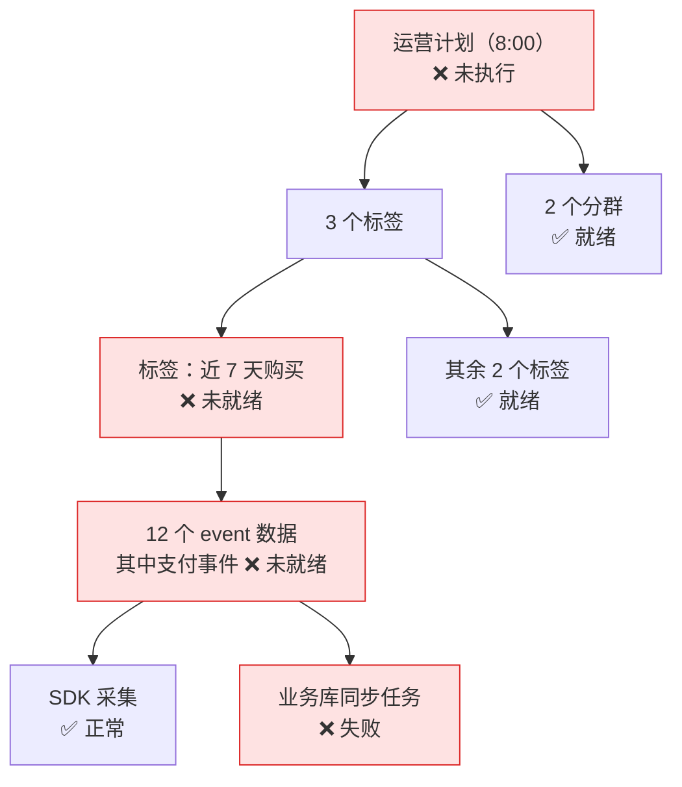
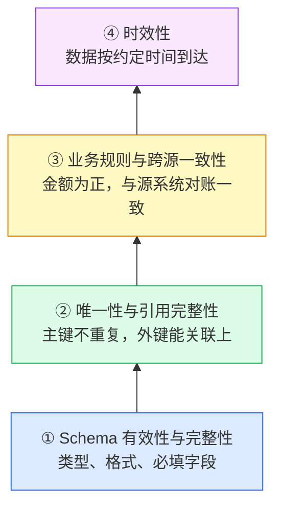
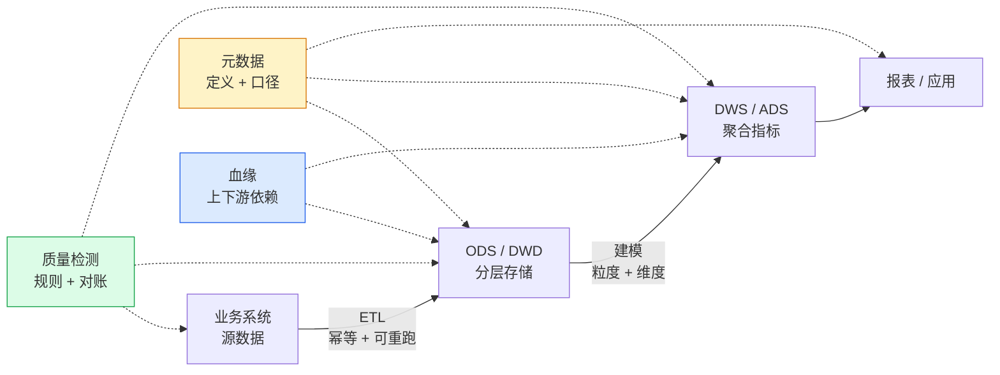

# 数据治理：分层、质量与元数据

Last updated: 2026-10-21

> **阶段目标：** 理解为什么要分层组织数据，掌握数据建模、ETL 幂等性、元数据管理、血缘追踪和质量保障的核心方法，能够设计一条可调试、可回溯、可信任的数据链路。
>
> **前置知识：** [[数据系统的构成]] — 数据流的七层架构、存储引擎与计算模型的基本区别；[[数据库基础与大数据演进]] — 范式、事务与索引。
>
> **完成标准：** 能解释一个指标为何在两个报表中产生不同数字，并说出需要在哪一层修复。

---

两个分析师，同一家公司，同一周，两个"月活跃用户"数字。

市场部算出 500 万，产品部算出 300 万。两个数都有 SQL 为证，两个人都觉得自己是对的。公司里有上百张表，由不同团队各自维护，没有统一规范。

这不是罕见的意外，而是没有数据治理时的常态。问题的根源几乎不在 SQL 本身，而在于它之前的每一步：数据从哪里来，经过什么转换，按什么口径聚合，谁定义了"活跃"，这个定义存在哪里，有没有人知道它变过。

### 治理首先是管理问题

工具能帮忙，但"两个月活"的根源不在工具。数据治理要回答三个管理问题：

- **谁对这份数据负责？** 没有 Owner 的表，出错时没人修，改动时没人通知。
- **数据标准是什么？** 字段叫什么、口径怎么算、质量要到什么程度。
- **如何保证数据持续可信？** 不是上线那天对，而是三年后还对。

围绕这三个问题，治理通常拆成四根支柱：

| 支柱 | 要建立的东西 | 缺了会怎样 |
|---|---|---|
| **组织** | 数据 Owner、数据管家（data steward）等角色和职责 | 出了问题互相推诿 |
| **流程** | 数据接入、变更、下线的标准流程 | 上游改了字段，没人通知下游 |
| **技术** | 质量监控、元数据、血缘等工具 | 问题要等用户投诉才被发现 |
| **文化** | 认同数据是资产，而不是业务系统的副产品 | 规范写在文档里，没人执行 |

本文的主体是"技术"这根支柱的展开，分六个层面：**分层**（数据如何组织）、**建模**（数据如何结构化）、**ETL**（数据如何正确地流动）、**元数据**（数据如何被理解）、**血缘**（数据如何被追踪）、**质量**（数据如何保持可信）。这六件事不是独立的工具，而是同一个问题的六个侧面。第七节再回到组织、流程和落地路径。

文中的 DuckDB 示例都可以在一次性环境里直接运行：`uv run --no-project --python 3.12 --with duckdb python demo.py`。

---

## 一、数据分层：隔离变更，控制爆炸半径

### 1. 没有分层会发生什么

曹犟在百度时亲历过一件事：某部门自己看的报表和给领导看的报表里，"日活跃用户数"因为口径不同相差超过 4%，而这个数字直接影响该部门的绩效评估。两张报表都直接从原始日志算，各写各的 SQL，没有一层是"日活"的唯一权威来源。百度从 Log 平台重构为 UDW 的完整经过见 [[大厂数据平台与实践案例]]，这里只看它暴露的问题。

想象一家电商公司的数据系统，没有分层，所有报表直接查原始日志。

第一个问题是**资源冗余**。"日活跃用户"这个指标，10 张报表各自从日志算一次，每天跑 10 个相同的任务，每次都全扫几千亿行。

第二个问题是**口径分裂**。推荐团队的"日活"定义为打开 App，增长团队的"日活"定义为产生一次点击。两个团队用的是同一张原始表，计算逻辑藏在各自的 SQL 里，互相不知道对方的定义。汇报时两个数对不上，没有人能解释为什么——上面百度的例子就是这样。

第三个问题是**维护成本失控**。底层日志格式一旦改变，所有直接依赖它的报表全部报错。一个字段改名，可能需要同时修改几十个地方。改一处、漏一处，数据就悄悄地错了。

第四个问题是**开发效率低**。每个新需求都要从原始日志开始写清洗逻辑，重复劳动，还容易出错。

分层要解决的正是这四个问题：在原始数据和应用之间插入有序的中间层，让每一层只做一件事，让同类计算只做一次，让变化只在最小范围内传播。

### 2. 经典四层模型：ODS / DWD / DWS / ADS

**数据分层**是把数据按加工程度和使用目的组织成不同层次。它是数据仓库建设的核心概念，同样适用于数据湖和湖仓一体架构。国内大数据实践中最常见的方案是 ODS→DWD→DWS→ADS 四层。



| 层次 | 存什么 | 做什么 | 不做什么 | 数据规模 |
|---|---|---|---|---|
| **ODS**（操作数据层）| 原始数据，基本保持原貌 | 必要的清洗和标准化：统一时间格式、处理空值 | 聚合、Join、业务逻辑 | 原始量级 |
| **DWD**（明细数据层）| 规范的明细事实 | 按预先设计的模型清洗、规范化、整合多源明细（如把注册、登录、购买整合成用户行为明细表）| 聚合指标、应用专属字段 | 与 ODS 同一量级 |
| **DWS**（汇总数据层）| 公共聚合指标 | 轻度聚合，计算跨应用共用的指标（日活、周活、留存）| 面向单一应用定制 | 比 DWD 小一个数量级以上 |
| **ADS**（应用数据层）| 应用就绪结果 | 为具体报表、推荐系统、大屏裁剪；"数据集市"就落在这一层 | 存储无人使用的中间计算 | 按应用而定 |

DWS 仍然是**公共层**，为所有应用服务；只有到了 ADS 才开始为某个应用定制。

四层是基础模型，不是标准答案。常见调整有两种：把 DWD 和 DWS 合并成一个 DW 层；或者增加一个 DIM（维度）层，专门管理用户、商品、地区这类维度数据，供各层共享。

### 3. 四条设计原则

| 原则 | 含义 | 例子 |
|---|---|---|
| **高内聚、低耦合** | 同一层的数据特征和用途相似；层间依赖单向且清晰 | 上层可以读下层，下层绝不读上层 |
| **追求复用** | 公共计算逻辑下沉到更底层，避免重复计算 | 用户基础属性在 DWD 算一次，而不是每张 ADS 表各算一次 |
| **逐层加工** | 每层只做该层该做的事，不在一层里做太多事 | 清洗留在 ODS→DWD，口径留在 DWS |
| **屏蔽原始变化** | 上层应用不感知底层变化 | 源系统改了结构，只改 ODS→DWD 的 ETL，上层不动 |

关于"能不能跳层"，实践中的规则比"绝对禁止"更务实：**依赖只能向下，读数据优先读最近的一层，上层满足不了需求时才向下读，并把每一次越级记录进元数据。** 百度 UDW 的规定就是如此——新应用不能直接访问原始日志，尽量使用上层数据，只有上一层无法满足时才向下访问。完全禁止越级，每个新需求都得先改公共层；完全放开，爆炸半径又会回到全局。

### 4. 爆炸半径：一个 bug 能走多远

分层不能阻止错误向下传播，但能让传播路径**可预测、可枚举**。下图是同一个 bug 出现在 DWD 时影响的范围：



| 出错位置 | 影响范围 | 修复后要重跑什么 |
|---|---|---|
| ODS 采集缺数 | 理论上是全部下游 | 补采后重跑整条链路 |
| ODS→DWD 清洗逻辑 | 这张明细表的所有下游 | 这张 DWD 表及其下游 |
| DWS 公共指标口径 | 引用这个指标的所有应用 | DWS 表及引用它的 ADS |
| ADS 单个应用表 | 一个应用 | 只重跑这张表 |

两个推论贯穿全文：**越底层的错误爆炸半径越大**，所以质量检查点要尽量往前放（第六节）；分层只告诉你"可能波及哪些层"，要列出具体"要重跑哪些表"，还需要血缘（第五节）。

### 5. 其他分层方案

ODS/DWD/DWS/ADS 不是唯一选择。它在国内互联网公司中广为流行（阿里巴巴在《大数据之路》中总结的 OneData 体系是常被引用的范本），但其他生态有自己的方案：

| 方案 | 层次 | 流行场景 | 适合 |
|---|---|---|---|
| **ODS / DWD / DWS / ADS**（+ DIM）| 4–5 层 | 国内企业数仓 | 主题多、团队多、公共指标复用要求高 |
| **Medallion**：Bronze → Silver → Gold | 3 层 | Databricks 推广，湖仓场景 | 湖仓一体、ELT 为主、原始数据先落地 |
| **staging → intermediate → marts** | 3 层 | dbt 推荐的项目结构 | SQL 优先、模型代码化、中小团队 |
| **raw → mart** | 2 层 | 起步阶段 | 数据源和应用都少；以后再拆 |

这些方案**结构不同，背后的原则一样**：隔离原始数据、集中公共计算、限制爆炸半径。选哪种取决于团队规模、工具链和业务复杂度，而不是哪种更"正确"。真正重要的是把选择记录进元数据，让所有人知道每张表属于哪一层。

### 6. 分层与元数据，分层与实时

分层设计必须体现在元数据里：每张表属于哪一层、层与层之间的依赖关系、数据的流转路径，都是重要的元数据。反过来，元数据也能驱动分层自动化——在元数据中定义好各层规范和转换规则，就能自动生成部分 ETL 代码，减少人工开发。

分层也有代价：**层数越多，管理越规范，但 ETL 链路越长，延迟也越大。** 实时场景常见三种处理方式：

- **实时链路少分几层**：从清洗后的明细流直接写到面向应用的存储，公共汇总层只在批处理里做。代价是实时口径和离线口径可能分叉。
- **在流里分层**：每一层是一个 Kafka topic，层与层之间由一个流计算作业衔接。规范性保住了，但每多一跳就多一份延迟和状态。
- **批流两条路径或单一流路径**：即 Lambda 与 Kappa 架构，机制见 [[数据系统的构成]]。

没有免费的选择：层数是"复用和一致性"与"延迟"之间的权衡。

---

## 二、分析数据建模：从业务需求到数据结构

### 1. 一家游戏公司的三个月

一家游戏公司最初只做手游，数仓按手游的特点设计，简单直接。后来扩展到 PC 游戏、主机游戏，每上线一个新平台就单独建一套表。几年后，平台上有了几百张表。

同样是统计"日活跃用户"，手游看 `login_mobile` 表，PC 游戏看 `login_pc` 表，主机游戏看 `login_console` 表。各平台的表结构不一样，用户标识也不一样：手游记设备 ID，PC 游戏记 MAC 地址，主机游戏记 PS 和 Xbox 各自的账号 ID。

领导想看"全平台日活"这样简单的需求，分析师要写很复杂的 SQL：分别从不同的表查，再去重合并。同一个玩家在不同平台的账号对不上，跨平台的用户关联根本做不了。

最后公司不得不重构整个数仓：停掉所有新需求三个月，数据重做和数据比对的过程让相关同事"掉了一层皮"。如果一开始就为多平台扩展设计一个通用的数据模型，这个代价本可以避免。

**数据模型不只是表和字段的设计，更是对业务本质的理解和对未来的预判。** 好的模型让复杂的分析变简单，糟糕的模型让简单的需求寸步难行。（跨平台账号对不上的问题，第三节的 ID-Mapping 专门处理。）

### 2. 数据模型是什么：从草图到施工图

数据模型是对现实世界的数据化描述，定义数据的结构、关系和约束。它像建筑图纸：把模糊的业务语言翻译成精确的数据结构。没有它，业务和技术就像在用两种语言对话。

一位顾客在星巴克买了一杯大杯拿铁：顾客是"用户"，星巴克是"商家"，拿铁是"商品"，购买动作产生一张"订单"。每个实体有自己的属性，实体之间还有关系——一个用户可以有多个订单，一个订单可以包含多个商品，一个商家可以卖多种商品。这些实体、属性和关系的定义，就是数据模型的基础。

数据模型分三个递进的层次，可以类比画一幅画：

| 层次 | 视角 | 类比 | 回答的问题 | 例子 |
|---|---|---|---|---|
| **概念模型** | 业务分析 | 素描草图 | 有什么？什么关系？ | "用户购买商品" |
| **逻辑模型** | 系统设计 | 详细线稿 | 是什么样？ | 用户有姓名、手机号、注册时间、等级；订单有订单号、下单时间、金额、支付状态 |
| **物理模型** | 具体实现 | 最终成品 | 怎么存？ | 表叫 `user` 还是 `customer`；手机号用 `varchar` 还是 `bigint`；订单表按天还是按月分区 |

概念模型理解业务，逻辑模型合理设计，物理模型确保高效。很多项目失败，就是因为跳过前两层直接画物理模型——像盖房子不画图纸直接砌砖，最后发现房子歪了，只能推倒重来。

### 3. 建模前先问：一行代表什么？

进入逻辑设计时，第一步不是选星型还是雪花型，而是回答一个问题：**这张表里，一行代表什么？**

这叫做**粒度（grain）**的设计。同样是"订单表"，粒度可以是：

- 每个订单一行（订单级）
- 每个订单中每个商品一行（订单明细级）
- 每个用户每天的订单汇总一行（用户日汇总级）

粒度选错，所有后续的指标计算都会出问题。如果订单表的粒度是"订单明细级"，直接 `COUNT(*)` 得到的是明细数，不是订单数。这个错误极其常见，也极其难排查——数字"看起来差不多"，但口径完全不同。

选粒度要看分析目标：经常按商品维度分析销售，用订单明细级；主要分析订单整体情况，订单级就够了。一般原则是：粒度越细，灵活性越高，存储和计算成本也越大。事实表通常选最小粒度，方便上层按任意维度聚合；汇总表按最常用的查询粒度预聚合。

### 4. 三种主流建模方法

大数据领域的建模方法大多从数据库领域衍生而来，包括范式建模、维度建模、Data Vault、Anchor 模型等。最主流的是三种。

#### 范式建模（E-R 模型）

把业务抽象为实体（Entity）、属性和实体间的关系（Relationship），主要有三类表：

- **实体表**：描述实体本身，如用户表、商品表
- **关系表**：描述实体之间的关系，如用户收藏了哪些商品
- **事务表**：记录业务活动和事件，如订单、支付

关系表和事务表有时可以互相转化："购买"是事务，但客观上也描述了用户和商品之间的关系。判断标准是：**要不要记录详细的时间戳和业务行为的完整过程？要，就用事务表。**

范式建模追求减少冗余：用户的城市只在用户表里存一次，订单表通过用户 ID 关联查询，而不是把城市复制进订单表。优点是一致性好、存储小，银行核心交易系统常用；缺点是查询需要大量 JOIN。1NF 到 3NF 的具体规则和"范式是权衡不是教条"的由来，见 [[数据库基础与大数据演进]]。

#### 维度建模

维度建模把数据分成两种角色：

**事实（Fact）** 是业务过程的度量结果，通常是可累加的数字：销售额、订单量、点击次数、停留时长。

**维度（Dimension）** 是观察事实的角度，回答"谁、什么、哪里、何时、为什么、如何"：用户、商品、地区、时间。

"2024 年 1 月，北京地区，电子产品的销售额是 100 万"这句话里：

- 事实是 `100 万`（销售额）
- 维度是 `2024年1月`（时间维度）、`北京地区`（地区维度）、`电子产品`（产品维度）

**星型模式（Star Schema）** 是最常见的维度建模方式：中央是事实表，周围是维度表，维度表通过外键与事实表连接。



星型模式的查询非常直观：

```sql
-- 按月、城市、品类统计销售额
SELECT
    d.year,
    d.month,
    u.city,
    p.category,
    SUM(f.amount) AS total_amount
FROM fact_orders f
JOIN dim_user    u ON f.user_sk    = u.user_sk
JOIN dim_product p ON f.product_id = p.product_id
JOIN dim_date    d ON f.date_id    = d.date_id
GROUP BY d.year, d.month, u.city, p.category;
```

**雪花模式（Snowflake Schema）** 把维度表再规范化：`dim_product` 不直接存品类名称，而是指向 `dim_category`，后者再指向 `dim_department`。它减少了维度内的冗余，代价是查询要多几次 JOIN。分析场景通常优先星型；维度特别大、或者一个层级结构被多个维度共享时，才考虑雪花。

维度建模的优势是查询性能好、业务人员容易理解——数据已经按分析需求组织好了。代价是冗余（同一用户的城市可能在多张事实表里重复），以及维度属性变化时处理复杂（见下文"缓慢变化维度"）。

#### 宽表模型

宽表把相关的所有信息放进一张表。一张用户行为表可以有上千个字段，其中很多是稀疏的——不同的行，大部分字段为空。

这在某种意义上违背了传统数据库的设计原则，但在分布式环境下很实用：分布式环境里 JOIN 意味着在节点之间搬运数据，代价很高；放进一张表就避免了关联。再加上列式存储只读查询用到的列、稀疏列压缩率极高，存储和 IO 都能大幅降低（列存储的机制见 [[数据系统的构成]]，宽表与 JOIN 的性能对比练习见 [[数据库基础与大数据演进]]）。

宽表的代价是更新困难：用户等级变了，已经写进历史行为记录里的旧等级无法更新，有些场景下会出问题。

| 方法 | 核心思想 | 优点 | 代价 | 典型位置 |
|---|---|---|---|---|
| **范式建模** | 实体 + 关系，消除冗余 | 一致性好，存储小 | JOIN 多，分析慢 | 业务系统、DWD 的实体表 |
| **维度建模** | 事实 + 维度 | 查询快，业务易懂 | 冗余；维度变化难处理 | DWS |
| **宽表模型** | 一张表装下所有相关字段 | 查询最简单最快 | 更新困难，字段稀疏 | DWD 行为表、ADS |

### 5. 按层组合：每层用不同的建模方式

实践中三种方法结合使用，一般也不严格遵守范式，而是按场景折衷：

| 层 | 建模方式 | 典型设计 |
|---|---|---|
| **ODS** | 基本不建模 | 保持原样，只做初步清洗 |
| **DWD** | 范式建模 + 宽表 | 互联网公司最重要的实体是用户：用户实体表（自然属性、标签）+ 用户行为表（用户实体的事务表）。电商的商品也是重要实体：商品实体表，需要记录状态变更时再加商品事务表。用户与商品的关系（历史购买、购物车、运送中）可以从行为表推出，也可以单独提成关系表，信息更集中。实体表和行为表都可以做成宽表，靠列存储优化 |
| **DWS** | 维度建模 | 用户维度汇总表：基础信息维度 + 最近 7 天登录次数、最近 30 天购买金额、历史累计订单数；商品维度汇总表：基础信息 + 最近 7 天销量、最近 30 天浏览量、历史累计评价数 |
| **ADS** | 以终为始 | 报表：直接做成报表所需的结构，字段名和顺序与展示一一对应；推荐系统：用户特征表、物品特征表，甚至包含向量化特征；实时大屏：KV 结构，支持快速点查 |

DWS 层要特别注意**时间窗口**：不同业务关心的窗口不同（最近 7 天、最近 30 天、历史累计），窗口的选择要和业务方充分沟通后确定。ADS 层的原则是"以终为始"：从应用的需求出发，怎么用得方便就怎么设计。

### 6. 缓慢变化维度：历史属性怎么保存？

维度有一个棘手问题：属性会随时间变化。

用户搬家了，`city` 从"北京"变成了"上海"。如果直接更新维度表，所有历史订单查询"用户所在城市"都会返回"上海"——即使订单发生在搬家之前。这就扭曲了历史。

这类问题叫做**缓慢变化维度（SCD, Slowly Changing Dimension）**，最常用的三种解法：

| 类型 | 做法 | 结果 | 适用场景 |
|---|---|---|---|
| **SCD Type 1** | 直接覆盖旧值 | 历史被抹去 | 属性变化不影响历史分析（如拼写错误修正）|
| **SCD Type 2** | 插入新行，用 `valid_from / valid_to` 标记有效期 | 保留完整历史 | 需要历史准确的分析（用户城市、用户等级）|
| **SCD Type 3** | 在同一行增加 `previous_value` 列 | 只保留上一个值 | 只需比较当前与上一状态 |

Kimball 的《数据仓库工具箱》第 3 版（2013）把类型扩展到 Type 0–7（如 Type 0 保留原值永不改变、Type 4 把变化频繁的属性拆进一个微型维度、Type 6 在 Type 2 维度上叠加 Type 1 的"当前值"列、Type 7 让事实表同时持有持久键和代理键以支持"按当时"和"按现在"两种口径），但日常讨论多集中在上面三种。

SCD Type 2 是最常见的选择。每次属性变更插入新行，而不是更新：

```text
时间轴       2024-01-01 ──────────────── 2024-06-14 | 2024-06-15 ──────────── 至今
dim_user     user_sk=1  北京 / 普通                 | user_sk=2  上海 / 黄金
fact_orders               订单 A（06-10）→ sk=1     |   订单 B（06-20）→ sk=2
```

```sql
CREATE TABLE dim_user (
    user_sk    BIGINT PRIMARY KEY,  -- 代理键，每次变更产生一个新值
    user_id    BIGINT NOT NULL,     -- 业务主键，同一个人始终不变
    city       VARCHAR(64),
    tier       VARCHAR(32),
    valid_from DATE NOT NULL,
    valid_to   DATE,                -- NULL 表示当前有效行；本表约定为闭区间
    is_current BOOLEAN DEFAULT TRUE
);
```

把事实和"当时的"维度行关联起来，有两种做法：

- **加载时写入代理键**（Kimball 的标准做法）：订单入库时，按下单日期查出当时有效的 `user_sk`，写进事实表。之后查询直接 `ON f.user_sk = u.user_sk`，简单且快。代价是加载逻辑更复杂，迟到的订单和回填都要按日期查代理键。
- **查询时按日期区间关联**：事实表只存业务主键 `user_id`，查询时用日期范围匹配。灵活，但每次查询都要做区间 JOIN。

第二种做法的关键在 JOIN 条件。下面这个例子同时演示了错误和正确的写法：

```python
import duckdb

con = duckdb.connect()
con.execute("""CREATE TABLE dim_user AS SELECT * FROM (VALUES
    (1, 1001, '北京', DATE '2024-01-01', DATE '2024-06-14', false),
    (2, 1001, '上海', DATE '2024-06-15', NULL,              true)
) AS t(user_sk, user_id, city, valid_from, valid_to, is_current)""")
con.execute("""CREATE TABLE fact_orders AS SELECT * FROM (VALUES
    (1, 1001, DATE '2024-06-10', 100.0),
    (2, 1001, DATE '2024-06-20',  80.0)
) AS t(order_id, user_id, order_date, amount)""")

# ❌ 只连当前行：6 月 10 日那笔被算到了上海
wrong = con.execute("""
    SELECT u.city, SUM(f.amount) FROM fact_orders f
    JOIN dim_user u ON f.user_id = u.user_id AND u.is_current
    WHERE f.order_date BETWEEN '2024-06-01' AND '2024-06-30'
    GROUP BY u.city ORDER BY u.city""").fetchall()

# ✅ 按下单日期找"当时有效"的那一行
right = con.execute("""
    SELECT u.city, SUM(f.amount) FROM fact_orders f
    JOIN dim_user u
      ON f.user_id = u.user_id
     AND f.order_date >= u.valid_from
     AND (u.valid_to IS NULL OR f.order_date <= u.valid_to)
    WHERE f.order_date BETWEEN '2024-06-01' AND '2024-06-30'
    GROUP BY u.city ORDER BY u.city""").fetchall()

print("只连当前行:", wrong)
print("时点关联  :", right)
```

```text
只连当前行: [('上海', Decimal('180.0'))]
时点关联  : [('上海', Decimal('80.0')), ('北京', Decimal('100.0'))]
```

"6 月按城市统计订单"这个问题，错误写法把整个月都算给了上海。还有一个容易被忽略的细节：`valid_to` 是闭区间还是开区间，必须写进元数据。上面的表约定闭区间（旧行在 06-14 结束，新行从 06-15 开始）；如果有人按开区间理解，写成 `order_date < valid_to`，06-14 当天的订单就会一行都匹配不上。

### 7. 从需求到模型：四个步骤

| 步骤 | 要做什么 | 技巧 |
|---|---|---|
| **需求收集** | 按"以终为始"了解核心业务过程 | 问四个问题：核心流程是怎样的？涉及哪些角色？经常看哪些指标？有什么特殊业务规则？ |
| **概念设计** | 识别核心实体、事务和关系 | **名词通常对应实体，动词通常对应事务**："用户购买商品"中用户、商品是实体，购买是事务（并产生"订单"这个新实体）；"用户浏览商品"中浏览是事务（产生浏览记录）。关系分一对一、一对多、多对多。这一步不考虑技术实现，用一张实体关系图让业务方看懂并确认 |
| **逻辑设计** | 设计具体表结构 | 按所在层选建模方法；**确定粒度** |
| **物理优化** | 结合技术环境优化 | **分区**：行为数据最常见按时间 + 事件类型分区；**存储**：不同时间窗口、访问频度的数据放不同介质，字段类型能用 `int` 不用 `bigint`；**索引**：按查询模式建，但索引会拖慢写入，不是越多越好；**冗余**：适度冗余换性能（订单表冗余用户等级，省掉一次关联），但只冗余不常变的属性 |

分区和存储分层的底层机制见 [[数据系统的构成]]。

实践中有四条经验原则：

1. **不要过度设计。** 模型为业务服务，不是展示技术能力。先满足当前需求，有新需求再迭代。过度设计浪费资源，还增加维护成本。
2. **为变化预留空间。** 用户表现在只支持手机号注册，也要想到以后可能支持邮箱、微信登录——可以预留扩展字段；订单状态这类会增加取值的字段放进配置表，新增状态时不用改表结构。
3. **保持一致性。** 同一个概念在各处保持同名、同格式、同取值范围：用户 ID 在行为表、用户表、订单表、画像表里应该是同一个东西。
4. **重视文档。** 模型设计完要写文档：业务背景、实体关系图、字段说明表、更新记录；每次修改模型同步更新文档。文档最终应该沉淀为元数据（第四节）。

### 8. 模型会演进：每一步都被一个需求逼出来

模型很少一次设计到位。一个典型的行为分析明细层，十年里大致走过四步：只有 Event 和 User 两张表；为了按商品、渠道、活动分析，引入可独立更新的维度表；为了给店铺打标签、按商品触达购物车用户，允许用户之外的多个实体；为了让大模型分析用户评论，加入多模态引用、向量字段和带**模型版本号**的 AI 提取字段。每一步都解决了上一步满足不了的需求，也带来了新代价：维度同步、建模复杂度，以及"模型版本成为数据的一部分"。一家行为分析厂商的完整演进表见 [[大厂数据平台与实践案例]]。

演进中贯穿始终的一条纪律是：**新增可以，修改谨慎，删除禁止。** 模型要随业务变化，但每次改动都不能影响现有应用。这条纪律在采集层表现为 Schema 演进规则（见 [[数据系统的构成]]），在治理层表现为下文的变更管理。

---

## 三、ETL 与幂等性：数据如何正确地流动

### 1. 为什么 ETL 是治理的主战场

ETL（Extract-Transform-Load，提取-转换-加载）是对数据进行预处理的完整链路：

- **Extract**：从关系数据库、数据仓库、日志文件、API、消息队列等数据源提取数据
- **Transform**：清洗、标准化、派生字段、多源 Join 和 Union、ID-Mapping
- **Load**：把处理好的数据写入目标系统——数据仓库、数据湖，或为某个应用准备的存储

它和前两节紧密相连：分层的每两层之间都是一次 ETL；数据模型决定了 Transform 的规则和 Load 的目标结构。

据曹犟在课程中的说法，他参与的行为分析项目交付中，ETL 相关成本占总成本 70% 以上，远超系统部署、培训等环节——而且这些项目的数据模型已经相当标准、应用范围非常明确。这个比例有道理：数据模型再完美，ETL 做不好，数据就无法准确、及时地到达该去的地方。

ETL 与 ELT 的区别在于转换发生的时机：

| 模式 | 流程 | 适合场景 |
|---|---|---|
| **ETL** | 先清洗转换，再入库 | 数仓：模型明确，写入的都是符合模型定义的高质量数据 |
| **ELT** | 先入库，再在目标系统里按需转换 | 数据湖：原始数据先存下来，探索性分析 |

湖仓一体架构中两者结合使用：模型和应用已经明确的数据用 ETL 严格管理，探索性数据用 ELT 灵活处理。采集的技术手段（SDK、日志、数据库 CDC 增量抽取）见 [[数据系统的构成]]，这里只从治理视角看 ETL。

### 2. Extract：五个容易被忽略的决定

**全量还是抽样。** 全量简单直接，适合规模不大或价值密度足够高的数据；抽样适合量大、价值密度低的数据。从应用场景出发决定：同样是 SDK 采集的用户行为，购买、支付等核心行为要精确统计和留档，必须全量；浏览这类非核心行为，可以按用户 ID 只采 1/8 的用户，统计时按比例乘回去。

按**用户**抽样而不是按**事件**抽样，是因为被抽中的用户保留了完整的行为序列，漏斗、会话、留存这类按用户计算的指标仍然成立：

```sql
-- 采集端或 ETL 中：按用户哈希稳定地抽取 1/8 的用户
SELECT * FROM ods_page_view WHERE hash(user_id) % 8 = 0;

-- 统计时按抽样比例还原
SELECT dt, COUNT(*) * 8 AS estimated_pv FROM dwd_page_view_sampled GROUP BY dt;
```

**质量检测。** 抽取阶段是整个质量体系的第一道防线，越早发现问题修复成本越低。这里就应该做完整性、一致性、及时性校验，发现问题后按规则选择告警后继续，或者直接终止任务（第六节）。

**安全合规。** 抽取可能涉及大量敏感数据的访问和传输，脱敏和加密从这一步就要开始，而不是等入库之后。具体的控制手段见 [[数据平台运维]]。

**血缘与"出生证明"。** 在抽取阶段就记录：数据来自哪个源系统、哪张表或哪个文件、抽取的时间范围、全量还是增量、抽了多少条。这些信息共同构成数据的"出生证明"，是后续排查和影响分析的基础。最直接的做法是把它们作为溯源列写进每一行：

```sql
SELECT
    o.*,
    'mysql.shop'                        AS _src_system,
    'orders'                            AS _src_object,
    '2024-06-15'                        AS _extract_dt,
    'incremental'                       AS _extract_mode,
    'batch_20240615_0200'               AS _batch_id
FROM source_orders o
WHERE o.updated_at >= '2024-06-15' AND o.updated_at < '2024-06-16';
```

表级血缘回答"这张表从哪些表来"；溯源列回答"**这一行**从哪个批次来"——排查一批脏数据是谁带进来的，靠的是后者。

**性能。** 一是减少对源系统的影响：只在业务低峰期执行、读从库不读主库、异步传输、控制抽取频率和并发；二是提高抽取效率：大表分片并行读、批量传输减少网络交互、压缩后再传。

### 3. Transform：清洗、标准化、派生、整合

Transform 是 ETL 中最复杂的环节，也最能体现治理水平。

| 类别 | 任务 | 例子与要点 |
|---|---|---|
| **清洗** | 空值处理 | 用户没填城市：根据 IP 推断，或标记为"未知" |
| | 去重 | 业务系统 bug 或多次导入造成；按业务主键去重，保留最新或最完整的记录 |
| | 异常值 | 年龄 200 岁或 -10 岁：清洗掉，或标记为异常 |
| **标准化** | 命名 | 同一概念在不同系统叫法不同（第四节的 `distinct_id = user_id = uid`）|
| | 类型与格式 | 日期有 `2024-01-01`、`20240101`、时间戳三种写法，统一成一种 |
| | 编码 | 中日韩文本的 UTF-8、GBK 等编码统一 |
| | 单位 | 金额、长度、重量统一单位 |
| | 时区与汇率 | 时间统一，但**时区本身作为字段保留**；货币一般按事件发生时的汇率换算，但**保留原币种和原金额**——有时需要按查询时的汇率重算 |
| **派生** | 类型转换 | 字符串转数字时，`"abc"` 转不了怎么办，要有明确的异常处理 |
| | 字段映射 | 一对一、多对一（多个源字段合成一个）、一对多（一个源字段拆成多个）|
| | 计算派生 | 由生日算年龄、由金额和数量算单价——计算逻辑要和业务方确认 |
| **整合** | Join | 订单表关联用户表：选 inner 还是 outer、选哪个 key、关联不上的行去哪里 |
| | Union | 多个业务线的订单合成一张表：处理字段不一致和重复 |

以上前三类是对单条数据的操作，整合则跨越多个数据源，也最容易出错。还有几个陷阱值得单独列出：

| 陷阱 | 表现 | 对策 |
|---|---|---|
| **多时区** | 同一天的数据被切到两个分区；"月活"按 UTC 和按北京时间算出两个数 | 存 UTC + 时区字段，口径里写明按哪个时区切日 |
| **编码** | 中文乱码，按字节截断截出半个汉字 | 入口统一编码，按字符而非字节截断 |
| **数据倾斜** | 某个 key（如匿名用户的默认 ID）数据量特别大，单个任务拖慢整体 | 把大 key 拆出来单独处理 |
| **NULL 语义** | 关联、分组、`NOT IN` 中行为反直觉 | 见下例；关联键和过滤条件显式处理 NULL |
| **精度** | 浮点运算累积误差 | 金额等关键数据用定点数（`DECIMAL`）|

NULL 的陷阱用一个例子就能看清：

```python
import duckdb

con = duckdb.connect()
con.execute("CREATE TABLE orders AS SELECT * FROM (VALUES ('u1'), ('u2'), (NULL)) t(user_id)")
con.execute("CREATE TABLE blacklist AS SELECT * FROM (VALUES ('u2'), (NULL)) t(user_id)")
print(con.execute("""SELECT COUNT(*) FROM orders
                     WHERE user_id NOT IN (SELECT user_id FROM blacklist)""").fetchone()[0])  # 0
print(con.execute("""SELECT COUNT(*) FROM orders o WHERE NOT EXISTS
                     (SELECT 1 FROM blacklist b WHERE b.user_id = o.user_id)""").fetchone()[0])  # 2
print(con.execute("SELECT COUNT(*), COUNT(user_id) FROM orders").fetchone())  # (3, 2)
```

黑名单里只要混进一个 NULL，`NOT IN` 就会让结果变成 0——因为 `x <> NULL` 的结果是"未知"，不是"真"。`COUNT(*)` 和 `COUNT(user_id)` 也会因为 NULL 而不同。

### 4. ID-Mapping：同一个人的十几个名字

回到游戏公司的问题：同一个玩家有设备 ID、MAC 地址、PS 账号、Xbox 账号，系统认不出这是同一个人。在精细化运营的时代，用户数据的采集、分析和应用是最重要的大数据应用之一，而这一切的前提是**ID-Mapping：识别出同一个用户在不同系统、渠道、数据源中的身份**。

现实中的标识五花八门：

- 网站上，未登录的匿名用户用 CookieID 标识，登录后有 UserID
- iOS、安卓、微信小程序各有匿名标识方案：IDFA、AndroidID、OpenID、UnionID 等
- 天猫、京东、配送平台等第三方只有限度地提供下单、配送、退货信息，只能通过手机号、地址等识别身份

不做 ID 映射，就无法追踪用户的完整行为路径，跨渠道分析无从谈起。

核心方案是：**以一个或多个可信 ID 为基础，以其他 ID 与它的关系为桥梁，构建一棵树状的 ID 体系。** 对一个同时有网页、iOS、安卓和微信小程序的产品，通常选统一登录标识 UserID 作为基础：用户在网页上注册或登录时，记录下 CookieID 与 UserID 的映射；其他终端同理。多条映射关系共同构成一棵映射树。



有了映射树，Transform 时：用户已登录，行为里必然带 UserID；未登录，就按映射补上 UserID；如果行为发生在映射建立**之前**，必要时还要往回回溯历史数据补字段——这就是一次回填（见下文"回填与修正顺序"）。之后所有分析都可以用 UserID 贯穿同一用户在所有终端上的行为。不过，有些分析场景刻意以 CookieID 或 IDFA 为主体（比如分析设备层面的行为），切换分析主体本身也有意义。

真实世界里的映射很少是一棵干净的树：

| 复杂情况 | 例子 | 要由业务规则决定的事 |
|---|---|---|
| **多对多** | 同一个浏览器的 CookieID 先后有两个不同的 UserID 登录 | 未登录期间的行为归给谁？前一个、后一个，还是都不归？ |
| **嵌套** | 微信体系下一个 UnionID 对应多个 OpenID，一个 UserID 又可能对应多个 UnionID | 树要分几层，以哪一层为准 |
| **解绑** | 用户解绑了手机号，或账号被注销 | 映射关系何时失效，历史归属要不要改 |

由此可以得出一个治理上的推论：**ID 映射本身是一张会变化的维度。** 映射发生合并或解绑时，历史行为的归属也随之改变。必须记录映射的版本，并明确规定：映射变化后，是回填历史（让过去的数据按新映射重算），还是冻结历史（只影响之后的数据）。否则同一份"用户数"在不同日期重算会得到不同结果，而没人知道为什么。

### 5. Load：三种写法与"幂等"的真正含义

把处理好的数据写入目标表有三种方式：

| 策略 | 行为 | 适用场景 |
|---|---|---|
| **覆盖写入（Overwrite）** | 替换整张表或整个分区 | 每日分区重算；维度表更新很频繁时，全量覆盖反而简单高效 |
| **追加写入（Append）** | 在末尾添加新数据，不改已有数据 | 日志、行为事件等事务型数据流 |
| **Upsert** | 按主键：存在则更新，不存在则插入 | 维度表：按自然键（业务主键）判断维度是否已存在 |

选哪种取决于数据量和数据语义，也要和所选的存储、查询方案结合。

ETL 任务一定会重跑：任务失败要重跑，上游修正了数据要重跑，口径调整要回填。所以 ETL 必须**幂等**——同一操作执行多次，结果与执行一次相同。

课程中有一个常见说法："Upsert 场景天然具备幂等性。"这只在三个条件同时成立时才对：

1. **更新是"赋值"而不是"累加"。** `SET total = excluded.total` 重跑无害；`SET total = total + excluded.amount` 每重跑一次就多加一遍。
2. **同一主键的多条变更有确定的顺序。** 如果同一窗口内一个订单先"已支付"再"已退款"，而处理顺序取决于到达顺序，那么谁最后写入谁就赢，两次运行可能得到不同结果。需要用版本号或事件时间决定胜负。
3. **上游不会删除数据。** Upsert 只能插入和更新，表达不了删除。上游撤销了一条订单，重跑 Upsert 时这条订单不在输入里，目标表中的旧记录却原封不动地留着。

第三点最隐蔽：它意味着 Upsert 后目标表的状态取决于**运行历史**，而不只取决于**当前的输入**。我们真正要的比"多跑一次不变"更强：**目标分区的内容应当是这个分区输入的确定性函数。** 分区替换做到了这一点：

```python
import duckdb

con = duckdb.connect()
con.execute("CREATE TABLE ods_orders (dt DATE, order_id INT, amount DECIMAL(10, 2))")
con.execute("""INSERT INTO ods_orders VALUES
    ('2024-06-15', 1, 100), ('2024-06-15', 2, 50), ('2024-06-15', 3, -5)""")
con.execute("CREATE TABLE dwd_append  (dt DATE, order_id INT, amount DECIMAL(10, 2))")  # 流水表通常没有主键约束
con.execute("CREATE TABLE dwd_upsert  (dt DATE, order_id INT PRIMARY KEY, amount DECIMAL(10, 2))")
con.execute("CREATE TABLE dwd_replace (dt DATE, order_id INT, amount DECIMAL(10, 2))")

CLEAN = "SELECT dt, order_id, amount FROM ods_orders WHERE dt = $1 AND amount > 0"


def load_append(target_date: str) -> None:
    con.execute(f"INSERT INTO dwd_append BY NAME ({CLEAN})", [target_date])


def load_upsert(target_date: str) -> None:
    con.execute(f"""INSERT INTO dwd_upsert BY NAME ({CLEAN})
                    ON CONFLICT (order_id) DO UPDATE SET amount = excluded.amount""", [target_date])


def load_replace(target_date: str) -> None:
    con.execute("BEGIN TRANSACTION")  # 删除与写入在同一事务里：读者要么看到旧分区，要么看到新分区
    con.execute("DELETE FROM dwd_replace WHERE dt = $1", [target_date])
    con.execute(f"INSERT INTO dwd_replace BY NAME ({CLEAN})", [target_date])
    con.execute("COMMIT")


def report(label: str) -> None:
    for name in ("dwd_append", "dwd_upsert", "dwd_replace"):
        total = con.execute(f"SELECT SUM(amount) FROM {name}").fetchone()[0]
        print(f"{label:<14}{name:<12} total={total}")


for load in (load_append, load_upsert, load_replace):
    load("2024-06-15")
report("首次运行")

for load in (load_append, load_upsert, load_replace):
    load("2024-06-15")
report("原样重跑")

con.execute("DELETE FROM ods_orders WHERE order_id = 2")  # 上游修正：订单 2 被撤销
for load in (load_upsert, load_replace):
    load("2024-06-15")
report("上游修正后重跑")
```

```text
首次运行          dwd_append   total=150.00
首次运行          dwd_upsert   total=150.00
首次运行          dwd_replace  total=150.00
原样重跑          dwd_append   total=300.00
原样重跑          dwd_upsert   total=150.00
原样重跑          dwd_replace  total=150.00
上游修正后重跑       dwd_append   total=300.00
上游修正后重跑       dwd_upsert   total=150.00
上游修正后重跑       dwd_replace  total=100.00
```

三行输出对应三种失败模式：追加写入重跑一次就翻倍；Upsert 原样重跑没问题，但撤销的订单 2 永远删不掉；只有分区替换在两种情况下都给出正确结果。

### 6. 原子发布：别让读者看到半个分区

很多 ETL 代码这样实现分区替换：

```python
# ⚠ 先删再写：有两个时间窗口会出错
spark.sql(f"ALTER TABLE dwd_orders DROP PARTITION (dt='{target_date}')")
df_cleaned.write.mode("append").partitionBy("dt").saveAsTable("dwd_orders")
```

删除和写入之间，下游查询会看到一个空分区；如果写入中途失败，这个分区就彻底没了。替换必须作为**一次提交**发生：

```python
# Spark：动态分区覆盖，只替换 DataFrame 中出现的分区
spark.conf.set("spark.sql.sources.partitionOverwriteMode", "dynamic")


def run_daily_etl(target_date: str) -> None:
    df = spark.table("ods_orders").where(F.col("dt") == target_date)
    transform(df).write.insertInto("dwd_orders", overwrite=True)
```

注意动态覆盖的一个反直觉之处：它只替换"有数据写入"的分区。如果当天清洗后一行都不剩，旧分区不会被清空——空结果需要显式处理。

原子性最终取决于存储层：Hive 表的覆盖本质上仍是"删目录、搬文件"，在对象存储上并不严格原子；需要严格的原子发布时，用 Iceberg、Delta Lake 这类表格式，一次覆盖就是一次快照提交（机制见 [[数据系统的构成]]）。另一种通用做法是先写到临时位置，校验通过后再切换指针或重命名。

分区加载还有三个注意点：**分区值的生成要统一规范**（同一天不能出现 `2024-06-15` 和 `20240615` 两个分区）；**分区粒度要合适**（太细产生大量小文件，太粗起不到裁剪作用，原理见 [[数据系统的构成]]）；**跨分区的数据要特殊处理**——比如 6 月 16 日才到达的 6 月 15 日事件，是按事件日期写回 15 日分区（需要重开旧分区），还是按到达日期写进 16 日分区？这个规则必须明确，并写进元数据。

加载性能的常规手段：批量写入减少 IO 次数；按分区并行加载；目标系统支持时优先用列式格式（Parquet、ORC）；压缩，在压缩率和速度之间权衡；把大事务拆成小事务，避免事务失败或锁等待。

### 7. 可重跑、回填与修正顺序

重跑是日常，不是应急。可重跑的核心约束是：**参数从外部传入，不能用系统当前时间推算。**

```python
# ❌ 不可重跑：依赖当前时间
df = spark.sql("SELECT * FROM ods_orders WHERE dt = CURRENT_DATE()")

# ✅ 可重跑：接受日期参数
def run_etl(target_date: str) -> None:
    df = spark.table("ods_orders").where(F.col("dt") == target_date)
```

重跑一个任务后，它的下游也必须跟着重跑，否则下游还在用旧数据。当修复涉及多张表、多个日期时（这就是**回填**），顺序很重要：

- **按依赖拓扑顺序**：先上游后下游。顺序从血缘里得出（第五节）。
- **维度先于事实**：如果事实表在加载时要查维度代理键，先修维度，再回填事实；ID 映射更新后，先刷新映射，再回填受影响的行为明细。
- **累计型表按日期从旧到新**：像"历史累计订单数"这种依赖前一天分区的表，必须串行回填，不能并行。
- **回填期间告知下游**：回填到一半时，下游看到的是新旧混合的数据。要么回填完整个范围再统一发布，要么提前通知使用方。

任务之间的依赖和自动重跑通常交给调度系统（DolphinScheduler、Airflow 等）。调度系统本身的设计见 [[数据平台运维]]。

### 8. 错误处理

ETL 一定会遇到错误，区别在于有没有章法：

- **对可预见的错误有明确策略**：类型转换失败时，是跳过、记录错误日志，还是终止任务？事先规定好。
- **记录详细的错误日志**：发生时间、错误类型、具体是哪条数据。
- **告警要不多不少**：太频繁会被忽略，太迟钝发现不及时。
- **可恢复的错误自动重试**：网络抖动导致的连接失败应该自动重试，但要有次数上限和间隔，避免无限重试或频繁重试加剧问题。

### 9. 流式与批量的实现差异

- **流式**：除多数据源的 Union 和 Join 外，大部分 Transform 在 Flink 等引擎里都能方便实现。计算逻辑上应尽量规避跨数据源的 Union 或 Join；必须做时，只能牺牲一部分精度——在有限的时间窗口内完成多源关联，或在 Union 时调整多源数据的顺序。
- **批量**：有明确 Schema 约束的数据，按 ETL 模式用 SeaTunnel 等工具或自研批处理任务处理完再入库；探索性数据源简单处理后先入库，必要时再用计算引擎二次加工。

计算引擎的事件时间、窗口和状态机制见 [[数据系统的构成]]。

### 10. 把 Transform 前置到数据产生的那一刻

当几十条产品线各自产生格式不同的日志时，"每条产品线一套 ETL"的烟囱式处理会同时带来重复开发、维护困难和资源浪费：任何一条产品线改了日志格式，下游就要跟着改代码。根源在于数据产生的源头是无序的。与其在下游救火，不如在源头建立秩序：

1. **统一的日志结构**：用 Protobuf 这类自带结构描述、前后兼容的格式定义公司级 Schema，公共字段（`event_time`、`user_id`、`event_name` 等）全公司一致，业务方可以扩展自己的字段；
2. **统一的 Logging SDK**：业务研发像打普通日志一样传入结构化数据，SDK 自动完成校验和序列化，统一发往数据总线；
3. **日志格式变更评审**：Schema 变更要经过评审，而不是随时随地发生。

这样做之后，传统的"清洗、格式统一、字段派生"几乎消失，Transform 只剩 ID-Mapping 和少量补充（比如根据 IP 补地理位置）。百度 UDW 正是这样把新业务接入周期从几周缩短到几天的，完整经过见 [[大厂数据平台与实践案例]]。

---

## 四、元数据：让数据变得可理解

### 1. 什么是元数据

元数据是"关于数据的数据"。用户订单表里每一行对应一次购买，这是数据；而这张表的名字、有哪些字段、字段类型、取值范围、数据从哪来、经过哪些清洗、多久更新一次、谁有权限用、谁正在用——这些是元数据。

把数据比作图书馆：元数据是图书的索引卡片，数据分层是图书的分类系统。没有索引和分类，再多的藏书也只是一堆废纸。

### 2. 三类元数据

| 类型 | 包含什么 | 例子 | 主要用户 | 用来做什么 | 采集方式 |
|---|---|---|---|---|---|
| **技术元数据** | 表结构、字段类型、分区信息、存储位置、文件格式、压缩方式 | `dwd_orders.amount DECIMAL(10,2)`，按 `dt` 分区，Parquet + ZSTD | 系统、开发工程师 | 保证数据被正确存储和访问 | 基本可自动采集 |
| **业务元数据** | 业务定义、计算口径、指标含义、质量标准、负责人、访问权限 | "活跃用户"在各部门的定义；某张表的哪些行、哪些列可被哪些角色查看、写入、删除 | 分析师、业务人员 | 理解和正确使用数据 | 大多需要人工维护 |
| **操作元数据** | 创建时间、最后修改时间、访问频率、数据血缘、资源消耗 | 用户行为表每天凌晨 2 点更新，最近 30 天被查询 1500 次，其中 30% 的查询来自推荐团队，却占用了 80% 的 CPU；营销效果表依赖 5 张上游表，上游标签表一延迟它就延迟 | 运维、平台、性能优化 | 发现热点和瓶颈、排查问题 | 可自动采集 |

最后一列解释了一个普遍的困境：技术和操作元数据可以自动采集，业务元数据却往往要人工维护——而它恰恰最有价值。如何激励业务团队持续维护业务元数据，是每个组织都要回答的问题（见文末思考题）。

### 3. 四样常被混为一谈的东西

"元数据"这个词底下其实装着四种不同的东西，它们回答不同的问题，缺一样都补不上另一样：

| | 回答的问题 | 粒度 | 例子 | 典型载体 |
|---|---|---|---|---|
| **Schema 目录** | 这张表有哪些列、什么类型、存在哪里 | 表、列 | `amount` 是 `DECIMAL(10,2)` | Hive Metastore、AWS Glue、Iceberg Catalog |
| **指标语义** | 这个数字怎么算、谁定义的、哪个版本 | 指标 | 月活的指标卡片 | 指标平台、语义层 |
| **数据集血缘** | 这张表 / 这一列从哪些表、列来 | 表、列、任务 | `mau` ← `dwd_user_events.user_id` | 血缘系统、OpenLineage |
| **记录级溯源** | 这一行从哪个源、哪个批次来 | 行 | `_batch_id`、`_src_system` | 数据本身的溯源列 |

Schema 目录告诉你 `amount` 是 `DECIMAL`，却不告诉你它含不含税；血缘告诉你 `mau` 来自 `user_id`，却不告诉你"活跃"是怎么定义的；表级血缘能告诉你一张表依赖哪些上游，却回答不了"这批脏数据是哪个批次带进来的"。开头的"两个月活"属于第二类问题——只修 Schema、只建血缘都解决不了它。

### 4. 为什么说元数据是治理的地基

**从数据孤岛到数据资产。** 课程里举过一个例子：某互联网金融企业积累了 3000 多张表，却没人知道全貌，分析师要么找不到数据，要么找到了不敢用——不知道含义，也不知道质量。建立元数据体系后，数据变得**可发现、可理解、可信任**，像给每个数据资产贴上了详细的标签。

**数据质量的前提。** 没有元数据，甚至无法定义什么是"高质量"。"用户 ID 不能为空"这条规则，如果不知道哪个字段是用户 ID、是什么类型、业务含义是什么，就无法执行。有了元数据，可以定义质量标准（必填字段、取值范围），基于元数据自动生成检查规则，并通过血缘追踪问题的根源。

**血缘追踪的载体。** 一个下游应用可能依赖几十个上游数据源，经过多层加工；没有记录，排查问题如同大海捞针。第五节专门展开。

**合规与安全的支撑。** 数据安全法、个人信息保护法实施后，元数据承担三件事：数据分类分级（标记哪些是个人信息、敏感数据）、权限管理（基于元数据控制不同角色的访问）、合规审计（通过操作元数据追踪使用情况）。据曹犟介绍，服务金融客户和海外业务客户时，常见做法就是通过元数据管理平台实现自动化的数据分类和权限控制，大幅降低合规风险。具体的安全控制见 [[数据平台运维]]。

**协作的共同语言。** 业务说"活跃用户数"，技术理解成"登录用户数"，报表交付后不符合预期。有了元数据平台，业务可以直接查看指标的准确定义，技术也清楚业务要什么，沟通成本和返工都少了。

曹犟的结论是：**元数据管理不是成本中心，而是价值创造的加速器，越早开始收益越大。**

### 5. 指标语义：解决"两个月活"

回到开头：市场部和产品部算出两个不同的"月活"。根本原因不是 SQL 写错了，而是**"活跃用户"的定义没有被统一记录在任何地方。**

下面用六个用户重现这个现象。事件时间按 UTC 存储；两位分析师各按自己的理解写 SQL，第三个查询按统一的指标卡片实现：

```python
import duckdb

con = duckdb.connect()
con.execute("""CREATE TABLE dwd_user_events AS SELECT * FROM (VALUES
    ('u1', 'session_start', TIMESTAMP '2024-06-10 03:00:00', 'normal',   false),
    ('u2', 'session_start', TIMESTAMP '2024-06-30 18:00:00', 'normal',   false),  -- 北京时间已是 7 月 1 日
    ('u3', 'page_view',     TIMESTAMP '2024-06-12 09:00:00', 'normal',   false),  -- 6 月没有 session_start
    ('u4', 'session_start', TIMESTAMP '2024-06-15 10:00:00', 'internal', false),  -- 内部测试账号
    ('u5', 'session_start', TIMESTAMP '2024-05-31 17:00:00', 'normal',   false),  -- 北京时间是 6 月 1 日
    ('u6', 'session_start', TIMESTAMP '2024-06-20 08:00:00', 'normal',   true)    -- 爬虫
) AS t(user_id, event_name, event_time_utc, user_type, bot_flag)""")

queries = {
    "分析师 A": """SELECT user_id FROM dwd_user_events
                  WHERE event_name = 'session_start'
                    AND event_time_utc >= '2024-06-01' AND event_time_utc < '2024-07-01'""",
    "分析师 B": """SELECT user_id FROM dwd_user_events
                  WHERE DATE_TRUNC('month', event_time_utc) = DATE '2024-06-01'
                    AND user_type != 'internal'""",
    # 指标卡片的口径：session_start、北京时间自然月、剔除内部账号和爬虫
    # Asia/Shanghai 没有夏令时，固定 UTC+8，这里直接加 8 小时
    "指标卡片": """SELECT user_id FROM dwd_user_events
                  WHERE event_name = 'session_start'
                    AND NOT bot_flag AND user_type != 'internal'
                    AND DATE_TRUNC('month', event_time_utc + INTERVAL 8 HOUR) = DATE '2024-06-01'""",
}
for who, sql in queries.items():
    users = sorted({row[0] for row in con.execute(sql).fetchall()})
    print(f"{who}: MAU={len(users)}  {users}")
```

```text
分析师 A: MAU=4  ['u1', 'u2', 'u4', 'u6']
分析师 B: MAU=4  ['u1', 'u2', 'u3', 'u6']
指标卡片: MAU=2  ['u1', 'u5']
```

最值得注意的是前两行：A 和 B 的数字**恰好相等，却不是同一批人**。数字对上了，不代表口径对上了。四处分歧——事件范围、时区、内部账号、爬虫——没有一处是 SQL 语法错误，全都是"定义"问题。

业务元数据里的**指标定义卡片**是标准解法：

```yaml
metric:
  name: monthly_active_users
  display_name: 月活跃用户数
  owner: data-platform@company.com
  version: v2.1
  updated: 2024-09-01

  definition: |
    自然月内，在 App 内产生至少一次 session_start 事件的去重用户数。
  grain: 用户 × 自然月（Asia/Shanghai）
  dedup_key: user_id
  filters:
    - bot_flag = false            # 剔除爬虫
    - user_type != 'internal'     # 剔除内部测试账号
  assumptions:
    - dwd_user_events 已完成 ID-Mapping，user_id 是登录后的统一 ID
    - 未登录用户以 device_id 计入，同一人登录前后会被算作两个用户，MAU 偏高
    - event_time_utc 为 UTC；Asia/Shanghai 无夏令时，按 +8 小时切月

  sql: |
    SELECT
        DATE_TRUNC('month', event_time_utc + INTERVAL 8 HOUR) AS month,
        COUNT(DISTINCT user_id)                               AS mau
    FROM dwd_user_events
    WHERE event_name = 'session_start'
      AND bot_flag   = false
      AND user_type != 'internal'
    GROUP BY 1

  changelog:
    - date: 2024-09-01
      change: "增加 bot_flag 过滤，剔除爬虫流量"
    - date: 2024-03-15
      change: "v1 初始定义，只按 session_start 去重"
```

卡片里最容易被省略、也最重要的是 `assumptions`：它把指标与上游的 ID-Mapping、时区约定连在一起。上游的映射规则一变，这个指标就会变，而只有写下假设，才有人知道该去检查。有了卡片，任何人实现"月活"都有明确参照；改动有 changelog，历史可追溯。两个分析师不会再算出不同的数字——或者至少，能在卡片里找到分歧点。

**指标平台：把卡片做成产品。** 当一个组织里使用数据的人达到几百个，"日活、留存、转化怎么定义"就不能再靠文档和口头约定。曹犟的判断是：没有统一的指标语义，再强的分析模型和查询性能，在复杂组织里也无法真正落地。成熟的指标平台通常具备四项能力：

- **统一的指标语义管理**：每个指标都有明确的业务定义、计算口径、维度信息、更新频率
- **权限与分享**：各部门和角色可以创建、管理自己的指标，也可以分享给其他团队
- **复用与组合**：已定义的指标直接引用到各种分析场景，不必重复配置；还能基于已有指标组合出派生指标
- **变更追踪与版本管理**：修改指标定义时，系统记录变更历史并**通知所有使用者**，避免指标悄无声息地变化导致分析偏差

它把元数据管理从底层技术实现提升成了面向业务的产品功能——这是元数据产品化的典型例子。

### 6. 元数据管理的四个挑战与对策

| 挑战 | 表现 | 对策 |
|---|---|---|
| **收集难** | 数据源多样（关系数据库、NoSQL、文件系统、消息队列），每种的元数据格式不同 | **自动化采集**：开发各种采集器，从不同系统和介质抽取元数据；前提是先建立**统一的元数据模型**，才能把采集结果映射进去。曹犟的观察是，靠人工维护元数据，基本没见过能坚持超过三个月的 |
| **一致性难** | 同一概念在不同系统里叫法不同：用户 ID 在 SDK 里叫 `distinct_id`，在业务库订单表里叫 `user_id`，数仓建模后叫 `uid`，报表上显示为"用户编号" | **统一的元数据中心和数据字典**：所有元数据集中管理，提供统一的查询和管理接口。元数据子系统是任何大数据系统都必不可少的子系统，贯穿整个数据流。在数据字典里建立**字段映射表**：`distinct_id = user_id = uid = 用户编号` |
| **时效性难** | 表结构会改，业务逻辑会变，元数据与实际数据脱节 | **实时同步和版本管理**：监听数据库 DDL 变更事件，第一时间同步；每次变更记录时间、内容和影响范围，确保使用的是正确版本 |
| **用起来难** | 收集了大量元数据，却变成另一个"沼泽" | **产品化和场景化**：收集不是目的，使用才是。血缘分析、故障排查与定位工具、资源消耗统计报表，都是基于元数据的典型应用，也是系统持续可用的必备工具；元数据还能直接改善产品体验，比如按"国家"字段筛选时自动提示候选值 |

很多组织更进一步，尝试**元数据驱动开发**：开发新的数据流和应用之前，先定义元数据，再进行开发。这样规范性有保证，后期也便于维护。

### 7. 数据字典：最小可行的元数据

数据字典是元数据最基础、也最重要的产出。一条合格的字典条目至少包含：

| 字段名 | 中文名 | 类型 | 业务定义 | 取值范围 | 负责人 | 所属层 | 敏感级别 |
|---|---|---|---|---|---|---|---|
| `amount` | 订单实付金额 | `DECIMAL(10,2)` | 用户实际支付的金额，含运费，不含已退款部分，单位：元 | ≥ 0 | 交易数据组 | DWD | 内部 |

没有数据字典的团队，新人理解一张表要靠挨个问人；有了字典，大部分问题可以自助回答。起步时哪怕用一张 Excel 也比没有强。

两个相关概念在别处有更完整的讲解：

- **数据沼泽**：数据湖缺乏元数据、血缘和负责人时的退化形态，定义和架构层面的选择见 [[数据系统的构成]]。治理层面的解药就是本文的这几件事：数据字典、分层、血缘、Owner。
- **埋点方案（tracking plan）**：它是采集侧的数据字典——事件名、属性、类型、触发条件——也是 ODS 层的**输入契约**。埋点本身怎么设计见 [[数据系统的构成]]；埋点质量怎么管，见第六节的埋点管理。

---

## 五、数据血缘：从结果追溯到源头

### 1. 血缘是什么：三个缺一不可的要素

**数据血缘（Data Lineage）** 是数据的"家谱"：像通过家谱追溯祖辈一样，追溯一张表、一个字段、一个指标的来龙去脉。曹犟也把它比作数据系统的"神经系统"——让系统具备感知和反应的能力。

一条完整的血缘包含三个要素：

| 要素 | 含义 | 为什么不能少 |
|---|---|---|
| **上游依赖** | 数据依赖哪些上游：一张表依赖多张上游表，一个字段由多个上游字段派生，一个指标需要多张维度表和事实表联合计算 | 出问题时追溯根源；上游变更时评估影响 |
| **处理逻辑** | 上游经过什么转换变成当前数据：一段 SQL、一个 ETL 任务、一条清洗规则 | **最有价值的部分**：不仅说明"有依赖"，还说明"依赖的具体内容是什么" |
| **下游影响** | 数据被谁使用：被多个 ETL 读取、被多个报表引用、被多个营销活动使用 | 修改数据时评估风险；出问题时及时通知受影响的应用 |

### 2. 三种粒度

| 粒度 | 记录什么 | 采集难度 | 主要用途 |
|---|---|---|---|
| **表级** | 表与表之间的依赖：`dws_user_daily` ← `dwd_user_events` ← `ods_app_log` | 最容易，大多数血缘系统从这里起步 | 全局视图、影响分析的粗筛、调度依赖 |
| **字段级** | 字段与字段的映射和转换：`amount` = `unit_price × quantity` | 难，要解析处理逻辑 | 理解字段含义、字段级影响分析、排查字段级质量问题、合规审计 |
| **任务级** | ETL 任务、调度任务之间的依赖 | 中等，调度系统里现成 | 运维：任务失败时哪些下游要等待、要重跑 |

实践中三者结合使用：表级提供全局视图，字段级提供细节，任务级支撑运维。

字段级血缘的价值，看一个例子就清楚了。假设上游订单日志的 `unit_price` 单位从"元"改成了"分"：



表级血缘只能说"`ads_gmv_report` 依赖 `ods_order_log`，整张报表都可能受影响"。字段级血缘能精确地说：GMV 和客单价会放大 100 倍，购买人数不受影响。前者让你通知所有人，后者让你只通知该通知的人。

### 3. 血缘用来做什么

**故障排查与影响分析**（最直接、最常用）。向上回溯：GMV 报表今天比昨天低了 20%，沿血缘链往上走，找到第一个数字异常的节点，那就是问题所在。向下追踪：业务系统要改某个字段的类型，血缘能立即列出受影响的 ETL 任务、表、报表和应用，于是可以提前准备、通知相关方、制定变更方案，而不是上线后引发连锁故障。没有血缘，只能全局搜索所有 SQL，还不保证找全。

**识别低效环节。** 多个下游任务在做相同或相似的计算——提取成公共计算；某条链路层次太深，多次转换既拖慢时效又容易出错——减少中间环节；某些表或报表没有任何下游依赖——这是"僵尸数据"，停止生成并清理，节省计算和存储。（清理的具体流程见 [[数据平台运维]]。）

**数据质量管理。** 血缘本身就是质量信号：一张核心表的血缘缺失或不准，说明它的质量管理有漏洞。血缘还能建立责任体系——每个数据对象的上游由谁负责、处理逻辑由哪个团队维护、下游被谁使用，一目了然，出了问题能快速找到责任方，避免相互推诿。

**合规审计。** 监管要求企业说清楚个人信息的来源、用途和流转路径，血缘能追踪一条个人信息从采集、存储、处理到使用的完整链路；用户要求删除个人信息时（如 GDPR 规定的删除权），血缘能定位出所有需要删除的位置，确保删除完整。删除如何在衍生表和备份中传播，见 [[数据平台运维]]。

**提升协作效率。** 数据使用者通过血缘了解来源和加工过程，更准确地理解含义、避免误用；数据开发者知道自己维护的数据被谁使用，改动时更谨慎，出问题时能及时通知；数据管理者掌握全局，知道哪些数据是被广泛使用的核心资产，哪些是可以清理的僵尸数据。

### 4. 采集：自动为主，手工兜底

人工维护血缘不现实、难持续、容易出错，构建血缘的核心是**自动化采集**。

**SQL 解析**是最常用也最有效的方式——大部分 ETL 和报表查询本质上都是 SQL。例如：

```sql
INSERT INTO user_profile
SELECT user_id,
       COUNT(*)    AS order_count,
       SUM(amount) AS total_amount
FROM orders
WHERE order_date >= '2024-01-01'
GROUP BY user_id;
```

解析后可知：`user_profile` 依赖 `orders`；`user_profile.user_id` 来自 `orders.user_id`；`total_amount` 来自 `orders.amount` 的聚合；`order_count` 是对 `orders` 行数的聚合。用 Python 的开源解析器 sqlglot 可以直接验证：

```python
# uv run --no-project --python 3.12 --with sqlglot python lineage_parse.py
from sqlglot.lineage import lineage

sql = """
SELECT user_id,
       COUNT(*)    AS order_count,
       SUM(amount) AS total_amount
FROM orders
WHERE order_date >= '2024-01-01'
GROUP BY user_id
"""
schema = {"orders": {"user_id": "BIGINT", "amount": "DECIMAL(10, 2)", "order_date": "DATE"}}

for column in ("user_id", "total_amount", "order_count"):
    node = lineage(column, sql, schema=schema)
    sources = sorted({n.name for n in node.walk() if not n.downstream and n.name != column}) \
        or ["（无字段来源，只依赖 orders 的行）"]
    print(f"{column:<13} <- {sources}  表达式: {node.expression.sql()}")
```

```text
user_id       <- ['orders.user_id']  表达式: orders.user_id AS user_id
total_amount  <- ['orders.amount']  表达式: SUM(orders.amount) AS total_amount
order_count   <- ['（无字段来源，只依赖 orders 的行）']  表达式: COUNT(*) AS order_count
```

`order_count` 这一行说明了为什么字段级血缘离不开表级血缘兜底：`COUNT(*)` 不依赖任何字段，只依赖表本身。注意，`WHERE order_date` 也不出现在输出里——过滤条件影响结果，却不是"值的来源"，有些血缘系统会把它单独记为"过滤依赖"。

SQL 解析的难点有两个。一是 SQL 本身复杂：方言多，不同系统语法有差异，还有子查询、多表 JOIN、窗口函数；好在有 JSqlParser（Java）、sqlglot（Python）这类开源解析器降低了门槛。二是**动态 SQL**：有些 SQL 由代码拼接，表名、字段名是变量，运行时才确定，静态解析拿不到准确血缘，只能靠运行时记录。

其他采集方式各有覆盖范围：

| 方式 | 原理 | 粒度 | 盲区 |
|---|---|---|---|
| **SQL 解析** | 离线解析 ETL 和报表的 SQL | 表、字段 | 动态 SQL；非 SQL 的处理 |
| **元数据抽取** | Hive、Spark 等平台的元数据里记录了任务读了哪些表、写了哪些表 | 表、任务 | 通常没有字段级 |
| **日志分析 / 运行时钩子** | 解析执行日志，或在引擎执行时拦截执行计划实时上报（如 Apache Atlas 的 Hive Hook、Spark 的 OpenLineage 监听器）| 表、字段（视实现）| 只覆盖实际运行过的路径 |
| **声明式依赖** | dbt 这类工具根据模型间的 `ref()` 声明直接构建依赖图 | 模型（表）| 只覆盖纳入该工具的部分 |
| **手工标注** | 人工在系统中登记 | 任意 | 成本高，易过期 |

**手工标注是必要的补充。** Python 脚本做的处理、通过外部 API 获取的数据，很难自动识别血缘；字段的计算逻辑可以从 SQL 解析出来，但**为什么要这样算、业务含义是什么**，只能靠人补充。实践建议：在组织内定下规范——无法自动采集的处理逻辑必须人工标注血缘，否则不允许上线；同时提供简单的标注界面，降低记录成本。

### 5. 存储：图，或者两张表

血缘本质上是一张图：数据对象是节点，依赖关系是边。图数据库（如 Neo4j）是理想选择——查上游是查入边，查下游是查出边，查完整链路是图遍历。

但工程实践中应尽量避免引入新组件。数据规模不大时，用关系数据库存两张表也很常见：

```sql
CREATE TABLE lineage_node (
    node_id     VARCHAR PRIMARY KEY,  -- 唯一标识，如 hive.dwd.dwd_orders
    node_type   VARCHAR,              -- 表 / 字段 / 任务 / 报表 / 标签 ...
    name        VARCHAR,
    description VARCHAR,
    system      VARCHAR               -- 所属系统
);

CREATE TABLE lineage_edge (
    upstream_id   VARCHAR,
    downstream_id VARCHAR,
    dep_type      VARCHAR,            -- 读取 / 写入 / 引用
    logic         VARCHAR,            -- 产生这条依赖的 SQL 或代码片段
    version       INT,                -- 逻辑变更时插入新版本，而不是覆盖
    valid_from    TIMESTAMP,
    valid_to      TIMESTAMP
);
```

图遍历用递归 CTE 就能完成。下面这个例子把边表和"操作元数据"（每个节点今天是否正常）结合起来，自动找出根因：

```python
import duckdb

con = duckdb.connect()
# 边表：一行 = 一条"上游 → 下游"依赖，附带产生它的处理逻辑
con.execute("""CREATE TABLE lineage_edge AS SELECT * FROM (VALUES
    ('kafka.payment',    'ods_payment_log', 'sync_payment'),
    ('kafka.app_events', 'ods_app_log',     'sync_app_log'),
    ('ods_app_log',      'dwd_user_events', 'etl_user_events'),
    ('ods_payment_log',  'dwd_orders',      'etl_orders'),
    ('dwd_user_events',  'dws_user_daily',  'agg_user_daily'),
    ('dwd_orders',       'dws_user_daily',  'agg_user_daily'),
    ('dim_user',         'ads_gmv_report',  'build_gmv_report'),
    ('dws_user_daily',   'ads_gmv_report',  'build_gmv_report')
) AS t(upstream, downstream, job)""")
# 操作元数据：每个节点今天的产出是否正常
con.execute("""CREATE TABLE node_status AS SELECT * FROM (VALUES
    ('kafka.payment', false), ('kafka.app_events', true), ('ods_payment_log', false),
    ('ods_app_log', true), ('dwd_user_events', true), ('dwd_orders', false),
    ('dws_user_daily', false), ('dim_user', true), ('ads_gmv_report', false)
) AS t(node, healthy)""")

upstream = con.execute("""
    WITH RECURSIVE up(node, depth) AS (
        SELECT 'ads_gmv_report', 0
        UNION
        SELECT e.upstream, up.depth + 1
        FROM lineage_edge e JOIN up ON e.downstream = up.node
    )
    SELECT up.node, MIN(up.depth) AS depth, ANY_VALUE(s.healthy) AS healthy
    FROM up JOIN node_status s USING (node)
    GROUP BY up.node ORDER BY depth, up.node""").fetchall()
for node, depth, healthy in upstream:
    print(f"上游第 {depth} 层  {node:<18}{'正常' if healthy else '异常'}")

# 根因候选：自己异常、但所有上游都正常（或没有上游）的节点
root = con.execute("""
    SELECT s.node FROM node_status s
    WHERE NOT s.healthy
      AND NOT EXISTS (
          SELECT 1 FROM lineage_edge e JOIN node_status p ON p.node = e.upstream
          WHERE e.downstream = s.node AND NOT p.healthy)""").fetchall()
print("根因候选:", [r[0] for r in root])
```

```text
上游第 0 层  ads_gmv_report    异常
上游第 1 层  dim_user          正常
上游第 1 层  dws_user_daily    异常
上游第 2 层  dwd_orders        异常
上游第 2 层  dwd_user_events   正常
上游第 3 层  ods_app_log       正常
上游第 3 层  ods_payment_log   异常
上游第 4 层  kafka.app_events  正常
上游第 4 层  kafka.payment     异常
根因候选: ['kafka.payment']
```

根因的判定规则只有一句话：**自己异常、而所有上游都正常的节点。** 把查询方向反过来（`ON e.upstream = down.node`），同一张边表就能回答"修复之后要重跑哪些下游"。

随着规模增长，血缘元数据也会变大，查询的实时性要求提高，需要合理的索引、缓存和查询优化。

### 6. 一个真实场景：8 点的运营计划为什么没跑

这是行为分析系统售后经常遇到的问题：某客户每天早上 8 点有一个运营计划要执行，某天没有按时触发。

这个运营计划依赖 3 个标签和 2 个分群的计算；这些标签和分群的上游依赖 12 个 event 数据就绪；event 又依赖 SDK 采集，以及业务库、数仓的数据同步任务。没有元数据记录这些依赖，就只能一层层手工排查。有了血缘，就可以从运营计划节点出发展开上游，找到第一个状态异常的节点。下图是这条排查路径的示意：



根因：业务库同步任务失败 → 支付事件未就绪 → 一个标签无法计算 → 运营计划无法触发。从排查"几十个对象"变成了沿一条红色路径走到底。

### 7. 维护：血缘不是建一次就完

| 问题 | 做法 |
|---|---|
| **更新频率** | 实时更新保证时效但影响性能，定期刷新开销小但有延迟。一般**核心链路实时更新，非核心链路定期刷新** |
| **版本管理** | 处理逻辑变了，血缘也跟着变。不能直接覆盖，而要插入带版本号和时间戳的新版本，才能回答"3 个月前这张表的上游是什么"——问题回溯和合规审计都需要 |
| **一致性** | 同一条血缘可能来自多个来源且互相矛盾。建立**优先级**：SQL 解析的字段级血缘最准确，优先级最高；元数据抽取的表级血缘次之；人工标注最低。冲突时按优先级选择 |
| **质量巡检** | 和数据质量一样，血缘也需要定期巡检：核心表的血缘是否完整、是否和实际运行一致 |
| **跨系统断裂** | 数据在业务系统 → 数仓 → BI 工具之间流转，每个系统有自己的元数据，血缘在边界处断开。需要统一的血缘管理平台把各系统打通 |
| **可视化** | 一张表有几十个上游，每个上游又有自己的上游，整张图直接画出来没人看得清。要分层展示、突出重点、支持交互式展开 |
| **分层分级** | 核心链路做到字段级、实时更新、严格校验；边缘数据有表级血缘、定期更新即可。资源有限，先保核心 |
| **与调度系统集成** | 调度系统本来就管理着任务依赖。直接复用它的元数据，可以减少重复建设；调度系统反过来也能利用血缘做更智能的调度 |

在 CDP（客户数据平台）这类链路极其复杂的场景里，报表、中间表、同步任务、标签、营销画布、AB 实验相互依赖，血缘不是可有可无的辅助功能，而是**核心基础设施**：没有它，故障排查、变更评估和僵尸资产清理都无从谈起。一家海外娱乐公司如何按对象类型分别采集血缘、为五类核心对象各建一个看板，见 [[大厂数据平台与实践案例]]。

---

## 六、数据质量：让数据保持可信

### 1. 一次"老用户召回"活动

某电商 App 的运营团队策划了一次"老用户召回"活动：给 3 个月未登录的用户发放 50 元优惠券。运营从 CDP 里筛出几万名目标用户，通过智能运营平台发出短信和推送。

第二天，客服电话被打爆。大量每天都在用 App 的活跃用户收到了"好久不见，我们想你了"，感觉被冒犯；而一部分真正流失的老用户反而没收到优惠券。

排查后发现：上游数据发生过一次变更，但漏了通知下游的 CDP 团队，ETL 任务没有相应更新，导致"最后登录时间"这个字段从那以后一直是错的。系统没有任何质量监控，错误一直没被察觉。

损失是全方位的：短信费用打了水漂，品牌形象受损，营销窗口被浪费，活动 ROI 为负。运营团队公开质疑数据团队的能力，数据团队有苦说不出。

这个案例说明，数据质量不是 ETL 写完就一劳永逸的事，它需要持续维护；而且它不仅是技术问题，更是**组织协作和流程管理问题**。头痛医头、脚痛医脚解决不了，需要一个体系。

### 2. 什么是数据质量

通俗地说，数据质量就是数据"好不好用、可不可信"。更正式的定义是：**数据在特定业务场景下满足预期用途的程度。** 高质量的数据不一定完美无缺，但它必须能支撑业务目标。低质量的数据像劣质原料，无论做成分析报告、AI 模型还是业务决策，结果都必然出问题——"垃圾进，垃圾出"（Garbage In, Garbage Out）。

质量通常从六个维度评估：

| 维度 | 问题 | 失败例子 | 检测示例（阈值为示意，按业务约定）|
|---|---|---|---|
| **准确性** | 数据与真实情况一致吗？ | 用户的城市信息不对；金额为负 | 抽样与源系统比对；金额 ≥ 0 |
| **完整性** | 必要的字段都有值吗？ | 订单缺用户 ID 或金额 | 核心字段空值率 < 0.1% |
| **一致性** | 不同来源、不同时间的数据一致吗？ | 数仓里的用户等级和 CRM 里对不上 | 数仓订单数与业务系统每日对账 |
| **及时性** | 更新时效满足业务需求吗？ | 推荐系统要求秒级更新，故障导致延迟一小时 | 端到端延迟不超过约定值 |
| **有效性** | 符合格式和业务规则吗？ | 年龄出现负数或 200 岁；邮箱格式错误 | 手机号 11 位数字；年龄在 0–120 |
| **唯一性** | 有不该有的重复吗？ | 同一用户在用户表里有两条记录 | 同一 `order_id` 在事实表中只出现一次 |

这六个维度不是平级的，检查有先后。下层检查成本低、结果确定，而且是上层检查的前提——字段类型都不对的行，没有必要再去校验业务规则：



有效性和完整性落在第 ①层，唯一性在第 ②层，准确性和一致性在第 ③层，及时性在顶层。

### 3. 问题会出在哪里，又会造成什么

从数据流的角度看，质量问题可能发生在任何一个环节：

| 环节 | 典型问题 |
|---|---|
| **源头** | 业务系统里的数据本身就是错的 |
| **采集** | SDK 或埋点代码有 bug；人工录入出错 |
| **传输** | 公网不稳定导致丢包或重复；接入层故障导致丢数——实践中几乎必然发生 |
| **处理** | ETL 规则复杂，配置或代码有 bug，边界条件没考虑到；NULL 处理有误 |
| **存储** | 存储故障导致数据损坏；分区错误导致数据查不到；覆盖写入误删数据 |
| **使用** | 对指标口径理解有偏差；查询 SQL 写错；用了已过期或被标记为低质量的数据 |

问题一旦产生，就会沿血缘向下传播。影响也是全方位的：基于错误数据做出错误决策，浪费资源甚至导致战略失误；错误营销浪费预算、伤害用户体验、引发投诉；下游系统因数据问题故障，链路中断，直接影响产品与服务；审计时数据对不上，可能被监管处罚，甚至涉及法律风险。

越晚发现，修复成本越高。一个常被引用的经验法则是"1-10-100"：入口校验预防花 1 元，入仓后清洗花 10 元，错误决策造成的损失是 100 元。它不是实测数据，而是一个方向。

### 4. 三个核心理念

**预防优于补救。** 不能先污染后治理。最好的质量管理是不让问题发生：在设计阶段就明确质量要求；建立统一的数据标准（字段命名、类型、取值范围）；在 SDK 和埋点代码中内置校验，不合规的数据在采集端就拦下。第三节"把 Transform 前置"的做法，就是在打日志的那一刻保证了规范性。

**全流程管控。** 质量不是某一个环节的事，每个环节都要有检查点：

| 环节 | 检查点 | 相关内容 |
|---|---|---|
| 采集 | 格式校验、范围校验 | [[数据系统的构成]] |
| 传输 | 完整性校验、去重 | [[数据系统的构成]] |
| 处理 | 清洗规则、异常检测 | 第三节 |
| 存储 | 一致性校验、血缘追踪 | 第四、五节 |
| 应用 | 口径统一、权限控制 | 第四节、[[数据平台运维]] |

**成本与质量权衡。** 100% 的质量往往既不现实也不必要。不同数据的要求不同：

| 数据类别 | 质量要求 | 例子 |
|---|---|---|
| 核心交易数据 | 必须 100% 准确，一分钱都不能错 | 订单金额、支付流水 |
| 关键决策指标 | 能容忍一定比例的误差 | GMV、用户留存率 |
| 辅助分析数据 | 包容性更好 | 页面停留时长、点击热力图 |
| 探索性分析 | 可以接受抽样 | 新功能的早期探索 |

按场景确定要求，把有限的精力投到最重要的数据上，而不是追求所有数据完美无缺。接入层也有同样的取舍：行为分析产品接收公网行为数据时，去重的时间窗口有意没设得特别大，正是因为下游应用不需要 100% 准确（去重窗口的机制见 [[数据系统的构成]]）。

### 5. 质量标准：把"质量要好"变成数字

体系的起点是标准。先从业务需求出发明确每份数据的要求：这些数据、字段下游对应什么应用？对误差的接受度是多少？对延迟的接受度是多少？它们在业务上应该有什么分布规律——取值有限可枚举？在某个范围内？还是有其他可描述的规则？

然后把业务要求转成**可量化、可监控的技术指标**：条目数、重复率、字段空值率、异常值率、数据延迟等。完整的指标不只有一个目标值，还包括不同时间窗口的统计值。以端到端延迟为例：目标 10 秒以内，当前 7 秒，再加上按小时、按天统计的平均延迟和最大延迟——这些都是质量指标的一部分。

几条原则：从业务需求出发，不为技术而技术；标准要可量化，避免"数据质量要好"这种模糊表述；运营中不断总结数据分布、完善指标；下游需求变化或技术进步时及时调整；**标准由业务方和技术方共同制定、共同认可**。

### 6. 监控、巡检与报表

有了标准，就要持续检查：

- **在关键节点实时采集质量数据**：采集端看每分钟数据量是否在正常范围、有没有异常值；传输端看消息队列有没有延迟或积压、接入层有没有错误日志；处理端看 ETL 是否按时完成、有没有失败、数据量和字段分布有没有突变。
- **设置合理的告警阈值**：太敏感会造成告警疲劳，太迟钝又发现不了问题。
- **在关键节点拦截和分流**：比如缺了某个字段的数据，是直接入库，还是进缓冲区等待补充清洗——这本身就是质量体系的一部分（见下文"隔离区"）。

除实时监控外，还要做**定期的深度检查**：每天、每周巡检数据完整性（分区有没有缺失）；定期做跨系统对账（数仓订单数和业务系统是否一致）；定期巡检血缘完整性（核心表的血缘是否完整准确）。

最后是**质量报表**：质量大盘展示各维度得分；趋势分析显示问题在增加还是减少、哪类问题最多；按数据源、按团队分解，展示各自的质量状况。

### 7. 检测技术

**基于规则**是最常用的方式：字段非空、取值范围（年龄 0–120、订单金额 > 0）、格式（手机号 11 位数字、邮箱格式）、枚举值（性别只能是"男""女""未知"）。规则要**配置化，不要硬编码**——业务规则变化时只改配置不改代码；规则本身也要**版本管理**，知道什么时候改了什么。

```python
# 规则要配置化，不要硬编码
expectations = [
    # 完整性：核心字段非空
    {"type": "not_null",    "column": "user_id"},
    {"type": "not_null",    "column": "order_id"},
    # 有效性：金额范围、枚举值
    {"type": "value_range", "column": "amount", "min": 0, "max": 1_000_000},
    {"type": "in_set",      "column": "gender", "values": ["男", "女", "未知"]},
    # 唯一性：主键不重复
    {"type": "unique",      "column": "order_id"},
    # 完整性：数据量波动不超过 20%
    {"type": "row_count_between",
     "min": yesterday_count * 0.8,
     "max": yesterday_count * 1.2},
]
```

一致性维度靠**对账**：

```sql
-- 数仓 vs 业务系统每日订单数对账
WITH compared AS (
    SELECT a.dt, a.dw_order_count, b.oltp_order_count,
           ABS(a.dw_order_count - b.oltp_order_count) * 100.0
               / NULLIF(b.oltp_order_count, 0) AS diff_pct
    FROM dws_daily_order_stats a
    JOIN source_daily_order_counts b ON a.dt = b.dt
)
SELECT dt, dw_order_count, oltp_order_count, ROUND(diff_pct, 2) AS diff_pct
FROM compared
WHERE diff_pct > 0.1       -- 阈值按业务约定
   OR diff_pct IS NULL     -- 源系统当天为 0 条，本身就值得告警
ORDER BY dt DESC;
```

**基于统计特征**解决规则写不出来的问题：数据量突变（今天的订单比昨天少一半，很可能有问题）；分布变化（用户地域分布突然大变，可能是数据源出了问题）；阈值自适应——根据历史数据自动学习正常波动范围。多租户的 SaaS 分析服务常常自动检测每个租户的数据波动是否符合预期，不符合时触发人工介入。

**基于机器学习**适合更复杂的场景：训练模型识别异常模式，减少手工配置规则的工作量。但它的可解释性较差，不太适合用于核心数据的质量判定，更适合辅助发现潜在问题。

自研质量平台通常需要四个模块：**规则配置**（业务人员自助配置，不用写代码）、**监控告警**、**质量报表**、**问题跟踪**（记录问题从发现到解决的全过程，形成闭环）。这些模块应与采集、接入、传输、计算各子系统的实现统一考虑。现成的开源工具见第七节。

### 8. 隔离区：不入库，也不丢弃

发现有问题的数据时，常见的两种处理都不理想：直接入库会污染下游，直接丢弃会永久丢数据。第三种做法是**隔离**：把不合格的数据暂存到隔离区，记录它违反了哪条规则；能修复的修复后重新校验、合并回正式表；确实修不了的，再决定是否丢弃。

```python
import duckdb

con = duckdb.connect()
con.execute("""CREATE TABLE ods_orders AS SELECT * FROM (VALUES
    (1, 'u1', 120.0, '北京'),
    (2, NULL, 80.0,  '上海'),   -- 缺 user_id
    (3, 'u3', -10.0, '广州'),   -- 金额为负
    (4, 'u4', 60.0,  NULL),     -- 缺城市，可以补
    (1, 'u1', 120.0, '北京')    -- 重复投递
) AS t(order_id, user_id, amount, city)""")

# 规则写成数据而不是写死在代码里：改规则只改这张表
RULES = {
    "user_id_not_null": "user_id IS NOT NULL",
    "amount_positive":  "amount > 0",
    "city_not_null":    "city IS NOT NULL",
}
violations = " || ".join(
    f"CASE WHEN NOT COALESCE({cond}, false) THEN '{name};' ELSE '' END" for name, cond in RULES.items())

con.execute(f"""CREATE TABLE checked AS
    SELECT DISTINCT order_id, user_id, amount, city, {violations} AS failed_rules
    FROM ods_orders""")
con.execute("CREATE TABLE dwd_orders AS SELECT * EXCLUDE (failed_rules) FROM checked WHERE failed_rules = ''")
con.execute("CREATE TABLE quarantine AS SELECT * FROM checked WHERE failed_rules <> ''")
print("入库:", con.execute("SELECT order_id FROM dwd_orders ORDER BY 1").fetchall())
print("隔离:", con.execute("SELECT order_id, failed_rules FROM quarantine ORDER BY 1").fetchall())

# 修复能修的（城市从用户维表补齐），重新校验后再合并；修不了的继续留在隔离区
con.execute("CREATE TABLE dim_user AS SELECT 'u4' AS user_id, '杭州' AS city")
con.execute("""UPDATE quarantine q SET city = d.city, failed_rules = replace(failed_rules, 'city_not_null;', '')
               FROM dim_user d WHERE q.user_id = d.user_id AND q.city IS NULL""")
con.execute("BEGIN TRANSACTION")
con.execute("INSERT INTO dwd_orders SELECT * EXCLUDE (failed_rules) FROM quarantine WHERE failed_rules = ''")
con.execute("DELETE FROM quarantine WHERE failed_rules = ''")
con.execute("COMMIT")
print("修复后入库:", con.execute("SELECT order_id, city FROM dwd_orders ORDER BY 1").fetchall())
print("仍在隔离:", con.execute("SELECT order_id, failed_rules FROM quarantine ORDER BY 1").fetchall())
```

```text
入库: [(1,)]
隔离: [(2, 'user_id_not_null;'), (3, 'amount_positive;'), (4, 'city_not_null;')]
修复后入库: [(1, '北京'), (4, '杭州')]
仍在隔离: [(2, 'user_id_not_null;'), (3, 'amount_positive;')]
```

`failed_rules` 列记录了每一行被拦下的原因，它既是修复的依据，也是质量报表的原料——"哪条规则拦得最多"直接指向最该先治理的上游。

### 9. 出了问题怎么办

问题有三个来源：**自动监控告警**（最理想）、**用户反馈**（被动发现）、**定期巡检**（主动发现）。不是所有问题都要立刻处理，要按影响分级。下面是曹犟给出的一个分级示例：

| 级别 | 影响 | 例子 | 响应要求 |
|---|---|---|---|
| **P0** | 影响客户核心业务决策，或有数据丢失风险 | 接入层 Nginx 故障导致公网 SDK 上报的数据收不到；核心字段计算错误导致营销活动圈错人群 | 立即处理 |
| **P1** | 影响重要报表或运营活动 | 核心报表数据缺失；数据延迟导致营销活动发不出去 | 尽量 30 分钟内响应、2 小时内恢复 |
| **P2** | 影响非核心的探索类应用 | 次要字段处理错误产生空值，探索性分析达不到预期 | 排期处理 |
| **P3** | 优化类，不影响当前使用 | 时效 1 分钟延迟已满足应用，但仍希望进一步提升 | 纳入迭代计划 |

处理的章法：最重要的是**定位问题、确定影响范围、及时通报所有下游**；然后尽快**恢复数据**；如果历史数据也受了影响，要**重跑历史**——第三节的幂等和可重跑设计在这里派上用场；最后**复盘**：问题为什么会发生、如何防止再次发生，形成文档沉淀到知识库。没有复盘的质量问题，往往过一阵子以另一种形式重现。

把这些步骤放到一条时间线上，每一步都用到了本文前面的某一节：


| 时刻 | 用到的能力 | 对应章节 |
|---|---|---|
| t0 发现 | 监控、统计检测、巡检 | 第六节 |
| t1 通报 | 下游血缘、Owner | 第五节、第六节 |
| t2 定位 | 上游血缘、操作元数据 | 第四、五节 |
| t3 止血 | 隔离区、原子发布 | 第六节、第三节 |
| t4 修复 | 统一日志规范、清洗规则 | 第三节 |
| t5 回填 | 幂等、修正顺序 | 第三节 |
| t6 验证 | 对账、复盘 | 第六节 |

### 10. 变更管理：召回事件真正缺的那一环

回看"老用户召回"事件：技术上，质量监控本可以更早发现问题；但根因是**上游变更没有通知下游**。技术手段能帮助发现问题，却替代不了变更机制。把"记得通知"变成机制，需要几件事：

- **变更前评估**：数据结构变更前，由 Owner 通过下游血缘评估影响范围，列出受影响的表、报表和应用。
- **兼容规则**：新增字段可以，修改要谨慎，删除要先确认所有消费者已迁移——采集层的 Schema 演进规则见 [[数据系统的构成]]，模型层的纪律见第二节。
- **变更评审**：像第三节的日志格式变更规范那样，Schema 变更要经过评审，而不是随时随地发生。
- **通知下游**：把受影响方的清单直接从血缘里生成，变更上线前通知，而不是事后解释。

### 11. 协作：质量问题背后是组织问题

- **每个数据源、数据表、数据指标都要有明确的 Owner**，对质量负责：定期查看质量报表；数据结构变更时评估影响范围并通知下游。
- **明确责任边界**：

| 角色 | 通常是谁 | 负责什么 |
|---|---|---|
| 数据采集方 | 业务研发团队 | 源头数据的准确性 |
| 数据处理方 | 数据工程团队 | ETL 的正确性和及时性 |
| 数据使用方 | 分析师、产品经理、运营 | 正确理解和使用数据 |

- **定期沟通**：比如每周的数据质量例会，同步问题、讨论改进。
- **考核和激励**：光有制度不够，把数据质量纳入团队 KPI——做得好的团队表彰，反复出问题的团队问责。

### 12. 埋点管理：把质量流程做成产品

埋点是质量问题的高发区（埋点本身怎么设计，见 [[数据系统的构成]]）。中大型企业的客户端埋点众多、组织结构复杂，埋点管理普遍有三个难题：

- **权责不清**：数据产品经理制定埋点方案，客户端工程师实现，数据分析师使用。产品经理的方案工程师理解有偏差；工程师的实现产品经理不清楚；分析师发现数据和预期不符，却不知道问题出在哪个环节。
- **版本管理难**：外面同时流通着多个 App 版本，用户升级时间不一致，每个版本的埋点可能不同——新版本加了埋点旧版本没有，旧版本的埋点 bug 新版本修了——口径因此混乱。
- **修复周期长**：Web 端发现埋点错误，改完代码几分钟就生效；客户端即使立刻修好代码，也要等下一个版本发布，再等用户升级，可能几周甚至几个月后大部分用户才用上修复版——期间错误数据持续产生。

行为分析产品的常见解法是把质量管理做成产品，四个核心模块：

| 模块 | 做什么 | 解决哪个难题 |
|---|---|---|
| **埋点协同工作流** | 产品经理在系统里创建埋点需求（事件名、属性、触发条件），自动生成标准埋点文档和代码示例；工程师按规范实现并标记状态；测试人员验证；数据使用者最后验收。全过程在一个平台完成 | 权责不清 |
| **可视化质量管控** | 实时统计每个埋点的状态：哪些已上线、哪些在开发；触发次数、覆盖的 App 版本、异常数据占比。数据量骤降或空值率骤升时自动告警；常见规则可以像写正则一样在平台上配置 | 版本管理、发现太晚 |
| **远程配置下发** | App 启动时从服务端拉取最新的埋点配置：哪些事件要采、哪些用户要采、哪些版本要采。不发新版也能调整——有问题的埋点远程关闭，需要临时采集的远程开启 | 修复周期长 |
| **数据缓冲区** | 按规则发现某个埋点有质量问题时，数据先进暂存区，既不丢弃也不入库；问题修复后清洗、补全，再合并进正式数据；确实修不了的才丢弃 | 不污染下游也不丢数据（即上文的"隔离区"）|

它的启发是：**质量管理不能只靠制度和流程，更要用产品化的手段落地。** 能不能把流程固化进产品，让协作更顺畅？能不能用技术缩短问题的发现和修复周期？能不能降低质量保障的人力成本？这种思路可以用到质量管理的每个环节。

### 13. 趋势

- **大模型改变质量管理**：学习数据的正常模式自动识别异常，不必人工配大量规则；发现人难以察觉的异常模式；理解数据语义自动修复错误（修正地址中的错别字、根据上下文推断缺失字段）；分析问题日志和血缘，自动定位根因甚至给出修复建议。
- **实时化**：数据应用越来越实时，质量保障也要从"T+1 巡检"走向"实时检测"，建立从数据产生到应用的端到端实时追踪。
- **数据可观测性（Data Observability）**：借鉴系统可观测性的理念，像监控系统运行状况一样监控数据健康度——不只是发现问题，更要理解数据的整体状态；从被动检测走向主动发现，从问题响应走向健康管理。

从实践看，质量管理是一个从**被动响应 → 主动监控 → 体系化管理**的演进过程，需要持续投入、不断优化。

---

## 七、把六件事连起来：框架、工具与落地路径

### 1. 六件事的关系

分层、建模、ETL、元数据、血缘、质量——这六件事服务同一个目标：让数据链路**可调试、可回溯、可信任**。



- **分层**定义边界，限制变更的爆炸半径
- **建模**决定一行代表什么，让聚合有意义
- **ETL** 保证数据按模型正确到位，且可重跑
- **元数据**让数据可被理解，让口径有地方落定
- **血缘**让链路可追踪，出了问题能找到根源
- **质量**在每一层设置检查点，防止问题向下传播

缺了任何一件，系统仍然能运转，但迟早会遇到"两个不同的月活"这类问题，而且越到后期越难修复。

### 2. 全生命周期：每个阶段谁负责什么

把治理放到数据的整个生命周期里看，每个阶段都有自己的产出和负责角色：

| 阶段 | 要产出什么 | 主要角色 |
|---|---|---|
| **定义标准** | 数据字典、命名规范、分类分级 | 数据架构师 |
| **采集接入** | 接入规范、校验规则、血缘记录 | 数据工程师 |
| **存储管理** | 分层模型、权限矩阵、生命周期策略 | DBA / 平台工程师 |
| **使用消费** | 数据目录、脱敏规则、质量报告 | 分析师 / 业务方 |
| **归档销毁** | 归档策略、删除记录、审计日志 | 安全合规团队 |

本文覆盖了前四个阶段的大部分内容；归档、销毁、权限和审计的工程实践见 [[数据平台运维]]。

### 3. 参考框架与成熟度

需要一个完整的知识体系时，最常被引用的是国际数据管理协会（DAMA）的 **DAMA-DMBOK**。它的第 2 版以数据治理为中心，环绕着十个知识领域：数据架构、数据建模与设计、数据存储与操作、数据安全、数据集成与互操作、文档与内容管理、参考数据与主数据、数据仓库与商务智能、元数据管理、数据质量。其中"主数据"是为客户、商品这类核心实体维护一份统一的"黄金记录"——与本文 ID-Mapping 要解决的问题同源。

评估一个组织的治理水平，常借鉴软件能力成熟度模型（CMM）的五级划分：

| 级别 | 特征 |
|---|---|
| **1 初始级** | 各自为政，靠个人经验 |
| **2 可重复级** | 有规范文档，但执行不一致 |
| **3 已定义级** | 有统一的流程和工具 |
| **4 已管理级** | 有量化指标和自动监控 |
| **5 优化级** | 持续改进融入日常开发 |

"两个月活"的公司处在第 1 级。对照本文：数据字典和分层把它带到第 2、3 级；质量指标和自动监控对应第 4 级；变更管理和复盘机制让改进成为日常，才是第 5 级。

### 4. 工具

| 工具 | 定位 | 适合 |
|---|---|---|
| **Great Expectations** | 数据质量校验，Python 管道中声明期望 | 在 Python ETL 中做规则校验 |
| **dbt** | SQL 建模与转换，内置测试（非空、唯一、枚举、引用关系）和依赖图 | SQL 优先的团队；staging / intermediate / marts 分层 |
| **DataHub** | 企业级元数据平台（源自 LinkedIn）| 统一元数据中心、血缘、数据发现 |
| **Apache Atlas** | Hadoop 生态的元数据与血缘，带 Hive 等组件的钩子 | Hadoop / Hive 体系 |
| **OpenMetadata** | 开源数据目录与元数据平台 | 中小团队起步 |
| **Amundsen** | 数据发现与搜索（源自 Lyft）| 让分析师自助找数据 |
| **OpenLineage** | 血缘事件的开放标准，各引擎按统一格式上报 | 跨系统打通血缘 |

工具只解决"技术"这根支柱。它们能否发挥作用，取决于有没有人维护业务元数据、有没有 Owner 处理告警。

### 5. 从零开始的五步路径

治理不必一次到位，渐进式落地的风险最小：

1. **先建数据字典**，哪怕用一张 Excel——这是一切的起点。
2. **加基本的质量校验**：核心表的非空、唯一、数据量波动。
3. **统一核心指标口径**：日活、月活、GMV 先写成指标卡片。
4. **手动管理成本变高时，再引入工具**：DataHub、dbt 等。
5. **建立流程**：变更评审、质量 SLA 和告警机制。

---

## 练习

**练习一：分层设计与变更注入**

为一个电商系统设计 ODS / DWD / ADS 三层数据模型，支持需求"按城市统计过去 30 天的 GMV"：

1. ODS 层需要哪些原始表？每张表的粒度是什么？
2. DWD 层需要做哪些清洗和整合？
3. ADS 层的最终结构，字段和粒度是什么？
4. 注入变更：源系统把 `city` 字段从城市名改成城市代码。影响哪一层？要改哪些地方？按"爆炸半径"表格，修复后需要重跑什么？

**练习二：SCD Type 2 查询**

有如下 `dim_user` 表（SCD Type 2，`valid_to` 为闭区间）：

| user_sk | user_id | city | tier | valid_from | valid_to |
|---|---|---|---|---|---|
| 1 | 1001 | 北京 | 普通 | 2024-01-01 | 2024-06-14 |
| 2 | 1001 | 上海 | 黄金 | 2024-06-15 | NULL |

用户 1001 在 2024-06-10 下了一笔订单，在 2024-06-20 又下了一笔。写 SQL 查询"这两笔订单在下单时，用户所在的城市和等级"。验证：6-10 的订单应返回"北京 / 普通"，6-20 的订单应返回"上海 / 黄金"。再把 JOIN 条件改成 `order_date < valid_to`（误当作开区间），在 6-14 加一笔订单，观察它是否还能匹配上。

**练习三：ETL 幂等性验证**

写一个 Python 函数 `run_daily_etl(target_date: str)`，从 CSV（模拟 ODS 层）读取指定日期数据，过滤掉 `amount <= 0` 的行，写入另一个文件（模拟 DWD 层，按日期分区）。要求：

1. 运行两次 `run_daily_etl("2024-06-15")`，结果应与运行一次完全相同
2. 先运行 `run_daily_etl("2024-06-14")`，再运行 `run_daily_etl("2024-06-15")`，两次结果互不影响
3. 从源 CSV 中删掉一行后重跑，被删的那行应从输出中消失——再用"按 `order_id` Upsert"的写法实现一遍，对比结果
4. 让写入在中途抛出异常，检查目标分区是否还保留着上一次的完整结果

**练习四：指标定义冲突**

两个分析师都在计算"月活跃用户数"：

```sql
-- 分析师 A
SELECT COUNT(DISTINCT user_id)
FROM dwd_user_events
WHERE event_name = 'session_start'
  AND event_time >= '2024-06-01'
  AND event_time <  '2024-07-01';

-- 分析师 B
SELECT COUNT(DISTINCT user_id)
FROM dwd_user_events
WHERE DATE_TRUNC('month', event_time) = '2024-06-01'
  AND user_type != 'internal';
```

找出所有的口径差异，然后按本文"指标定义卡片"的格式写出一个统一的定义，并在 `assumptions` 里写明它依赖的上游约定。

**练习五：质量检测规则**

给定订单明细表，字段：`order_id`、`user_id`、`product_id`、`amount`、`event_time`、`city`。

写出覆盖六个质量维度的检测规则，每个维度至少一条，并标出每条规则属于质量金字塔的哪一层。对于"一致性"维度，假设有源系统表 `source_orders_daily`，写出对账查询。

**练习六：沿血缘定位根因**

在第五节的 `lineage_edge` 和 `node_status` 基础上：

1. 把 `kafka.payment` 改为正常、其余节点不变，重新运行，根因候选应变成什么？
2. 写一个向下的递归查询，列出 `dwd_orders` 修复后需要重跑的所有下游。
3. 给出这些下游的重跑顺序（提示：按到 `dwd_orders` 的最长路径深度排序），并说明哪些可以并行、哪些必须串行。

**练习七：注入脏数据**

在第六节隔离区示例的基础上，再注入三类问题：一条 `event_time` 比当前分区晚到两天的迟到数据、一条 `amount` 为字符串 `"abc"` 的数据、一批与上一批完全重复的数据。

1. 为每类问题设计一条规则，决定它应该入库、隔离还是丢弃
2. 迟到数据应写入哪个分区？你的规则需要在元数据里记录什么？
3. 假设隔离区里的数据修复后要合并回 `dwd_orders`，哪些下游表需要回填？按什么顺序？

---

## 思考题

**分层与元数据**

1. 你的公司有统一的元数据管理中心吗？元数据管理上存在哪些挑战？
2. 技术元数据可以自动采集，业务元数据往往要人工维护——如何激励业务团队持续维护业务元数据？
3. 分层越多管理越规范，但 ETL 链路越长、延迟越大。在实时性要求高的场景，你会如何权衡分层设计？有没有替代方案？

**建模**

4. 工作中有没有因为数据模型设计不当导致的问题？当时是如何发现和解决的？
5. 如果设计一个外卖平台的数据模型，你会识别出哪些核心实体？它们之间是什么关系？这些关系该用事务表还是关系表描述？
6. 在 AI 时代，你所在业务的数据模型需要做哪些扩展才能支持大模型应用？需要存哪些新类型的数据、增加哪些 AI 相关字段？

**ETL**

7. 你所在组织的 ETL 最大的痛点是什么——性能、数据质量，还是开发维护成本？
8. 除了技术成本，ETL 最大的"隐性成本"可能是什么？如何向业务方量化 ETL 投入的商业价值？
9. AI 能否自动化 ETL 的某些环节？它又会带来哪些新的数据处理挑战？

**血缘**

10. 你的组织建立了数据血缘体系吗？如果有，主要用来解决什么问题？如果没有，最大的障碍是什么？
11. AI 能否彻底解决血缘采集的准确性和覆盖率问题？

**质量**

12. 你所在组织的数据质量问题主要集中在哪个环节——源头采集、传输处理，还是应用使用？根本原因是什么？
13. 对不同优先级的质量问题，如何平衡"完美主义"和"实用主义"？有没有为了追求 100% 准确反而耽误了业务的情况？

---

## 参考资料

- 曹犟，《大数据应用实战》第 11–15 讲（元数据管理与数据分层、数据模型、ETL、数据质量、数据血缘）
- Easy-Vibe 教程，「数据治理导论」
- DAMA International, *DAMA-DMBOK: Data Management Body of Knowledge*, 2nd Edition
- Ralph Kimball, Margy Ross, *The Data Warehouse Toolkit*, 3rd Edition（维度建模与缓慢变化维度）
- 阿里巴巴数据技术及产品部，《大数据之路：阿里巴巴大数据实践》（OneData 与数仓分层）
- [OpenLineage](https://openlineage.io/)、[dbt 项目结构指南](https://docs.getdbt.com/best-practices/how-we-structure/1-guide-overview)、[sqlglot](https://github.com/tobymao/sqlglot)

---

*[[数据平台]] — 系列导读*
*[[数据库基础与大数据演进]] — 范式、ACID、索引与 CAP 的底层机制*
*[[数据系统的构成]] — 采集、传输、存储、计算与湖仓的技术实现*
*[[数据平台运维]] — 部署、调度、生命周期与安全合规*
*[[大厂数据平台与实践案例]] — 大厂数据平台对比与完整企业案例*
