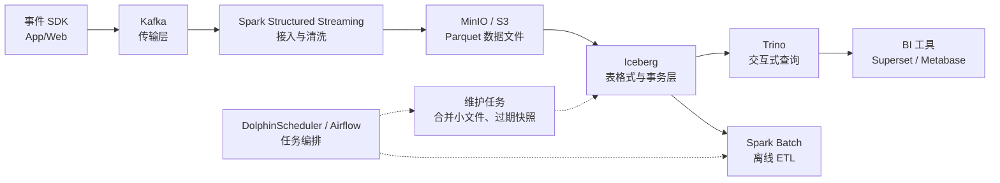
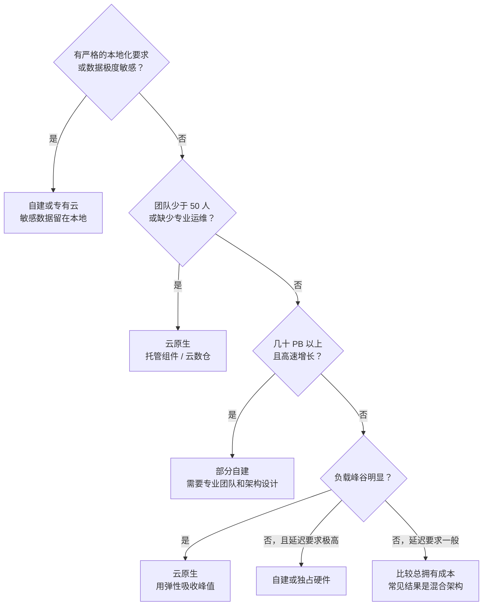
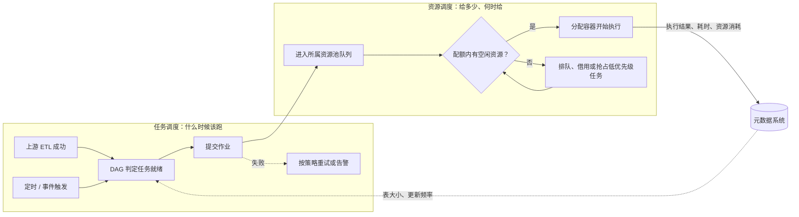
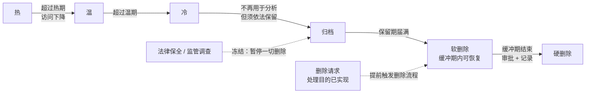
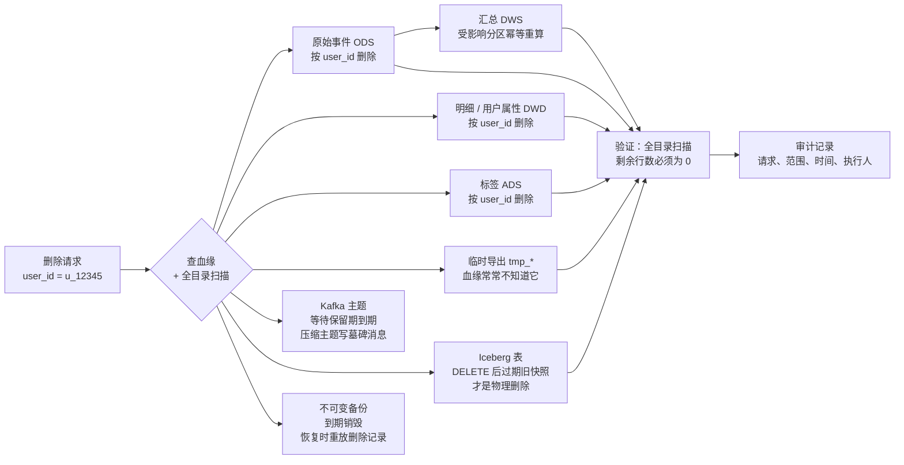

# 数据平台运维：部署、调度、生命周期与安全的工程全貌

Last updated: 2026-10-21

## 核心问题

一个数据系统建成之后，如何在多年运行、多团队共享、成本约束和监管合规的压力下持续健康？

## 前置知识

- [[数据平台]]：数据系统的设计目标与架构权衡（系列导读）
- [[数据库基础与大数据演进]]：存储系统的演化、CAP 与一致性
- [[数据系统的构成]]：七层架构、分析型存储、计算引擎与湖仓机制
- [[数据治理]]：分层、建模、ETL 幂等性、元数据、血缘与质量

真实企业的完整演进故事（百度 Log 平台到 UDW、一家行为分析厂商的十年、一家银行的调度改造）集中在 [[大厂数据平台与实践案例]]。本文只讲机制，需要时引用一两句。

## 核心洞察

前三篇讲的是"怎么把系统建对"。这一篇讲的是另一件更长的事：系统建成以后，压力不会停止，只会换一种形式出现。

- 成本上升时，暴露的是**部署方式**的问题（自建、云托管还是混合）；
- 用户变多时，暴露的是**资源分配**的问题（谁先用、谁后用、谁用多少）；
- 运行变久时，暴露的是**维护**的问题（僵尸资产、日志、备份）；
- 监管变严时，暴露的是**边界**的问题（谁能看、能看多少、能不能删干净）。

这些问题都没有一劳永逸的技术答案。它们的答案一半是机制，一半是流程和组织。

## 实践锚点

完成本文后，你应该能：

- 说出云原生的四个使用层级，并解释为什么"层级越高越省钱"是误区
- 推导"每天高峰低于 8 小时，弹性扩容更划算"这类经验规则背后的成本公式
- 解释工作流编排（Airflow DAG）和资源分配（YARN/Kubernetes 配额）为什么必须分开，并用模拟验证资源池的最小保障如何保护核心任务
- 区分副本与备份、保留期与删除义务，并用 RPO/RTO 设计一次恢复演练
- 对一份删除请求，追踪它到达原始事件、衍生表、临时导出、湖仓快照和备份的完整路径，并验证删除是否完整

---

## 一、开源湖仓栈：省掉授权费，留下运维

十几年前，大厂只能自研整套数据平台；今天，同样的架构可以用开源组件拼出来。在下面几种情况下，自己组装开源栈是合理的选择：数据不能离开私有网络；预算对 SaaS 溢价敏感；团队有足够的工程能力，愿意用运维成本换取控制权。

以下是一个端到端的开源湖仓栈，场景是一家中等规模电商的用户行为分析。

### 1. 技术选型与职责边界



| 层 | 选择 | 替代方案 | 为什么这样选 |
|---|---|---|---|
| 传输 | Kafka | Pulsar、Redpanda | 生态最成熟，运维资料最多 |
| 接入处理 | Spark Structured Streaming | Flink | 与离线 ETL 共用同一套 Spark 代码，降低团队的认知负担；更低延迟的需求再考虑 Flink |
| 对象存储 | MinIO（自建）/ S3 | GCS、OSS | MinIO 兼容 S3 API，本地开发和云上生产可以用同一套代码 |
| 表格式 | Iceberg | Delta Lake、Hudi | 厂商中立，Spark、Trino、Flink 都原生支持 |
| 查询引擎 | Trino | ClickHouse、Doris | 联邦查询能力强，能同时查 Iceberg 和外部 MySQL |
| 编排 | DolphinScheduler / Airflow | 云厂商托管调度 | 成熟、社区活跃，不需要自研 |

Iceberg 如何在对象存储上实现原子提交、快照隔离和时间旅行，见 [[数据系统的构成]]。这里只讨论把它跑在生产里时，工程成本集中在哪里。

### 2. 运维经验

**小文件需要例行合并。** 流处理每隔几分钟提交一次，就会产生大量小 Parquet 文件。打开的文件越多，查询延迟越高，而且会随时间持续增长。合并操作应当作为例行任务进入调度系统：

```sql
-- Spark SQL，需要 Iceberg 的 Spark 扩展
CALL lakehouse.system.rewrite_data_files(table => 'ods.events');
```

**快照需要例行过期。** 每次写入都会产生新的快照和元数据文件。不清理的话，元数据会持续膨胀，被旧快照引用的数据文件也永远不会被删除。保留多少快照，取决于你需要支持多久的时间旅行：

```sql
CALL lakehouse.system.expire_snapshots(
  table => 'ods.events',
  older_than => TIMESTAMP '2026-10-14 00:00:00',
  retain_last => 20
);
-- 失败的写入可能留下没有被任何快照引用的文件
CALL lakehouse.system.remove_orphan_files(table => 'ods.events');
```

快照过期和合规删除直接相关：在 Iceberg 表上执行 `DELETE`，只会产生一个"不再包含这些行"的新快照，旧快照引用的数据文件仍然在对象存储里，时间旅行也还能查到被删的数据。**只有旧快照过期、文件被物理清理之后，删除才真正完成。** 第五节的删除传播会再用到这一点。

**流任务的消费位置必须持久化。** Spark Structured Streaming 消费 Kafka 时，`startingOffsets` 默认只对第一次启动生效（流查询默认从最新 offset 开始）。任务异常重启后，靠的是 checkpoint 目录里记录的进度。checkpoint 必须写在持久化存储上，不能写在本地磁盘；删掉 checkpoint 重启，任务会从最新位置开始读，中间的数据就丢了。

**每个组件都要有人值守。** 这套栈有五六个独立组件，每一个都有自己的升级、扩容和故障排查。开源省掉的是授权费，不是运维成本。下一节会把这笔账算清楚。

---

## 二、云上、自建与混合：部署方式是运维责任的分配

开源栈让"能不能建"不再是问题，接下来的问题是"在哪里建、谁来运维"。这件事常被简化成"要不要上云"，但真正的决策是**把哪些运维责任交给别人、为此付多少钱、放弃多少控制权**。

### 1. 云原生不只是"部署在云上"

云原生是一种构建和运行应用的方法论，目的是充分利用云计算的弹性、分布式和自动化：

- 以容器为交付单位；
- 以微服务拆解复杂业务；
- 以声明式 API 和不可变基础设施保证环境一致；
- 配合 DevOps，通过自动化编排和自愈能力实现快速迭代、弹性伸缩和故障自愈；
- 通过服务网格和完备的可观测性（日志、指标、监控），把环境差异和运维复杂度"平台化"，让团队聚焦业务。

大数据关注的是如何采集、存储、分析海量数据，云原生关注的是应用如何高效、弹性地运行。两者是天然的搭档：云原生给大数据提供运行环境，大数据给云原生提供丰富的应用场景。具体收益有三处：

- **资源调度**：大数据任务的运行时间很不均衡。Spark、Flink 等框架可以直接在云原生集群上按需申请资源，空闲资源可以被其他服务复用。
- **部署运维**：用容器打包（Docker）、用编排系统管理（Kubernetes），部署、升级、回滚更标准化，减少"我这能跑，你那里不能跑"的问题。
- **存储**：对象存储（S3、GCS、OSS）结合表格式（Iceberg、Delta Lake），提供高扩展、低成本的存储方案，机制见 [[数据系统的构成]]。

曹犟在服务国央企客户时观察到一个常见的立项顺序：先建自己的私有云或混合云，再部署主流大数据系统，最后才开始探索具体的应用场景。

### 2. 四个使用层级：越往上越省心，但不一定越省钱

云原生不是一个开关，而是一个从轻到重的光谱：

| 层级 | 使用什么 | 谁负责运维 | 灵活性 | 典型例子 |
|---|---|---|---|---|
| 1. 基础设施 | 云上的计算、存储、网络资源 | 自己运维所有大数据组件 | 最高 | 云主机 + 自建 Hadoop/Kafka |
| 2. 平台服务 | 托管的大数据组件 | 云厂商负责部署、监控、升级、扩缩容 | 较高 | AWS EMR、托管 Kafka、托管 Doris |
| 3. 数据系统 | 一体化的云数仓 / 数据湖 | 厂商提供从数据准备、建模到开发的一体化方案 | 中 | Snowflake、Databricks |
| 4. 应用 | 大数据 SaaS 产品 | 厂商连应用场景都做好了抽象和约束 | 最低 | Google Analytics、Amplitude、神策分析 SaaS 版 |

**常见误区是以为云原生程度越高，成本越有优势。** 从下往上，使用者介入得越来越少，维护越来越方便，但场景灵活性越来越低，成本也可能越来越高。曹犟给出的一个例子：处理相同的数据流量，自己在公有云上买虚拟机搭 Kafka，和直接用托管 Kafka 服务相比，很多时候硬件成本能差十倍。从商业角度看这很好理解：越往上集成度越高、你的维护成本越低，省下的成本会以其他方式体现在账单上。

### 3. 五个核心考量

**成本：并不总是最划算。** 传统自建是**资本性支出（CapEx）**：一次性投入大量资金买硬件，但硬件利用率往往不高。曹犟在百度时观察到，为了应对高峰，大部分在线服务节点的 CPU Idle 保持在 90% 以上；Hadoop 集群好一些，但大部分时候闲置率也在 70% 以上。闲置的机器照样要付机房、电力和运维成本。

云是**运营性支出（OpEx）**：只为实际使用的资源付费，可以通过竞价实例、预留实例等定价模式进一步降低成本。订阅制还能把一次性采购的财务压力分摊到不同年份，对现金流紧张的创业公司很有价值。但云并不永远更便宜：有些 IDC 能提供比公有云便宜得多的硬件，前提是部署和运维自己解决。

用云服务时，成本管理有几条基本做法：

- 建立成本监控，实时看各项服务费用，设置预算告警；
- 根据负载特点选择按需、预留、竞价等定价模式；
- 定期清理不用的资源，调整过度配置的实例。

**弹性：应对业务峰谷。** 电商平台在双十一期间要处理的数据量，可能是平时的十倍。按峰值规划自建集群，平时大量闲置；按平均值规划，峰值时又处理不过来。私有化部署的客户在大促前扩容、大促后缩容，这些操作都需要额外人力，最终会体现在账单上。云的自动伸缩规则可以根据负载自动增减节点。

**运维：把精力留给业务。** 开源降低了技术门槛，但运维大数据集群依然复杂：硬件故障、系统升级、性能调优、安全补丁。曹犟给出的经验数据是，50 台左右的中等规模集群，至少需要 3 到 5 个有经验的专职运维。用托管服务时，这部分工作由云厂商承担。例如用 AWS EMR，就不需要关心 Hadoop 版本升级、组件兼容性和集群高可用配置。当然，托管运维本身是额外付费的。

**技术：持续创新、技术锁定与性能调优。**

- **持续创新**：云厂商投入巨大，新功能、更好的性能可以直接享受，不需要自己升级改造。Snowflake 这样的一体化方案，是自建很难做到的。
- **技术锁定**：用专有服务，将来迁移到其他云或回到自建的成本会很高。应对办法是优先使用开源标准（比如标准 SQL 接口，而不是某家厂商的专有查询语言）；做好架构分层，把业务逻辑和基础设施分开；关键系统保持多云部署能力。曹犟提到，一家只用云上虚拟机、不依赖任何专有服务的 SaaS 厂商，因为迁移在技术上可行，与国内几家公有云谈判时拿到了相当不错的折扣：可迁移性本身就是议价筹码。
- **性能调优**：上云后失去了对底层硬件的控制，调优更难。自己要具备基本能力：根据负载选择实例类型；优化数据布局（分区、缓存）；利用云存储的特性（如 S3 的范围读取和并行下载）。大客户通常能拿到厂商的技术支持，但"求人不如求己"。

**安全与合规：不能 100% 依赖云厂商。** 一方面要选择合规的厂商和区域，比如在中国要选有相应牌照的云厂商。另一方面，加密存储和传输、敏感数据脱敏、访问控制和审计都要自己做。对特别敏感或有合规要求的数据，专有云或混合云往往是必须的选择。"敏感数据在本地，其他数据上云"是很多金融和政企客户实际采用的方案。具体的控制措施见第五节。

托管服务还有一个容易被误解的地方：它屏蔽的是运维细节，不是分布式系统的取舍。托管数据库的同步/异步复制、云 NoSQL 的强一致/最终一致读，仍然是你要做的选择。这部分见 [[数据库基础与大数据演进]]。

### 4. 中国市场的现实：上云没有报告预测得那么快

咨询机构的报告普遍把公有云和云原生当作确定的趋势，但在中国市场，即使是数字化程度领先的企业客群，私有化部署仍然占多数，信创要求还在强化这一点。所以"要不要上云"在国内往往不是技术问题，而是合规和采购问题。一家行为分析厂商的客户部署比例、信创的时间表，以及几家云厂商为此做出的不同选择，见 [[大厂数据平台与实践案例]]。

### 5. 四个评估维度

曹犟给出了四个评估维度。下面的阈值是他的经验判断，不是行业标准：

| 维度 | 倾向云原生 | 倾向（部分）自建 |
|---|---|---|
| 团队规模与技术能力 | 团队较小（少于 50 人），或缺少专业大数据运维 | 团队技术实力强，且业务对性能、成本有极致要求 |
| 数据规模与增长预期 | PB 级以下，增长相对平稳 | 几十 PB 以上，且持续高速增长 |
| 业务特点与负载模式 | 负载波动大，峰谷明显 | 负载平稳，且对延迟有极高要求（如高频交易） |
| 合规要求与数据敏感度 | 大多数行业的大部分场景，公有云安全性已足够，再补充必要的安全措施 | 有严格的数据本地化要求，或数据极度敏感（自建或专有云） |

即使选择自建，也不建议从零开始完全自建：公有云的虚拟机通常是必选项，部分托管组件也可以按需采用。



### 6. 把成本算清楚

成本对比最常见的陷阱是只比硬件单价。两种模式的成本结构根本不同：

| 成本项 | 自建（IDC / 私有云） | 云托管 |
|---|---|---|
| 硬件 | 一次性资本支出，按年限折旧 | 运营支出，按使用付费 |
| 机房、电力、带宽 | 自己承担 | 包含在实例价格里 |
| 运维人力 | 自己的运维团队（含招聘、培训、流失） | 主要由厂商承担，体现为托管溢价 |
| 峰值预留 | 按峰值配置，平时闲置 | 按需扩缩，闲置成本低 |
| 数据流量 | 内网流量基本免费 | 跨区、出云流量通常单独计费 |
| 迁移与锁定 | 硬件迁移成本高 | 专有服务越多，迁出成本越高 |

一个更完整的公式：

```text
总拥有成本（自建）= 硬件折旧 + 机房 + 电力 + 带宽 + 运维人力 + 闲置的峰值容量
总拥有成本（云）  = 实例费用 + 存储费用 + 流量费用 + 托管服务溢价 + 仍需自己承担的运维
```

### 7. 混合架构：最常见的实际答案

纯云原生和纯自建都比较少见，更常见的是混合架构：

- 核心数据和实时计算放在自建集群，保证性能和安全；
- 离线分析和机器学习放在云上，利用弹性资源；
- 冷数据归档到对象存储，降低存储成本；
- 临时的数据探索任务使用无服务器计算。

混合架构能综合两种模式的优势，代价是架构更复杂：团队要同时理解两套运维体系，以及数据在两套系统之间流动时的一致性和权限边界。

### 8. 弹性扩容的临界点

混合架构里最常见的一个具体问题是：高峰期的额外容量，是常驻还是按需？曹犟给出的经验是：**只要每天的高峰时长低于 8 小时，弹性扩容就有更好的性价比。** 这条规则背后是一个简单的成本公式。假设基础容量用包年包月（或自有硬件摊销），峰值的额外节点要么常驻、要么按需：

```text
额外节点常驻的成本 = 额外节点数 × 24 小时 × 包年包月单价（折算到每小时）
额外节点按需的成本 = 额外节点数 × 高峰小时数 × 按需单价

两者相等时：高峰小时数 = 24 × 包年包月单价 / 按需单价
```

如果按需单价大约是包年包月折算单价的 3 倍，临界点就是 8 小时。你的实际临界点取决于你拿到的价格，练习五会把这个公式写成代码。前提是客户给的是能弹性伸缩的公有云虚拟机；物理机和自建虚拟化环境里，峰谷只能靠人工扩缩容。一家 SaaS 厂商如何同时服务 SaaS 和私有化客户、如何把存储迁到对象存储省下一半硬件开支，见 [[大厂数据平台与实践案例]]。

### 9. 不被"云原生"这个概念绑架

曹犟的建议可以归结为四句话：不要被"云原生"这个概念绑架，基于自己的实际情况做选择；即使选择自建，也要学习云原生的架构理念；即使选择上云，也要保持技术的自主性和可迁移性；最重要的是建立持续优化的机制，因为技术和业务都会变。

---

## 三、资源调度：有限资源如何让所有人满意

部署方式决定了资源从哪里来，资源调度决定了资源给谁用。曹犟提到，在他服务过的企业客户中，相当大一部分"系统不好用"的问题，最终都可以归因到资源调度。

### 1. 问题的本质

大数据平台的资源主要有两类：**计算资源**（CPU、内存、GPU）和**存储侧资源**（磁盘 I/O、网络带宽）。对资源的争夺，往往体现在任务优先级和 SLA 上。资源永远有限，需求一直增长，而且系统越好用，需求增长越快。

**资源调度要回答的问题是：多个不同类型的任务竞争有限资源时，谁先用、谁后用、谁用多少？** 目标同时有三个：保障核心业务的 SLA、让所有用户得到合理资源、提高整体利用率并控制成本。

大数据平台的调度有三个独特难点：

- **任务类型多样**：批处理任务运行时间长、资源需求稳定；实时任务需要持续运行、不能中断；adhoc 查询随时提交，运行时间和资源需求波动很大。
- **资源需求差异巨大**：有的查询几秒钟、扫描几百 MB；有的任务要跑几小时、处理几 TB 甚至几十 TB。
- **时间维度的冲突**：早上报表生成时段，大量任务集中启动；夜间业务活动减少，但很多 ETL 又恰好选在夜间运行。

调度不当会带来四种后果：任务延迟甚至阻塞，影响业务决策；资源利用率低，高峰不够用、夜间大量闲置；核心业务得不到保障；成本和性能难以平衡。**这些问题的根源，往往不是资源绝对不足，而是调度策略不合理。**

### 2. 三种基础策略与混合方案

| 策略 | 机制 | 适合 | 风险 |
|---|---|---|---|
| **公平调度** | 所有用户或队列平均分配资源 | 用户少、任务类型单一 | 不区分重要性，资源紧张时核心任务得不到保障 |
| **容量调度** | 按组织或业务预先划分配额（如总行 60%、分行 40%），闲置配额可被临时借用 | 多部门共用集群，既保证权责对等，又有弹性 | 配额划分本身需要协商 |
| **优先级调度** | 重要任务优先获得资源，甚至抢占低优先级任务 | 必须保障核心业务的场景 | 所有人都把任务标为高优先级（优先级膨胀）；低优先级任务长期得不到资源（饥饿），需要防饥饿机制 |

真实生产环境很少只用一种策略。比较成熟的做法是三层混合：

1. **第一层，容量调度**：按组织或业务线划分资源池，每个池有自己的配额；
2. **第二层，优先级调度**：在每个资源池内部，由该组织自己按优先级排序；
3. **第三层，公平调度**：同优先级的任务之间公平分配。

没有一劳永逸的调度策略。先明确当前的核心目标是保障 SLA、提高利用率还是保证公平，再选策略。

### 3. 资源隔离与资源池设计

共享集群如果不做隔离，就会出现**邻居效应**（noisy neighbor）：一个用户的大任务占满资源，其他用户的任务无法执行。把不同优先级、不同类型的任务隔离到不同资源池，一个池出问题不会拖垮其他池。

主流计算平台（Hadoop YARN、Kubernetes、Spark）都提供资源池配置，AWS 和阿里云的 EMR 也内置了这类能力。选哪种技术取决于你的计算平台，关键还是调度策略本身。

每个资源池需要三个参数：

| 参数 | 含义 |
|---|---|
| **最小保障** | 无论如何都不会被其他池占用的资源下限 |
| **目标配额** | 正常情况下这个池的资源分配量，是调度的目标值 |
| **最大上限** | 包括从其他池借用之后，这个池最多能使用的资源 |

**借用与归还**：某个池的资源没用完时，空闲资源可以被其他池临时借用；原池有新任务时，再逐步归还。这把静态配额变成了动态分配，在不增加硬件的前提下显著提高利用率。在云环境下，还可以叠加自动扩缩容：需求超过当前容量时自动加入新节点，需求下降时释放闲置节点。

最小保障到底保护了什么，可以用练习一的模拟直观看到：一个全表扫描如果可以占满集群，五个核心报表要排队到 150 分钟后才全部完成；给核心池保留 6 个槽位后，核心报表 65 分钟内全部完成，代价是扫描从 120 分钟变成 240 分钟。**资源隔离不会凭空产生资源，它只是决定了排队的代价由谁来承担。**

### 4. 任务调度与资源调度是两个不同的问题

这是最常见的认知混淆：

- **任务调度**（Airflow、DolphinScheduler）解决"这个任务什么时候该运行"：DAG 依赖、定时或事件触发、重试和告警。它不知道集群还有多少空闲资源。
- **资源调度**（YARN、Kubernetes）解决"任务提交之后，给它多少资源、何时给"：配额检查、排队、抢占。它不知道任务之间的业务依赖。



两者协作，但职责不重叠。一个任务"就绪了但没资源"，和"有资源但上游没跑完"，是两种完全不同的延迟，需要在不同的系统里排查。小规模时一个工具兼管两件事尚可接受，规模变大后必须分开。

成熟的任务调度系统需要五个核心能力：

| 能力 | 说明 |
|---|---|
| 定时调度 | 按时间规则触发，如每天凌晨 2 点执行 ETL |
| 事件触发 | 响应业务变化，如文件到达指定目录时触发导入 |
| 依赖管理 | 管理任务之间的 DAG，上游全部成功后下游才开始 |
| 失败重试与告警 | 临时性错误自动重试，持久性错误及时告警；重试要有策略和次数上限 |
| 执行监控 | 实时监控任务状态、执行时长、资源消耗，提供可视化界面和 API |

开源可选 Apache DolphinScheduler、Apache Airflow，云上也可以用托管服务（如 AWS Step Functions）。选一个成熟、稳定、社区活跃的系统即可，**尽量不要自己从头开发**。

任务调度也不应孤立运行，而要和元数据、血缘协同：

- 血缘记录的上下游关系，本质上就是任务的依赖关系（见 [[数据治理]]）；
- 元数据可以驱动调度：表数据量大，对应任务可能需要更多资源；表更新频率高，对应任务可能需要更高优先级；
- 反过来，任务的执行时间、资源消耗、成功失败状态都是重要的操作元数据，应当写回元数据系统。

### 5. 监控与持续优化

资源调度需要持续监控、持续优化。监控指标分两类：

| 类别 | 指标 | 反映什么 |
|---|---|---|
| 计算资源指标 | CPU、内存、磁盘 I/O、网络带宽利用率 | 系统负载 |
| 任务执行指标 | 等待时间、执行时长、成功率、SLA 达标率 | 系统对任务的完成情况 |

常见的四种优化方法：

- **定期找出低效任务**：执行时间和资源消耗排名靠前的任务往往有优化空间，比如没建索引导致全表扫描、JOIN 方式不对导致数据倾斜。这件事要定期做，优化完前三名，还会出现新的前三名。
- **调整任务并发度**：并行度太低浪费算力，太高导致资源争抢。并发度很难在系统初始化时一次设好，需要根据运行情况持续调整。
- **存算分离**：存储和计算的增长节奏常常不匹配，为了存更多数据而闲置计算节点，或为了更多算力而多部署存储，都是浪费。机制见 [[数据系统的构成]]。
- **成本量化与透明化**：很多时候，只要把成本明确算出来，就能起到很好的作用。把各部门的实际花费、最耗资源的任务和查询公示出来，使用者会主动合理地使用资源。

### 6. 调度首先是优先级管理

上面的机制都是技术手段，但复杂组织里，资源调度首先是**业务优先级管理问题**：谁的任务算核心、探索查询在什么时段让路、超出配额怎么办，这些规则要先和使用者讲清楚。用户能接受"错峰使用"，但不能接受系统毫无征兆地变慢。一家股份制银行如何用三个资源池、分时规则和资源大盘止住投诉和成本上升，见 [[大厂数据平台与实践案例]]。

---

## 四、Housekeeping：让系统不慢性老化

调度解决的是"此刻怎么分"，housekeeping 解决的是"长期怎么不烂"。即使调度体系完善，不做日常维护，系统也会逐渐老化，最终不堪重负。

### 1. 为什么重要却总被忽视

Housekeeping 指为了保持系统持续健康运行而做的一系列日常维护，主要包括五个方面：

| 方面 | 内容 |
|---|---|
| 数据清理 | 过期数据、临时数据、僵尸数据 |
| 日志管理 | 日志轮转、归档、清理，避免占满磁盘 |
| 资源回收 | 不再使用的计算资源、存储空间、账号和权限 |
| 性能优化 | 定期分析慢查询、优化索引、更新统计信息 |
| 预防性维护 | 监控健康状况，在问题发生前解决 |

它总被忽视，有四个原因：

- **没有成就感**：做了没什么感觉，不做会出大问题；
- **问题渐进累积**：存储不是一天满的，性能不是一天变慢的，像温水煮青蛙；
- **投入产出难量化**：很难向管理层解释"这个月清理了 500 张僵尸表"的价值；
- **责任不明确**：很多组织里没有人觉得这是自己的工作。

它要应对的挑战也很具体：数据量持续增长时历史数据怎么处理；临时数据和中间结果怎么及时清理；日志怎么管理才不会占满磁盘；怎么识别和清理僵尸资源；清理工作怎么不影响业务。

### 2. 数据生命周期与保留策略

一份数据从产生到删除，会经历几个阶段：**热数据**（刚产生，频繁访问）、**温数据**（偶尔访问）、**冷数据**（很少访问但不能删）、**归档数据**（不再用于日常分析，但出于合规要求必须保留）、**过期数据**（确定可以删除）。不同阶段放在什么存储介质上、存算分离如何配合，见 [[数据系统的构成]]。这里关心的是另一半问题：**谁来决定一份数据处在哪个阶段，以及什么时候必须离开。**



制定保留策略时要考虑三个因素：

- **业务需要**（最重要）：不同时间段的历史数据，访问热度大概是什么样；
- **合规要求**：金融行业的交易数据、医疗行业的病历都有必须遵守的保存期限，具体年限取决于行业和法域；
- **存储成本**：数据越多成本越高，要在业务价值和成本之间权衡。

这里要区分两个经常被混为一谈的概念：

- **保留期**回答"至少要留多久、最多能留多久"。法规可能规定最短保存期限；而个人信息的处理通常要求不超过实现处理目的所必需的期限，这又给出了上限。
- **删除义务**回答"什么时候必须删"。处理目的已实现、用户撤回同意或提出删除请求时，可能产生删除义务，但它有例外：比如法律规定的保存期限未届满。两者冲突时，以法定保留优先，同时把数据隔离、停止其他处理。如何判断适用哪种情况，属于法务的结论；工程要做的是让两种规则都能被系统执行。

**归档**的注意点：归档前验证数据完整性，确保没有遗漏；归档数据要压缩，进一步降低成本；归档后要保留访问接口，虽然慢，但必要时能查到。

**删除**要更谨慎，采用"软删除 + 硬删除"两阶段：

1. **软删除**：把数据标记为"待删除"，从正常查询结果中隐藏，但物理上还在。设置缓冲期，期间发现误删还能恢复。
2. **硬删除**：缓冲期结束后物理删除。对核心数据要有审批流程，删除后记录日志（删除时间、数据范围、执行人、原因），用于审计。

清理通常由定时任务自动完成，比如每天凌晨扫描所有表的分区，按保留策略删除或归档过期数据。**数据迁移任务，尤其是定时删除任务，一定要经过严格的测试和试运行。** 先跑 dry-run，只输出"将要删除什么"，确认无误后再真正执行（练习二）。

### 3. 临时数据与中间结果

除了正式业务数据，系统还会产生大量临时数据：

- ETL 过程中创建的中间表；
- 分析师做探索分析时保存的临时查询结果；
- 开发人员调试时创建的测试表和测试数据；
- 计算引擎的中间文件，比如 Spark Shuffle 产生的大量中间文件。

管理临时数据不能依赖个人的责任心，要靠机制：

- **命名规范**：统一前缀（`tmp_`、`temp_`、`test_`），一眼就能识别；
- **TTL**：为临时数据自动设置过期时间，比如临时表默认 7 天后自动删除；
- **存储隔离**：放在独立区域，清理时不会误删正式数据，也方便统计临时数据的占用；
- **定期清理**：每天或每周扫描并清理超期的临时数据，清理前先通知创建者，给出缓冲期。

很多存储系统原生支持 TTL；不支持的，可以用定时任务加元数据实现。临时数据还是合规删除最容易漏掉的地方：一张分析师导出的临时表里如果有用户手机号，它同样在删除请求的范围之内（练习四）。

### 4. 日志管理

日志分四类：应用日志（服务监控）、审计日志（安全审计）、访问日志（使用分析）和系统日志（底层排查）。它们的难点是：量大、增长快，可能打满磁盘造成严重故障，但贸然删除又会影响排查和审计；而且查询海量历史日志本身也很困难。

五条最佳实践：

- **日志分级**：不同级别保留不同时间。曹犟给出的一组建议是：ERROR 保留 90 天，WARN 保留 30 天，INFO 保留 7 天，DEBUG 只在调试时开启，不在生产环境保留；
- **日志轮转**：单个文件不能无限增长，按大小切分（如单文件不超过 1GB）或按时间切分（如每小时一个新文件，一天前的旧文件自动压缩）；
- **日志归档**：历史日志压缩后转移到对象存储等低成本介质；
- **统一日志中心**：把分散在各节点的日志集中收集，方便查询、分析和设置告警，可以用 ELK（Elasticsearch、Logstash、Kibana），也可以用云厂商的日志服务；
- **定期清理**：按类型和级别设置保留期，到期自动删除，删除前确保已归档或确实不再需要。

日志管理应尽量自动化：用 logrotate 自动轮转，用 Filebeat 自动收集，用定时任务自动清理。审计日志例外：它的保留期由合规要求决定，并且必须防篡改，见第五节。

### 5. 僵尸资源的识别与清理

系统运行一段时间后，会积累大量"僵尸资源"：仍然占用存储和计算，但已经没有价值。主要有四类：

- 长期没有下游应用的数据，比如标签和分群；
- 已经不再需要、但仍在调度系统里每天执行的任务；
- 离职员工的账号和权限，不仅浪费资源，还是安全隐患；
- 没人看的报表。

它们不只浪费资源。曹犟提到，不少行为分析系统的客户在使用几年后抱怨查询变慢、甚至前端界面变慢，排查后很多时候是僵尸资源导致的：大量元数据拖慢了整个系统。

**识别的三种方法**：

- **访问日志**：取得每个资源的最后访问时间。前提是系统有意识地记录了查询日志，否则事后无从查起；
- **数据血缘**：没有任何下游依赖的对象，很可能是僵尸（血缘见 [[数据治理]]）；
- **用户确认**：定期和业务方确认哪些数据、报表还在用。办法原始，但对核心资源是必要的。

**规范的清理流程**：

1. 生成清理候选列表；
2. 通知数据 Owner 逐一确认（前提是每个数据对象都登记了 Owner）；
3. 设置观察期：标记为"待清理"后不立即删除，期间有人访问或提出异议，就自动取消标记；
4. 执行清理并记录（对象、时间、原因、执行人），同样采用软删除加硬删除。

**渐进式执行**：第 4 步不应该一步到位，而要拆成几个越来越不可逆的阶段：

| 步骤 | 时间 | 做什么 | 如何撤销 |
|---|---|---|---|
| 停止调度 | 第 0 天 | 从调度系统移除，不再计算更新，计算负载立即下降 | 恢复调度即可，数据和元数据都在 |
| 隐藏展示 | 第 7 天无异议 | 前端标记为"已停用"，普通用户不可见，管理员可见 | 取消停用标记 |
| 删除数据 | 再过 7 天无异议 | 删除历史数据文件释放存储，先进回收站，过期后再彻底清理；元数据保留 | 从回收站恢复，或按元数据重算 |
| 归档元数据 | 再过 30 天 | 元数据从线上库迁到归档库，保留完整删除记录用于审计 | 从归档库追溯 |

**每一步都有观察期，而且每一步的撤销代价都比上一步大**，所以越不可逆的操作越往后放。直接跳到删除数据是常见错误，被删对象的依赖方往往几周后才会发现问题。

最难的往往不是技术，而是**找谁来确认**：几年下来人员流动、组织调整，已经没人说得清哪些资产还在用。一个客户用这套流程清理了 3000 多个标签和 1500 多个分群，计算负载下降 40%，见 [[大厂数据平台与实践案例]]。

### 6. 性能监控与预防性优化

Housekeeping 不只是清理，还包括持续监控和预防性优化。四个关键指标：

| 指标 | 一组可参考的做法（课程案例） |
|---|---|
| 存储使用率 | 设置 80% 和 90% 两档告警，分别对应自动工单和人工接警 |
| 查询性能 | 持续监控 P95 响应时间，定期优化 Top 慢查询 |
| 任务执行时长 | 确保关键任务不超过 SLA 约定时间 |
| 资源使用率 | CPU、内存、磁盘 I/O、网络，发现瓶颈及时调整 |

发现问题时，除了改写 SQL、加索引、调整表结构，重新梳理任务依赖、清理数据库碎片、合并文件系统上的碎文件、调整存储分区，都是常见手段。

**容量规划**也是预防性优化的一部分：基于历史数据预测增长趋势，提前规划扩容，而不是等资源耗尽才被动应对。规划要在成本和性能之间平衡，不是越多越好。

### 7. 备份与恢复：副本不是备份

很多人觉得分布式系统已经有多副本，不需要额外备份。但**副本只能防止硬件故障，不能防止误操作、软件 bug、恶意破坏这类逻辑错误**：一条错误的 `DELETE` 会被忠实地复制到所有副本上。

| | 副本（Replication） | 备份（Backup） |
|---|---|---|
| 防什么 | 磁盘、机器、机架故障 | 误删、错误写入、软件 bug、勒索和恶意破坏 |
| 与源数据的关系 | 实时或准实时同步，错误也会同步 | 某个时间点的独立拷贝，与源数据隔离 |
| 恢复粒度 | 切换到另一个副本 | 回到某个时间点 |

完善的备份策略有五个要点：

- 全量备份和增量备份组合；
- **不只备份数据，一定要备份重要的元数据**：Schema、权限、血缘、调度配置。只有数据没有元数据，恢复出来的是一堆不知道含义的文件；
- 不同数据用不同频率，核心数据尽量每天备份；
- **备份要验证**：定期测试恢复流程，避免真正需要恢复时才发现备份是坏的；
- **异地备份**：把备份存到不同地理位置，防止区域性灾难。

备份策略要用两个目标来设计：

- **RPO**（Recovery Point Objective，恢复点目标）：最多能接受丢失多长时间的数据。每天备份一次，RPO 最坏就是 24 小时。
- **RTO**（Recovery Time Objective，恢复时间目标）：从故障到恢复服务，最多能接受多长时间。

两者都要通过**恢复演练**来验证，而不是写在文档里。一次演练至少包括：

1. 在隔离环境中，从备份恢复一个指定时间点的数据和元数据；
2. 校验行数、校验和以及关键指标，与源系统同一时间点的记录对比；
3. 确认权限、调度任务和血缘也恢复了，下游任务能正常运行；
4. 记录实际耗时，与 RTO 对比；记录恢复到的时间点，与 RPO 对比；
5. 把发现的问题写进故障案例库。

还有一个设计选择：不是所有数据都需要同等备份。如果原始数据和转换代码都完整保留，并且转换是确定性的、可以幂等重跑（见 [[数据治理]]），衍生层可以通过重算恢复，备份的重点就落在原始数据、元数据和代码上。代价是 RTO 变长，重算需要时间。

### 8. 自动化与流程保障

靠人工执行 housekeeping 不可持续：工作量太大、容易遗漏、难以保证一致性。**自动化是关键**：清理脚本、监控告警、巡检工具、运行报告。可用的成熟工具包括 DolphinScheduler（不仅能调度业务任务，也能定时执行 housekeeping 任务）、Prometheus + Grafana（监控告警的业界标准方案），以及各云厂商的托管服务（AWS CloudWatch、阿里云日志服务等）。自动化是持续演进的：一开始可能只有清理脚本，逐步再加入监控、告警和巡检。

但 **housekeeping 不只是技术问题，更是组织和流程问题**：

- **责任制**：每个数据对象都有明确的 Owner，不仅负责开发维护，也负责清理和优化；
- **巡检制度**：每周或每月巡检存储使用、僵尸资源、慢查询，结果形成报告并提交到必要的层级；
- **纳入考核**：不能只考核新功能，也要考核系统维护；
- **三个规范流程**：
  - 数据创建要审批，评估必要性和影响，避免一时兴起创建大量无用数据；
  - 数据下线要通知相关方、确认无影响后再删除，不能悄无声息地删；
  - 重要的维护操作（大规模删除、调整分区策略）要走变更审批：评估影响范围、准备回滚方案、在业务低峰期执行；
- **知识沉淀**：维护手册（步骤、注意事项、常见问题）、故障案例库（问题、原因、解决方案）、定期的团队分享。

---

## 五、安全与合规：不能拿来交换的约束

前面每一节都在做权衡：成本换弹性，灵活性换省心，探索查询的速度换核心报表的 SLA。安全合规是例外。曹犟在讲接入层设计时说得很直接：**在成本一定的情况下，时效性、可靠性都可以做牺牲，但安全合规是刚性目标，不应该被牺牲；必要时为了安全合规增加成本也是必要的。**

### 1. 为什么是刚性需求

**法规越来越严，监管越来越强。** 国内 2021 年相继实施《数据安全法》和《个人信息保护法》；国际上有欧盟 GDPR、美国 CCPA，以及金融领域的 SOX 法案、支付卡行业的 PCI-DSS 标准。监管的方向是从建议性变为强制性，从事后处罚变为事前预防。曹犟在课程中提到，2025 年 9 月初，某全球知名奢侈品品牌因用户数据合规问题被处罚，不少国际零售品牌随即开始内部自查。

**不重视的代价有四个层面**：

- **监管处罚**：数额巨大的罚款；
- **品牌损害**：往往更严重，用户的信任多年积累，一次事故就可能崩塌；
- **业务中断**：被要求整改时可能需要暂停服务；
- **法律责任**：在新的法律框架下，相关责任人个人也可能承担责任，这让 CIO、CTO 面临前所未有的压力。

**它不是一个独立模块。** 安全合规是一条贯穿采集、传输、存储、计算、应用的红线，任何一个环节出问题，都可能导致整个系统合规失败。

### 2. 安全与合规：两个不同维度

- **安全**是技术层面的防护能力：防止数据被未经授权地访问、篡改、泄露或破坏。问题是"有没有技术手段保护数据"。
- **合规**是符合法律法规、行业标准和内部政策：数据的采集、使用、存储、传输是否符合规定。问题是"行为是否在规则允许的边界内"。

一家公司可以对所有用户数据做强加密，黑客无法攻破，技术上非常安全；但如果它在用户不知情的情况下采集通讯录和位置信息，并提供给第三方广告公司，那么在合规层面就是严重违规。**安全是合规的基础，合规是安全的目标**，两者缺一不可。

这里还要分清工程和法律的分工：

| 工程控制（工程师负责实现和证明） | 法律结论（法务/DPO 负责判断） |
|---|---|
| 数据分类分级与敏感字段识别 | 某项处理是否有合法性基础 |
| 最小权限、行级过滤、列级脱敏 | 适用哪个法域、哪条规则、有哪些例外 |
| 传输与存储加密、密钥管理 | 数据能否出境、走哪条出境路径 |
| 审计日志、血缘、删除传播与验证 | 保存期限多长、删除请求是否必须执行 |

工程师不应该替法务下结论，但必须让法务的结论能被系统执行和证明。

### 3. 全流程管控：数据的六个阶段

**采集：合规的第一道关口。**

- **最小必要**：只采集业务真正需要的数据，不采集无关数据。"能采则采"是一种数据资产建设思路，不是合规依据，采集范围必须能对应到明确的处理目的。
- **合法性基础**：处理个人信息需要合法性基础，同意是最常见的一种，但不是唯一一种。《个人信息保护法》第十三条列出了取得同意、订立或履行合同所必需、履行法定职责或义务所必需等情形；处理敏感个人信息还需要取得单独同意。GDPR 第六条规定了六种合法性基础。具体场景适用哪一种，由法务判断。
- **以同意为基础时**，告知目的、范围、方式要清楚，不能用默认勾选、隐藏条款获取同意。
- 技术上：SDK 端对敏感字段加密，持久化记录用户的授权状态，第三方数据的获取要有合法来源（采集方案见 [[数据系统的构成]]）。

**传输：最容易被攻击的环节。**

- **通道加密**：使用 HTTPS，对跨机房、跨云的链路甚至使用 IPSec 专线；
- **字段级端到端加密**：在应用层对部分敏感字段单独加密，即使中间节点被攻破，也读不到这些字段；
- **密钥管理**：用 HSM（硬件安全模块）或云 KMS 服务管理密钥，不在代码和配置里硬编码；
- **访问控制**：对接入层和传输层的访问，结合 IP 白名单、VPN、API Key 等方式，每个服务只拿到完成任务所需的最小权限，并以操作审计作为兜底；
- **全链路审计**：尽可能记录每条数据怎么采集、从哪来、经过哪些节点、到哪去，必要时在数据中添加专门的来源字段；
- **按展业区域和行业**，针对 GDPR、SOX、PCI-DSS 等要求建立对应的技术控制和流程规范；
- **跨境传输**：GDPR 下，数据可以传输到获得"充分性认定"的国家和地区，也可以在采取适当保障措施（如标准合同条款）或符合特定例外时传输；《个人信息保护法》下，向境外提供个人信息需要满足安全评估、个人信息保护认证、标准合同等条件之一。具体路径和门槛以现行规定为准，由法务判断；工程上要配合做数据识别、脱敏、授权记录和审计。

**存储：数据量最大、存在时间最长的环节。**

- 分类分级（如公开、内部、敏感、高度敏感），按级别加密存储、隔离权限、脱敏展示；
- **存储位置**：《个人信息保护法》第四十条要求，关键信息基础设施运营者和处理个人信息达到国家网信部门规定数量的处理者，应当将境内收集和产生的个人信息存储在境内，确需向境外提供的，应当通过安全评估。

**处理（ETL）：**

- **ETL 程序遵循最小权限**：一个负责聚合统计的 ETL 任务，只需要对几张源表的读权限和对结果表的写权限，不应该有删表、改表结构的权限；
- **尽早脱敏或加密**：不要等到最后一步。比如数据从业务库抽取到数仓的第一步，就对手机号、身份证号做脱敏或加密，后续所有环节处理的都是脱敏后的数据；
- **记录审计日志**：ETL 什么时候执行、处理了哪些数据、是否成功。

**应用：数据价值最高、泄露风险也最高的环节。**

- **产品层面少暴露**：成熟的分析产品里，用户在界面上做分群、事件分析时，系统根据角色和权限自动过滤敏感字段、自动对部分字段脱敏；用户看不到原始 SQL，也无法绕过权限控制；
- **导出管控**：很多泄露事件都是数据被导出到不安全的环境。敏感数据禁止导出或只允许导出脱敏结果；确需导出完整数据的，要有审批，并记录时间、范围、导出人和原因；
- **水印与溯源**：在导出的数据中嵌入导出人 ID、导出时间等信息，即使泄露，也能追溯到是谁导出的。

**删除：看起来简单，实际要求最多。**

- GDPR 第十七条规定了删除权（"被遗忘权"），《个人信息保护法》第四十七条也规定了应当删除个人信息的情形。两者都有例外：比如法律要求的保存期限未届满。《个人信息保护法》还规定，保存期限未届满或删除在技术上难以实现的，应当停止除存储和采取必要安全保护措施之外的处理。GDPR 下，对删除请求通常应在一个月内答复，特定情况下可以延长。
- 难点在于**完整性**：一个用户的数据可能分散在原始事件、明细表、汇总表、标签表、分析师的临时导出、Kafka 主题、湖仓的历史快照和备份里。定位它们要靠血缘，执行要靠软删除加硬删除，证明要靠审计日志。

### 4. 删除传播：一次删除请求要走多远



几个关键判断：

- **汇总表通常没有 user_id**，不需要按用户删除，但需要从清理后的明细**幂等重算**受影响的分区，而不是在旧结果上"减一"（见 [[数据治理]] 的 ETL 幂等性）；
- **血缘不完整是常态**：分析师随手导出的临时表、邮件附件、BI 缓存，往往不在血缘图里。所以验证不能只查血缘知道的表，要扫描整个目录（练习四）；
- **不可变备份**通常无法逐条删除。常见做法是让备份按保留期自然过期，同时维护一份"删除记录"，任何一次从备份恢复之后都必须重放这份记录，防止已删除的数据随恢复"复活"。这种做法是否满足具体法规的要求，需要法务确认。

### 5. 访问控制矩阵

最小权限落到系统里，就是一张"谁能对什么做什么"的矩阵：

| 角色 | 原始事件（含手机号） | 明细表 | 汇总表 | 导出 | 跨租户 |
|---|---|---|---|---|---|
| 租户分析师 | 不可见 | 不可见 | 只读，限本租户 | 只能导出聚合结果，需审批 | 不可 |
| 租户数据工程师 | 不可见 | 只读，限本租户，手机号脱敏 | 只读，限本租户 | 需审批，带水印 | 不可 |
| ETL 服务账号 | 读指定源表 | 写指定结果表 | 写指定结果表 | 不可 | 不可 |
| 平台管理员 | 可读，所有访问审计 | 可读 | 可读 | 需双人审批 | 可，所有访问审计 |

三种粒度的控制：

- **表级**：这个角色能不能访问这张表；
- **行级**：能访问，但只看到本租户、本分行的行；
- **列级**：能看到行，但敏感列被脱敏（`138****0001`）或干脆不可见。

一个安全的默认做法是：**普通用户永远不直接访问基础表，只访问按租户过滤、按角色脱敏的视图。** 这样"忘了加 WHERE tenant_id"就不再是一个可能发生的错误。练习三用 SQLite 的授权回调演示了这种做法。

### 6. 审计与追溯：能证明你做到了

全流程管控是"做到"，审计体系是"能证明做到了"。

**数据血缘在合规中的三个作用**：

- 记录个人信息从采集、存储、处理到使用的完整流转路径，监管要求企业能说清楚；
- 支持删除权的完整执行，快速定位所有存储位置；
- **版本化的血缘**支持回溯：如果发现某个时间段的处理有问题，要看的是当时的血缘，不是现在的血缘。

**操作审计日志**的核心是四个要素：

| 要素 | 示例 |
|---|---|
| 谁 | 账号、角色、来源 IP |
| 何时 | 精确到毫秒的时间戳 |
| 做了什么 | 查询、导出、修改权限、删除 |
| 对哪些数据 | 表、字段、行范围、租户 |

审计日志有两条硬要求：

- **保留期**按行业监管要求设置，曹犟提到金融行业通常要求保留 3 到 5 年，医疗行业可能更长；
- **防篡改**：写入后普通用户不能修改或删除，通常采用只追加（append-only）的方式，或使用区块链等防篡改技术，并定期做完整性校验。

**合规报告应当由系统基于血缘和审计日志自动生成**，而不是人工编写。手工编写工作量大、容易出错，可信度也不高。

### 7. 组织保障

- **专门的团队**：数据保护官（DPO）要同时懂法律和技术，既能理解监管要求，也能指导技术实现；定期做合规检查（内部自查或第三方机构），发现问题及时整改、形成闭环；数据、法务、安全三个团队在系统设计之初就一起评审。
- **全员的责任**：所有接触数据的员工定期培训；开发人员遵守安全编码规范（禁止 SQL 拼接、禁止硬编码密钥、必须校验用户输入）；数据分析师和产品经理遵守权限规定，不导出、不分享不该接触的数据，优先使用脱敏数据。
- **把合规能力产品化**：让用户自然而然地满足合规要求，而不是额外负担。比如数据分类分级用自动化工具完成；查询界面自动脱敏；审计日志自动采集和分析；元数据平台自动识别敏感字段并建议分级；审计模块自动生成报告。

一家服务金融和政府客户的 SaaS 厂商如何把这些要求落成渗透测试、依赖库基线、多租户隔离审计和全球化部署规则，见 [[大厂数据平台与实践案例]]。

---

## 六、练习

所有代码都只依赖 Python 3.12 标准库，可以在一次性环境里运行，比如 `uv run --no-project --python 3.12 python contention.py`。

### 练习一：资源池的最小保障到底保护了什么

一个 10 个槽位的集群。00:00 一个分析师提交了全表扫描（想要 8 个槽位，总工作量 960 槽位·分钟，给的槽位越少跑得越久）；00:05 五个核心报表到达（每个固定需要 2 个槽位、跑 30 分钟）。比较"无隔离"和"给核心池保留 6 个槽位"两种配置：

```python
import heapq
from dataclasses import dataclass

CLUSTER_SLOTS = 10

@dataclass(frozen=True)
class Job:
    name: str
    pool: str
    submit: int        # minute
    slots: int         # executors it asks for
    work: int          # slot-minutes; fewer slots -> runs longer

# 00:00 an analyst's full-table scan; 00:05 five core reports that must finish before the morning meeting
JOBS = [Job("explore-scan", "explore", 0, 8, 960)] + \
       [Job(f"core-{i}", "core", 5, 2, 60) for i in range(5)]

def simulate(pool_caps: dict[str, int]) -> dict[str, tuple[int, int]]:
    """Returns name -> (wait, finish). pool_caps: max slots each pool may hold at once."""
    pending = sorted(JOBS, key=lambda job: job.submit)
    running: list[tuple[int, str, int]] = []            # heap of (finish, pool, slots)
    result: dict[str, tuple[int, int]] = {}
    now = 0
    while pending:
        held = {pool: sum(s for _, p, s in running if p == pool) for pool in pool_caps}
        free = CLUSTER_SLOTS - sum(held.values())
        for job in [j for j in pending if j.submit <= now]:
            granted = min(job.slots, free, pool_caps[job.pool] - held[job.pool])
            if granted <= 0 or (job.pool == "core" and granted < job.slots):
                continue                                # core reports are not elastic
            finish = now + -(-job.work // granted)      # ceil division
            heapq.heappush(running, (finish, job.pool, granted))
            held[job.pool] += granted
            free -= granted
            result[job.name] = (now - job.submit, finish)
            pending.remove(job)
        # jump to the next event: a submission or a job finishing
        upcoming = [j.submit for j in pending if j.submit > now] + [f for f, _, _ in running[:1]]
        if not upcoming:
            raise RuntimeError(f"can never schedule: {[j.name for j in pending]}")
        now = min(upcoming)
        while running and running[0][0] <= now:
            heapq.heappop(running)
    return result

for label, caps in [("no isolation", {"core": 10, "explore": 10}),
                    ("core guaranteed 6 slots", {"core": 10, "explore": 4})]:
    result = simulate(caps)
    core_done = max(finish for name, (_, finish) in result.items() if name.startswith("core"))
    _, scan_done = result["explore-scan"]
    print(f"{label:24s} core reports all done at {core_done:3d} min | scan done at {scan_done:3d} min")
```

预期输出：

```text
no isolation             core reports all done at 150 min | scan done at 120 min
core guaranteed 6 slots  core reports all done at  65 min | scan done at 240 min
```

任务：

1. 解释为什么无隔离时核心报表要排到 150 分钟：瓶颈在哪一刻形成？
2. 把探索池上限改成 0，会发生什么？为什么模拟会报错，现实中对应的是什么情况？
3. 设计题：一个三部门共享的平台。总部有 5 条每天必须按时完成的核心报表，延迟会影响早会决策；销售部有 30 个分析师做探索查询；技术部有每晚运行的常规 ETL。为每个池确定最小保障、目标配额、最大上限、借用规则和分时策略，并说明当销售部某个查询扫描全表时，你的方案如何保护总部报表。

### 练习二：清理之前先 dry-run

清理规则写错一次，代价可能是删掉别人还在用的表。先写一个只输出报告、不删除任何东西的 dry-run：

```python
from dataclasses import dataclass
from datetime import date

@dataclass(frozen=True)
class Asset:
    name: str
    owner: str | None
    last_read: date
    idle_limit_days: int         # cleanup policy for its data class

ASSETS = [
    Asset("tmp_zhang_0312",       "zhang", date(2026, 3, 12), 7),
    Asset("dws_user_week_v1",     None,    date(2025, 11, 2), 180),
    Asset("dwd_order_detail_old", "li",    date(2026, 1, 5),  180),
    Asset("ads_gmv_daily",        "wang",  date(2026, 10, 20), 365),
]
# lineage edges: upstream -> downstream tables/tasks that still read it
DOWNSTREAM = {
    "dwd_order_detail_old": ["ads_refund_report"],   # someone still depends on it
}

def dry_run(today: date) -> None:
    for asset in ASSETS:
        idle_days = (today - asset.last_read).days
        if idle_days <= asset.idle_limit_days:
            continue                                   # still within the allowed idle window
        if DOWNSTREAM.get(asset.name):
            print(f"BLOCKED   {asset.name}: idle {idle_days}d, but read by {DOWNSTREAM[asset.name]}")
        elif asset.owner is None:
            print(f"CONFIRM   {asset.name}: idle {idle_days}d, no owner -> ask the data admin first")
        else:
            print(f"CANDIDATE {asset.name}: idle {idle_days}d -> notify {asset.owner}, stop scheduling")

dry_run(date(2026, 10, 21))      # prints a report; deletes nothing
```

预期输出：

```text
CANDIDATE tmp_zhang_0312: idle 223d -> notify zhang, stop scheduling
CONFIRM   dws_user_week_v1: idle 353d, no owner -> ask the data admin first
BLOCKED   dwd_order_detail_old: idle 289d, but read by ['ads_refund_report']
```

任务：

1. `dwd_order_detail_old` 已经 289 天没人直接查询，为什么仍然不能删？"最后访问时间"漏掉了哪一类读取？
2. 把这份报告接到第四节的四步渐进式流程上：每一类结果（CANDIDATE、CONFIRM、BLOCKED）分别进入哪一步？
3. 扩展：对一个运行了两年的 Hive 数仓，写一个 SQL 查询找出候选对象，条件是过去 90 天内没有查询记录、在血缘中没有被任何 ETL 引用、且不是已知核心业务的源表。说明在开始清理前需要和哪些人确认。

### 练习三：多租户访问控制，以及一个被拒绝的查询

用 SQLite 的授权回调模拟"普通用户只能访问视图，不能访问基础表"：

```python
import sqlite3

DB = "file:warehouse?mode=memory&cache=shared"
admin = sqlite3.connect(DB, uri=True)          # keeps the shared in-memory DB alive
admin.create_function("current_tenant", 0, lambda: None)
admin.executescript("""
CREATE TABLE events (tenant_id TEXT, user_id TEXT, phone TEXT, amount REAL);
INSERT INTO events VALUES
  ('A', 'u1', '13800000001', 120), ('A', 'u2', '13800000002', 80),
  ('B', 'u9', '13900000009', 500);
-- row-level: each view only sees the session's tenant
CREATE VIEW tenant_events AS
  SELECT tenant_id, user_id, substr(phone, 1, 3) || '****' || substr(phone, -4) AS phone, amount
  FROM events WHERE tenant_id = current_tenant();
CREATE VIEW tenant_daily AS
  SELECT tenant_id, COUNT(DISTINCT user_id) AS users, SUM(amount) AS gmv
  FROM events WHERE tenant_id = current_tenant() GROUP BY tenant_id;
""")

# role -> objects it may read; base table `events` is admin-only
GRANTS = {
    "analyst":  {"tenant_daily"},                    # aggregates only
    "engineer": {"tenant_daily", "tenant_events"},   # rows, phone masked
    "admin":    {"tenant_daily", "tenant_events", "events"},
}

def open_session(role: str, tenant_id: str) -> sqlite3.Connection:
    con = sqlite3.connect(DB, uri=True)
    con.create_function("current_tenant", 0, lambda: tenant_id)

    def authorize(action, arg1, arg2, db_name, via_view):
        if action in (sqlite3.SQLITE_SELECT, sqlite3.SQLITE_FUNCTION):
            return sqlite3.SQLITE_OK
        if action == sqlite3.SQLITE_READ:
            # reads through a view are judged by the view's grant, not the base table's
            obj = via_view or arg1
            return sqlite3.SQLITE_OK if obj in GRANTS[role] else sqlite3.SQLITE_DENY
        return sqlite3.SQLITE_DENY                    # no writes, no DDL, no PRAGMA

    con.set_authorizer(authorize)
    return con

def run(role: str, tenant_id: str, sql: str) -> None:
    try:
        rows = open_session(role, tenant_id).execute(sql).fetchall()
        print(f"{role}@{tenant_id}: {sql}\n  -> {rows}")
    except sqlite3.DatabaseError as error:
        print(f"{role}@{tenant_id}: {sql}\n  -> DENIED ({error})")

run("analyst",  "A", "SELECT * FROM tenant_daily")
run("analyst",  "A", "SELECT * FROM tenant_daily WHERE tenant_id = 'B'")   # cross-tenant: filtered
run("analyst",  "A", "SELECT * FROM tenant_events")                        # row data: not granted
run("engineer", "A", "SELECT * FROM tenant_events")
run("engineer", "A", "SELECT phone FROM events")                           # base table: denied
run("engineer", "A", "DELETE FROM events")                                 # write: denied
run("admin",    "-", "SELECT tenant_id, COUNT(*) FROM events GROUP BY tenant_id")
```

预期输出：

```text
analyst@A: SELECT * FROM tenant_daily
  -> [('A', 2, 200.0)]
analyst@A: SELECT * FROM tenant_daily WHERE tenant_id = 'B'
  -> []
analyst@A: SELECT * FROM tenant_events
  -> DENIED (access to events.tenant_id is prohibited)
engineer@A: SELECT * FROM tenant_events
  -> [('A', 'u1', '138****0001', 120.0), ('A', 'u2', '138****0002', 80.0)]
engineer@A: SELECT phone FROM events
  -> DENIED (access to events.phone is prohibited)
engineer@A: DELETE FROM events
  -> DENIED (not authorized)
admin@-: SELECT tenant_id, COUNT(*) FROM events GROUP BY tenant_id
  -> [('A', 2), ('B', 1)]
```

任务：

1. 租户 A 的分析师查询租户 B 的数据，为什么得到的是空结果而不是报错？这两种行为各有什么安全含义？
2. 这里的租户隔离靠的是 `current_tenant()` 在会话建立时被固定。如果它改成读取用户在 SQL 里传入的参数，会出现什么漏洞？
3. 把这个模型改写成生产数据库的做法：例如 PostgreSQL 的行级安全策略（`CREATE POLICY ... USING (tenant_id = current_setting('app.tenant_id'))`），并说明审计日志应该记录哪些字段，才能定期检查是否发生过跨租户访问。

### 练习四：删除传播，以及血缘不知道的那张表

```python
import sqlite3

con = sqlite3.connect(":memory:")
con.executescript("""
CREATE TABLE ods_events (user_id TEXT, event TEXT, dt TEXT);
CREATE TABLE dwd_users  (user_id TEXT, city TEXT);
CREATE TABLE dws_daily_active (dt TEXT, active_users INTEGER);       -- no user_id: aggregate
CREATE TABLE ads_user_tags (user_id TEXT, tag TEXT);
CREATE TABLE tmp_campaign_export_0915 (user_id TEXT, phone TEXT);   -- analyst's ad-hoc copy
INSERT INTO ods_events VALUES ('u_12345','view','2026-10-01'), ('u_12345','buy','2026-10-02'),
                              ('u_777','view','2026-10-01');
INSERT INTO dwd_users VALUES ('u_12345','杭州'), ('u_777','上海');
INSERT INTO ads_user_tags VALUES ('u_12345','high_value'), ('u_777','new');
INSERT INTO tmp_campaign_export_0915 VALUES ('u_12345','13800000001');
INSERT INTO dws_daily_active SELECT dt, COUNT(DISTINCT user_id) FROM ods_events GROUP BY dt;
""")

# What lineage knows: table -> how an erasure request reaches it
LINEAGE = {
    "ods_events": "delete",
    "dwd_users": "delete",
    "ads_user_tags": "delete",
    "dws_daily_active": "recompute",   # rebuild the affected partitions from cleaned ODS
}

def propagate_erasure(user_id: str) -> None:
    with con:                                                   # one transaction
        for table, action in LINEAGE.items():
            if action == "delete":
                con.execute(f"DELETE FROM {table} WHERE user_id = ?", (user_id,))
        # idempotent partition replacement, not "subtract one"
        con.execute("DELETE FROM dws_daily_active")
        con.execute("INSERT INTO dws_daily_active "
                    "SELECT dt, COUNT(DISTINCT user_id) FROM ods_events GROUP BY dt")

def verify_erasure(user_id: str) -> list[str]:
    """Scan the whole catalog, not just the tables lineage knows about."""
    leftovers = []
    tables = [name for (name,) in con.execute("SELECT name FROM sqlite_master WHERE type = 'table'")]
    for table in tables:
        columns = {row[1] for row in con.execute(f"PRAGMA table_info({table})")}
        if "user_id" not in columns:
            continue
        (count,) = con.execute(f"SELECT COUNT(*) FROM {table} WHERE user_id = ?", (user_id,)).fetchone()
        if count:
            leftovers.append(f"{table}: {count} row(s)")
    return leftovers

propagate_erasure("u_12345")
print("leftovers:", verify_erasure("u_12345"))
print("dws_daily_active:", con.execute("SELECT * FROM dws_daily_active ORDER BY dt").fetchall())
```

预期输出：

```text
leftovers: ['tmp_campaign_export_0915: 1 row(s)']
dws_daily_active: [('2026-10-01', 1)]
```

任务：

1. 删除按血缘执行，验证却扫描整个目录。为什么两者必须不同？如果验证也只查血缘里的表，会得到什么结论？
2. `2026-10-02` 这个分区为什么整个消失了？如果汇总表的做法是"在旧结果上减一"，重跑两次会发生什么？
3. 把场景扩展到真实系统：该用户还有 10,000 条原始事件在 Kafka 主题里、在 Iceberg 表的历史快照里，以及三份每周全量备份里。分别写出删除方式、完成删除的时间点，以及如何证明删除已经完成。哪些部分需要法务确认？

### 练习五：弹性扩容的临界点

```python
# All prices are PLACEHOLDERS. Replace them with your own quotes before drawing any conclusion.
RESERVED_PER_NODE_HOUR = 1.0    # monthly-subscription / owned hardware, amortised per hour
ON_DEMAND_PER_NODE_HOUR = 3.0   # pay-as-you-go price for the same node size

def monthly_cost(base_nodes: int, peak_nodes: int, peak_hours_per_day: float) -> dict[str, float]:
    hours = 30 * 24
    sized_for_peak = peak_nodes * hours * RESERVED_PER_NODE_HOUR
    elastic = (base_nodes * hours * RESERVED_PER_NODE_HOUR
               + (peak_nodes - base_nodes) * 30 * peak_hours_per_day * ON_DEMAND_PER_NODE_HOUR)
    return {"sized_for_peak": sized_for_peak, "elastic": elastic}

# Break-even: extra nodes cost the same either way when
#   24 * reserved == peak_hours * on_demand  ->  peak_hours = 24 * reserved / on_demand
print("break-even peak hours/day:", 24 * RESERVED_PER_NODE_HOUR / ON_DEMAND_PER_NODE_HOUR)
for peak_hours in (2, 8, 14):
    print(peak_hours, "h/day ->", monthly_cost(base_nodes=10, peak_nodes=30, peak_hours_per_day=peak_hours))
```

预期输出：

```text
break-even peak hours/day: 8.0
2 h/day -> {'sized_for_peak': 21600.0, 'elastic': 10800.0}
8 h/day -> {'sized_for_peak': 21600.0, 'elastic': 21600.0}
14 h/day -> {'sized_for_peak': 21600.0, 'elastic': 32400.0}
```

任务：

1. 用你能拿到的真实报价替换两个单价，算出你的临界点。它和"8 小时"经验差多少？
2. 这个模型忽略了什么？至少列出三项：扩容需要的启动时间、按需资源在高峰时不一定买得到、运维人力、数据流量费用……它们分别让临界点往哪个方向移动？
3. 估算题：一个电商平台每天产生 5 TB 原始事件，保留 2 年（热存储 3 个月，冷存储 21 个月），每天运行 4 小时 Spark ETL（需要 50 核），分析师每天约 200 次交互查询。分别估算云上方案（对象存储 + 托管 Spark + 无服务器查询）和本地 IDC 方案（硬件折旧、机房、运维人力）的月成本，写清每一个假设，并找出两者相等的数据规模。

### 练习六：迷你湖仓，以及"删除"什么时候才真正完成

这个练习需要 Spark 3.5 + Iceberg 运行环境（例如官方的 Spark + Iceberg 快速入门镜像），以下 SQL 未在本书的验证环境中运行：

```sql
-- 1. 从 CSV 建一张 Iceberg 表
CREATE TABLE lakehouse.ods.events USING iceberg PARTITIONED BY (days(event_time))
AS SELECT * FROM csv.`/data/events.csv`;

-- 2. 删除一个用户，然后查看快照
DELETE FROM lakehouse.ods.events WHERE user_id = 'u_12345';
SELECT snapshot_id, committed_at, operation FROM lakehouse.ods.events.snapshots;

-- 3. 时间旅行：删除之前的快照里，这个用户还在吗？
SELECT COUNT(*) FROM lakehouse.ods.events VERSION AS OF <删除前的 snapshot_id>
WHERE user_id = 'u_12345';

-- 4. 过期旧快照、清理孤儿文件，再重复第 3 步
CALL lakehouse.system.expire_snapshots(table => 'ods.events', retain_last => 1);
CALL lakehouse.system.remove_orphan_files(table => 'ods.events');
```

任务：

1. 第 3 步的结果说明了什么？对一份删除请求，"`DELETE` 执行成功"和"数据已删除"之间差了哪些步骤？
2. `retain_last => 1` 会让时间旅行失效。为了合规删除，你愿意保留多长的时间旅行窗口？写下你的取舍理由。
3. 用 Trino 连接同一张表，执行 `SELECT * FROM ods.events FOR TIMESTAMP AS OF TIMESTAMP '...'`，比较两个引擎看到的快照是否一致。

---

## 思考题

1. 你的组织目前用云原生还是自建？选择的主要依据是什么？如果重新选择，会不会不同？
2. 一家传统制造企业要建大数据平台：IT 团队 20 人、没有大数据经验、日数据量约 1TB、对数据安全要求高、预算有限。你会选择哪个层级的云原生方案？
3. 一个电商平台日常数据量约 10 万条/天，双十一期间飙升 10 倍。你会如何用弹性方案应对，需要考虑哪些因素？
4. 一个混合云系统同时涉及金融交易数据（高度敏感）和用户行为数据（相对不敏感）。哪些数据放本地、哪些上云？两部分数据如何协同工作，权限和审计如何贯通？
5. 考虑到信创要求和数据安全法规，你认为中国市场的云原生大数据会呈现什么特点？与海外市场有哪些差异？
6. 你的组织里，资源调度最大的挑战是资源不足、分配不均，还是缺乏有效的调度机制？
7. 一个重要的营销活动临时需要大量计算，但所有资源池都接近满载。作为平台管理员，你会采取哪些应急措施？事后如何避免同样的情况？
8. 你经历过因为缺乏 housekeeping 导致的故障吗？事后有没有建立预防机制？如果组织里还没有系统化的 housekeeping，最大的障碍是什么？
9. 你的组织在数据合规上处于什么阶段：被动应对监管，还是已有主动的合规体系？有没有遇到过合规影响业务效率的情况，是如何平衡的？

---

## 参考资料

- 曹犟，《大数据应用实战》第 01、04、07、08、10、16、17、18 讲
- 《中华人民共和国个人信息保护法》（2021）第十三、二十九、三十八、四十、四十七条；《中华人民共和国数据安全法》（2021）
- Regulation (EU) 2016/679（GDPR）第 6、12、17 条及第五章（向第三国传输）
- Apache Iceberg 文档，[Spark Procedures](https://iceberg.apache.org/docs/latest/spark-procedures/)：`rewrite_data_files`、`expire_snapshots`、`remove_orphan_files`
- Apache Spark 文档，[Structured Streaming + Kafka Integration Guide](https://spark.apache.org/docs/latest/structured-streaming-kafka-integration.html)
- SQLite 文档，[Compile-Time Authorization Callbacks](https://www.sqlite.org/c3ref/set_authorizer.html)
- Martin Kleppmann, *Designing Data-Intensive Applications*，第 10–12 章

*本文是数据系统系列的第四篇。前三篇：[[数据库基础与大数据演进]]（存储系统的演化）、[[数据系统的构成]]（七层架构与湖仓机制）、[[数据治理]]（分层、质量与元数据）。下一篇 [[大厂数据平台与实践案例]] 把这些机制放回真实企业的演进里。系列导读见 [[数据平台]]。*
