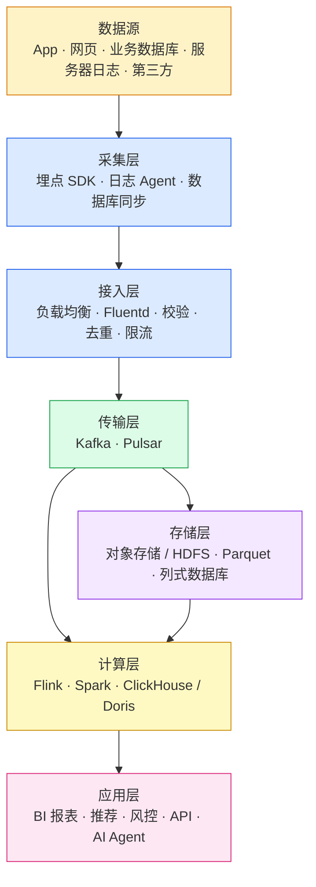
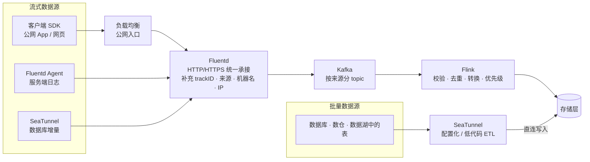
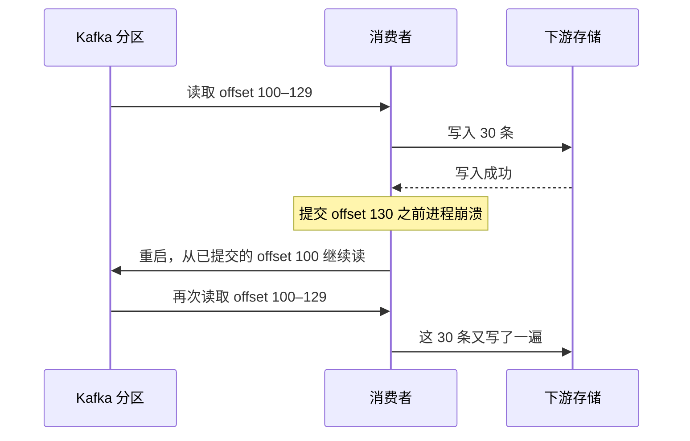
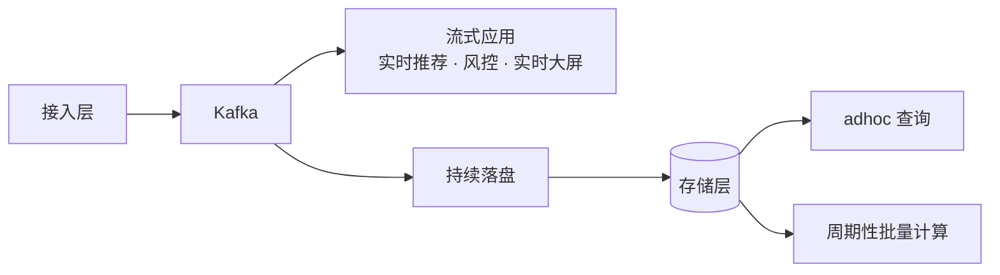
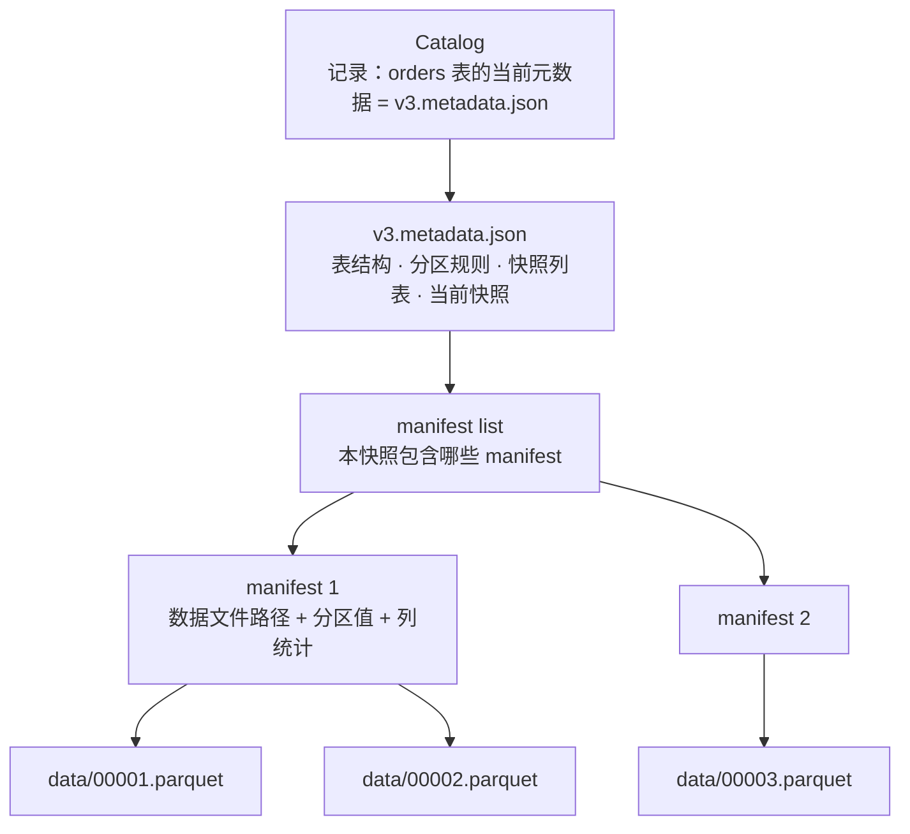
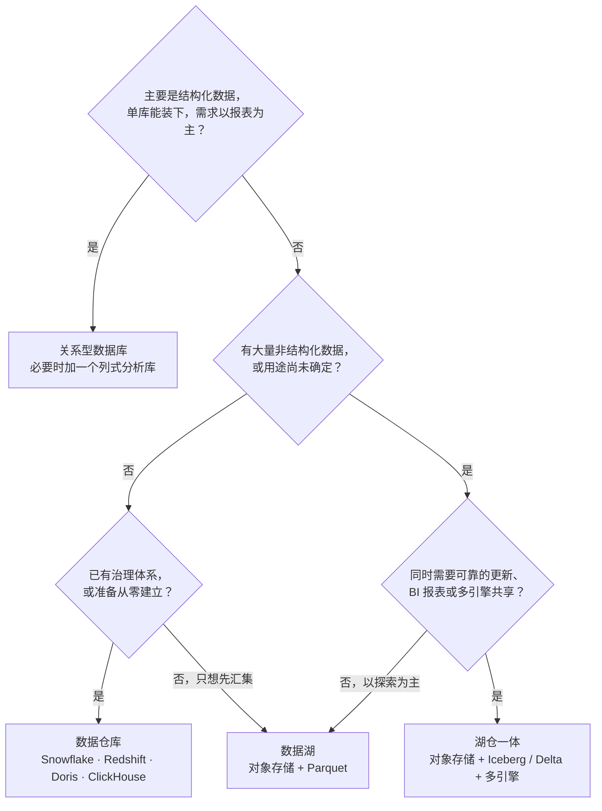
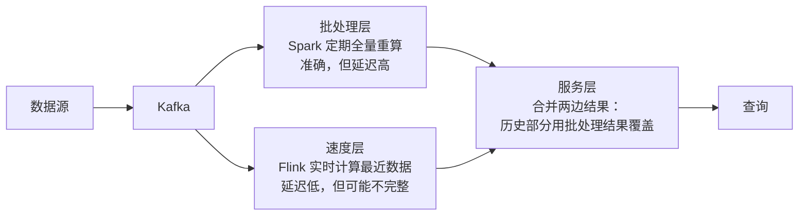
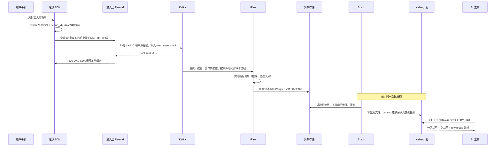

# 数据系统的构成：一次点击如何变成一张报表

Last updated: 2026-10-21

用户在手机上点了一下"加入购物车"。第二天早上，运营经理在报表里看到"昨日加购人数 12 万"。

这中间看起来只隔了一个 SQL，其实经过了七八个系统：手机上的 SDK、公网入口、消息队列、流处理引擎、对象存储、批处理作业、表格式的元数据层、OLAP 引擎，最后才是 BI 工具。每个系统都有一个团队负责，每一跳都可能丢数据、重复数据或者延迟。

**为什么一个"统计点击次数"的需求，需要这么多层？**

答案不在任何一个组件的说明书里，而在它们出现的顺序里。每一层都是被上一层留下的某个具体问题逼出来的：SDK 要逐条发送扛不住，就有了攒批；攒批遇到断网就会重试，重试又带来重复，于是有了去重；去重以后数据量还是太大、写入太猛，就需要消息队列来缓冲；进了存储，为了让查询快起来，又要考虑列存、分区和小文件……本文沿着数据流动的方向，一层一层看这些问题是怎么被逼出来、又是怎么被解决的。

文中的经验和数字大多来自曹犟《大数据应用实战》课程里的一线经历。完整的企业案例，比如一家行为分析厂商十年里的采集、存储和计算选型，一家中型互联网公司的十年三次存储升级，集中在 [[大厂数据平台与实践案例]]。本文只在需要时引一两句。

## 这篇文章怎么读

**核心问题**：一个完整的数据系统由哪些部分组成？每一部分在解决什么问题，又留下了什么问题给下一部分？

**前置知识**：

- [[数据库基础与大数据演进]]：B+ 树与 LSM-tree、行存与列存、CAP 与最终一致性、存储的"不可能三角"。本文默认你已经知道这些概念，只讲它们在数据管线里怎么用。
- [[数据平台]]：数据系统的六个设计目标和五个核心权衡。
- 能读懂 Python 和 SQL；知道 HTTP 请求和 JSON 是什么。

**读完之后你应该能**：

- 为一个电商 App 设计埋点事件，说清楚每个字段为什么必要，以及 Schema 将来怎么演进
- 解释为什么"至少一次"投递必然带来重复，以及怎样让重复无害
- 用 DuckDB 演示分区裁剪、row group 统计信息和小文件问题，并解释测量结果
- 解释流处理为什么需要事件时间和水位线，以及流式结果和批量重算为什么会对不上
- 讲清楚 Iceberg 在对象存储上怎样实现原子提交和时间旅行
- 面对一个具体团队，在数仓、数据湖、湖仓一体之间给出有理由的选择

本文之后，[[数据治理]] 讲数据进入仓库之后如何分层、建模、追溯和保证质量；[[数据平台运维]] 讲系统上线之后的调度、生命周期、安全合规和云部署。

---

## 一、全景：七层，每一层回答一个问题

### 1. 一张地图



传输层同时连着存储和计算，这一点值得注意。实时计算直接从 Kafka 读数据，批量计算从存储读，而存储里的数据也是从 Kafka 落下来的。这就是后面会讲的"流批一体管线"。

### 2. 每一层解决了什么，又留下了什么

| 层 | 它回答的问题 | 它留给下一层的问题 | 典型技术 |
|---|---|---|---|
| **采集** | 用户做了什么？业务系统里发生了什么？ | 格式五花八门，来源分散在公网和内网 | 埋点 SDK、Fluentd Agent、SeaTunnel、CDC |
| **接入** | 怎样安全地收下所有数据，并挡住脏数据？ | 收下来的数据要送到多个下游，速度还不一致 | 负载均衡、Fluentd、Flink 预处理 |
| **传输** | 怎样让生产者和消费者互不拖累，并且能重放？ | 数据需要长期保存，还要能被高效查询 | Kafka、Pulsar |
| **存储** | 怎样在容量、性能、成本之间取得平衡？ | 存下来的数据需要被大规模加工和查询 | HDFS、对象存储、Parquet、ClickHouse、Doris |
| **计算** | 怎样在可接受的时间内把数据算出来？ | 结果要被人和系统使用 | Spark、Flink、Trino、ClickHouse |
| **组织与保护**（湖/仓/湖仓） | 怎样让数据可发现、可信任、可安全修改？ | 指标口径、血缘、质量 → [[数据治理]] | Hive Metastore、Iceberg、Delta Lake |
| **应用** | 谁在什么时候需要什么结果？ | — | BI、API、推荐、风控 |

"组织与保护"不是数据流上的一跳，而是覆盖在存储和计算之上的一层约定：哪些数据算"原始"，哪些算"可信"，表结构由谁定义，修改怎样做到原子。第七节专门讲它。

### 3. 分层是有代价的

数据每跨一层，就要付出序列化和反序列化、网络传输、格式转换的成本。只有 1GB 数据的时候，一个单机 Python 脚本往往比七层系统更快，也更容易调试。

分层换来的是三种隔离：

- **规模隔离**：数据量超过单机容量后，每一层可以独立扩容。
- **团队隔离**：采集团队改 SDK，不需要通知计算团队重新部署。
- **用途隔离**：同一份数据可以同时服务秒级的实时推荐和小时级的离线训练。

如果这三种隔离你都不需要，就不需要七层。

### 4. 贯穿全文的取舍原则

曹犟在课程里反复强调一条设计原则，后面每一层都会用到它：

> **成本、可靠性、时效性三者可以互相折衷；安全合规是刚性目标，不能拿来折衷。**

在预算一定的前提下，可以接受数据晚一点到（牺牲时效性），也可以接受偶尔有几条重复（牺牲准确性），但不能为了省钱让数据明文跨公网传输。必要的时候，为了满足安全合规而增加成本是应该的。安全合规的完整做法见 [[数据平台运维]]，本文只在每一层指出它出现在哪里。

---

## 二、采集层：先想清楚"采什么"，再决定"怎么采"

### 1. 采集决定了整个系统的上限

数据采集是为了统计、分析和挖掘，去搜集和获取各种数据的过程。任何大数据系统都是从采集开始建的。后面的处理技术再先进，也补不回采集阶段没有拿到的信息。课程中引用了 IDC 和 Gartner 的研究来说明"数据质量问题大多源自采集环节"，但没有给出具体出处，这里不复述那些数字。不过有一个结论不需要统计数字也成立：**用户行为数据如果当时没有采集，事后无法补回来。** 用户昨天在哪个按钮上犹豫了三秒，如果没有记下来，就永远不会再有了。

### 2. 评估一个采集方案："大、全、细、时"，再加准确性

曹犟给出的评估框架有四个字，外加一个贯穿全链路的维度：

| 维度 | 含义 | 做不到时的典型症状 | 设计上的应对 |
|---|---|---|---|
| **大**（可扩展性） | 能跟上企业规模、数据量和数据类型的增长 | 新接一个业务线就要重做采集；类型从结构化扩展到日志、音视频时无处安放 | 采集端天然分布式（SDK 跑在用户设备上）；Schema 预留扩展字段；接收端可水平扩容 |
| **全**（全面性） | 为未来的应用尽可能采全，覆盖所有触点 | 只采了 App，小程序和网页的行为接不上；跨端的用户旅程断裂 | 覆盖 App、网页、小程序、公众号等全部触点；跨端打通用户身份；业务数据库和后台日志也纳入 |
| **细**（细致性） | 每条记录的字段尽量完整准确 | "加入购物车"只记了商品 ID，分析品类偏好时还要回查商品表，而当时的价格已经查不到了 | 业务属性（名称、品类、价格）和环境属性（机型、版本、系统）在事件发生时一起记录 |
| **时**（时效性） | 采集和处理的速度满足下游需要 | 推荐系统拿到的是昨天的点击 | 按应用的真实需求分级：日报每天采一次即可；个性化 feed 需要纯实时 |
| **准确性** | 从采集到应用全链路的正确程度 | 两份报表数字对不上 | 全链路通盘考虑；要求越高成本越高，按应用的实际需要取舍（见 [[数据治理]] 的质量部分） |

"全"背后有一个成本判断：和数据的价值相比，存储硬件已经非常便宜了。"时"则有一条硬约束：**及时性越高，技术成本越高。** 所以评估时不能只问"能不能更快"，还要问"慢一点会损失什么"。

### 3. 案例：一家中型电商的采集方案

一家中型电商同时运营 PC 网站、移动 App 和微信小程序，数据应用有报表、商品推荐、营销活动和用户画像。用上面的框架逐项看它的方案：

- **大**：客户端 SDK 采集天然是分布式的，只要接收端能扩容，每天百万级用户的行为采集不是问题，用户规模增长也不会让采集变成瓶颈。Schema 预留了扩展性，将来可以快速接入抖音小店、快手小店，也能容纳从天猫、京东等第三方平台拿到的有限数据。
- **全**：各触点的浏览、搜索、加购、下单、支付、评价全部采集；以注册手机号为纽带，用 ID-Mapping 把同一个人在不同端的身份打通，串起完整的用户旅程；除了行为数据，还采集业务数据库的表和后台管理系统的日志。
- **细**：浏览商品不只记商品 ID，还记名称、类别、品牌、价格、库存状态、页面位置、推荐来源；记录设备环境（操作系统、浏览器版本、屏幕分辨率、网络类型）；记录页面上下文（从哪个页面进入、停留时长、滚动深度）。
- **时**：不同应用的时效性差别很大，采集方式也随之不同：

| 应用 | 时效要求 | 采集方式 |
|---|---|---|
| 商品推荐 | 准实时：一次点击要在 1 分钟内影响推荐结果 | 客户端 SDK 及时发送 |
| 库存预警 | 实时：库存一变化就要检测到 | 内网库存服务模块里通过同步网络请求直接上报 |
| 用户画像、运营日报 | 每天计算一次 | 行为数据分钟级以内到达即可；业务表每天同步一次 |

这个案例说明，一个好方案不是在每个维度上都做到最好，而是按应用逐项判断，在四个维度之间找到平衡点。

跨端打通身份（ID-Mapping）在采集端只需要做一件事：把设备标识和登录后的账号标识都如实记下来。真正的身份合并发生在下游的 ETL 里，见 [[数据治理]]。

### 4. 采集范围：目标导向还是建设导向

确定"采哪些数据"有两种思路：

| | 目标导向型 | 建设导向型 |
|---|---|---|
| 出发点 | 从具体应用反推需要的数据范围、维度和粒度 | 暂时没有明确应用也采："能采则采，应采尽采" |
| 优点 | 资源利用率高，落地快，很快能看到效果 | 能支撑未来各种潜在应用，符合"数据资源入表"的趋势 |
| 代价 | 受限于当前的业务认知；业务方向一变，已采的数据可能撑不起新需求 | 资源消耗更多，项目周期更长 |
| 不可逆的风险 | 行为数据一旦没采，无法回溯 | 采了用不上，变成成本，甚至变成"数据沼泽"（见第七节） |

曹犟在服务两千多家企业时的观察是：规模不大、组织流程简单的企业倾向于目标导向，先围绕一个应用快速采集、看到效果，有了新应用再迭代；银行等国企、央企更多从数据资产建设的角度出发，先尽可能采全，构建"数据中台"，再考虑具体应用。

两种思路没有对错之分，真正需要权衡的是不可逆性：漏采的行为数据补不回来，多采的数据却可以删掉。所以即使采用目标导向，核心用户行为也值得适当多采一些。

### 5. 能采到哪些数据：两种分类

**按数据的所有者分：**

- **私域数据（第一方数据）**：企业通过自己的运营场景直接获得，拥有完全的所有权和控制权。例如 CRM、ERP 里的客户、交易、物流数据；官网、App、小程序上的用户行为；用户在企业平台上产生、所有权归企业的内容（文章、评论）。注意，私域数据归企业所有，并不意味着采集时可以不受法律约束。
- **公域数据（第三方数据）**：所有权属于公共机构、合作伙伴或公开渠道，企业通过合法方式获取。例如政府公布的天气、GDP、统计报告；微博、小红书、抖音上公开的话题和评论；电商平台公开的商品信息、排行榜和价格；第三方数据服务商合法出售的匿名化行为数据和标签。这一类存在灰色地带，要遵守法律法规和 robots 协议等行业约定，不能给第三方带来负面影响。

**按数据的产生方式分**，这种分法直接决定用什么技术去采：

| 类型 | 例子 | 形态 | 常见采集方式 |
|---|---|---|---|
| 用户类数据 | 各触点上的行为；用户主动填写的属性、兴趣 | 结构化事件 | 埋点 SDK |
| 业务类运行数据 | ERP、CRM 运行时的日志；订单表、商品表、物流表 | 日志（半结构化）、数据库表（结构化） | 日志 Agent（如 Fluentd）；数据库同步（全量 + 增量 / CDC，如 SeaTunnel） |
| 内容类数据 | 官网文章、宣传图片、直播视频 | 文本、多媒体（非结构化） | 文件或对象存储直接导入 |
| IoT 数据 | 用户终端、门店货架、摄像头、生产线上的传感器 | 时序数据、多媒体 | 设备网关上报 |
| 第三方接口数据 | 通过合法 API 获取的外部数据 | 多为结构化 | 定时拉取、回调推送 |

两种分法互相补充：前一种决定**能不能采、要遵守什么规则**，后一种决定**用什么技术采**。合规要求的细节见 [[数据平台运维]]。

### 6. 埋点：把看不见的行为变成数据

线下店的店长可以站在收银台旁，看见顾客拿起哪件商品、犹豫了多久、最后买了什么。App 和网站没有这样的视角。

**埋点（Event Tracking）就是在应用的关键位置放一个"记录器"**，把用户不可见的操作转换成可以查询的结构化数据。埋点有三种做法：

| 方式 | 谁来做 | 优势 | 代价 |
|---|---|---|---|
| **代码埋点** | 开发者在代码里手动指定 | 能记录任意业务细节：优惠券、账户余额、商品价格 | 每加一个记录点都要写代码、测试、发版，周期长 |
| **可视化埋点** | 运营人员在界面上圈选按钮 | 不需要开发参与，配置快 | 只能记录界面操作，拿不到界面背后的业务数据 |
| **全埋点** | 集成 SDK 后自动记录所有操作 | 覆盖最全：每次点击、滑动、停留时长都不会漏 | 数据量巨大，大量无用信息需要后续筛选 |

三种方式都能回答"用户在 14:32 点了哪个按钮"。但只有代码埋点能回答"用户用一张 20 元的券买了 3 件 SKU-001"，也只有全埋点能回答"用户在这一页停留了多久、滑到了哪里"。所以实践中通常组合使用：核心转化路径用代码埋点保证业务细节，其余交互用全埋点兜底。

### 7. 一条事件长什么样：4W1H

不管记录的是什么操作，每条事件都要回答五个问题：

| 问题 | 字段 | 说明 |
|---|---|---|
| **Who** 谁 | `user_id` / `device_id` | 登录用户用账号 ID；未登录用设备唯一标识。两者都要记，登录前后才能关联起来 |
| **When** 何时 | `event_time` | 精确到毫秒，统一用 UTC，避免时区混乱 |
| **Where** 在什么环境 | `platform`、`app_version`、`os_version`、`network` | **公共属性**：SDK 自动附带，用于定位"某个机型、某个版本才有的 Bug" |
| **How** 通过什么方式 | `page`、`referrer` | 也是公共属性：从哪个页面、经由什么入口 |
| **What** 做了什么 | `event_name` + `properties` | **自定义属性**：按事件定义。加购记商品名、价格、数量；支付记金额、方式、优惠券编号 |

时间必须统一用 UTC。原因很简单：不同时区的设备如果各自记本地时间，事件流就无法正确排序，"昨天"的边界也会因人而异。

一条完整的"加入购物车"事件：

```json
{
  "event_name": "add_to_cart",
  "dedup_id": "5f0c6a2e-8d4b-4a51-9a0e-3c2f7d1b9e44",
  "event_time": "2026-10-21T06:32:00.123Z",
  "user_id": "u_12345",
  "device_id": "d_abc789",
  "platform": "iOS",
  "app_version": "2.1.3",
  "os_version": "17.0",
  "network": "wifi",
  "page": "item_detail",
  "properties": {
    "item_id": "SKU-001",
    "item_name": "运动鞋",
    "category": "鞋类",
    "price": 299.00,
    "quantity": 1,
    "recommend_source": null
  }
}
```

`dedup_id` 和 `recommend_source` 这两个字段的作用，后面两小节会讲到。

### 8. 从手机到服务器：三道保障，以及它们各自留下的问题

如果 SDK 每捕获一个事件就发一次请求，手机会耗电、耗流量，高峰期服务器也会被压垮。所以 SDK 和服务端一起设了三道保障：

1. **攒一批再发**：SDK 攒够一定条数（比如 30 条），或者等待超过一定时间（比如 5 秒），才打包发送一次。网络请求减少了，也省电省流量。
2. **断网也不丢**：还没发出去的数据存在手机本地，网络恢复后自动补发，用户短暂断网不会丢数据。
3. **服务器不被压垮**：高峰期每秒可能涌入几万条数据，先进入消息队列（如 Kafka）排队，下游的存储和计算按自己的节奏消费。

这三道保障各自解决一个问题，同时又留下一个新问题，这也是整个采集链路的推进方式：

| 步骤 | 得到了什么 | 留下了什么问题 |
|---|---|---|
| 选择采集方案 | 能记录行为 | 各处记录的格式不统一 |
| 设计数据格式（4W1H + JSON） | 统一的事件结构 | 逐条发送扛不住 |
| 攒批、本地缓存、消息队列 | 数据安全到达服务器 | **补发和重试带来重复数据** |
| 清洗入库（去重、校验） | 干净统一的数据 | — |

第三步留下的问题不是偶然现象。只要有"失败就重试"，就一定会有"其实已经成功了，但发送方不知道，又发了一遍"。传输层还会再遇到这个问题。

### 9. 去重与校验：为什么 dedup_id 由客户端生成

服务器怎么判断"这条事件我已经处理过了"？办法是**由客户端在事件产生的那一刻生成一个全局唯一 ID（dedup_id）**，并和事件一起持久化在本地。服务器存储前检查这个 ID 是否已经存在，存在就丢弃。

为什么不让服务器在收到时生成 ID？设想一下：服务器收到事件，生成了 ID，写入成功，但响应在网络上丢了。客户端以为发送失败，重发同一条事件，服务器又生成一个新 ID，这样两条记录看起来就是两件不同的事。**只有在事件诞生时就确定的 ID，才能跨越重试保持不变。**

去重之外，入库前还要做校验和格式统一：

- 字段名对齐：`userId` → `user_id`
- 异常时间戳丢弃或隔离：比如 1970 年。这往往是设备时钟还没初始化时产生的数据
- 无法识别的值标记为 `unknown`，而不是直接丢掉

清洗后的数据才写入 ClickHouse、Hive 这类分析存储，分析师可以直接用 SQL 查询。接入层会把这一步做得更系统（见第三节），练习一给出了一个可以运行的最小实现。

### 10. Schema 是协议，不是实现细节

采集方案长期运行以后，最常见的问题是 Schema 演进：产品改了字段名，新增了属性，又删掉了旧属性。不兼容的变更会悄悄地破坏下游，报表突然少了一列却不报错，训练任务读到一片空值。

几条基本规则：

- **新增字段必须是可选的**。旧客户端不会发这个字段，下游必须能处理它缺失的情况。上面例子里的 `recommend_source: null` 就是这样预留出来的。
- **重命名 = 新增新字段 + 标记旧字段废弃**。不能直接改名，因为线上还有大量旧版本客户端在发旧字段名，App 的版本更新从来不是一夜之间完成的。
- **删除字段之前，确认所有消费方已经迁移**。

把这些规则落到实处有两种手段。一种是**埋点方案文档**（tracking plan）：每个事件叫什么、有哪些属性、类型是什么、由谁负责、从哪个版本开始，都写下来，作为产品、开发、分析三方共同的契约。另一种是带 **Schema Registry** 的序列化格式（Avro、Protobuf）：Schema 变更必须先注册，注册时检查兼容性，消费方读取时按版本解析。纯 JSON 灵活，但把兼容性检查留给了每一个下游自己去做。

---

## 三、接入层：系统的"门户"

### 1. 接入层要做哪些事

数据采集之后，要通过公网或内网发送到大数据系统。负责接收它们的是**接入层**。它的选型和采集方案联系紧密，最好一起设计。

接入层不只是"收数据"，它同时承担四类职责：

- **接收**：承接所有流式数据和批量数据
- **预处理与校验**：在脏数据污染下游之前把它挡住
- **格式标准化**：把不同来源的数据统一成内部的标准结构
- **流量管理**：在大促这种洪峰到来时依然稳定

这里讨论的方案以开源免费组件为主，架构上尽量对不同类型的应用都通用。核心挑战是：**在成本有限的情况下，同时兼顾可靠性、时效性和安全性。**

### 2. 两条入口：流式与批量



**流式数据**统一由 Fluentd 通过 HTTP/HTTPS 承接。来自公网的流量要在 Fluentd 前面部署负载均衡。Fluentd 收到数据后，可以给每个数据包补上几个字段供后续处理使用：一个随机的 trackID（后面去重要用）、数据来源标签、机器名、IP 等。

**批量数据**（数据库、数仓、数据湖里的整张表）推荐用 SeaTunnel 采集，并且**直连写入存储**，不绕道消息队列。批量数据本来就是成块到达的，不需要削峰，直连能让架构保持简单。

### 3. 接收不难，难的是共性问题

很多团队的第一版接入层是这样的：用 Nginx 接收 SDK 发来的数据、以日志文件落盘，再写一个 Agent 读日志往后传。它能工作，但很快就要补一堆功能：**读到哪里了**（进度保存）、**进程挂了怎么办**（故障恢复）；如果产品要私有化部署到客户机房，还要适配千差万别的软硬件环境。

这些都是每个团队都会遇到的共性问题，今天 Fluentd、SeaTunnel 这类成熟组件已经解决了它们。能用社区组件解决的共性问题，就不要自己再造一遍。（一家行为分析厂商 2015 年走过这条路，十年后的回顾见 [[大厂数据平台与实践案例]]。）

### 4. 预处理：Kafka + Flink 的分工

流式数据预处理最主流的方案是 **Kafka + Flink**：Fluentd 把不同来源的数据写到不同的 topic，Flink 根据业务逻辑消费和处理。这部分 Flink 作业是数据开发工程师在接入层的核心工作。批量数据流则继续用 SeaTunnel 的 ETL 能力，以配置和低代码的方式完成。

**数据完整性校验**的目标是防止脏数据污染后续链路，它分几个层次：

| 层次 | 检查什么 | 例子 |
|---|---|---|
| 基础类型 | 数值范围、字符串长度、日期格式 | `price` 必须是数字；`event_time` 必须能解析 |
| 完整性 | 数据包是否完整传输、必填字段是否缺失 | JSON 被截断；缺少 `event_name` |
| 业务规则 | 单字段的业务含义 | 订单金额不能为负；用户 ID 必须存在 |
| 跨字段关联 | 字段之间是否一致 | 支付时间不能早于下单时间 |
| 重复 | 同一条数据是否到达多次 | 利用 Flink 的窗口能力，按业务主键或 trackID 去重 |

在单条校验之上，还要建立**数据质量指标**并实时监控，例如空值率、异常值率、格式错误率，异常时标记并告警。质量指标体系的完整设计见 [[数据治理]]。

### 5. 格式转换：编码、字段映射、Union 与 Join

不同采集工具的数据要统一转换成系统内部的标准结构：

- **字符编码与类型映射**：UTF-8、GBK 等统一转换；各来源的类型映射到内部类型。
- **字段映射与重命名**：不同数据源的命名规范不同，需要维护一张字段映射表，把外部字段名映射为内部标准字段名。
- **Union**：把 SDK 采集的某类用户事件和通过日志采集的同类事件合并成一个流，有时还要按时间重新排序。
- **Join**：SDK 采集购买行为时只带了商品 ID，需要和 SeaTunnel 导入的商品表关联，补上商品名称、品类等信息。

在批量数据流里，SeaTunnel 提供了很好的 Union 和 Join 能力。在流式数据流里，Join 就困难得多：两个流的数据到达时间不一致，商品表本身也在变化，需要结合 Flink 的双流 Join、窗口 Join、实时维度表等能力自己实现，技术挑战相当大。

### 6. 必要的折衷：不是每个下游都需要 100% 准确

下游应用很多时候并不要求 100% 准确。实现时可以做必要的折衷：牺牲一部分准确性，换取更低的成本、更简单的实现和更好的时效性。

曹犟介绍过一个典型做法：行为分析产品在接收公网用户行为数据时，**只在一个有限的时间窗口内做去重**。窗口越大，需要在内存或状态里记住的 ID 越多。由于下游的行为分析本身不需要 100% 准确，出于性能考虑，这个窗口没有设得特别大。代价也很明确：两次发送的间隔如果超过窗口，重复数据就会漏过去。

练习一演示了这个代价：同一条事件在 9 秒后重发会被拦住，25 分钟后重发就会漏进系统。这个折衷是否合理，取决于下游：对行为分析来说，这点误差可以忽略；对计费来说就不行，计费需要在下游再做一次以业务主键为准的幂等写入（见第四节）。

这些预处理工作本质上是整个系统 ETL 的一部分。ETL 的幂等性、重跑和身份合并见 [[数据治理]]。

### 7. 流量管理：大促那一天

电商大促、金融交易高峰期，数据量可能是平时的十倍。接入层要在这种洪峰下保持稳定，靠的是四种能力：

| 能力 | 做法 | 落在哪里 |
|---|---|---|
| **多维度限流** | 按客户端 IP 段、数据内容、API 接口、用户身份分别限流 | SDK 提供一部分采集端限流；服务端需要结合业务在 Fluentd 上开发配置 |
| **弹性伸缩** | 根据实时流量自动增减接收和处理实例：高峰快速扩容，低谷回收资源 | Fluentd、Kafka、Flink 都有成熟方案；用云原生方式更容易实现 |
| **优先级队列** | 关键业务、时效要求高的数据优先处理，核心业务不受一般数据洪峰影响 | 主要在 **Flink 层**实现：实践中 Fluentd 的接收能力通常远高于 Flink 的处理能力，瓶颈在处理而不在接收 |
| **灾备** | 网络中断、系统故障时数据不丢 | 主要依赖各组件自身能力，再加上必要的冗余：适当延长 Kafka 的数据保留时间，用 Fluentd 的日志做备份 |

优先级队列为什么放在 Flink 层？因为瓶颈在哪里，排队就发生在哪里。接收端能轻松收下十倍的流量，真正处理不过来的是后面的 Flink。所以要在 Flink 消费时区分轻重缓急，比如把核心交易数据和普通浏览数据放在不同的 topic，由不同优先级的作业消费。

---

## 四、传输层：为什么 Kafka 成了"数据管线"

### 1. 传输层要的五个性质

传输层是系统的核心数据管线，负责各组件之间可靠、高效地传递数据。一个好的传输层需要：

- **高吞吐**：能处理每秒数百万条消息
- **低延迟**：数据从源头快速到达目标系统
- **高可用**：靠冗余和故障转移保证服务不中断
- **数据一致**：传输中不丢失、不重复、不损坏
- **可扩展**：能水平扩展，跟上数据量的增长

曹犟在课程中的结论是：**Apache Kafka 是最理想的选择**。它有百万级 QPS 的处理能力，数据持久化保存，支持回放，分区机制支持水平扩展。下面看这些能力从哪里来。

### 2. 日志，而不是队列

很多人把 Kafka 理解成"消息队列"。这个理解够用，但没有抓住它最关键的设计：**Kafka 的核心数据结构是分区的、只追加的日志（partitioned append-only log）**。

| 维度 | 传统消息队列（如 RabbitMQ） | Kafka |
|---|---|---|
| 消息被消费后 | 删除 | **保留**，按时间或大小过期 |
| 消费进度 | 由队列跟踪 | **消费者自己记录 offset** |
| 多个下游 | 一条消息通常只给一个消费者 | **多个消费者组独立读取同一份数据** |
| 重新读一遍 | 做不到 | **从任意 offset 重读** |

这个区别影响深远：同一份 Kafka 数据，可以被实时计算引擎（Flink）持续消费，也可以被离线作业（Spark）从头完整地重跑一遍。批流一体和 Kappa 架构都建立在这一点上。

### 3. 分区：并行度的来源，也是顺序的边界

一个 topic 分成多个分区（partition），每个分区是一个独立的有序日志。同一个消费者组里，每个分区在同一时刻只分配给一个消费者实例。

```text
Topic: user_events（3 个分区）
├── Partition 0: [m0, m3, m6, ...]  → 消费者 A
├── Partition 1: [m1, m4, m7, ...]  → 消费者 B
└── Partition 2: [m2, m5, m8, ...]  → 消费者 C
```

**分区键（key）决定一条消息进哪个分区**：同一个 key 总是进同一个分区，所以**只有同一分区内是有序的**，跨分区没有顺序保证。用 `user_id` 作为 key，同一用户的事件有序，不同用户之间并行处理。

分区数要在一开始规划好。分区数只能增加不能减少；增加之后，key 到分区的映射会变化，同一个 key 的新旧消息落在不同分区，这段时间内的顺序保证就失效了。

### 4. offset：消费者自己的书签

offset 是消费者在每个分区上记录的"我读到哪里了"。消费者重启后，从上次提交的 offset 继续读。

**什么时候提交 offset，决定了你得到哪种投递语义**：

- 先提交 offset，再处理：处理到一半崩溃，重启后从新 offset 读，这条消息就丢了 → **至多一次**
- 先处理，再提交 offset：处理成功但提交前崩溃，重启后从旧 offset 读，这条消息再处理一次 → **至少一次**



### 5. 三种投递语义：送达不等于生效

投递语义描述的是"一条消息最终被处理几次"：

| 语义 | 怎么实现 | 代价 | 适合 |
|---|---|---|---|
| **至多一次** | 不重试；或先提交 offset 再处理 | 会丢数据 | 允许偶尔丢失的监控指标 |
| **至少一次** | 生产端失败重试（`acks=all`）；消费端先处理再提交 | 会重复，下游必须能承受 | 绝大多数数据管道的默认选择 |
| **恰好一次** | 幂等生产者 + Kafka 事务 + 消费端 `read_committed` + 事务性或幂等的下游写入 | 实现和运维更复杂，延迟更高 | 计费、对账、库存这类重复就会出错的场景 |

这里要分清两件事：**Kafka 的投递保证**和**业务上的效果**。Kafka 的事务只能保证"从 Kafka 读、处理、再写回 Kafka"这一段是恰好一次的；一旦下游是数据库、对象存储或者外部 API，恰好一次就需要下游自己配合：

- 下游支持事务，并且和 offset 一起原子提交（Flink 的两阶段提交 sink 就是这个思路）；或者
- **下游写入是幂等的**：用 dedup_id 或业务主键做唯一约束，同一条消息写两次，结果和写一次一样。

第二种做法简单得多，也是实践中最常用的：**用至少一次投递，加上幂等写入，得到"效果上的恰好一次"。** 练习三用一个可以复现的实验演示这一点。

### 6. 保留、回放与毒消息

Kafka 能回放，前提是数据还在。所以有几个参数需要和业务需求一起设计：

- **保留时长**：决定了出问题以后能往回追多远。前面流量管理里提到"适当延长 Kafka 保留时间"作为灾备手段，就是这个原因。
- **去重的时间范围**：上游的去重窗口（第三节）和这里的保留时长共同决定了"多久以前的重复数据还能被识别出来"。
- **毒消息（poison message）**：某条消息格式异常，每次处理都失败。如果消费者一直重试，整个分区就会卡住。常见做法是重试几次后把它转到单独的死信 topic，记录原因，然后继续往下处理。

### 7. Kafka 还是 Pulsar

如果需要多租户、跨地域传输，可以考虑 **Apache Pulsar**（最初由 Yahoo 开发，后捐给 Apache）。两者的差别源于架构：

| | Kafka | Pulsar |
|---|---|---|
| 存储位置 | broker 本地磁盘，数据和服务绑在一起 | broker 不存数据，数据存在独立的 BookKeeper 集群 |
| 扩容 | 新 broker 加入后需要迁移分区数据 | 计算和存储分别扩容，broker 可以快速增减 |
| 多租户 | 靠 topic 命名和 ACL 约定 | 原生的租户 / 命名空间层级，配额和策略按租户隔离 |
| 跨地域复制 | 需要额外工具（如 MirrorMaker） | 内建的跨地域复制 |
| 生态与人才 | 更成熟，资料和工程师更多 | 相对小众 |

如果没有明确的多租户或跨地域需求，Kafka 的生态优势通常更重要。

### 8. 流批一体的管线

把 Kafka 当作数据管线，就能同时服务流和批两类应用：



流式应用直接订阅 Kafka；同时 Kafka 的数据实时写入存储，满足 adhoc 查询和周期性批量计算的需要。一份数据只进入系统一次，两类应用共用。

### 9. 成本：哪些可以折衷

成本往往决定一个架构方案是否可行。很多看起来技术最先进、性能最好的方案，最终因为成本原因并不合适。成本由三部分组成：硬件、软件、运维。

按照"成本、可靠性、时效性可以折衷"的原则，接入层和传输层的常见做法是：

- 选型以开源免费方案为主，节省软件成本
- 具备弹性伸缩能力，按流量模式自动扩缩容，避免资源闲置
- 支持容器化部署，提高资源利用率
- 在业务允许的情况下，放弃一部分准确性（比如有限窗口去重）
- 整体以主流开源方案为主，故障恢复和灾备能力好、对运维友好，节省运维成本

### 10. 安全合规：唯一不能折衷的目标

接入层和传输层是数据离开用户设备之后的第一站，安全要求从这里开始：传输过程加密（HTTPS，必要时用 IPSec 专线），敏感字段在应用层做端到端加密（即使中间节点被攻破也读不出来），密钥交给 HSM 或云 KMS 管理；访问控制结合 IP 白名单、VPN、API Key，按最小权限分配，并以操作审计兜底；合规上要记录每条数据从哪里来、经过哪些节点、到哪里去，并根据业务所在地区和行业，对照 GDPR、SOX、PCI-DSS 等法规建立技术控制措施。完整的安全合规体系见 [[数据平台运维]]。

---

## 五、存储层：数据落地之后

### 1. 存储是性能和成本的核心

数据接入之后，要作为资产存下来。存储层的设计直接决定系统能否高效处理 PB 级数据，也是**性能和成本控制的核心**，因为后面的计算能有多快、要花多少钱，很大程度上取决于数据是怎么存的。

存储设计的基本矛盾是**容量、性能、成本**三者不可兼得（这个"不可能三角"的推导见 [[数据库基础与大数据演进]]）：想存海量数据，成本就会急剧上升；想要毫秒级查询，就存不了太多数据；想把成本控制在合理范围，就得在容量或性能上妥协。

### 2. 存储一旦落地，迁移代价随时间增长

存储选型除了权衡容量、成本、性能，还要考虑一件容易被低估的事：**换掉它要花多少钱**。数据越多、用户越多，迁移就越贵；私有化部署的产品更难，因为数据分散在每个客户自己的机房里，只能逐个客户停服务、原地升级。

一家行为分析厂商 2016 年把存储换成 HDFS + Kudu，所有工程师一起动手、一个客户一个客户地迁，花了好几个月；此后近十年，存储架构只敢小修小补（经过见 [[大厂数据平台与实践案例]]）。所以存储要尽量选有前瞻性的主流方案：今天省下的选型时间，将来会以重构成本的形式还回来。

### 3. 设计存储方案的七个考量

| 考量 | 核心问题 | 设计手段 |
|---|---|---|
| **适配规模增长** | 数据增长时，能不能不迁移、不重构？ | 架构本身可水平扩展；扩容是低成本操作，硬件不需要超前储备；提前预留盘位和机架，或者交给公有云 |
| **容纳多样的数据** | 不同类型的数据放在哪里？ | 结构化数据（行为日志、交易流水）→ 列式格式（Parquet、ORC）或时序数据库；半结构化（JSON 日志、XML）→ 文档型数据库或数据湖；非结构化（图片、视频、文本）→ 对象存储或分布式文件系统 |
| **分层存储** | 所有数据的价值都一样吗？ | 按访问频率和业务重要性分为热、温、冷、归档四类：规模逐层扩大，访问量逐层减少；每层用不同的存储技术和成本结构 |
| **全生命周期管理** | 数据怎样在各层之间流动，什么时候删除？ | 按访问模式自动在存储之间迁移；按业务和法规要求自动清理过期数据；冷数据用更高压缩率，以访问性能换成本（详见 [[数据平台运维]]） |
| **按读写模式优化** | 主要的读写方式是什么？ | 见下表 |
| **整体成本控制** | 只看硬件采购价够不够？ | 硬件、软件、运维三部分一起算；重点评估扩容、缩容、迁移等常见运维操作的成本，以及故障监控和恢复是否方便 |
| **安全合规** | 第一天就考虑了吗？ | 字段加密、权限隔离、日志审计（见 [[数据平台运维]]） |

归档数据值得单独说一句：它只是法规要求或历史备份，访问频率极低，却必须长期保存。如果和热数据用同一种存储，成本会非常高。

不同应用的读写模式差异很大，存储要针对性优化：

| 场景 | 读写特点 | 优化手段 |
|---|---|---|
| **批量分析**（离线处理、ETL） | 大范围扫描少数几列 | 列式格式（Parquet、ORC）；分区和分桶减少扫描量；向量化计算 |
| **流式写入**（实时日志、事件流） | 高并发持续写入 | LSM-tree 结构、带预写日志（WAL）的写优化存储（如 HBase）；做好负载均衡，避免写入热点 |
| **adhoc / 交互式查询**（行为分析、BI） | 秒级响应、查询模式不固定 | 在列存、分区分桶的基础上，结合内存计算引擎；适当使用预计算和物化视图 |

关于成本结构，曹犟在课程中给出的经验数据是：硬件通常占总成本的一半，软件和运维各占四分之一左右。这个比例因组织而异，但他强调的规律有普遍性：**硬件成本容易预估和控制，软件有大量免费开源方案，运维成本却很容易发生"雪崩"，远远超出预算。** 原因在于运维成本和系统的复杂度相关，而复杂度会随着组件数量增长而快速增加。

### 4. 物理布局：为什么分析查询偏爱列存

行存和列存是同一份数据在磁盘上的两种排列方式。行存把一行的所有字段连续存放，读一整行只需要一次定位，适合 OLTP 的点查和更新；列存把同一列的值连续存放，`SELECT city, SUM(amount) ... GROUP BY city` 只需要读 `city` 和 `amount` 两列，其他列完全跳过。同一列的值类型相同、分布相近，压缩效果也更好。

这背后的历史以及动手对比实验见 [[数据库基础与大数据演进]]。下面关注的是：既然选了列存，**文件内部和目录结构怎样设计，才能让查询少读数据**。

### 5. Parquet 内部：查询为什么能跳过数据

Parquet 是最常用的列式文件格式。它的结构决定了很多调优手段为什么有效：

```text
Parquet 文件
├── Row Group 0            ← 按行切成若干组（行组）
│   ├── Column Chunk: dt         ← 每组里，每列连续存放
│   │   └── Pages（字典编码 / RLE / 位压缩）
│   ├── Column Chunk: user_id
│   └── Column Chunk: amount
├── Row Group 1
│   └── ...
└── Footer
    ├── Schema
    └── 每个 Row Group、每一列的统计信息：min / max / null 数量
```

查询引擎打开文件时**先读 footer**，再决定要读哪些部分。这带来两种"跳过"：

- **列裁剪（projection pushdown）**：只读查询用到的列的 Column Chunk。
- **谓词下推（predicate pushdown）**：如果某个 Row Group 里 `dt` 的 min 是 `2026-01-01`、max 是 `2026-01-07`，那么查询 `WHERE dt = '2026-02-14'` 可以整组跳过，不用解压也不用读取。

这里有一个容易被忽视的前提：**统计信息只有在数据按该列大致有序时才有用**。如果写入时行的顺序是随机的，每个 Row Group 都会覆盖全部日期，min/max 范围都很宽，一组也跳不掉。练习二里，同一个文件只是行的顺序不同，需要读的 Row Group 就从 2/41 变成了 41/41。

Row Group 的大小由写入端决定：parquet-java 默认按约 128MB 切分，DuckDB 默认每组约 12 万行。组太大，跳过的粒度就粗；组太小，footer 和读取的开销就大。

### 6. 分区与分桶：在目录层面减少扫描

存储层的"分区"（和 Kafka 的分区不是一回事）是把数据按某个字段拆到不同目录：

```text
s3://lake/events/
├── dt=2026-10-19/part-0000.parquet
├── dt=2026-10-20/part-0000.parquet
└── dt=2026-10-21/part-0000.parquet
```

查询 `WHERE dt = '2026-10-21'` 时，引擎根据目录名就能排除其他日期，连文件都不用打开。这叫**分区裁剪**，它比 Row Group 跳过更早发生，也更便宜。

**分区键的选择**：

- 选查询中最常出现在 `WHERE` 里的字段，时间几乎总是第一选择。
- 基数要适中。按 `user_id` 分区会产生上百万个目录，每个目录里只有几行，这正是下面要讲的小文件问题的典型来源。
- 分区只对它自己的键有用。按 `dt` 分区后，`WHERE event_name = 'pay'` 依然要扫描所有分区。

**分桶（bucketing）**用于高基数字段：把 `hash(user_id) % N` 相同的数据放进同一个文件，文件数固定为 N 个。按用户的点查和按用户的 Join 都能利用它，又不会产生海量小文件。

### 7. 小文件问题

**案例**：一家中型互联网公司初期数据不到 10TB，用一个 3 节点的 HDFS 集群存储。很快就遇到了麻烦：每天产生上万个小文件，NameNode 的内存压力越来越大。

原因是 HDFS 的 NameNode 把所有文件和数据块的元数据都放在内存里。文件数量多了，无论单个文件多小，NameNode 的内存都会被吃掉。他们的对策是**加一个定时合并任务**，把小文件合成大文件。

对象存储没有 NameNode，但小文件同样昂贵：每打开一个文件就是一次网络请求，还要额外读一次 footer；列举目录本身也要分页请求。练习二里，同样的 500 万行数据，拆成约 2000 个小文件之后，全表聚合慢了十几倍；合并成一个文件后又恢复了。

小文件最常见的来源是**流式写入**：流处理作业每隔几秒提交一次，每次都写出一批小文件。所以流式落盘几乎总是需要配套的合并（compaction）作业。Iceberg、Delta Lake 这类表格式把合并作为内建的维护操作（如 Iceberg 的 `rewrite_data_files`、Delta 的 `OPTIMIZE`），这也是它们流行的原因之一。

### 8. 四类典型的存储方案

| 类别 | 代表 | 擅长 | 局限 |
|---|---|---|---|
| **分布式文件系统** | HDFS | Hadoop 生态的基础设施；PB 级批量数据；与 MapReduce、Spark 深度集成；可线性扩展到数千节点；普通服务器即可 | 写一次读多次，不支持随机写；大文件性能优异，小文件效率低下；需要专业的运维团队 |
| **大数据 NoSQL** | HBase、Cassandra（宽列）；MongoDB（文档）；InfluxDB、TDengine（时序）；向量数据库 | 海量实时数据的高并发写入和查询；半结构化数据的复杂查询；时序优化；向量相似度检索 | 各自只擅长特定的访问模式，复杂分析通常需要配合其他系统 |
| **列式存储** | 文件格式：Parquet、ORC on HDFS / 对象存储；分析型数据库：ClickHouse、Apache Doris、Apache Kudu | 为查询优化，适合海量数据的分析场景 | 点查和频繁更新不是强项 |
| **对象存储** | S3、OSS、GCS | 数据湖的核心；理论上无限扩展、无容量上限；可靠性和灾备有保障；成本优势明显；与现代计算引擎深度集成 | 读取延迟通常高于本地盘，需要结合分层和缓存优化 |

有一个常见的混淆需要澄清：HBase、Cassandra 常被叫作"列式数据库"，但它们是**宽列**（wide-column）的逻辑模型，数据按列族组织，底层用 LSM-tree 按行键排序存储，擅长的是按行键的高并发读写；ClickHouse、Parquet 是**分析型列存**，按单列连续存放，擅长的是大范围扫描聚合。名字相近，适合的场景完全不同。数据模型的完整分类见 [[数据库基础与大数据演进]]。

应用越复杂，越不可能只用一种存储。实践中几乎总是把几类方案组合起来使用，下面这个案例就是一个典型。

### 9. 存算一体与存算分离

- **存算一体**（如开源 ClickHouse 的默认部署）：数据和计算在同一批节点上，读数据不跨网络，查询非常快；但扩容时要搬数据，存储和计算也只能一起扩。
- **存算分离**（如 Snowflake、各类云数仓、Spark / Trino 读对象存储）：数据放在对象存储里，计算集群按需启停、独立扩缩；代价是每次读取都要走网络，需要缓存来弥补。

存算分离让"数据只存一份，多种引擎来读"成为可能，这是后面湖仓一体的基础。在云上如何权衡这两种部署，见 [[数据平台运维]]。

存储方案很少一次设计到位。一家中型互联网公司十年里升级了三次：从 3 节点 HDFS + JSON + Hive，到 Kafka + HBase + Spark + Parquet，再到本地 HDFS 存热数据、云上对象存储存温冷数据、Doris 承载高价值数据。每一次都是被具体的业务压力推动的，没有一次是为了追新技术。完整经过见 [[大厂数据平台与实践案例]]。

---

## 六、计算层：同一份数据，三种速度

### 1. 不存在一直满足需求的计算引擎

很多数据产品在十年里换过两三次计算引擎：从商业 OLAP 数据库，到 Impala + Kudu，再到 Doris 这类现代 MPP 数据库（一个完整的例子见 [[大厂数据平台与实践案例]]）。每次重构，对应用层都是不小的改动。

这说明**不存在一种能一直满足需求的完美计算引擎**。每种引擎在设计上都做了折衷，折衷体现在三个维度上：**响应速度**决定多快能拿到结果，**灵活性**决定能处理多复杂的逻辑，**使用难度**决定使用者能否高效地用起来。

### 2. 维度一：响应速度的三个层次

| 层次 | 目标 | 典型场景 | 为什么需要这个速度 |
|---|---|---|---|
| **实时计算** | 毫秒级 | 实时风控、实时推荐、监控告警 | 用户下单时，风控要在几十毫秒内判断是否欺诈，慢了体验就很糟 |
| **交互式分析** | 秒级 | 产品经理临时分析、分析师验证假设 | 几秒内看到结果，"假设 → 验证 → 修正 → 再假设"的思路才连贯 |
| **批量处理** | 分钟到小时级 | 日报周报、历史数据回填 | 不要求实时，但也不能太慢，否则影响决策 |

这里有一个关键区分：**真实的性能需求和感知到的性能需求**。同样是报表，每天只看一次的日报，10 分钟出和 1 分钟出差别不大；挂在公司门口监控大屏上的报表，响应时间就很关键。把每个需求都当成"越快越好"，是计算层成本失控最常见的原因。

### 3. 维度二：灵活性

- **计算范式**：最简单的引擎为了性能，可能连完整的 SQL 语义都不支持，只能响应有限的算子（比如只兼容 MDX 多维分析，甚至更弱）；主流引擎基本兼容 SQL（方言有差异，但计算能力与 SQL 等价，基础分析够用）；有些在 SQL 之上支持复杂窗口函数和用户自定义函数（UDF）；如果需要机器学习或图计算，SQL 的表达能力就远远不够了。
- **支持的数据源和格式**：有的只能处理流式数据源，有的只能处理部分结构化数据，有的能处理半结构化甚至非结构化数据。这些限制会约束应用场景，要突破限制往往需要更复杂的预处理。
- **扩展能力**：有的引擎提供丰富的插件和 OpenAPI，可以通过二次开发扩展计算范式、数据源和格式；有的相对封闭，很难扩展。

### 4. 维度三：使用难度

- **学习成本**：SQL 对大部分数据从业者来说很熟悉，但对产品经理、运营人员来说通常太难，需要进一步简化；写 UDF 需要一定开发能力，但通常不复杂；最难的是需要深入理解系统原理的框架，比如 Flink 的状态管理和检查点机制，需要经验积累。
- **开发效率**：从有想法到实现想法要多久。有的系统提供可视化开发界面，拖拽就能完成复杂的处理流程；有的内置丰富的函数和模板；有的需要从头写代码。
- **运维门槛**：简单的云托管服务几乎不需要运维；复杂的分布式系统需要专业团队负责部署、调优、排障、容量规划。使用开源系统时，社区资料是否丰富非常关键：尽量用主流开源系统，遇到问题社区有回应，避免出现曹犟说的"炒股炒成股东"，也就是用了一个小众系统，最后只能自己去维护它的代码。

### 5. 三个维度为什么不可兼得

| 冲突 | 例子 |
|---|---|
| **响应速度 vs 灵活性** | 想要毫秒级响应，就要预计算大量结果，而预计算决定了只能支持预先设计好的那些查询模式 |
| **灵活性 vs 易用性** | Flink 能表达非常复杂的流计算逻辑，但学习曲线陡峭，要掌握分布式系统、事件时间、状态管理等一系列概念 |
| **团队能力 vs 需求** | 盲目求新：选了团队驾驭不了的技术栈；或者反过来，选了过于简单的方案，满足不了业务需求 |

正因为存在这些矛盾，才需要真正理解这三个维度，并学会权衡。下面先看计算层里最基础的一个分野：批和流。

### 6. 有界与无界：批和流的根本区别

批处理和流处理的本质区别不在延迟，而在于**数据有没有边界**：

- **批处理面对有界数据**："处理昨天的所有订单"。昨天的数据是完整的，有开始也有结束。
- **流处理面对无界数据**："实时处理用户行为"。数据源源不断，永远没有"全部到齐了"的时刻。

用同一批数据走两条路，差别一目了然：

```text
事件发生   10:00 ─ 10:03 ─ 10:04 ─ 10:06 ─ 10:08 ─ 10:02(迟到) ─ 10:12
                              ↓
流处理     每到一条就更新状态；水位线越过窗口边界就输出结果
           10:08 输出 [10:00,10:05) = 180    ← 秒级可见，但不包含迟到的那条
                              ↓
批处理     第二天凌晨，读取全部数据一次算完
           次日 02:00 输出 [10:00,10:05) = 250  ← 晚了十几个小时，但数据是齐的
```

| 维度 | 批处理（Spark、Hive） | 流处理（Flink、Spark Structured Streaming） |
|---|---|---|
| 数据 | 有界：开始和结束都确定 | 无界：持续到达 |
| 延迟 | 分钟到小时 | 毫秒到秒 |
| 状态 | 一次算完，中间结果可以丢弃 | 窗口、聚合都要长期保存中间状态 |
| 容错 | 失败就重跑整个批次 | 从检查点恢复，只重放最近一段 |
| 迟到数据 | 不存在：算的时候数据已经齐了 | 必须明确策略：丢弃、更新结果还是旁路输出 |
| 实现复杂度 | 低 | 高 |

### 7. 事件时间、水位线与迟到数据

流处理最容易踩的坑是：**一个事件发生的时间，和它到达处理引擎的时间，不是一回事。**

用户在 23:59 下单，网络很差，这条事件 10 分钟后才到 Kafka。如果按到达时间统计，这一单就被算进了第二天。

- **事件时间（event time）**：事件实际发生的时间，由客户端记录在事件里。这就是 4W1H 里要求精确到毫秒、统一 UTC 的那个字段。
- **处理时间（processing time）**：事件被引擎处理的时间。
- 两者的差距来自网络延迟、客户端离线后补发、设备时钟偏差。前面讲的"断网也不丢"会把这个差距拉得很大：补发的数据可能晚到几个小时。

按事件时间统计是对的，但引擎面临一个问题：**它怎么知道某个时间窗口的数据已经到齐了？** 永远无法确定，只能估计。这个估计就是**水位线（watermark）**。最常用的是"有界乱序"策略：

```text
水位线 = 已经见到的最大事件时间 − 允许的最大乱序时间
```

已见到的最新事件时间是 10:08，允许乱序 2 分钟，水位线就是 10:06。水位线越过 10:05 时，引擎认为 `[10:00, 10:05)` 这个窗口的数据已经到齐，于是输出结果、释放状态。

之后才到的、事件时间落在已关闭窗口里的数据，就是**迟到数据**。处理策略有三种：

- **丢弃**：最简单，结果会偏小
- **允许一段额外的迟到时间**：窗口关闭后仍保留状态一段时间，迟到数据到达时输出更新后的结果（Flink 的 `allowedLateness`），要求下游能处理"同一个窗口的结果被更新"
- **旁路输出**：把迟到数据送到单独的流里另行处理（Flink 的 side output）

允许的乱序时间越长，结果越完整，但输出越晚、要保存的状态越多。这又是一次准确性和时效性的折衷。练习四用几十行代码复现了这个过程，并展示流式结果和第二天批量重算的结果为什么对不上。

### 8. 窗口

窗口是把无界数据切成有限块来计算的机制：

```text
滚动窗口（Tumbling）：[0,5) [5,10) [10,15) ...     互不重叠，每条数据只属于一个窗口
滑动窗口（Sliding）：  [0,10) [5,15) [10,20) ...    每 5 分钟滑动一次，一条数据属于多个窗口
会话窗口（Session）：  按同一用户两次操作的间隔切分   没有固定长度
```

会话窗口最贴近用户行为分析：同一用户两次操作的间隔超过 30 分钟，就算两次会话。"人均会话时长"这类指标靠的就是它。

### 9. 状态与检查点

流处理是**有状态**的：一个 5 分钟窗口的累计金额、一个用户最近 30 分钟的操作序列，都要在内存或本地存储里一直保留。机器一旦故障，状态就丢了。

Flink 的办法是**检查点（checkpoint）**：定期在数据流里插入一个标记（barrier），各个算子收到标记时，把自己当前的状态异步快照到持久存储，同时记下数据源（如 Kafka）读到的 offset。故障时，把所有算子的状态恢复到最近一次检查点，再把数据源回退到对应的 offset 重新读。这样，**状态本身**能做到恰好一次：每条数据对状态的影响只算一次。

```text
──数据──▶ [barrier n] ──数据──▶ [barrier n+1] ──数据──▶ ✗ 故障
                                    ↑
              恢复：状态回到检查点 n+1，Kafka offset 回到检查点 n+1 时的位置，重放其后的数据
```

注意，检查点只管引擎内部的状态。如果结果已经写到外部数据库，重放会让这部分数据再写一次。要实现端到端的恰好一次，sink 要么支持事务，和检查点一起提交（两阶段提交），要么写入是幂等的。这和第四节说的"送达不等于生效"是同一件事。

检查点的间隔是一个折衷：间隔越短，故障时要重放的数据越少；但快照越频繁，正常运行时的开销越大。

### 10. 主流计算引擎的三个类别

| 类别 | 代表 | 响应速度 | 灵活性 | 使用难度 | 适合的团队和场景 |
|---|---|---|---|---|---|
| **易上手、能力有限** | Hive + MapReduce | 分钟到小时；只支持批处理 | SQL + UDF，计算范式有局限 | SQL 友好，熟悉数据库的人几乎没有学习成本；鲁棒，运维容易 | 中小团队，以业务分析师为主，需求是报表和简单聚合 |
| **高性能、能力较强** | Apache Spark | 内存计算，秒级；课程中称比 MapReduce 快一个数量级 | 批流统一；SQL 之外还支持机器学习、图计算 | 有学习门槛，但资料多，越过门槛后容易掌握；大量使用内存，容错设计需要更多考虑 | 有一定技术能力的中大型团队，既有数据开发也有数据科学家，需求从报表一直到机器学习 |
| **特定场景的极致性能** | Apache Flink | 毫秒级处理延迟 | 复杂事件处理、恰好一次、复杂状态管理 | 要深入理解分布式流处理的各种概念，学习成本很高 | 大用户量下的实时推荐、金融实时风控 |
| | Apache Doris、ClickHouse | 亚秒级分析查询 | 专注分析查询，支持复杂聚合和实时写入 | 对熟悉 SQL 的人比较容易上手 | 交互式分析、海量广告主的报表系统 |
| **联邦查询** | Trino / Presto | 秒级 | 同一条 SQL 查询多个数据源 | SQL 即可 | 数据分散在多个系统里的 adhoc 分析 |

大公司还会针对特定场景深度定制自己的引擎，比如字节跳动基于 ClickHouse 优化的 ByteHouse，阿里在 Flink 基础上定制的 Blink（后来贡献回了 Flink 社区）。这类引擎在特定场景下性能极致、能力完全定制，但需要专门的团队在代码层面长期维护。

### 11. 选型的三个问题

做计算选型要回到三个问题：**应用场景期望什么？团队有什么能力？将来怎么演进？** 既不要超出场景需求太多、过度设计，也要给未来留出扩展空间。

三个问题的答案都会变，所以"正确的选型"也会变。同一个团队，2016 年选 Impala 是对的：场景要秒级交互和行为序列分析，团队有 MPP 引擎的代码级经验，Doris、ClickHouse 还不成熟。九年后考虑换成 Doris 也是对的：信创要求、混合部署、社区活跃度和 AI 原生产品的需要都变了。这次推演的完整过程见 [[大厂数据平台与实践案例]]。

### 12. 四条选型原则

1. **追求"适用性"，而不是"先进性"**。很多团队被新技术吸引，觉得用最新的框架代表技术水平高，但最适合的才是最好的。
2. **团队能力建设先于技术架构升级**。技术由人来用、由人来维护，团队驾驭不了，再先进的方案也没用。
3. **渐进式演进比一步到位风险更小**。大规模切换技术栈风险高、成本大，渐进式演进可以逐步积累经验；当然，真到需要重构的时候也要敢于决策。
4. **重视运维，不能只关注开发**。很多团队选型时只看开发是否便利，忽视运维的复杂性，而系统上线后的运维成本往往远高于开发成本。

---

## 七、数仓、数据湖与湖仓一体：数据怎样被组织和保护

前面几节是从**系统架构**的角度讲数据怎样流动。这一节换一个角度：从**数据治理**的角度看，数据存下来以后，应该按什么方式组织和管理，才能真正成为资产。

### 1. 数据仓库：写时建模

数据仓库的经典定义来自比尔·恩门（Bill Inmon），他在 1992 年出版的《Building the Data Warehouse》中把数据仓库定义为：**面向主题的、集成的、非易失的、随时间变化的数据集合，用于支持管理决策。**

数据仓库是最早被广泛采用的企业级数据管理方案。它本质上回答的是"数据怎样组织、管理和治理"，和大数据技术没有直接关系：底层既可以是分布式大数据组件，也可以是传统关系型数据库。

它有三个鲜明的特点：

- **写时建模（Schema-on-Write）**：数据写入之前必须经过严格的 ETL，按预先定义的模式转换和清洗。好比图书馆，书必须先分类、编目，才能上架。
- **以结构化数据为主**：主要处理交易记录、客户信息这类字段定义和数据类型都明确的业务数据。
- **按主题组织**：用户主题、销售主题、财务主题、客户主题，每个主题有自己的数据模型。

典型例子是银行的风控数据仓库：交易数据、客户数据入库前严格清洗转换，入库后按风控主题再加工，支撑风险评估和监控。

技术上，数据仓库通常采用**列式存储**（只读需要的列，减少 I/O）加 **MPP 大规模并行处理**（把查询分散到多个节点并行执行，可以线性扩展）。数据建模普遍采用维度建模，即星型模型或雪花模型，由事实表加维度表组成，兼顾规范性和查询效率。维度建模的具体方法见 [[数据治理]]。

代价是：构建模型需要额外的计算，也需要相当多的开发工作。

### 2. 数据湖：读时建模

大数据时代，数据的种类和规模都发生了剧变，传统数据仓库的局限显现出来，数据湖应运而生。它和数据仓库最大的不同是**读时建模（Schema-on-Read）**：数据以原始格式存储，读取时再解析和转换。好比一个没有分类管理的仓库，东西先放进来，用的时候再整理。

这也对应着处理顺序的变化：数据仓库是 **ETL**（先抽取、转换，再加载），数据湖是 **ELT**（先加载进存储，再转换）。两者的取舍见 [[数据治理]]。

数据湖的优势在于：

- **保留原始数据**：不在入库时丢失信息，这对数据探索和支撑新需求特别重要
- **适合对象存储**：成本低，容量几乎没有上限
- **格式包容**：结构化的 CSV，半结构化的 JSON/XML，列式的 Parquet/ORC，以及完全非结构化的文本、图片、音频、视频都能放，被称为企业的"数据原料库"
- **更适合机器学习和大模型**：这类应用需要引入非结构化数据

### 3. 数据沼泽：数据湖最常见的失败方式

数据湖最大的挑战是退化为**数据沼泽（Data Swamp）**：数据无序堆积，缺乏管理和治理。典型症状有四个：

- 同一份数据重复存储，但版本不一致
- 没有数据字典，没人知道某个字段是什么意思
- 没有血缘记录，不知道数据从哪里来
- 数据质量参差不齐，但没人负责

最终，使用数据的成本变得极高，甚至完全无法使用。读时建模的"灵活"变成了"无法使用"。

百度早年的 Log 平台是一个在"数据湖"这个词出现之前就陷入沼泽的数据湖：因为好用，每季度都要申请约 30% 的新增硬件，增长的主要原因却不是日志变多，而是新数据源、新任务和中间结果无序堆积，没人知道它们的含义和下游。它后来如何重构，见 [[大厂数据平台与实践案例]]。

沼泽的根源不在存储技术，而在缺少元数据、血缘和质量管理。治理手段见 [[数据治理]]。

### 4. 湖仓一体：在湖上加一层事务

2020 年之后，业界开始探索把数据仓库的严格性和数据湖的灵活性结合起来，这就是**湖仓一体（Lakehouse）**：一种开放式架构，打通数据仓库和数据湖，把数仓的高性能和管理能力与数据湖的灵活性融合在一起。

它的核心能力是：底层支持多种数据类型并存、互相共享；上层通过统一的接口访问；同时支持实时查询和分析。很多湖仓方案还用同一套存储同时服务批处理和流处理。

技术原理是**在数据湖之上加一个事务层**，让原本"只能追加文件"的数据湖具备更新、删除和一致性保证：

| 能力 | 纯数据湖（对象存储 + Parquet） | 湖仓（+ Iceberg / Delta Lake / Hudi） |
|---|---|---|
| 并发写入 | 两个作业同时写一个目录，可能互相覆盖 | 原子提交，冲突的写入会失败并重试 |
| 读写隔离 | 读者可能读到写了一半的数据 | 读者只看到已提交的快照 |
| 更新和删除 | 要重写整个文件，且不原子 | 行级 upsert / delete |
| Schema 演进 | 靠约定 | 加列、改名有明确规则，并被强制执行 |
| 时间旅行 | 不支持 | 查询任意历史快照 |
| 小文件 | 自己写合并作业 | 内建合并、快照清理等维护操作 |

需要澄清一个常见误解：湖仓一体**不是**把数据湖和数据仓库放进同一个集群，也**不要求**只用一个计算引擎。它的统一体现在三点：统一的存储层（通常是对象存储）、统一的元数据管理、开放的表格式。正因为表格式是开放的，Spark 可以写、Flink 可以流式写、Trino 和 Doris 可以查，**"一份数据，多种计算"**。

### 5. Iceberg 如何在对象存储上做到原子提交

对象存储本身不提供"同时修改多个文件"的事务。Iceberg 的做法是：**数据文件一旦写出就不再修改，表的"当前状态"由一棵元数据树描述，而提交就是原子地替换树根的指针。**



**一次写入的过程**：

1. 把新数据写成新的 Parquet 文件。此时它们已经在存储里，但没有任何元数据引用它们，读者看不到。
2. 写新的 manifest，记录这些文件的路径、分区值和列统计信息。
3. 写新的 manifest list，引用新旧 manifest，构成一个新快照。
4. 写新的元数据文件 `v4.metadata.json`，把新快照设为当前快照。
5. **请 catalog 原子地把指针从 v3 换成 v4，前提是指针此刻仍然指向 v3。**

第 5 步是唯一需要原子性的一步，它由 **catalog** 保证，不同 catalog 用不同的机制：Hive Metastore 用表锁，JDBC catalog 用数据库事务，AWS Glue、REST catalog、Nessie 用各自服务端的条件更新。

**并发冲突时**：两个作业都基于 v3 准备了提交，只有一个能把指针换成功。另一个会失败，然后读取最新的元数据，**检查自己的修改和对方的是否冲突**（比如两边是否改了同一批文件）。不冲突就基于新版本重新生成元数据再提交，冲突就报错。这就是**乐观并发控制**：不加锁，冲突时才重试。

**读者看到什么**：读者开始查询时，从 catalog 拿到当时的元数据，此后只读这个快照引用的文件。写入方在旁边写新文件、换指针，都不会影响正在进行的查询。这就是快照隔离。

**时间旅行**几乎是免费得到的：旧的快照和它们引用的文件都还在，查询时指定某个快照即可。

```sql
-- Spark SQL（Iceberg）
SELECT * FROM shop.orders VERSION AS OF 8236472384012;          -- 按快照 ID
SELECT * FROM shop.orders TIMESTAMP AS OF '2026-10-20 10:00:00'; -- 按时间点
```

旧快照不会永远保留，否则存储会无限增长。定期执行快照过期（`expire_snapshots`）会删除不再被引用的文件，过期之后就无法再回溯到那些时刻。保留多久，属于数据生命周期管理的问题（见 [[数据平台运维]]）。

另外两种表格式的思路相近，机制有所不同：Delta Lake 把每次提交写成 `_delta_log/` 目录下按序编号的 JSON 文件，依赖"同名文件只能被创建一次"的原子语义，在不提供这种语义的存储上需要额外的协调服务；Hudi 用时间线（timeline）记录提交，更侧重行级 upsert 和 CDC 场景。它们的来历见 [[数据库基础与大数据演进]]。

### 6. 怎样选择：四个维度

**维度一：业务场景**

| 场景 | 推荐 | 原因 |
|---|---|---|
| 传统 BI 报表、财务分析；数据源固定、格式规范（如金融风控、零售销售分析） | 数据仓库 | 对数据质量和查询性能的稳定性要求极高，严格管理反而是优势 |
| 大量非结构化数据（评论、图片、视频）；机器学习、大模型训练；尤其是用途还没确定的探索阶段 | 数据湖 | 灵活存储、保留全部原始信息，为后续挖掘留出可能 |
| 既有结构化分析又有非结构化处理；一套系统同时支撑 BI 和机器学习；实时和批量并存（秒级查询 + 大规模扫描） | 湖仓一体 | 对不同的数据分别治理，同时共享存储 |

**维度二：复杂度与成本**

| | 数据仓库 | 数据湖 | 湖仓一体 |
|---|---|---|---|
| 建设成本 | **较高**：ETL 开发复杂 | **较低**：抽取写入即可 | 居中 |
| 持续维护成本 | **较低**：流程和模型明确，格式限制严格，质量容易保持 | **较高**：必须持续投入治理，否则变成沼泽 | 居中 |
| 团队门槛 | 低：SQL 和 ETL 工具即可 | 取决于治理投入 | 居中 |
| 单位存储成本 | 较高：要维护表结构、索引、分区等元信息；维度建模会刻意制造冗余（宽表、物化视图）；常用更贵的存储介质 | 低：HDFS、对象存储 | 低：对象存储 |

湖仓一体的成本落在两者之间，具体取决于"湖"与"仓"的比例，也就是已治理的数据和仅收集、未治理的数据各占多少。

**维度三：治理成熟度**

| 现状 | 建议 |
|---|---|
| 没有治理体系，暂时也不准备建；只想先把数据汇集起来积累资产 | 数据湖，作为低成本的兜底 |
| 从零开始建治理体系，业务需求传统数仓就能满足 | 先建数据仓库，逐步建立管理规范和流程 |
| 除传统应用外还有机器学习等数仓满足不了的需求；或者暂时不知道具体应用，只想先积累数据 | 湖仓一体，对不同数据分别处理 |
| 已有完善的治理体系（数据标准、质量管控、元数据管理，通常意味着已经有成熟的数仓） | 在现有基础上，随应用和采集扩展逐步过渡到湖仓一体 |

**维度四：团队技术栈**

主流方案：数据仓库有 Oracle、Teradata、Snowflake、Amazon Redshift；数据湖有 AWS S3 + EMR、Azure Data Lake、阿里云 MaxCompute；湖仓一体有 Databricks（Delta Lake）、Apache Iceberg、Apache Hudi。

曹犟的观点是，技术栈匹配度不必作为重点。这些技术都相对成熟，资料和人才都不少；而且选型只占整体成本的一小部分，成本的大头在于摸清数据现状、按业务需求设计数据模型、做 ETL。团队较小或运维经验有限时，选云原生方案，虽然要额外付费，但更可行。

**别忘了更简单的选择**。很多企业盲目追求数据湖或湖仓一体，反而增加了复杂度、降低了使用效率。数据量在单机数据库能承受的范围内、只有结构化数据、主要需求是报表时，一个关系型数据库（必要时加一个列式分析库）就够了。正确的做法是从小处着手，先解决最核心的业务问题，再逐步扩展。



**三种架构不是简单的技术迭代关系，而是面向不同业务场景和治理需求的方案。** 从数据湖出发、陷入沼泽之后再补治理（百度），和从严格的数据仓库出发、为了接入业务库数据和非结构化文本走向湖仓一体（一家行为分析厂商），是两条都走得通的路，见 [[大厂数据平台与实践案例]]。实践中很多企业的数据架构都是混合型的。

---

## 八、两种架构模式：Lambda 与 Kappa

上面那家中型互联网公司为了实时化引入 Kafka 和 HBase 之后，很快遇到了"批和流两条链路算出来的结果偶尔不一致"的问题。这不是个例，而是一种架构模式的固有代价。

### 1. Lambda 架构：批和流各走一条路

Lambda 架构（由 Nathan Marz 提出）为了同时得到低延迟和准确性，维护两条并行的路径：



- **批处理层**：定期用 Spark 重算完整的历史数据，结果准确（迟到数据都已到齐），但延迟是小时级。
- **速度层**：用 Flink 处理批处理还没覆盖到的最近数据，秒级可见，但可能丢掉迟到数据。
- **服务层**：查询时合并两边，批处理的结果一出来就覆盖速度层对应的部分。

**Lambda 的核心问题**：同一份业务逻辑要写两遍，一套 Spark 批处理，一套 Flink 流处理。逻辑一变更就要同步改两处，并且保证行为完全一致，这在实践中几乎做不到。那家公司遇到的"偶尔不一致"，根源就在这里：两套代码对迟到数据、时区、去重的处理只要有一点差别，结果就对不上。

### 2. Kappa 架构：只保留流

Kappa 架构（由 Jay Kreps 在 2014 年提出）的核心想法是：**所谓"历史重算"，就是把 Kafka 里的数据从最早的 offset 再读一遍**。如果流处理引擎足够快，就不需要单独的批处理层。

```text
日常：  数据源 → Kafka（保留足够长）→ Flink 作业 v1 → 结果表 v1 → 查询

逻辑变更时：
  1. 启动 Flink 作业 v2，从 Kafka 最早的 offset 开始重放，写入结果表 v2
  2. v2 追上实时进度后，把查询切换到结果表 v2
  3. 停掉 v1，删除结果表 v1
```

Kappa 成立的前提是：

- Kafka 的保留时间要覆盖需要重算的全部历史，或者有可以重放的长期存储
- 重放速度足够快，追上实时进度所需的时间可以接受
- 所有业务逻辑都能用流处理框架表达

| 维度 | Lambda | Kappa |
|---|---|---|
| 代码 | 两套逻辑，长期保持一致很难 | **一套逻辑** |
| 实时延迟 | 低 | 低 |
| 历史准确性 | 高（批处理兜底） | 高（代价是重放） |
| 架构复杂度 | 高：两条链路，两套运维 | **较低** |
| 适用前提 | 批处理有明显优势，例如复杂的全量计算 | 流处理能满足所有计算需求 |

**实践建议**：新系统优先考虑 Kappa，或者至少让批和流共用同一套逻辑代码（比如都用 Flink，或都用 Spark 的批流统一 API）；已有大量复杂的批处理逻辑，而流处理还不足以替代时，才保留 Lambda，并且要为两边结果的对账建立机制。湖仓一体的表格式同时支持流式写入和批量读取，让第二种做法容易了许多。

---

## 九、技术全景：每个工具在哪一层

| 层 | 实时场景 | 批处理场景 | 交互式查询 | 云托管服务 |
|---|---|---|---|---|
| **采集** | 埋点 SDK（Segment、DataFinder、神策等） | SeaTunnel、数据库导出 | — | 各类 SaaS 分析产品自带的 SDK |
| **接入** | 负载均衡 + Fluentd → Flink | SeaTunnel 直连 | — | AWS Kinesis Data Firehose 等 |
| **传输** | Kafka、Pulsar | Kafka（重放） | — | Confluent Cloud、Amazon MSK |
| **存储** | HBase、Kudu | HDFS / 对象存储 + Parquet、ORC | ClickHouse、Doris | S3、OSS、GCS |
| **表格式** | Iceberg / Hudi（流式写入） | Iceberg、Delta Lake、Hudi | — | Databricks、各云的湖仓服务 |
| **计算** | Flink、Spark Structured Streaming | Spark、Hive | Trino / Presto、Impala | EMR、Databricks、BigQuery、Snowflake |
| **分析服务** | ClickHouse、Doris（实时写入） | — | ClickHouse、Doris、StarRocks | Snowflake、BigQuery、Redshift |

**几个起源于国内团队的开源项目**：在信创要求下，它们常常出现在选型清单里。

| 项目 | 来历 | 所在层 |
|---|---|---|
| Apache Doris | 起源于百度内部的 Palo，后捐给 Apache | 分析型数据库（存储 + 计算） |
| StarRocks | 由 Doris 分叉发展而来 | 分析型数据库 |
| Apache RocketMQ | 起源于阿里巴巴 | 消息传输 |
| Apache SeaTunnel | 前身是国内开发者发起的 Waterdrop | 数据集成 |

信创的具体要求、它对选型的影响，以及几家云厂商的不同应对，见 [[大厂数据平台与实践案例]]。

---

## 十、一个事件的完整旅程

把七层串起来，跟着一条"加入购物车"事件走一遍：



这条链路的端到端延迟由最慢的一跳决定。Spark 每小时跑一次，BI 看到的数据就最多晚一个小时。改成 Flink 直接写入可查询的存储（比如 ClickHouse，或者 Iceberg 的流式写入），延迟能降到秒级或分钟级，代价是实现复杂度、小文件合并和运维成本的上升。回到前面说的区分：这张报表的使用者，真的需要秒级吗？

---

## 练习

### 练习一：采集链路的校验、去重和隔离

**目标**：亲手实现接入层的最小版本，观察有限窗口去重的代价。

**环境**：Python 3.12，只用标准库。

```python
"""接入层的最小模型：解析 → 字段对齐 → 校验 → 有限窗口去重 → 分流。"""
import json
from dataclasses import dataclass, field
from datetime import datetime, timedelta, timezone

REQUIRED_FIELDS: tuple[str, ...] = ("dedup_id", "event_name", "event_time", "device_id")
FIELD_ALIASES: dict[str, str] = {"userId": "user_id", "deviceId": "device_id", "ts": "event_time"}
EARLIEST_VALID_TIME = datetime(2020, 1, 1, tzinfo=timezone.utc)
DEDUP_WINDOW = timedelta(minutes=10)  # 去重窗口：越大越准，也越占内存

# 每行模拟一个 HTTP 请求体里的事件；received_at 是接入层收到它的时间
RAW_EVENTS: list[tuple[str, str]] = [
    ("2026-10-21T14:00:01Z", '{"dedup_id":"e1","event_name":"add_to_cart","event_time":"2026-10-21T14:00:00Z","device_id":"d1","userId":"u1","properties":{"price":299.0,"quantity":1}}'),
    ("2026-10-21T14:00:09Z", '{"dedup_id":"e1","event_name":"add_to_cart","event_time":"2026-10-21T14:00:00Z","device_id":"d1","userId":"u1","properties":{"price":299.0,"quantity":1}}'),
    ("2026-10-21T14:00:10Z", '{"dedup_id":"e2","event_name":"add_to_cart","event_time":"1970-01-01T00:00:00Z","device_id":"d2","properties":{"price":59.0,"quantity":2}}'),
    ("2026-10-21T14:00:11Z", '{"dedup_id":"e3","event_name":"pay_order","event_time":"2026-10-21T14:00:05Z","device_id":"d3","properties":{"amount":-10}}'),
    ("2026-10-21T14:00:12Z", '{"dedup_id":"e4","event_name":"view_item"'),
    ("2026-10-21T14:00:13Z", '{"dedup_id":"e5","event_time":"2026-10-21T14:00:06Z","device_id":"d4"}'),
    ("2026-10-21T14:25:00Z", '{"dedup_id":"e1","event_name":"add_to_cart","event_time":"2026-10-21T14:00:00Z","device_id":"d1","userId":"u1","properties":{"price":299.0,"quantity":1}}'),
]


@dataclass
class IngestResult:
    accepted: list[dict[str, object]] = field(default_factory=list)
    quarantined: list[tuple[str, str]] = field(default_factory=list)  # (原始内容, 原因)
    duplicates_dropped: int = 0


def parse_utc(text: str) -> datetime:
    return datetime.fromisoformat(text.replace("Z", "+00:00")).astimezone(timezone.utc)


def normalize_fields(event: dict[str, object]) -> dict[str, object]:
    return {FIELD_ALIASES.get(key, key): value for key, value in event.items()}


def validate(event: dict[str, object]) -> list[str]:
    missing = [name for name in REQUIRED_FIELDS if name not in event]
    if missing:
        return [f"缺少必填字段 {missing}"]
    errors: list[str] = []
    if parse_utc(str(event["event_time"])) < EARLIEST_VALID_TIME:
        errors.append("时间戳异常（早于 2020 年，多半是设备时钟未初始化）")
    properties = event.get("properties", {})
    if isinstance(properties, dict) and float(properties.get("amount", 0)) < 0:
        errors.append("业务规则：支付金额不能为负")
    return errors


def ingest(raw_events: list[tuple[str, str]]) -> IngestResult:
    result = IngestResult()
    last_seen_at: dict[str, datetime] = {}  # dedup_id → 最近一次收到的时间；只保留窗口内的
    for received_text, body in raw_events:
        received_at = parse_utc(received_text)
        # 窗口外的 id 被遗忘：这就是"有限窗口去重"的代价
        last_seen_at = {key: seen for key, seen in last_seen_at.items() if received_at - seen <= DEDUP_WINDOW}
        try:
            event = normalize_fields(json.loads(body))
        except json.JSONDecodeError:
            result.quarantined.append((body, "JSON 无法解析（数据包不完整）"))
            continue
        errors = validate(event)
        if errors:
            result.quarantined.append((body, "；".join(errors)))
            continue
        dedup_id = str(event["dedup_id"])
        if dedup_id in last_seen_at:
            result.duplicates_dropped += 1
            continue
        last_seen_at[dedup_id] = received_at
        result.accepted.append(event)
    return result


if __name__ == "__main__":
    outcome = ingest(RAW_EVENTS)
    print(f"接收 {len(outcome.accepted)} 条，隔离 {len(outcome.quarantined)} 条，窗口内去重 {outcome.duplicates_dropped} 条")
    for event in outcome.accepted:
        print("  accepted:", event["dedup_id"], event["event_name"], "user_id =", event.get("user_id"))
    for body, reason in outcome.quarantined:
        print("  quarantined:", reason, "|", body[:40])
    leaked = [e["dedup_id"] for e in outcome.accepted].count("e1") - 1
    print(f"窗口外漏过的重复：{leaked} 条")
```

**运行**：`uv run --no-project --python 3.12 python ingest.py`

**预期输出**：

```text
接收 2 条，隔离 4 条，窗口内去重 1 条
  accepted: e1 add_to_cart user_id = u1
  accepted: e1 add_to_cart user_id = u1
  quarantined: 时间戳异常（早于 2020 年，多半是设备时钟未初始化） | ...
  quarantined: 业务规则：支付金额不能为负 | ...
  quarantined: JSON 无法解析（数据包不完整） | ...
  quarantined: 缺少必填字段 ['event_name'] | ...
窗口外漏过的重复：1 条
```

**观察与延伸**：

1. 9 秒后的重发被拦住了，25 分钟后的重发漏了进来。把 `DEDUP_WINDOW` 改成 30 分钟再运行，`last_seen_at` 最多会保存多少个 ID？如果每秒到达 10 万条事件呢？这就是行为分析产品通常不把窗口设得很大的原因。
2. `userId` 被对齐成了 `user_id`。如果映射表漏了一个别名，会发生什么？这条数据会被接收还是被隔离？
3. 被隔离的数据去了哪里？设计一个隔离区的表结构，让数据修复之后可以重新进入链路。

### 练习二：分区裁剪、row group 统计信息与小文件

**目标**：用测量结果解释第五节的三个机制。行存与列存的对比见 [[数据库基础与大数据演进]] 的练习，这里只关注列存文件和目录的布局。

**环境**：DuckDB 1.5（`uv run --no-project --python 3.12 --with duckdb python layout.py`），在一个空目录里运行，会生成约 200MB 的测试文件。

```python
"""同一份数据，四种落盘方式：已排序 / 未排序 / 按天分区 / 上千个小文件。"""
import re
import shutil
import time
from pathlib import Path

import duckdb

ROWS = 5_000_000
TARGET_DAY = "2026-02-14"
LAB = Path("layout_lab")
shutil.rmtree(LAB, ignore_errors=True)
LAB.mkdir()
con = duckdb.connect()

con.execute(f"""
    CREATE TABLE events AS
    SELECT
        DATE '2026-01-01' + CAST(i % 90 AS INTEGER)                AS dt,
        CAST(hash(i) % 1000000 AS BIGINT)                          AS user_id,
        ['view', 'add_to_cart', 'pay'][1 + CAST(i % 3 AS INTEGER)] AS event_name,
        CAST(hash(i * 7) % 100000 AS DOUBLE) / 100                 AS amount
    FROM range({ROWS}) t(i)
""")
con.execute(f"COPY (SELECT * FROM events ORDER BY dt)      TO '{LAB}/sorted.parquet'   (FORMAT PARQUET)")
con.execute(f"COPY (SELECT * FROM events ORDER BY user_id) TO '{LAB}/shuffled.parquet' (FORMAT PARQUET)")
con.execute(f"COPY events TO '{LAB}/partitioned' (FORMAT PARQUET, PARTITION_BY (dt))")
# 模拟流式作业每隔几秒落一个文件：每 2500 行一个文件
con.execute(f"COPY (SELECT *, CAST(rowid // 2500 AS INTEGER) AS chunk FROM events) TO '{LAB}/tiny' (FORMAT PARQUET, PARTITION_BY (chunk))")


def prunable_row_groups(path: str) -> str:
    """读 footer 里每个 row group 的 dt 最小/最大值，数出必须打开的 row group。"""
    total, must_read = con.execute(f"""
        SELECT count(*), count(*) FILTER (WHERE stats_min <= '{TARGET_DAY}' AND stats_max >= '{TARGET_DAY}')
        FROM parquet_metadata('{path}') WHERE path_in_schema = 'dt'
    """).fetchone()
    return f"{must_read}/{total} 个 row group 需要读"


def files_scanned(sql: str) -> str:
    plan = con.execute("EXPLAIN ANALYZE " + sql).fetchall()[0][1]
    match = re.search(r"Scanning Files: (\d+/\d+)", plan)
    return match.group(1) if match else "全部（没有可用的文件过滤）"


def best_ms(sql: str, repeat: int = 5) -> float:
    best = float("inf")
    for _ in range(repeat):
        start = time.perf_counter()
        con.execute(sql).fetchall()
        best = min(best, time.perf_counter() - start)
    return best * 1000


partitioned = f"read_parquet('{LAB}/partitioned/*/*.parquet', hive_partitioning = true)"
one_day = f"dt = DATE '{TARGET_DAY}'"

sorted_file, shuffled_file = f"'{LAB}/sorted.parquet'", f"'{LAB}/shuffled.parquet'"
print("① row group 统计信息（同一个文件，只差行的顺序）")
print(f"   已排序: {prunable_row_groups(f'{LAB}/sorted.parquet')}   未排序: {prunable_row_groups(f'{LAB}/shuffled.parquet')}")
print(f"   查询一天：已排序 {best_ms(f'SELECT sum(amount) FROM {sorted_file} WHERE {one_day}'):.1f} ms"
      f" / 未排序 {best_ms(f'SELECT sum(amount) FROM {shuffled_file} WHERE {one_day}'):.1f} ms")

print("② 目录级分区裁剪")
by_day = f"SELECT sum(amount) FROM {partitioned} WHERE {one_day}"
by_event = f"SELECT sum(amount) FROM {partitioned} WHERE event_name = 'pay'"
print(f"   按分区键 dt 过滤:        扫描文件 {files_scanned(by_day)}")
print(f"   按非分区列 event_name 过滤: 扫描文件 {files_scanned(by_event)}   ← 分区只对它自己的键有用")

print("③ 小文件")
tiny_count = con.execute(f"SELECT count(*) FROM glob('{LAB}/tiny/*/*.parquet')").fetchone()[0]
one_file = best_ms(f"SELECT sum(amount) FROM {sorted_file}")
many_files = best_ms(f"SELECT sum(amount) FROM read_parquet('{LAB}/tiny/*/*.parquet')")
print(f"   全表聚合：1 个文件 {one_file:.1f} ms / {tiny_count} 个小文件 {many_files:.1f} ms")

con.execute(f"COPY (SELECT * EXCLUDE (chunk) FROM read_parquet('{LAB}/tiny/*/*.parquet')) TO '{LAB}/compacted.parquet' (FORMAT PARQUET)")
compacted_file = f"'{LAB}/compacted.parquet'"
print(f"   合并（compaction）之后：{best_ms(f'SELECT sum(amount) FROM {compacted_file}'):.1f} ms")
```

**一次参考运行**（笔记本电脑、本地 SSD；绝对耗时会因机器而异，比例关系应当稳定）：

```text
① row group 统计信息（同一个文件，只差行的顺序）
   已排序: 2/41 个 row group 需要读   未排序: 41/41 个 row group 需要读
   查询一天：已排序 1.0 ms / 未排序 5.1 ms
② 目录级分区裁剪
   按分区键 dt 过滤:        扫描文件 1/90
   按非分区列 event_name 过滤: 扫描文件 全部（没有可用的文件过滤）   ← 分区只对它自己的键有用
③ 小文件
   全表聚合：1 个文件 4.4 ms / 2031 个小文件 65.3 ms
   合并（compaction）之后：4.2 ms
```

**解释你看到的结果**：

1. 已排序和未排序的文件内容完全一样，为什么需要读的 row group 差了 20 倍？这对"流式写入时数据按什么顺序落盘"有什么启示？
2. 按 `event_name` 过滤为什么一个文件也跳不过？如果这类查询很多，你会改分区键，还是在每个文件内按 `event_name` 排序？
3. 小文件慢了十几倍，但数据量完全相同。时间花在了哪里？换成每次打开文件都要走网络的对象存储，差距会变大还是变小？

### 练习三：至少一次投递，加上幂等写入

**目标**：亲手制造一次"处理成功但 offset 没提交"，看重复从哪里来，再用幂等写入消除它。

**环境**：本地单节点 Kafka（例如 `docker run -d -p 9092:9092 apache/kafka:3.8.0`），Python 客户端用 confluent-kafka（`uv run --no-project --python 3.12 --with confluent-kafka ...`）。

```python
"""producer.py：开启幂等生产，发送 100 条带 dedup_id 的订单事件。"""
import json
import uuid

from confluent_kafka import Producer

producer = Producer({
    "bootstrap.servers": "localhost:9092",
    "acks": "all",               # 所有同步副本确认才算成功
    "enable.idempotence": True,  # 生产端重试不会在 Kafka 里产生重复
})
for order_number in range(100):
    event = {"dedup_id": str(uuid.uuid4()), "order_id": order_number, "amount": 10.0}
    producer.produce("orders", key=str(order_number), value=json.dumps(event))
producer.flush()
```

```python
"""consumer.py：先写下游，再提交 offset；第 50 条写完后模拟崩溃。"""
import json
import os
import sqlite3
import sys

from confluent_kafka import Consumer

IDEMPOTENT = "--idempotent" in sys.argv
CRASH_AFTER = 50 if "--crash" in sys.argv else None

sink = sqlite3.connect("sink.db")
sink.execute("CREATE TABLE IF NOT EXISTS orders (dedup_id TEXT, order_id INTEGER, amount REAL)")
if IDEMPOTENT:
    sink.execute("CREATE UNIQUE INDEX IF NOT EXISTS orders_dedup ON orders (dedup_id)")

consumer = Consumer({
    "bootstrap.servers": "localhost:9092",
    "group.id": "order-sink-idempotent" if IDEMPOTENT else "order-sink",
    "enable.auto.commit": False,      # 由我们决定什么时候提交
    "auto.offset.reset": "earliest",
    "session.timeout.ms": 6000,       # 崩溃的旧成员 6 秒后被踢出消费组，新进程才能分到分区
})
consumer.subscribe(["orders"])

processed, idle_polls = 0, 0
while idle_polls < 20:                # 连续 20 秒没有新消息就结束（加入消费组、等旧成员超时都要几秒）
    message = consumer.poll(1.0)
    if message is None:
        idle_polls += 1
        continue
    idle_polls = 0
    if message.error():
        raise RuntimeError(message.error())
    event = json.loads(message.value())
    verb = "INSERT OR IGNORE" if IDEMPOTENT else "INSERT"
    sink.execute(f"{verb} INTO orders VALUES (?, ?, ?)", (event["dedup_id"], event["order_id"], event["amount"]))
    sink.commit()                     # ① 下游写入成功
    processed += 1
    if CRASH_AFTER and processed == CRASH_AFTER:
        os._exit(1)                   # ② 在提交 offset 之前崩溃
    if processed % 20 == 0:
        consumer.commit(asynchronous=False)  # ③ 每 20 条提交一次 offset
if processed % 20:
    consumer.commit(asynchronous=False)      # 提交最后不足 20 条的部分；没有新进度时提交会报错
consumer.close()
rows, distinct = sink.execute("SELECT count(*), count(DISTINCT dedup_id) FROM orders").fetchone()
print(f"下游共 {rows} 行，其中不同的事件 {distinct} 个")
```

**步骤**：

1. 运行 `producer.py`。
2. 运行 `consumer.py --crash`：处理到第 50 条时崩溃。此时下游已经有 50 行，但 offset 只提交到了第 40 条。
3. 运行 `consumer.py`：从第 40 条继续读。**预期**：下游共 110 行，不同的事件 100 个，第 41–50 条各写了两次。
4. 删除 `sink.db`，用 `--idempotent` 重复第 2、3 步（代码里幂等模式使用另一个 `group.id`，所以会从头读）。**预期**：下游共 100 行，不同的事件 100 个。

**思考**：

- 为什么开了 `enable.idempotence` 之后，下游还是会有重复？（提示：它管的是"生产者 → Kafka"这一段。）
- 如果下游不是 SQLite，而是一个只支持追加的 Parquet 目录，你会怎么做到幂等？（提示：想想 Iceberg 的 `MERGE INTO`，或者按分区整体覆盖。）
- 什么场景下，"至少一次 + 幂等写入"仍然不够，必须用 Kafka 事务？

### 练习四：流式窗口 vs 批量重算

**目标**：复现"批和流结果偶尔不一致"，并说清楚哪个结果才对、为什么。

**环境**：Python 3.12，只用标准库。

```python
"""同一批事件：流式窗口（水位线 + 迟到丢弃）vs 第二天的批量重算。"""
from collections import defaultdict
from dataclasses import dataclass
from datetime import datetime, timedelta

WINDOW = timedelta(minutes=5)
MAX_OUT_OF_ORDER = timedelta(minutes=2)   # 水位线 = 已见最大事件时间 - 2 分钟


@dataclass(frozen=True)
class Event:
    event_time: datetime    # 用户真正下单的时刻（客户端记录）
    arrival_time: datetime  # 到达流处理引擎的时刻
    amount: float


def t(hhmm: str) -> datetime:
    return datetime.fromisoformat(f"2026-10-21T{hhmm}:00")


EVENTS: list[Event] = sorted([
    Event(t("10:00"), t("10:00"), 100.0),
    Event(t("10:03"), t("10:03"), 50.0),
    Event(t("10:04"), t("10:06"), 30.0),   # 乱序 2 分钟，仍在容忍范围内
    Event(t("10:06"), t("10:06"), 80.0),
    Event(t("10:08"), t("10:08"), 20.0),
    Event(t("10:02"), t("10:09"), 70.0),   # 手机离线 7 分钟后补发：迟到
    Event(t("10:12"), t("10:12"), 10.0),
], key=lambda event: event.arrival_time)


def window_start(moment: datetime) -> datetime:
    return moment - timedelta(minutes=moment.minute % 5, seconds=moment.second)


def stream(events: list[Event]) -> tuple[dict[datetime, float], list[Event]]:
    """按到达顺序处理；水位线越过窗口结束时间就输出并关闭窗口。"""
    open_windows: dict[datetime, float] = defaultdict(float)
    emitted: dict[datetime, float] = {}
    late: list[Event] = []
    watermark = datetime.min
    for event in events:
        start = window_start(event.event_time)
        if start in emitted:          # 窗口已关闭：迟到数据
            late.append(event)
            continue
        open_windows[start] += event.amount
        watermark = max(watermark, event.event_time - MAX_OUT_OF_ORDER)
        for closing in sorted(w for w in open_windows if w + WINDOW <= watermark):
            emitted[closing] = open_windows.pop(closing)
            print(f"  [{event.arrival_time:%H:%M}] 水位线 {watermark:%H:%M} → 输出窗口 {closing:%H:%M} = {emitted[closing]}")
    emitted.update(open_windows)      # 输入结束时冲刷剩余窗口
    return emitted, late


def batch(events: list[Event]) -> dict[datetime, float]:
    """第二天重算：数据已全部到齐，没有'迟到'这回事。"""
    totals: dict[datetime, float] = defaultdict(float)
    for event in events:
        totals[window_start(event.event_time)] += event.amount
    return dict(totals)


if __name__ == "__main__":
    print("流处理：")
    streamed, late_events = stream(EVENTS)
    recomputed = batch(EVENTS)
    print("\n窗口      流式结果  批量结果")
    for start in sorted(recomputed):
        marker = "  ← 不一致" if streamed.get(start) != recomputed[start] else ""
        print(f"{start:%H:%M}    {streamed.get(start, 0):>7}  {recomputed[start]:>7}{marker}")
    print(f"\n被丢弃的迟到事件：{[(f'{e.event_time:%H:%M}', e.amount) for e in late_events]}")
```

**预期输出**：

```text
流处理：
  [10:08] 水位线 10:06 → 输出窗口 10:00 = 180.0
  [10:12] 水位线 10:10 → 输出窗口 10:05 = 100.0

窗口      流式结果  批量结果
10:00      180.0    250.0  ← 不一致
10:05      100.0    100.0
10:10       10.0     10.0

被丢弃的迟到事件：[('10:02', 70.0)]
```

**观察与延伸**：

1. 10:04 发生、10:06 才到的那条为什么没有被丢弃？把 `MAX_OUT_OF_ORDER` 改成 1 分钟再运行，它的命运会怎样？
2. 把 `MAX_OUT_OF_ORDER` 改成 10 分钟：结果一致了吗？窗口 10:00 的结果是在什么时候输出的？你用什么换来了准确性？
3. 在 Lambda 架构里，这个 70 元的差异会在第二天被批处理层修正。如果用 Kappa 架构，你会怎样处理迟到数据？

### 练习五：Iceberg 的提交与时间旅行

**目标**：亲眼看到"数据文件不改，只换元数据指针"，并按快照查询历史状态。

**环境**：Java 11 或 17，PySpark 3.5（`uv run --no-project --python 3.12 --with pyspark==3.5.3 python iceberg_lab.py`）。首次运行时 Spark 会通过 `spark.jars.packages` 下载 Iceberg 运行时包，需要联网；Iceberg 的版本要和 Spark、Scala 版本匹配。

```python
"""iceberg_lab.py：在本地文件系统上创建 Iceberg 表，观察快照和元数据文件。"""
from pathlib import Path

from pyspark.sql import SparkSession

WAREHOUSE = Path("iceberg_warehouse").resolve()

spark = (
    SparkSession.builder
    .appName("iceberg-lab")
    .config("spark.jars.packages", "org.apache.iceberg:iceberg-spark-runtime-3.5_2.12:1.6.1")
    .config("spark.sql.extensions", "org.apache.iceberg.spark.extensions.IcebergSparkSessionExtensions")
    .config("spark.sql.catalog.lab", "org.apache.iceberg.spark.SparkCatalog")
    .config("spark.sql.catalog.lab.type", "hadoop")          # 指针存在文件系统里，仅适合本地实验
    .config("spark.sql.catalog.lab.warehouse", str(WAREHOUSE))
    .getOrCreate()
)

spark.sql("CREATE TABLE IF NOT EXISTS lab.shop.orders (user_id BIGINT, city STRING, amount DOUBLE) USING iceberg")
spark.sql("INSERT INTO lab.shop.orders VALUES (1, '北京', 100.0), (2, '上海', 200.0)")
spark.sql("UPDATE lab.shop.orders SET city = '广州' WHERE user_id = 1")

history = spark.sql("SELECT snapshot_id, committed_at, operation FROM lab.shop.orders.snapshots ORDER BY committed_at")
history.show(truncate=False)
first_snapshot = history.first()["snapshot_id"]

print("当前状态：")
spark.sql("SELECT * FROM lab.shop.orders ORDER BY user_id").show()
print("第一个快照时的状态：")
spark.sql(f"SELECT * FROM lab.shop.orders VERSION AS OF {first_snapshot} ORDER BY user_id").show()

# DataFrame API 的等价写法：as-of-timestamp 接受的是毫秒级 epoch 时间戳
first_commit_ms = int(history.first()["committed_at"].timestamp() * 1000)
spark.read.option("as-of-timestamp", str(first_commit_ms)).format("iceberg").load("lab.shop.orders").show()

print("数据文件清单：")
spark.sql("SELECT file_path, record_count FROM lab.shop.orders.files").show(truncate=False)
```

**步骤与观察**：

1. 运行后，`snapshots` 表里应该有两个快照：一个 `append`（插入），一个 `overwrite`（UPDATE 改写了包含 user_id=1 的数据文件）。
2. 按第一个快照查询，user 1 的城市仍是"北京"；当前状态是"广州"。
3. 查看 `iceberg_warehouse/shop/orders/metadata/`：有 `v1.metadata.json`、`v2.metadata.json`……每次提交多一个；`snap-*.avro` 是 manifest list，其余 `.avro` 是 manifest；`version-hint.text` 记录当前版本号，它就是这个实验里的"指针"。
4. 查看 `data/` 目录：UPDATE 之后，旧的数据文件**还在**，只是当前快照不再引用它。这就是时间旅行能够成立的原因。

**注意**：`type = hadoop` 的 catalog 依赖文件系统的原子重命名来替换指针，只适合本地文件系统或 HDFS 上的实验。在 S3 这类对象存储上，要使用 Hive Metastore、AWS Glue、JDBC 或 REST catalog，由它们提供原子的指针替换。

### 练习六：设计题，一个电商的分层存储方案

某电商平台每天产生用户行为数据 500GB、交易数据 50GB、商品数据 10GB。业务要求：

- 近 7 天数据的某些累加指标，要支持**毫秒级、数千 QPS** 的查询
- 近 30 天数据要支持**秒级**的复杂分析查询
- 历史数据要保存 **3 年**，用于合规审计

请设计分层存储方案，说明你在容量、性能、成本之间怎样权衡，并解释每个决策的理由。

**提示**：

- 先算规模：每天约 560GB，7 天约 3.9TB，30 天约 17TB，3 年约 600TB（压缩前）。每一层要装多少数据？
- "毫秒级、数千 QPS 的累加指标"和"秒级复杂分析"是同一种查询吗？它们需要的是同一个系统吗？（回想第五节读写模式的三种场景，以及第六节响应速度的三个层次。）
- 3 年的审计数据，一年会被查几次？每次能等多久？
- 数据从热层流到冷层，靠什么机制、什么时候触发？（生命周期管理见 [[数据平台运维]]。）

---

## 总结

一条事件走完七层，每一层都在解决上一层留下的问题：

1. **采集**：先用"大、全、细、时"和准确性评估方案，再决定采集范围。漏采的行为数据补不回来。dedup_id 必须在事件诞生时由客户端生成。Schema 是协议。
2. **接入**：接收不难，难的是校验、格式转换和流量管理。不是每个下游都需要 100% 准确，有限窗口去重是有意识的折衷。
3. **传输**：Kafka 是可以回放的日志，不是阅后即焚的队列。投递不等于生效：至少一次加上幂等写入，是最常用也最稳妥的组合。
4. **存储**：容量、性能、成本三者不可兼得，靠分层存储和针对读写模式的优化来平衡。列存只是起点，排序、分区、合并决定了能跳过多少数据。存储迁移的代价会随时间增长。
5. **计算**：响应速度、灵活性、使用难度不可兼得。批处理面对有界数据，流处理面对无界数据；事件时间和水位线是流处理正确性的基础。选型追求适用性，而不是先进性。
6. **湖、仓、湖仓**：写时建模换来质量，读时建模换来灵活。湖仓一体靠一棵元数据树加上 catalog 的原子指针替换，在对象存储上实现事务；它不要求只用一个引擎，也不是所有团队都需要它。
7. **架构模式**：Lambda 用两套代码换取准确性和低延迟，代价是长期的一致性问题；Kappa 用回放代替批处理层。

贯穿所有层的是同一条原则：**成本、可靠性、时效性可以互相折衷，安全合规不行。** 最好的架构不是最先进的，而是最适合的。当约束变了，比如数据量更大、延迟要求更严、团队更小，你应该能沿着这七层重新推导出合适的方案，而不是去找一个新的流行框架。

数据进入仓库以后，如何分层、建模、追溯和保证质量，是 [[数据治理]] 的主题。

---

## 思考题

1. 回顾你参与过或见过的一个数据采集方案，用"大、全、细、时"和准确性重新评估：采集的数据满足后续应用的需要吗？可扩展性够吗？它采用的是目标导向还是建设导向？
2. 一个日活 100 万的 App，每个用户每天平均产生 50 个事件。Kafka 的 topic 应该设多少个分区？你需要知道哪些额外信息才能回答？
3. 你做架构设计时，有哪些根据成本对设计目标做折衷的实际例子？事后看，哪些折衷是值得的？
4. 你所在组织的数据平台，运维成本占总成本的多大比例？主要花在哪些场景？哪些因素可能让运维成本"雪崩"？
5. 你所在组织的数据计算，主要瓶颈是响应速度、灵活性还是使用难度？现在的技术选择有哪些可以改进的地方？
6. 什么情况下值得承担更高的使用难度，换取更强的计算能力？什么情况下应该选择"够用就好"？
7. 你所在组织用的是数据湖、数据仓库还是湖仓一体？存在哪些痛点？
8. 假设公司已经建了数据湖，存放了过去三年的各类业务数据，最近查询越来越慢、数据重复严重、分析师经常找不到需要的数据。这是数据沼泽吗？如果是，你会建议采取哪些具体措施：继续优化数据湖，还是向湖仓一体演进？
9. 一家中型电商目前用关系型数据库存储交易数据，每天约产生 100GB 结构化数据，现在想建大数据平台支撑 BI 分析和用户画像。请从建设成本、维护成本、技术难度三个方面，分析应该选择数据仓库、数据湖还是湖仓一体。

---

## 参考资料

- 曹犟，《大数据应用实战》第 02 讲（数据采集需求）、第 04–06 讲（接入与传输、存储、计算）、第 10 讲（数仓、数据湖与湖仓一体）
- W. H. Inmon, *Building the Data Warehouse*, QED Technical Publishing Group, 1992
- Jay Kreps, [The Log: What every software engineer should know about real-time data's unifying abstraction](https://engineering.linkedin.com/distributed-systems/log-what-every-software-engineer-should-know-about-real-time-datas-unifying), 2013
- Jay Kreps, [Questioning the Lambda Architecture](https://www.oreilly.com/radar/questioning-the-lambda-architecture/), 2014
- Apache Kafka 文档：[Design](https://kafka.apache.org/documentation/#design)、[Message Delivery Semantics](https://kafka.apache.org/documentation/#semantics)
- Apache Flink 文档：[Timely Stream Processing](https://nightlies.apache.org/flink/flink-docs-stable/docs/concepts/time/)、[Checkpoints](https://nightlies.apache.org/flink/flink-docs-stable/docs/ops/state/checkpoints/)
- Apache Parquet 文档：[File Format](https://parquet.apache.org/docs/file-format/)
- Apache Iceberg 文档：[Table Spec](https://iceberg.apache.org/spec/)、[Spark Queries](https://iceberg.apache.org/docs/latest/spark-queries/)
- Martin Kleppmann，《数据密集型应用系统设计》第 10–11 章（批处理与流处理）
