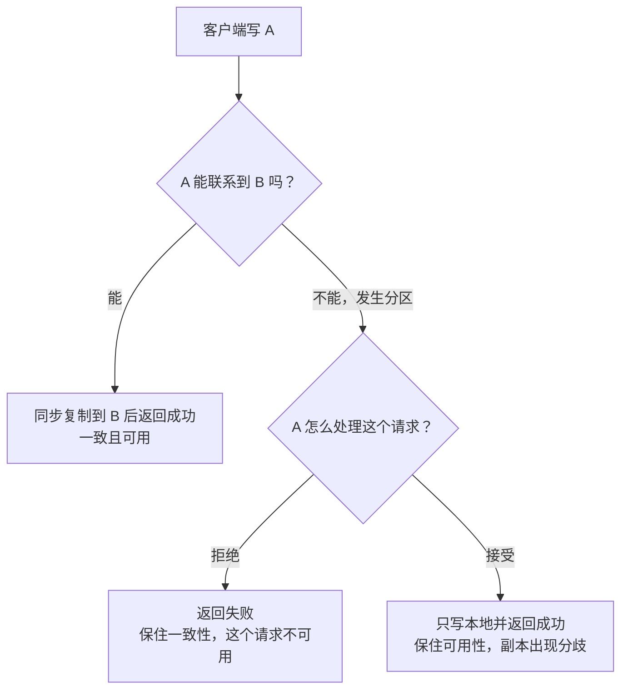
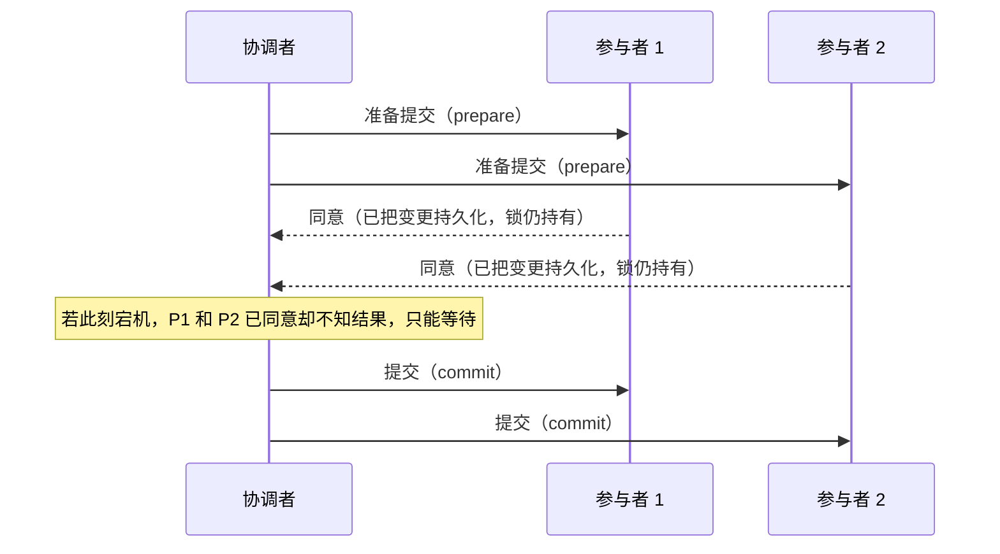

# 数据库基础与大数据演进

Last updated: 2026-10-21

## 这篇文章怎么读

数据存储系统的演化史，本质上是一连串"假设失效"的故事。每隔几年，数据量或时效性要求上一个台阶，上一代系统赖以成立的某个前提就会崩塌，工程师被迫重新设计存储与计算。关系数据库、NoSQL、Hadoop 大数据、云原生数仓、Lakehouse——它们不是彼此替代的潮流，而是一根连续的因果链：每一代技术都是对"上一代在更大规模下失效的那个假设"的回应。

本文用这条因果链作为主线，把数据库基础和大数据演化串成一个故事。你会看到每个概念不是凭空出现的，而是在某个具体的历史时刻，被一个具体的规模问题逼出来的。理解了"它为什么被发明"，你就能判断"今天我该不该用它"。

**核心问题**：从文件到关系数据库、再到大数据与 Lakehouse，每一代存储系统解决了什么问题，又因为什么局限被下一代取代或补充？

**前置知识**：
- 会写基础 Python 和 SQL（SELECT、JOIN、GROUP BY）
- 理解 HTTP 和 Web 服务的基本请求-响应模型
- 知道什么是文件系统（曾用文件存过数据）

**学完之后你能做什么**：
- 说出每一代存储技术是在回应哪个失效的假设
- 解释为什么 B+ 树索引快、什么写法会让索引失效、而 LSM-tree 为什么写入更高效
- 分清"一致性"这个词在 ACID、隔离级别、副本复制、两阶段提交和共识算法里各指什么
- 描述一个具体系统在网络分区时每类操作会怎样表现，而不是给它贴一个 CP 或 AP 的标签
- 面对一个业务需求，先把数据分类，再为每类数据选关系数据库或某种 NoSQL，并说出理由

**演化的七个时代**（本文的章节脉络）：

| 时代 | 时间 | 失效的假设 | 回应 |
|------|------|-----------|------|
| 关系数据库诞生 | 1970s | 文件系统能存数据 | 关系模型 + 范式 + ACID + B+ 树 |
| 关系库的极限 | 1990s-2000s | 一台机器够用 | 主从复制、分库分表、去 IOE、NoSQL 萌芽 |
| Google 三驾马车 | 2003-2006 | 单机存得下、算得动 | GFS + MapReduce + Bigtable |
| Hadoop 与以数据为中心 | 2006-2013 | 以计算为中心能扩展 | 数仓分层、百度 UDW 案例 |
| NoSQL 与分布式理论 | 2010s | 强一致 + 关系查询是必需 | CAP、ACID/BASE、共识、多模型数据库 |
| 云原生与存算分离 | 2015-2020 | 数据和计算绑在同一台机器 | 对象存储 + 弹性计算 + 列式 OLAP |
| Lakehouse 与 AI 数据 | 2020-至今 | 对象存储没有事务保证 | Iceberg/Delta/Hudi + 向量索引 |

这是数据系统系列的第一篇。系列入口和全局地图见 [[数据平台]]；本文讲"存储系统为什么长成今天这样"，下一篇 [[数据系统的构成]] 讲"一条数据流经哪些系统"。

---

## 第一代：关系数据库（1970s）——文件系统的假设失效了

### 文件系统在哪里撑不住

在数据库出现之前，程序把数据存在文件里。这在单人、单机、数据量小的场景下完全够用。但 1960 年代末，航空公司的座位预订系统、银行的账户管理系统开始暴露出文件存储的三个系统性缺陷——不是边缘情况，而是规模上去之后必然触发的失败。

**并发写入冲突**：两个售票员同时修改同一个座位的状态，后写入的人会覆盖前一个人的修改。文件系统没有事务语义，这不是 bug，是设计缺失。

**查询效率崩溃**：找所有"经济舱余票大于 0 的航班"，唯一的办法是把文件从头读到尾逐行检查。100 条记录没问题，100 万条就需要几十秒。

**引用关系混乱**：乘客信息在一个文件，订单在另一个文件，座位在第三个。保证它们之间的引用一致性（订单里的 passenger_id 必须真实存在）完全依赖应用代码，遗漏一处就产生孤儿数据。

### Codd 的回应：关系模型（1970）

IBM 研究员 Edgar Codd 在 1970 年发表《A Relational Model of Data for Large Shared Data Banks》。核心思想是用数学里的"关系"（二维表）来组织数据：表由行和列组成，每行用**主键**唯一标识，表与表通过**外键**关联，查询用代数操作而非文件遍历。

这带来了几个即时收益：明确的 schema（列和类型有约束，不是自由文本）、关系查询能力（JOIN 替代手动遍历），以及后来发展出的事务支持。

关系模型解决了引用关系混乱——外键约束让数据库在引用不存在时直接拒绝写入，不依赖应用层的自觉。

### 被迫发明的概念 1：范式，消除冗余的代价

关系模型告诉你用表组织数据，但没有告诉你怎么拆表。把所有字段塞进一张表的代价很快暴露——更新异常：

```
| 订单号 | 客户名 | 客户城市 | 商品名  | 价格 |
|--------|--------|----------|---------|------|
| 1001   | 张三   | 北京     | 笔记本  | 5000 |
| 1002   | 张三   | 北京     | 鼠标    | 100  |
```

张三搬家，你要更新两行。漏改一行，同一个客户有两个不同城市，数据矛盾了。这不是偶然错误，是设计缺陷——冗余使"更新"变得不安全。

**范式**是消除冗余的拆表规则。用一个图书管理系统走一遍三个层次：

| 范式 | 要求 | 违例 | 怎么拆 |
|------|------|------|--------|
| **1NF** | 每个字段值原子不可再分 | 两本同名书的 ISBN 挤在 `Books.isbn` 一个字段里 | 拆成两个属性或两行 |
| **2NF** | 非主属性必须依赖**全部**主键，不能只依赖其中一部分 | 联合主键是 `(book_id, author_id)`，但 `book_name` 只依赖 `book_id` | 拆出图书表：被部分依赖的那半个主键，成为新表"一"那头的主键 |
| **3NF** | 非主属性必须**直接**依赖主键，不能经由另一个非主属性传递 | `category_name` 依赖 `category_id`，`category_id` 又依赖 `book_id` | 让传递链中间的 `category_id` 自立门户，成为分类表 |

一般分析到 3NF 就够了。更严格的还有 BC 范式（连主属性之间的传递依赖也消除）以及第四、第五范式，工程中很少用到。

范式越高，冗余越少，但每升一级都是一次拆表；表越多，查询时的 JOIN 越多，数据模型也越难一眼看懂。JOIN 是关系数据库最贵的操作之一。**范式是权衡，不是教条**——分析型系统后来会故意"反范式化"，把维度信息冗余进宽表，原因正在这里（[[数据治理]]讲分析建模时会回到这个取舍；练习五会量化它）。

### 被迫发明的概念 2：B+ 树，让查询从 O(n) 变 O(log n)

全表扫描是文件时代的痛点，关系模型本身并不解决它——你需要索引。

MySQL InnoDB、PostgreSQL 默认使用 **B+ 树**索引。它是一棵刻意"矮胖"的树：每个内部节点存数百个键值，树高通常只有 3-4 层。这个设计的物理原因是：**磁盘最慢的操作是"寻址"**（磁头移动到正确位置），而不是"读取"（数据传输到内存）。树越矮，查一条记录需要的磁盘寻址次数越少。

```
           [50 | 100]              ← 3 层，每层一次磁盘 I/O
          /     |     \
    [20|35]  [60|80]  [110|150]
   叶节点←→叶节点←→叶节点     ← 叶节点双向链表，支持范围扫描
```

B+ 树的叶节点间形成双向链表，使范围查询（`WHERE age BETWEEN 20 AND 35`）高效：找到起点后顺序扫描链表，不用回到树根。

代价是写入：每次插入可能触发节点分裂，最坏情况下要修改多层节点。B+ 树为"读多写少"的 OLTP 场景而生——这个前提在 Web 2.0 时代的日志写入场景会失效，那时会催生 LSM-tree。

#### 索引不是银弹

索引用空间和写入速度换查询速度：它要占额外的存储，每次增删改都要同步维护每一个相关索引。因此建不建索引是个取舍：

- **适合建**：数据量大、经常出现在 `WHERE` / `JOIN` 条件里、区分度高的列
- **不适合建**：很少被查询的列、频繁更新的列、本身就很小的表

更隐蔽的问题是**建了索引却用不上**。B+ 树之所以能跳着找，是因为它按列的原始值排好了序；任何让数据库无法利用这个顺序的写法，都会退回全表扫描：

| 写法 | 为什么用不上索引 |
|------|----------------|
| 列上套函数：`WHERE abs(user_id) = 5000` | 树是按 `user_id` 排的，不是按 `abs(user_id)` 排的 |
| 隐式类型转换：字符串列和数字比较 | 数据库要先把每行的值转换再比，等于套了函数（MySQL 里 `varchar` 列 `= 123` 是典型陷阱） |
| 前导通配符：`LIKE '%@mail3.com'` | 不知道开头是什么，就无法在有序的树上定位起点；`LIKE 'u123%'` 则可以 |
| `OR` 连接一个无索引列 | 只要一个分支必须扫全表，整条查询就要扫全表（部分数据库能用 index merge 缓解） |
| 复合索引不满足最左前缀 | `(user_id, month)` 先按 `user_id` 排序，跳过它只查 `month`，顺序就不存在了 |

判断一条 SQL 有没有走索引，不靠猜，靠执行计划：MySQL / PostgreSQL 用 `EXPLAIN`，SQLite 用 `EXPLAIN QUERY PLAN`。练习一会逐条验证上表。

### 被迫发明的概念 3：ACID，并发写入的安全网

关系数据库在 1970s-1980s 的核心客户是银行和航空公司——"转账必须原子"是铁律。这催生了**事务**：一组要么全部成功、要么全部失败的操作，以及它的四个保证：

- **原子性（Atomicity）**：转账的"扣款"和"到账"要么都成功，要么都回滚，不存在第三种状态。以 InnoDB 为例，靠 Undo Log 实现：修改前先记录原始值，失败时逆向还原。
- **一致性（Consistency）**：事务前后，数据库的所有约束（主键、外键、类型、CHECK、触发器）都依然成立。注意：这是**数据完整性**意义上的一致，与后文副本复制和 CAP 里的"一致性"完全是两回事——本文第五代会把五种"一致"并排放在一起。
- **隔离性（Isolation）**：并发事务互不看见对方的中间状态。完全隔离很贵，因此 SQL 标准定义了四个隔离级别：

| 隔离级别 | 脏读 | 不可重复读 | 幻读 | 并发吞吐 |
|---------|------|-----------|------|---------|
| 读未提交 | 可能 | 可能 | 可能 | 最高 |
| 读已提交 | 不会 | 可能 | 可能 | 高（Oracle、PostgreSQL 默认） |
| 可重复读 | 不会 | 不会 | 标准允许 | 中（MySQL InnoDB 默认） |
| 串行化   | 不会 | 不会 | 不会 | 最低 |

这张表是 SQL 标准的定义，真实数据库的实现各有出入：InnoDB 的可重复读用 MVCC 快照和间隙锁，在大多数情况下也挡住了幻读；而基于快照的隔离又会放过一种标准表格里没有的异常——写偏斜（两个值班医生各自确认"还有别人在班"后同时请假）。选隔离级别时要查所用数据库的文档，而不是只看标准。

- **持久性（Durability）**：提交后数据不会因崩溃丢失。靠 WAL（Write-Ahead Log，InnoDB 里叫 redo log）实现：提交前先把变更写入日志落盘，崩溃恢复时重放日志。

ACID 让关系数据库成为金融、订单、库存的标准选择。它的代价是锁带来的等待，以及 MVCC 维护多个数据版本的开销——在高并发写入时成为瓶颈。这个局限在 2000s 互联网爆发时会被正面撞上。

#### 隔离级别不是唯一的防线

最常见的并发 bug 并不需要调隔离级别就能修。看秒杀扣库存：

```sql
-- 错误：先 SELECT 读出库存，在应用里判断 > 0，再 UPDATE 写回一个算好的值。
-- 两个请求交错执行时，都基于同一个旧值做判断，第二次写入覆盖第一次——这叫"丢失更新"。

-- 正确：把判断和扣减合成一条原子语句，用影响行数判断是否抢到
UPDATE stock SET qty = qty - 1 WHERE sku = 'iPhone' AND qty > 0;

-- 或者乐观锁：带上读到的版本号，版本变了说明有人抢先，重试或失败
UPDATE stock SET qty = 0, version = version + 1 WHERE sku = 'iPhone' AND version = 7;

-- 再加一道约束兜底：即使应用代码写错，数据库也拒绝负库存
ALTER TABLE stock ADD CHECK (qty >= 0);   -- 语法因数据库而异
```

需要"先读后写、中间还有复杂逻辑"时，用悲观锁 `SELECT ... FOR UPDATE` 把行锁住。练习七会复现丢失更新。

---

## 第二代：关系库的极限（1990s—2000s）——"一台机器够用"的假设失效了

关系数据库在 1990s 统治了整个企业软件世界。Oracle、IBM DB2、Microsoft SQL Server 三分天下。这套体系有一个隐含的前提：**一台足够强的机器能放下所有数据**。纵向扩展（Scale Up）——换更快的 CPU、加更多内存、上更大的磁盘——是当时默认的扩容方式。持久层课程的作者回忆，早年给电信运营商开局时，做法就是把服务器 CPU 升到 96 核。

1994 年 Amazon 上线，1998 年 Google 创立，2004 年 Facebook 诞生。用户成为数据的主要制造者，每天产生的数据量不再是几百 GB，而是 TB 级、几年后是 PB 级。单机 Scale Up 触到了物理和价格的双重天花板：单机性能的提升有限且极其昂贵，最贵的服务器也撑不住全球数亿用户同时写入。今天说"扩展性"，默认指的已经是横向扩展（Scale Out）——在同一层加机器。

但在加机器之前，工程师先学会了一件更便宜的事。

### 第零步：先让数据库少做事

大多数"数据库扛不住"，其实是数据库在做多余的工作：没走索引的全表扫描、返回了用不到的列、本可以缓存的重复查询。优化遵循四条原则：

1. **先测量后优化**：用 `EXPLAIN` 看执行计划，找到真正慢的那一步，而不是凭感觉改。
2. **索引优先**：大部分慢查询的根因是索引缺失或失效（见上一节的五种写法）。
3. **减少数据库压力**：能缓存就缓存，能异步就异步。
4. **分而治之**：大表拆小表，大查询拆小查询。

几个常见的 SQL 层面问题：

- **深分页**：`LIMIT 20 OFFSET 1000000` 要先扫过并丢弃前一百万行。改成"记住上一页最后一条的 id"：`WHERE id > :last_id ORDER BY id LIMIT 20`。
- **逐条插入**：一万次单条 `INSERT` 是一万次网络往返，批量插入一次搞定。
- **`SELECT *`**：多读的列浪费 I/O 和网络，还会让本可以只读索引的查询被迫回表。

高并发场景下，问题从单条 SQL 变成整体流量，应对手段也随之变成架构层面的：

| 场景 | 对策 |
|------|------|
| 热点数据读压力大 | 缓存 + 读写分离 |
| 秒杀 | 条件更新或乐观锁 + 库存预热到缓存 + 消息队列削峰 |
| 慢查询 | 索引优化 + 查询拆分 + 读写分离 |
| 连接耗尽 | 连接池调优 + 限流 + 服务降级 |

表里反复出现的"读写分离"，背后是这一代最重要的机制：复制。

### 第一波：复制——副本换来可用性，也带来一致性问题

只有一份数据时，不存在一致性问题。但数据要不丢，几乎只能靠冗余——存储介质一定会老化损坏；服务要一直可用、还要有足够性能，也需要多个节点同时提供读写。于是必然出现多个副本，**一致性问题从副本出现的那一刻起才成为课题**。

这里的"一致性"要从**客户端视角**定义：客户端对数据的读写行为是可预期的、符合某种规则的。系统内部的副本在某些时刻可以不一致（比如事务还没提交时，客户端读到的是老数据），只要客户端看到的行为符合承诺的规则即可。不同的一致性模型，承诺的规则不同。

围绕副本，有四类架构：

**简单备份（Backup）**：定期全量或增量复制一份数据，个人电脑和工业界都大量使用（Amazon RDS 的快照就是这一类）。它异步进行，对正常读写几乎没有影响；但它不是高可用——存储系统挂了，服务照样中断，而且只能恢复到最近一个备份点，之后的数据全丢。还要分清两件事：给 Web 服务器做双机备份，解决的是服务可用性，不是数据可用性。

**主从（Master-Slave）**：一个可写的主节点，加若干个只读从节点，更新以异步方式单向复制到所有从节点。
- 优点：只有一个写入点，没有写冲突；增加从节点就能扩展读能力，正适合互联网"读远多于写"的业务。
- 代价：写无法扩展；异步复制意味着从库会落后——刚下完单，立刻从从库查订单列表，可能看不到；主库宕机时，还没复制出去的已确认写入会丢失。
- 主库挂了要做**故障切换**：选哪个从库顶上？旧主库复活后怎么办？处理不好就会出现两个节点都以为自己是主库的"脑裂"。

**多主（Multi-Master）**：多个主节点各自提供完整读写，节点间异步互相复制，通常只能做到最终一致。某个主节点挂了，其余照常服务。为什么不同步复制、做成强一致？有两个原因：同步会拉长每个请求的延迟；更关键的是节点异常时复制会失败——如果忽略失败照常返回成功，强一致名存实亡；如果返回错误，任何一个主节点不可用都会拖垮整个系统，与高可用的初衷自相矛盾。多主的另一个硬伤是全局事务：两个主节点的本地事务各自提交成功，异步复制时才发现改了同一条记录，此时用户早已收到"成功"，冲突无从告知、也难判定以谁为准。

**同步方案（2PC/3PC、Paxos）**：能保证强一致，但实现复杂得多，延迟也高——第五代会展开。

主从的同步与异步之间还有一个实用的折中，课程称为"最小副本数量"：比如有 5 个从库，写入在其中 2 个确认后就返回成功，不等另外 3 个；失败的节点打上标记，按策略自动修复。MySQL 的半同步复制就是这个思路（主库等至少一个从库确认收到日志才返回）。它既降低了丢数据的概率，又不会让主库因为个别慢从库而"死等"。

Google 工程师 Ryan Barrett 在 Google I/O 2009 的演讲《Transactions Across Datacenters》里，把这些方案放进同一张表比较：

| | 备份 | 主从 | 多主 | 2PC | Paxos |
|--|--|--|--|--|--|
| 一致性 | 弱 | 最终 | 最终 | 强 | 强 |
| 事务 | 无 | 完整 | 仅本地 | 完整 | 完整 |
| 延迟 | 低 | 低 | 低 | 高 | 高 |
| 吞吐 | 高 | 高 | 高 | 低 | 中 |
| 故障时丢数据 | 多 | 少量 | 少量 | 无 | 无 |
| 故障切换 | 停服 | 只读 | 读写 | 读写 | 读写 |

没有一列全是优点：靠异步副本的方案换来了低延迟，却做不到强一致；靠同步协调的方案做到了强一致，却付出了高延迟。

### 第二波：分库分表

复制扩展了读，没有扩展写，也没有让单表变小。工程师用两种"拆分"把关系数据库继续撑大：

**垂直分库（Vertical Partitioning）**：按业务拆库，用户数据一个库、订单一个库、商品一个库，每个库独立扩容。代价是跨库 JOIN 消失了，所有跨业务域的关联查询必须在应用层完成。

**水平分表（Horizontal Sharding）**：把同一张表按某个键（用户 ID 取模、按时间范围）切成若干片，分布到多台机器。代价是全局查询变成了 scatter-gather（向所有分片发查询再合并结果），分片键设计不当就会出现热点节点，全局事务几乎不可能。

（Sharding 和 Partitioning 这两个词经常被混用：通常 partition 泛指把数据切开，shard 特指切开后分布到不同机器上的那一片。）

分库分表不是优雅的设计，而是在关系模型上打补丁。它暴露的真正问题是：**关系模型从设计之初就不是为水平扩展而生的**。外键约束、JOIN、全局事务，这些核心特性都假设数据在同一台机器上。

### 去 IOE 与 NoSQL 萌芽

在 NoSQL 出现之前，设计大型网站时面对海量、非结构化的数据，只能靠关系数据库的 sharding 和 partition 硬撑。DBA 因此炙手可热，顾问费极其高昂。

2000s 中期起，全球互联网公司几乎同时开始"去 IOE"——去掉 IBM 小型机（I）、Oracle 数据库（O）、EMC 存储（E）。阿里巴巴的版本最为著名；Amazon 也在做同样的事，并在 2019 年宣布其消费者业务关掉了最后一个 Oracle 数据库（持久层课程的作者当年在 Amazon 销量预测团队工作，团队维护的正是全公司最大的传统关系数据库之一）。驱动力不只是成本，更是可扩展性：IOE 的 Scale Up 路径已经跟不上业务增长速度，且单点故障风险极高。

Web 2.0 时代的数据有几个共同特征：量大、结构不定、彼此关联弱、要求高可用但对一致性要求不高。这正好是关系数据库最不擅长的组合。学术界和工业界开始质疑 ACID 是否处处必要：新闻页面显示旧数据 5 秒，真的是灾难吗？用户点赞数延迟几秒才更新，真的不可接受吗？

数据本身的形态也在变。关系数据库里每一行都严格符合表结构定义，这叫**结构化数据**，确定的结构就是 schema，它带来最好的查询、校验和关联能力。后来出现的 NoSQL 里，每行的列数、类型、含义都不再固定，仍有结构但共同部分很少，叫**半结构化数据**。再往前一步是**非结构化数据**：对象存储里的一个文件，哪怕内容恰好是 JSON，存储服务也无法依据它的结构查询。结构本质上是规则，结构越强，越容易用简单直白的代码处理；但现实中的绝大多数数据，很难套进固定的规则。

这些问题为下一代系统打开了空间。

---

## 第三代：Google 三驾马车（2003—2006）——"单机存得下、算得动"的假设失效了

2003—2006 年，Google 连续发表三篇论文，颠覆了"大规模数据处理必须靠昂贵专有硬件"的假设。它们不是学术玩具，而是 Google 内部运行中的真实系统。

```
GFS（2003）      → 解决：可靠存储几百 TB 数据
MapReduce（2004）→ 解决：在 PB 级数据上运行任意计算
Bigtable（2006） → 解决：结构化数据的半随机读写
```

### GFS：把廉价机器组成可靠存储

**失效的假设**：存储必须依赖昂贵的高可靠硬件（RAID、SAN）。

GFS 的设计前提是"普通商用机器随时会坏"——这不是容错设计的边缘情况，而是基本假设。一个大文件被切成 64MB 的 chunk，每个 chunk 默认存三副本到不同机器。单台机器宕机不是故障，是正常运营状态的一部分。

关键设计：master 节点（HDFS 里对应 NameNode）只记录元数据——文件由哪些 chunk 组成、每个 chunk 在哪些机器上，实际数据流不经过 master。这让系统可以线性扩展：加机器就增加容量，master 不成为数据通路上的瓶颈。

代价：GFS 优化了大文件顺序读写，对小文件和随机写入支持差。这个局限后来在 Hadoop 体系里反复出现。

### MapReduce：把计算移到数据旁边

**失效的假设**：数据要集中搬到计算节点才能处理。

把 500TB 的数据搬到一台机器再处理是不可能的，但反过来——把计算任务调度到数据所在的机器上执行——是可行的。MapReduce 的调度器把 Map 任务尽量发到存有对应 chunk 的机器上运行（data locality），最小化网络传输。

编程模型：任意计算被拆成两步。

```python
# Map：对每条记录独立处理，输出 (key, value) 对
def map(record):
    for word in record.split():
        yield (word, 1)

# Reduce：对相同 key 的所有 value 做聚合
def reduce(word, counts):
    yield (word, sum(counts))
```

框架负责：把输入数据切片分发到 Map 任务、按 key 做 shuffle 排序、把相同 key 的结果送到 Reduce、处理任意节点失败时的重试。工程师只写 Map 和 Reduce，不管分布式细节。

局限：Map+Reduce 的两步模型表达力有限，每步都要落盘（Map 输出写磁盘，Reduce 输入读磁盘）。迭代类算法（机器学习训练）要跑几十轮，每轮落盘一次，性能灾难性地差。这个局限在 2010s 催生了 Spark。

### Bigtable：半结构化数据的大规模存储

**失效的假设**：关系数据库的行列模型能覆盖所有结构化数据需求。

Bigtable 是一个稀疏、分布式、持久化的多维排序 map。行键按字典序排列，按行键范围切成 tablet 分布到多台机器。每行可以有不同的列，列族（column family）是物理存储分组的单位，同一列族的数据存在一起。

这套模型对 Google 的网页爬取数据（每个 URL 是行键，爬取时间戳是列名，网页内容是值）完美契合。关系数据库强加的 schema 约束在这里是负担，Bigtable 去掉了它。

注意 Bigtable / HBase 这类"宽列"模型和后面分析型的"列式存储"不是一回事：宽列说的是**逻辑模型**（每行的列可以不同、按列族分组），数据仍然按行键组织，擅长按行键读写；列式存储说的是**物理布局**（同一列的值连续存放），擅长对少数几列做大范围扫描。第五代的分类表会把这几个维度拆开。

Bigtable 的底层存储用 SSTable（Sorted String Table）组织成 LSM-tree。LSM-tree 的思想早在 1996 年就由 O'Neil 等人提出，Bigtable 是它最有影响力的早期工业实践之一。

### LSM-tree：为写入密集场景发明的索引

B+ 树在写入时要做随机 I/O（定位到树上某个位置再原地更新），而磁盘的随机写比顺序写慢得多，机械盘上可差两个数量级。日志采集场景（每秒写入几万条记录）让 B+ 树的写入成本无法接受。

**LSM-tree 的解法**：所有写入先进内存缓冲区（MemTable），内存满了才顺序刷盘成一个不可变的 SSTable 文件。写入始终是顺序写，速度极快。

```
写入 → MemTable（内存）
           ↓ 满了，顺序刷盘
      L0: [SST1][SST2][SST3]      ← 最新，键可能重叠
           ↓ 后台 Compaction
      L1: [SST_a][SST_b]          ← 键范围不重叠
           ↓
      L2: [SST_x][SST_y][SST_z]   ← 更大，持久存储
```

代价是读放大：一次查询要检查 MemTable、L0 的多个文件、L1……逐层找。加 Bloom Filter（概率型结构，快速判断某键是否不在某个文件里）减少无效磁盘读，但读成本始终高于 B+ 树的单次路径查找。

| | B+ 树（MySQL InnoDB） | LSM-tree（RocksDB、HBase、Cassandra） |
|--|--|--|
| 写入模式 | 原地随机写 | 追加顺序写 |
| 写吞吐 | 中 | 高 |
| 读性能 | 高（明确树路径，O(log n)） | 中（跨多 level，Bloom Filter 缓解） |
| 写放大 | 低（只改影响节点） | 高（Compaction 反复重写数据） |
| 读放大 | 低（一条树路径） | 中（要检查多个 level） |
| 空间放大 | 低（原地更新，无冗余） | 中（旧版本数据在 Compaction 前共存） |
| 适合场景 | 读多写少的 OLTP，点查为主 | 写密集的日志、时序数据、宽列存储 |

两种索引结构不是谁替代谁，而是对不同工作负载的不同回答。练习六会给出一个反直觉的细节：如果写入的键本身是递增的（自增 ID、时间戳），B+ 树的插入几乎都落在最右边的叶子上，差距会大幅缩小；真正拉开差距的是**随机键**写入。**选错了索引结构，无论查询优化做得多好，写入或读取的天花板都在硬件层就先定死了。**

---

## 第四代：Hadoop 与以数据为中心（2006—2013）——"以计算为中心能扩展"的假设失效了

Google 的论文发表后，Doug Cutting 等人把 GFS 和 MapReduce 的思想实现为开源的 Hadoop：GFS 的对应物是 HDFS，MapReduce 保留了原名。2006 年 Cutting 加入 Yahoo，同年 Hadoop 0.1.0 发布，TB/PB 级数据处理第一次走进普通工程师的视野。

国内的百度是最早落地 Hadoop 的公司之一。2008 年前后，它把分散在各业务线前端服务器上的日志汇聚到 Hadoop 上的统一 Log 平台，用 MapReduce 做批量统计，还自研了比 Apache Hive 更早的类 SQL 语言 DISQL。到 2011 年，平台覆盖了所有业务线，计算节点从几十台涨到 5000 台——然后失控了：没有 schema、没有血缘，同一份日志被不同任务重复计算，中间结果无法复用，只能产出报表。根因是系统**以计算为中心**：每个任务服务一个报表，数据只是任务的副产品。重构为用户数据仓库 UDW 时，核心转变是**以数据为中心**——先有分层、有 schema、有所有者的数据，再让计算围绕数据复用；后来又在批处理之外加上了流式链路。这个案例的完整经过与教训见 [[数据平台运维]]，分层为什么能控制变更的影响范围见 [[数据治理]]。

对这条演化链来说，百度的教训是：**规模先打破的往往不是存储或计算能力，而是组织数据的方式**。Hadoop 解决了"存得下、算得动"，却没有回答"这份数据是什么、谁负责、能不能复用"。

---

## 第五代：NoSQL 与分布式理论（2010s）——"强一致 + 关系查询是必需品"的假设失效了

Hadoop 解决了存储和批量计算的规模问题。但互联网产品还有另一个需求：在线服务的高并发读写。MySQL 加分库分表在高写入压力下已经非常痛苦，千万级用户的社交平台需要的不是分表补丁，而是从设计之初就为水平扩展而生的存储系统。

这催生了 NoSQL 运动。NoSQL 不是"不用 SQL"，而是"Not Only SQL"——它的设计目的是补充关系数据库，而不是取代。它们放弃了关系模型的某些能力（强 schema、关系查询、跨记录事务），换来了高得多的写入性能和横向扩展能力。

关系数据库也没有消失：需要强一致和关系查询的业务仍然依赖它。数据问题由此分成两条出路：换一种更贴合业务的非关系数据库，或者把关系数据库搬到云上、交给托管服务（第六代会讲到）。

### 被迫正面回答的问题：CAP 定理

2000 年 Eric Brewer 在 PODC 会议上提出 CAP 猜想，2002 年 Seth Gilbert 和 Nancy Lynch 给出形式化证明。要读懂它，先把它的**故障模型**和三个词的精确含义说清楚：

- **故障模型**：数据有多个副本，分布在通过网络通信的节点上；网络可能任意丢弃或延迟节点之间的消息（这就是**分区**）。只要某个节点和其他节点失去联系、数据同步无法及时完成，即使它自己还能对外服务，分区就已经发生。
- **一致性（C）**：读操作总能得到最近一次已完成写入的值——形式上叫线性一致性（linearizability），也就是前面说的强一致。写入成功返回后，下一次读如果得到"非失败"响应，就一定是最新、完整的数据，不会是过期值或中间值。
- **可用性（A）**：每个发给非故障节点的请求，都要得到一个非失败的响应（课程把它表述为"在限定时间内返回非失败响应"）。注意它说的是"非失败"，不是"正确"——返回的数据可以是旧的，正确与否由一致性负责。

用两个节点 A、B 推演。正常写入分四步：① 客户端写 A；② A 把变更同步给 B；③ B 向 A 确认；④ A 向客户端返回成功。为保证一致性，复制必须同步完成后才返回。现在 A、B 之间的网络断了，客户端的写请求到达 A，A 只有两种选择：

- **写入并返回成功**：满足可用性，但 A 有新值、B 是旧值，一致性丢了；
- **拒绝写入、返回失败**：A、B 仍是一致的旧数据，但系统对这个请求不可用。

没有第三种选择。这就是定理的全部内容：**在分区发生时，同一个操作不能既保证一致又保证可用。**



#### 四个常见误读

| 误读 | 更准确的说法 |
|------|-------------|
| "三选二" | P 不是可选项。硬件损坏、机房断电、光缆被挖断都无法预料，跨节点的系统随时可能分区。真正的取舍只发生在分区期间：一致还是可用 |
| "某系统是 CP / AP" | 取舍是**每一类操作、每一种配置**在分区期间的行为。同一个数据库，强一致读和最终一致读可以并存；同一个业务，查询余票和出票可以做出不同选择 |
| "CAP 的可用性 = 99.99% 的 SLA" | 不是一回事。SLA 统计的是一段时间内请求成功的比例，宕机、bug、发布事故都算在内；CAP 只回答分区期间非故障节点能不能响应。分区很罕见时，一个在分区期间拒绝写入的系统，SLA 照样可以很高 |
| "没有分区时也只能二选一" | 没有分区时，一致和可用可以同时满足。这时的真实代价是**延迟**：强一致要等副本确认。Daniel Abadi 2012 年提出的 PACELC 把它补全为"分区时在 A 与 C 之间取舍，否则在延迟 L 与 C 之间取舍"，前面 Google I/O 那张表里"强一致 ⇒ 高延迟"说的就是这一半 |

还有一类系统不在 CAP 的讨论范围内：只有一个节点的系统（单机 MySQL），或者虽然多节点、但每份数据只存一处、节点之间不交换数据的系统（不配副本的 Memcached 或 Elasticsearch，数据哈希到各节点后互不相干）。它们常被叫作 "CA"，但更准确的说法是：没有副本，也就没有分区期间的一致性问题——当然，一个节点挂了，它上面那部分数据就不可用了。

#### 真实系统在分区时怎么表现

与其给系统贴标签，不如问三个问题：正常时读写走哪条路径？分区时哪一侧的哪类操作会失败？有哪些旋钮可以调？

| 系统 | 正常时的读写路径 | 分区时会怎样 | 可调的旋钮 |
|------|----------------|-------------|-----------|
| MySQL 主从（异步复制） | 写主库，读可以走从库 | 从库照常返回可能落后的数据；主库失联后若切换到从库，未复制出去的已确认写入会丢失 | 只读主库；半同步复制 |
| ZooKeeper | 写经 leader 由多数派确认；读由所连节点本地返回 | 少数派一侧的节点停止服务，多数派一侧照常读写 | 读前调用 `sync` 才能读到最新值（默认读可能略旧） |
| Cassandra | 每个请求自带一致性级别（ONE / QUORUM / ALL） | `QUORUM` 请求在凑不齐多数副本的一侧失败；`ONE` 请求继续成功，但可能读到旧值 | 读写都用 `QUORUM` 时读写副本集合必有交集，能读到最近确认的写；并发写仍按时间戳"后写者胜"合并 |
| DynamoDB | 默认最终一致读；单次请求可设 `ConsistentRead=true` | AWS 文档写明：网络延迟或中断时，强一致读可能不可用并返回服务端错误，最终一致读仍可返回 | 按请求选择；全局二级索引不支持强一致读 |
| HBase | 每个 region 同一时刻只由一个 RegionServer 服务，单行读写强一致 | RegionServer 失联后，它负责的 region 在重新分配完成前不可读写 | — |

#### 同一个系统里，不同操作做不同选择

选择是带灰度的过程，不是 0 和 1：

- **门户网站**：新闻、图片、样式通过 CDN 放到离用户近的节点。上海读者比北京读者晚几分钟看到一条新闻没关系，页面打不开才是大问题——优先可用。
- **航空售票**：在不考虑超售、一座一票的前提下，余票显示可以不准确（只显示"有票"而不显示具体数字），但真正扣款出票时必须一致——订票失败用户会抱怨，两个人订到同一个座位是事故。
- **ATM**：网络故障时进入 stand-alone 模式，仍然可以查余额（数字可能不准），甚至可以取款，但会限制额度或卡种，风险由银行承担。涉及钱的事不一定选一致：可用性和一致性的丢失带来不同的风险，两害相权取其轻。
- **银行跨系统交易**：总行核心、分行交易系统、商户系统构成一个分布式系统。交易状态不明时，分行先发起冲正；网络恢复后重试成功就达成一致；仍然不明，就靠次日对账和柜员手工处理——跨系统层面走的是"最终一致 + 补偿"，而核心系统内部各节点之间要求强一致。
- **电商库存**：同一件商品绝不能被多人下单成功，宁可让一部分请求失败。

### 五个"一致"，五件不同的事

"一致性"这个词在数据系统里至少有五种用法，混在一起就会出现"ACID 保证了一致性，所以主从复制也是一致的"这类错误推理：

| 概念 | 回答的问题 | 由谁保证 | 反例 |
|------|-----------|---------|------|
| ACID 的一致性 | 事务前后数据是否满足约束 | 数据库的约束 + 应用自己的不变量 | 没有声明 `CHECK (qty >= 0)`，库存被扣成负数，数据库照单全收 |
| 隔离性 | 并发事务交错执行，效果是否等价于某种串行顺序 | 锁、MVCC、隔离级别 | 读已提交级别下，同一事务里两次读同一行，结果不同 |
| 副本一致性（一致性模型） | 多个副本对外呈现什么样的读写规则 | 复制协议 | 刚在主库下单，立刻从从库查询，看不到这笔订单 |
| 两阶段提交（2PC） | 跨多个节点的一个事务，能否全部提交或全部中止 | 协调者 + 所有参与者 | 协调者在参与者投票后宕机，参与者不知道该提交还是回滚，只能持锁等待 |
| 共识（Paxos、Raft） | 一组节点能否对一个值或一串日志顺序达成一致，并在部分节点故障时继续前进 | 多数派投票 | 5 个节点挂了 3 个，剩下 2 个凑不够多数，集群拒绝写入 |

2PC 和共识最容易混淆，它们解决的是不同问题：



- **2PC** 是原子提交协议：所有参与者都同意才提交，任何一个反对就全部中止。它要求**每一个**参与者都在线，并且在协调者宕机时会阻塞。3PC 多加一个预提交阶段来减少阻塞，但依赖"网络延迟有上界"的假设，在真实网络里很少使用。
- **共识**只需要**多数派**同意就能前进，`2f+1` 个节点能容忍 `f` 个故障。etcd 用 Raft，ZooKeeper 用类似的 ZAB 协议，它们被用来选主、保存配置、复制日志。
- 两者可以组合：Google Spanner 把 2PC 的每个参与者做成一个 Paxos 组，参与者本身就不会因为单台机器宕机而失联。

### 一致性模型：承诺的是什么规则

副本一致性有一个从强到弱的光谱：

| 模型 | 承诺 | 例子 |
|------|------|------|
| **强一致（线性一致）** | 读总能得到最近一次已完成写入的值 | 只读主库的关系数据库；单节点本地文件，写入落盘后读到的就是最新 |
| **有界陈旧** | 可能读到旧值，但落后程度有明确上界（多少秒或多少个版本） | Azure Cosmos DB 的 bounded staleness 级别；严格遵守 TTL 的 CDN，旧内容最多存活一个 TTL |
| **最终一致** | 如果不再有新的写入，所有副本**最终**会收敛到同一个值；但不承诺什么时候 | Dynamo 风格的多副本存储；网盘在多个节点间异步同步 |
| **弱一致** | 不保证收敛 | 一条永远不会被主动失效的缓存 |

一个常见的错误说法是"最终一致性保证经过某个固定的时间窗口后一定读到新值"。最终一致性**不提供时间上界**，它只保证收敛；能给出上界的是有界陈旧，那是一个更强的承诺。缓存的 TTL 则是一种刷新策略，它能不能变成一致性承诺，取决于系统是否严格执行它。

同一个系统归到哪一类，取决于它承诺了什么，而不是它通常表现如何。课程材料里，搜索引擎就被分别归入过"最终一致"和"弱一致"两类：如果爬虫保证会定期重新抓取每个页面，索引最终会追上源站；如果某些页面可能很久都不被重新抓取，就没有收敛保证。浏览器缓存也一样，取决于缓存头是否让它过期后回源校验。

技术选型时真正要问的不是"要不要 CAP 的 C"，而是：**我的业务能容忍多大、多久的不一致，这个上界又由谁来保证？**

### ACID 的对立面：BASE

ACID 和 BASE 恰好是英文里的"酸"和"碱"。BASE 来自 Dan Pritchett 2008 年的文章《BASE: An Acid Alternative》，是"分区时优先可用"这一分支落实到工程实践的经验总结：

- **基本可用（Basically Available）**：为了保住核心功能，次要功能在功能和性能上都可以牺牲。双十一时关闭次要特性、只保下单支付，就是"优雅降级"的典型形式
- **软状态（Soft State）**：允许数据在同步完成前处于中间状态，这种过渡态是设计允许的
- **最终一致（Eventually Consistent）**：软状态终将收敛。它和上一条说的是同一件事——一致性的牺牲是有限度的。社交媒体的点赞数、评论数可以晚一会儿显示，但如果一直不同步，就是故障了

| | ACID | BASE |
|--|--|--|
| 一致性目标 | 强一致，提交即全局一致 | 最终一致，允许中间状态 |
| 故障处理 | 回滚，整体撤销 | 接受部分失败，后台补偿 |
| 写入成本 | 高（锁、跨节点要两阶段提交） | 低（无全局锁） |
| 适合场景 | 金融、订单、库存 | 推荐、计数、社交动态、日志 |

### 一致性哈希：扩容不再迁移全量数据

NoSQL 系统水平扩展时遇到了数据路由问题：加一台机器，原来的数据怎么重新分配？

哈希函数把任意数据映射成一个简短的值：两个输入哈希值不同，则一定不同；哈希值相同，则可能相同也可能不同。朴素的路由方案是**取模哈希**：用 `hash(key) % N` 决定数据存在哪台机器。问题在于节点数一变，几乎所有数据都要换位置。从 N 台扩到 N+1 台，只有 `hash % N` 恰好等于 `hash % (N+1)` 的数据能留在原地，其余 N/(N+1) 都要迁移：3 台扩到 4 台迁 75%，5 台扩到 6 台迁约 83%。（课程原文给出的 5→6 台的数字是 96.7%，理由是"只有 30 的倍数不用动"，这个算法漏掉了余数恰好相同的情况；练习四可以直接验证。）

**一致性哈希**把哈希值空间想象成一个时钟圆环。设想表盘有 12 格，数据按 `hash % 12` 落到某一格；三台服务器各负责连续的 4 格。新增一台机器时，它只需从一台老机器那里接手一段，比如把原来 5~8 点那一段中的 5~6 点接过来，只有 2/12 = 1/6 的数据需要搬家。

但这样分布并不均匀：新机器只承担了 1/6，老机器里有的还是 1/3。解决办法是**虚拟节点**：把圆环切成更多小段，比如 12 段，由 12 个虚拟节点负责，按 A1-B1-C1-A2-B2-C2… 的顺序交错排布，每台物理机拥有的虚拟节点均匀散布在环上。新增机器 D 时，只要从 A、B、C 各接手一个虚拟节点（比如 A1、B2、C3），迁移量最小，四台机器的负载也重新均匀。实际系统会把圆环分成更多份。

这套机制最早在 Amazon 的 Dynamo 论文（2007）里成为工业实践，Cassandra、Riak 都沿用了它。也有系统选择别的路：Redis Cluster 把键空间预先切成固定的 16384 个哈希槽，扩容时整槽迁移；Elasticsearch 用 `hash(路由键) % 主分片数` 决定文档落在哪个分片，主分片数在建索引时就固定下来，想改只能拆分或重建索引——它用固定分片数回避了取模哈希的迁移问题，代价是要提前规划好分片数。

### 数据库类型的分化

放弃关系模型之后，不同的 NoSQL 系统选择了不同的数据模型，各自服务不同的数据形态。在比较之前，先把四个经常被混在一起的维度拆开，否则就会出现"HBase 和 Redshift 都是列式数据库"这种说法：

| 维度 | 回答的问题 | 例子 |
|------|-----------|------|
| **逻辑数据模型** | 应用看到的数据长什么样 | 关系表、键值、文档、宽列、图、时序、向量 |
| **物理布局** | 字节在磁盘上怎么排 | 行存储、列存储；B+ 树、LSM-tree |
| **访问接口** | 应用怎么读写它 | SQL、键值 API（get/put）、Cypher、S3 的 HTTP API |
| **部署形态** | 谁来运行、在哪里运行 | 自建、托管服务（RDS、DynamoDB）、嵌入式库 |

于是：HBase 是**宽列逻辑模型** + LSM 物理布局，擅长按行键读写；Redshift、ClickHouse 是**关系逻辑模型** + 列式物理布局，擅长扫描聚合——二者都被叫作"列式数据库"，解决的却是相反的问题。S3 是对象**存储**，按 key 存取任意大小的字节块，它不是存放编程语言对象的"对象数据库"。

按数据形态选择逻辑模型，这张表是起点：

| 数据形态 | 适合模型 | 代表系统 |
|---------|---------|---------|
| 结构固定、关系明确 | 关系型 OLTP | MySQL、PostgreSQL |
| 字段不固定、嵌套深 | 文档型 | MongoDB、DynamoDB |
| 高频写入、按时间范围查询 | 时序 | InfluxDB、TimescaleDB |
| 多跳关系遍历 | 图数据库 | Neo4j、Amazon Neptune |
| 热点数据、毫秒级点查 | 键值 | Redis、DynamoDB |
| 海量数据聚合分析 | 列式 OLAP | ClickHouse、Redshift |
| 语义相似度搜索 | 向量 | Pinecone、Milvus、pgvector |

每一种都是"放弃了某些通用能力，换来了对某类数据形态的数量级性能提升"：

**键值**：通过唯一的 key 取 value，靠哈希直接定位，访问时间不随数据量增长。本地常用 Redis，云上常用 DynamoDB。DynamoDB 的 key 分两级：分区键（partition key）决定数据落在哪个存储分区，排序键（sort key）决定分区内的顺序，因此除了按 key 取值，还支持在同一分区键下按排序键做范围查询。它的表看起来像关系表，但每一行的属性可以完全不同。按其他属性查询要靠二级索引：全局二级索引可以换一组分区键和排序键（默认配额每表 20 个），本地二级索引沿用表的分区键、只换排序键（每表最多 5 个，且只能在建表时创建）。

**文档**：可以看作键值的演化——value 是带结构的 JSON / BSON 文档，数据库能理解并查询文档内部的字段，比纯键值强大。每个文档可以有不同的字段，相关数据直接嵌套在一起，一次读取就能拿全，也天然适合分片。适合内容管理（文章、评论、标签结构各异）、用户画像（不同用户的属性不同）、商品目录（手机有屏幕尺寸，食品有保质期）、配置中心。代价是跨文档的关联查询弱。一个常见误区是"MongoDB 不需要设计数据结构"：文档模型同样要认真设计，嵌套不宜过深，频繁更新的子文档应拆成独立集合。

**图**：用节点表示实体、用边表示关系，节点和边都能带属性。它的杀手级能力是多跳查询。找"朋友的朋友的朋友"，关系型每多一跳就多一次自 JOIN，中间结果迅速膨胀；图数据库沿着边上的指针遍历，代价只和实际走过的路径有关：

```sql
-- 关系型：三跳就是三次自连接
SELECT DISTINCT f3.followee FROM follows f1
JOIN follows f2 ON f2.follower = f1.followee
JOIN follows f3 ON f3.follower = f2.followee
WHERE f1.follower = 'me';
```

```cypher
// 图数据库（Cypher）：跳数只是一个参数
MATCH (me:User {id: 'me'})-[:FOLLOWS*1..3]->(target) RETURN DISTINCT target
```

典型场景：社交网络（好友推荐、共同关注）、知识图谱（"谁是谁的老师的学生"）、反欺诈（发现资金环路和关联账户）、基于"用户-商品-标签"关系的推荐。

**时序**：以时间戳为主轴，专为"按时间顺序追加写入、按时间范围查询"优化。和用通用关系库存时序数据相比，它的优势来自对这个访问模式的专门设计：写入是按时间追加的批量写；过期数据按保留策略（TTL）自动删除，而不是手工清理一张越来越大的表；内置降采样（比如把 5 秒粒度聚合成 1 分钟均值）；同一指标的相邻数值很接近，按时间分块的列式压缩效率很高。典型场景：服务器监控、IoT 传感器、金融行情、日志的时间线聚合。

**向量**：把文本、图片、音频通过 Embedding 模型转成高维向量，用向量间的距离（如余弦相似度）衡量语义是否相近。比如"好吃的日料"和"银座寿司之神"的向量很接近，和"意大利披萨"则离得远。第七代会讲它的索引机制。

没有万能数据库。现代系统通常多模型并存：核心业务放 PostgreSQL，热点数据放 Redis 缓存，行为日志进时序库或 ClickHouse，知识库用向量索引，推荐用图。核心原则是**不追求"一个数据库解决所有问题"，而是让每种数据找到最合适的家**。

### B+ 树回答不了的两类查询：全文与地理位置

还有两类常见需求，被逼出了专门的索引结构。

#### 搜索：倒排索引

BBS 的帖子搜索、站内搜索，最直观的做法是 `SELECT * FROM articles WHERE content LIKE '%存储%'`。前导通配符让索引失效，只能全表扫描：几十篇文章没问题，几百万篇时单表放不下，扫描时间也无法接受。

**倒排索引**把存储方向倒过来：不再是"先找到文章，再在内容里找关键字"，而是"先找到关键字，再看它出现在哪些文章里"；关键字本身被索引起来，所以查得快。用关系表就能实现：

```sql
CREATE TABLE articles        (id INTEGER PRIMARY KEY, content TEXT);
CREATE TABLE keywords        (id INTEGER PRIMARY KEY, keyword TEXT UNIQUE);   -- keyword 上有索引
CREATE TABLE keyword_article (keyword_id INTEGER, article_id INTEGER,
                              PRIMARY KEY (keyword_id, article_id));          -- 多对多关系

SELECT a.* FROM keywords k
JOIN keyword_article ka ON ka.keyword_id = k.id
JOIN articles a         ON a.id = ka.article_id
WHERE k.keyword = '存储';
```

一个关键字可以出现在多篇文章里，一篇文章也包含多个关键字，所以中间是一张多对多的关系表。查询要经过三张表，但每一步都走索引，免去了全表扫描和 `%` 匹配，还能写进同一条 SQL。

这解决了扫描问题，没有解决单机容量问题。数据再大，就要用 Elasticsearch 这样的分布式搜索引擎。它把文档按 `hash(路由键) % 主分片数` 分散到多个分片（shard），**每个分片为自己持有的文档建一份倒排索引**，每个分片还有若干副本（replica），而且副本必须放在不同的物理机器上。一次搜索会发给每个分片的一个副本，再把各自的结果合并排序。这样每台机器只管理稳定可控的数据量，单台机器宕机时副本顶上，搜索服务仍然可用。倒排表里每个词除了记录出现在哪些文档，还可以记录在文档中的位置，用于短语匹配和高亮。

倒排索引是按"词"匹配的，所以中文搜索的质量很大程度取决于**分词**；而 `LIKE` 是按子串匹配的，搜"存储"会把"内存储器"也匹配进来（练习八）。

#### 地理位置：GeoHash

订餐软件要在地图上列出离用户最近的餐馆，地图缩放时范围随之变化——本质是"找出某个范围内的目标集合"，这是 LBS（基于位置的服务）里最通用的功能。

直观方案是把经纬度存进 `locations` 表，按用户位置和缩放程度算出经纬度的上下界，做范围查询。没有合适的索引时，这要全表扫描，再和餐馆表做关联，代价很高。

- **思路一：只给一个维度建索引**。比如给经度建索引，用二分查找（`log n`）找出经度范围内的 m 家餐馆，再逐个检查纬度，总代价 `m·log n`。简单，数据量不大时已经是很好的方案；但范围是一条细长的经度带时，m 可能很大。
- **思路二：GeoHash，降维**。把经度和纬度各自不断二分，得到两串二进制位，再从左到右交替拼接成一个一维编码（常用 base32 显示）。编码的前缀相同，就意味着落在同一个格子里；前缀越长，格子越小（5 位约 5 公里见方，7 位约 150 米见方）。于是经纬度合成了一列，可以作为主键或索引，做单列范围查询。存储用 MySQL 这样的关系数据库或 Redis 这样的键值库都可以（Redis 的 GEO 命令就是把 GeoHash 存进有序集合）。

GeoHash 有一个必须处理的边界问题：两个只相距几米的点，如果恰好落在格子边界两侧，编码前缀可能从第一位就不同。所以"查附近"的正确做法是查目标所在的格子**加上周围 8 个格子**，再按真实距离过滤（练习九）。这种把二维压成一维的方法属于**空间填充曲线**，GeoHash 的交替拼接对应 Z 序曲线；希尔伯特曲线的局部性更好。另一条路是 R 树这类专门的空间索引（PostGIS、MySQL 的空间索引）。

---

## 第六代：云原生与存算分离（2015—2020）——"数据和计算绑在同一台机器"的假设失效了

Hadoop 的核心设计哲学是**数据局部性**：把计算任务调度到数据所在的机器上，避免大量数据跨网络传输。2006 年这是正确的——当时的千兆网络远比本地磁盘阵列慢，移动计算比移动数据划算。

但到了 2015 年前后，这个假设开始反转。数据中心网络带宽快速提升，从对象存储并行读取的聚合吞吐足以喂饱计算节点。更关键的问题暴露出来：**计算和存储耦合在同一台机器上，弹性伸缩成了噩梦**。需要更多计算？你只能同时扩存储。不需要那么多计算？你的存储机器还得开着，因为数据在上面。Hadoop 集群的机器常年在那里运转，即使没有任务在跑。

### 对象存储：存储的彻底解耦

AWS S3 在 2006 年上线时被当作文件存储服务，但它真正的影响要在十年后才完整显现：**按使用量付费、容量近乎无限、设计持久性 11 个 9、任何地方可访问**。

对象存储常被当成"文件系统"用——把 key 设计成 `logs/2026/10/21/part-0.parquet` 这样的路径形式——但它和操作系统的文件系统有本质区别：命名空间是扁平的，"目录"只是 key 的公共前缀；没有原子的重命名；标准 S3 对象不支持修改其中某个字节范围，只能整体覆盖。HDFS 的追加和改名语义无法在 S3 上直接运行。但对于"写一次读多次"的分析工作负载，这根本不是问题——把 Parquet 文件传到 S3，读出来聚合，完全够用。

这开启了**存算分离**时代：数据永久存在对象存储（S3/GCS/OSS），计算集群按需启动（Spark 集群、Presto 集群），任务完成后关闭。

- 存储成本下降：不用再为三副本磁盘和常年开机的存储节点付费
- 计算真正弹性：高峰开百台，低谷关掉，只按计算时间收费
- 计算和存储可以独立选型升级：换更快的查询引擎不影响存储，迁移数据不影响正在运行的计算

存算分离的内部机制——缓存、冷热分层、谓词下推——在 [[数据系统的构成]] 的存储层一节展开。

### 托管服务没有让分布式理论过时

托管数据库、Serverless、云原生中间件在**运维层面**屏蔽了大量细节：你不用自己搭集群、配复制、管故障转移。关系数据库云服务（如 RDS）把传统 DBA 的大量管理工作自动化了，普通工程师也能完成过去 DBA 才能做的事——DBA 是技术变革改变人才市场的典型例子。

但 CAP、复制、一致性模型并没有消失，只是从"你需要自己实现"变成了"你需要自己选择"：

- **DynamoDB**：每次读请求都要选最终一致还是强一致。在库存扣减这种场景误用最终一致读，就会基于旧值做判断。
- **S3**：2020 年 12 月之前，新建对象和覆盖、删除对象的一致性行为不同（覆盖后立刻读，可能读到旧版本）；之后 AWS 为所有读写和列举操作提供了强的读后写一致性。早年很多数据湖工具里绕过这个问题的复杂设计，正是源于此——不懂这段历史，就看不懂那些设计。
- **托管 MySQL / PostgreSQL**：仍然面对同步复制与异步复制的选择。以 RDS 为例，多可用区部署的备用实例是同步复制，只读副本是异步复制——前者保证故障切换不丢已提交的数据，后者换来读扩展，同时带来复制延迟。
- **Azure Cosmos DB**：提供强一致、有界陈旧、会话、一致前缀、最终一致五个级别，选哪个是你的决定。

这些知识在云上反而更重要了，原因有四个：

1. **分布式是默认架构**。一个应用同时用着对象存储、消息队列、缓存、关系数据库、搜索引擎，每一个本身都是分布式的，它们之间的数据流动又构成一个更大的分布式系统。
2. **屏蔽不等于消除**。云上照样会发生网络分区，云厂商会自动故障转移，但转移期间的一致性行为决定了你的业务是否受损——没有这些基础，连故障恢复文档都看不懂。
3. **选型从"用哪个"变成"怎么配"**。同一个产品的一致性级别、部署模式、复制方式都是参数。
4. **排障仍然靠原理**。数据不一致、延迟抖动、部分请求超时时，控制台不会告诉你"这是分区期间可用性优先导致的不一致窗口"，要靠你从现象推回根因。

一句话：程序员从"手写分布式组件"变成了"理解分布式原理以正确使用云服务"。前者是工程实现能力，后者是架构决策能力。业务开发者手写 Paxos 的机会确实少了，但做选型、设计、调优、排障时，这些理论是地基。云上部署的成本与取舍见 [[数据平台运维]]。

### Snowflake 的示范

Snowflake 2012 年成立、2014 年公开亮相，用存算分离重新设计了数据仓库。它的架构分三层：

```
共享存储层（对象存储）← 数据永久存放，所有计算集群共享
      ↓
虚拟仓库层（计算）   ← 按需启动的独立计算集群，各自有本地缓存
      ↓
云服务层（元数据）   ← 查询解析、优化、事务管理、元数据
```

多个虚拟仓库可以同时读同一份数据而互不干扰。一个 BI 团队的查询不会因为 ETL 任务在跑就变慢。这在存算耦合的 Hadoop 集群里几乎做不到。Snowflake 2020 年 9 月上市，是当时规模最大的软件公司 IPO——存算分离不只是技术选择，也在商业上得到了验证。

### 列式 OLAP 的普及

存算分离让列式文件格式（Parquet、ORC）成为事实标准。原因很直接：数据躺在对象存储上，每读一个字节都要走网络；分析查询通常只用到几十列中的几列，列式布局让引擎只读需要的列，同一列类型相同、取值相近，压缩效果也更好——读得少、传得少。

同期，ClickHouse（2016 年 Yandex 开源）让列式 OLAP 走入了中小团队。过去需要 Hadoop 集群才能做的亿行级聚合查询，单台 ClickHouse 服务器常常就能在秒级完成。

列存储也有它的反面：按主键查一整行时，列存储要到每一列里分别定位同一行，远不如行存储一次 B+ 树查找。练习二会同时测出这两面。Parquet 的内部结构、分区和小文件问题，在 [[数据系统的构成]] 里展开。

---

## 第七代：Lakehouse 与 AI 数据（2020—至今）——"对象存储没有事务保证"的假设被正面撞上

存算分离解决了成本和弹性问题，但暴露了新的局限：**对象存储本身没有事务语义**。

在对象存储上直接改表是危险的：两个任务同时往同一张"表"（一个目录下的一批 Parquet 文件）写入，没有锁，可能互相覆盖；读者可能读到写了一半的文件集合；更新操作（upsert）需要读出整个文件、修改、再整体写回——既慢又不原子。数据仓库的一个核心需求——**可靠的增量更新**——在纯对象存储上几乎无法实现。

分析场景还有另一个常见需求：**时间旅行**（time travel）——"把这张表回溯到昨天上午 10 点的状态"。这在传统数据仓库里需要复杂的快照机制，在纯对象存储里根本不存在。

### Lakehouse：给对象存储加上事务层

Lakehouse 这个词由 Databricks 推广，但背后的思路是一个清晰的工程问题：在对象存储之上加一个**事务元数据层**，让它具备传统数据仓库的管理能力，同时保留对象存储的成本和弹性优势。

三个主流开源实现：

| 格式 | 起源与归属 | 核心机制 |
|------|-----------|---------|
| Apache Iceberg | Netflix 发起，Apache 顶级项目 | 快照 + 元数据文件，原子提交 |
| Delta Lake | Databricks 发起，Linux 基金会项目 | 事务日志（delta log） |
| Apache Hudi | Uber 发起，Apache 顶级项目 | 面向行级 upsert，适合 CDC 场景 |

它们共同提供了：

- **ACID 事务**：并发写入有原子保证，读者总是看到一个完整的版本
- **schema 演化**：加列、改列类型有明确的兼容性规则，下游不会突然读出 null
- **时间旅行**：每次提交产生一个快照，可以查询任意历史时刻的数据
- **增量更新（upsert）**：不用全表重写，在列式文件上支持行级修改

这套机制让"数据湖"（廉价对象存储 + 任意格式）和"数据仓库"（管理、事务、查询性能）的优点合并在一起——这就是 Lakehouse 名字的来源。一次提交在对象存储上具体发生了什么、怎样保证原子性，见 [[数据系统的构成]]；什么时候该选数仓、数据湖还是湖仓，也在那里讨论。

### 向量数据库：LLM 带来的新数据形态

2020 年 GPT-3 发布，2022 年 ChatGPT 爆发，LLM 应用带来了一种新的存储需求：**embedding 向量的大规模相似度检索**。

RAG（检索增强生成）的数据流是：把文档切成段落，每段用 Embedding 模型转成高维向量（常见的是几百到几千维），存进向量索引；用户提问时把问题也转成向量，找出最相似的段落，作为上下文交给 LLM。

#### 为什么需要专门的索引

精确地找出"几百万个高维向量里离查询最近的 K 个"，只能把每个向量都算一遍距离，代价随数据量和维度线性增长；B+ 树这类按单个键排序的结构在高维空间里帮不上忙。于是工程上接受**近似最近邻（ANN）**：允许偶尔漏掉一个真正的近邻，换来数量级的速度提升。衡量 ANN 的指标是**召回率**（找回的结果里有多少是真正的 K 近邻）和延迟，所有参数都在这两者之间权衡。两类主流索引：

| 索引 | 怎么建 | 怎么查 | 代价 |
|------|-------|-------|------|
| **HNSW**（分层可导航小世界图） | 把向量连成多层近邻图：上层稀疏、负责远距离跳跃，下层稠密、负责精细定位 | 从最上层的入口出发，每层贪心地走向更近的邻居，再下降一层继续 | 内存占用大；查询快、召回高；支持增量插入 |
| **IVF**（倒排文件） | 先用聚类（如 k-means）把向量分成若干簇，每个簇一张"倒排表" | 只在离查询最近的几个簇里精确比较（探测的簇数 `nprobe` 越大越准越慢） | 需要先训练聚类；常和乘积量化（PQ）组合压缩向量、省内存 |

IVF 和搜索引擎的倒排索引是同一个思路：先用一个粗粒度的"桶"缩小范围，再在桶里精确比较。

#### 关键词检索与向量检索

| | 关键词检索（倒排索引，BM25 打分） | 向量检索（ANN 索引） |
|--|--|--|
| 匹配方式 | 词是否出现 | 语义是否相近 |
| 搜"好吃的日料" | 只命中含"日料"的文本 | 也能找到"寿司""刺身""居酒屋" |
| 多语言 | 每种语言分别处理 | 多语言 embedding 模型可以跨语言匹配 |
| 多模态 | 只有文本 | 文本、图片、音频可以进入同一个向量空间 |
| 弱点 | 同义词、换种说法就搜不到 | 精确的型号、编号、人名反而容易搜偏 |

两者的弱点恰好互补，所以实际系统常用**混合检索**：两路各取候选，再合并排序。

#### 一个 RAG 系统里的存储分工

| 组件 | 存储 | 存什么 |
|------|------|-------|
| 向量索引 | 向量数据库或数据库的向量扩展 | 文档片段的 embedding |
| 元数据 | 关系数据库 | 来源、权限、时间戳等结构化信息 |
| 缓存 | 键值数据库（Redis） | 高频查询结果 |
| 原始文档 | 对象存储 | 大量非结构化文件 |

这正是第五代"多模型并存"的延续。部署上有三种选择：独立的向量数据库（Pinecone、Milvus、Weaviate、Qdrant）检索性能最专注；传统数据库的扩展（PostgreSQL 的 pgvector 支持 HNSW 和 IVFFlat 索引，MongoDB 也有 Atlas Vector Search）少引入一套系统；进程内的向量库（FAISS、Annoy）适合小规模、低延迟的场景。

向量数据库是这个演化链条里唯一不是被"数据量破坏了旧假设"驱动的一代，而是被一种新的数据形态驱动的。

---

## 存储方案的不可能三角

贯穿整个演化史，存储设计始终在三个维度之间做权衡：**容量、性能、成本**——三者不能同时最优。

这不是比喻，是物理约束：
- 高性能（毫秒级查询）→ 需要 SSD、内存计算、预聚合 → 成本高，容量受限
- 海量容量（PB 级历史数据）→ 机械盘或对象存储 → 随机读性能差
- 低成本（对象存储 + 高压缩）→ 每次查询扫描大量数据 → 性能受限

工程上的应对是**分层存储**：按访问频率把数据分成热、温、冷、归档，每层用不同的介质和引擎，让少量热数据享受高性能，大量冷数据享受低成本。各层的介质选择和迁移机制见 [[数据系统的构成]]，保留和清理策略见 [[数据平台运维]]。

三角之外还有第四个容易被低估的维度：**变更的代价**。2016 年前后，一家私有化部署的行为分析厂商为了提升可扩展性，把存储从某分布式 OLAP 数据库换成 HDFS + Kudu。数据在每个客户自己的机房里，只能逐个客户原地升级，前后花了好几个月；此后存储架构基本只做小修小补。这个案例的完整经过见 [[大厂数据平台与实践案例]]。

**存储方案一旦落地，变更的代价随时间增长**。选型时要尽量选择有技术前瞻性的主流方案，把"未来可迁移性"和"运维成本"与性能、容量一起放进评估——后两者往往比前两者更容易被低估。

---

## 选型：先拆数据，再选技术

"电商网站该用 SQL 还是 NoSQL？"——"用 MySQL"或"用 Redis"这样一刀切的回答都不对。选型之前，先把两个前提问清楚：

1. **数据分类**："电商"涵盖的数据类型差别巨大：商品元数据（描述、厂家）、媒体数据（图片、视频）、库存（某个库房某件商品还剩几件）、交易（订单、支付、余额）、用户（注册、登录、设置）。
2. **数据规模**：电商可大可小，不必一想到就是商品上亿的大平台；它完全可以是只有几十件商品的体育用品小店。

两点都明确之后，讨论数据结构、一致性、可用性才有意义。结论往往是：**为每一类数据选"一组"技术，而不是给整个系统选"一项"技术。**

三条经验思路（基于经验的大致分类，具体问题仍要具体分析）：

**1. 中小型系统优先关系数据库。** 数据量不大、没有特殊的吞吐或可用性要求，或者几种数据库都能满足时，优先选关系数据库：功能成熟（强 schema、关系查询、事务），业务变化时加索引、加表、加列、加关系查询就能迅速应对，ORM 框架也成熟。不要以为 NoSQL 是大数据量的必然选择：单表性能问题可以用分片缓解，可用性问题可以用集群加冗余解决（通常要牺牲一定的一致性）。课程举的例子是，微博和 Twitter 都曾长期把分片后的 MySQL 作为推文的主要存储。

**2. 有明确的 schema，或者需要关系查询、需要事务——只要有一项回答"是"，优先关系数据库。**
- 有人会说"电商商品的 schema 不确定：服装有尺码，电器有功率"。不必牵强地统一：通用属性（厂家、商品编号）放统一的商品表，其余信息按商品类型放各自的表，就像基类和派生类。抽象只能做到某一层，层次太高反而难以理解和维护。
- 下单这类事务需求通常落在关系数据库上；但也有提供强一致读和事务的 NoSQL，比如 DynamoDB。
- 用户数据多数情况下 schema 明确、伸缩要求不高，放关系数据库；有些系统的用户属性不固定，会存成 JSON 等松散结构，文档数据库是常见选择；而用户搜索功能可能又交给搜索引擎。

**3. 符合"结构不定、高伸缩、可接受最终一致、高性能（高吞吐、高可用、低延迟）"时考虑非关系数据库。** 分两步：先根据一致性与可用性的要求，确定分区期间要怎样表现；再根据数据的结构化程度，在键值、文档、宽列、图、时序、向量里选一类。
- 媒体数据（图片、视频）：可用性更重要，内部没有 schema，存进对象存储或擅长大对象的文档库，再用 CDN 分发到离用户近的节点——对视频来说，CDN 几乎是必选项。
- 商品详情页：大部分区域可以缓存，缓存本质上是为了可用性而牺牲一定的一致性，可以用 Memcached / Redis 缓存页面和大部分区域的信息。

把三条思路落到一个中型电商上：

| 数据类别 | 首选存储 | 理由 |
|---------|---------|------|
| 订单、支付、余额 | 关系数据库 | 需要事务和强一致 |
| 库存 | 关系数据库 + 条件更新；秒杀时预热到缓存 | 不能超卖；高峰时要削峰 |
| 商品通用属性 | 关系数据库 | schema 明确 |
| 商品类目特有属性 | 按类目分表，或文档数据库 | 字段因类目而异 |
| 商品详情页 | 缓存 | 读多写少，可接受短暂陈旧 |
| 图片、视频 | 对象存储 + CDN | 大对象，可用性优先 |
| 商品搜索 | 搜索引擎（倒排索引） | 全文检索 |
| 行为日志、报表 | 列式 OLAP | 大范围聚合 |

最后，用七代演化表做一张速查：

| 你的核心需求 | 被哪代技术回答 | 今天的代表选择 |
|------------|--------------|--------------|
| 事务安全、关系查询 | 第一代（关系数据库） | PostgreSQL、MySQL |
| 高并发点查、热点缓存 | 第五代（NoSQL 键值） | Redis、DynamoDB |
| 海量数据批量分析 | 第三/四/六代（Hadoop → 列式 OLAP） | ClickHouse、BigQuery |
| 写入密集的时序/日志 | 第三代（LSM-tree 系统） | InfluxDB、Cassandra |
| 复杂关系多跳查询 | 第五代（图数据库） | Neo4j |
| 半结构化数据 | 第五代（文档型） | MongoDB |
| 全文检索、附近的人 | 第五代（倒排索引、空间索引） | Elasticsearch、Redis GEO、PostGIS |
| 数据湖 + 仓库统一 | 第七代（Lakehouse） | Databricks、Iceberg on S3 |
| LLM 应用语义检索 | 第七代（向量索引） | pgvector、Milvus |

中小系统的常见默认组合是 **PostgreSQL + Redis + ClickHouse**：事务、缓存、分析各有其家，三套系统的运维边界都很清晰。业务真正超出它们的能力时，才值得引入 Kafka（解耦高频写入）、Flink（流计算）、Iceberg（Lakehouse 管理）——这些组件在 [[数据系统的构成]] 里按数据流的顺序出场。

---

## 动手验证

以下练习都在一次性环境里运行，不会改动你的系统 Python：

```bash
mkdir -p /tmp/db-lab && cd /tmp/db-lab            # 生成的数据库和 Parquet 文件都落在这里
uv run --no-project --python 3.12 python ex1.py                       # 只用标准库的练习
uv run --no-project --python 3.12 --with duckdb python ex2.py         # 练习二
uv run --no-project --python 3.12 --with rocksdict python ex6.py      # 练习六
```

输出里的毫秒数取决于机器，下文给出的是一次实测的量级；要关注的是**相对差距和执行计划**，而不是绝对值。

### 练习一：B+ 树索引的效果、代价与失效

```python
import random, sqlite3, time

random.seed(42)
rows = [(i, random.randint(1, 10_000), f"2026-{random.randint(1, 12):02d}", f"u{i}@mail{i % 7}.com")
        for i in range(1_000_000)]

def build(with_index: bool) -> tuple[sqlite3.Connection, float]:
    conn = sqlite3.connect(":memory:")
    conn.execute("PRAGMA case_sensitive_like = ON")  # 让 SQLite 的 LIKE 'abc%' 可以走索引
    conn.execute("CREATE TABLE orders (id INTEGER PRIMARY KEY, user_id INTEGER, month TEXT, email TEXT)")
    if with_index:
        conn.execute("CREATE INDEX idx_user_month ON orders(user_id, month)")  # 复合索引：最左列是 user_id
        conn.execute("CREATE INDEX idx_email ON orders(email)")
    t0 = time.perf_counter()
    conn.executemany("INSERT INTO orders VALUES (?, ?, ?, ?)", rows)
    conn.commit()
    return conn, time.perf_counter() - t0

def timed_ms(conn: sqlite3.Connection, sql: str) -> float:
    t0 = time.perf_counter()
    conn.execute(sql).fetchall()
    return (time.perf_counter() - t0) * 1000

def plan(conn: sqlite3.Connection, sql: str) -> str:
    return " | ".join(row[-1] for row in conn.execute("EXPLAIN QUERY PLAN " + sql))

plain, write_plain = build(with_index=False)
indexed, write_indexed = build(with_index=True)
print(f"写入 100 万行：无索引 {write_plain:.2f}s，两个索引 {write_indexed:.2f}s")

query = "SELECT COUNT(*) FROM orders WHERE user_id = 5000"
print(f"点查：无索引 {timed_ms(plain, query):.1f}ms，有索引 {timed_ms(indexed, query):.2f}ms")

cases = {
    "等值命中最左列": "SELECT * FROM orders WHERE user_id = 5000",
    "最左列 + 第二列": "SELECT * FROM orders WHERE user_id = 5000 AND month = '2026-03'",
    "列上套函数":     "SELECT * FROM orders WHERE abs(user_id) = 5000",
    "跳过最左列":     "SELECT * FROM orders WHERE month = '2026-03'",
    "OR 含无索引列":  "SELECT * FROM orders WHERE user_id = 5000 OR id + 0 = 7",
    "前缀 LIKE":      "SELECT * FROM orders WHERE email LIKE 'u12345@%'",
    "前导 % LIKE":    "SELECT * FROM orders WHERE email LIKE '%@mail3.com'",
}
for name, sql in cases.items():
    print(f"{name:<10} → {plan(indexed, sql)}")
```

一次实测：点查从约 18ms 降到 0.04ms；但带两个索引时，写入 100 万行的时间从 0.4 秒涨到 1.1 秒——索引的代价是真实的。执行计划里，`SEARCH ... USING INDEX` 表示走了索引，`SCAN orders` 表示全表扫描：

```
等值命中最左列 → SEARCH orders USING INDEX idx_user_month (user_id=?)
最左列 + 第二列 → SEARCH orders USING INDEX idx_user_month (user_id=? AND month=?)
列上套函数     → SCAN orders
跳过最左列     → SCAN orders
OR 含无索引列  → SCAN orders
前缀 LIKE      → SEARCH orders USING INDEX idx_email (email>? AND email<?)
前导 % LIKE    → SCAN orders
```

（`id + 0` 是 SQLite 里阻止使用主键索引的惯用写法，用来模拟一个没有索引的列。）

### 练习二：行存储 vs 列存储——聚合与点查的两面

```python
import os, sqlite3, time
import duckdb

N = 5_000_000
PARQUET = "'orders.parquet'"
con = duckdb.connect()
# 用 DuckDB 生成 500 万行订单：8 列，其中 note 是一列较宽的文本
con.execute(f"""
    COPY (
        SELECT i AS order_id,
               (random() * 1e6)::INT AS user_id,
               ['手机','电脑','耳机','充电器','数据线'][1 + (i % 5)] AS category,
               round(random() * 5000, 2) AS revenue,
               (DATE '2026-01-01' + (i % 365)::INT)::VARCHAR AS order_date,
               (random() * 100)::INT AS province_id,
               (random() * 10)::INT AS channel_id,
               md5(i::VARCHAR) || md5((i + 1)::VARCHAR) AS note
        FROM range({N}) t(i)
    ) TO {PARQUET} (FORMAT PARQUET)
""")

# 同一份数据写进 SQLite：行存储，整张表是一棵按 order_id 组织的 B+ 树
lite = sqlite3.connect("orders.db")
lite.execute("""CREATE TABLE orders (order_id INTEGER PRIMARY KEY, user_id INT, category TEXT, revenue REAL,
                                     order_date TEXT, province_id INT, channel_id INT, note TEXT)""")
lite.executemany("INSERT INTO orders VALUES (?,?,?,?,?,?,?,?)", con.execute(f"SELECT * FROM {PARQUET}").fetchall())
lite.commit()

def ms(run) -> float:
    t0 = time.perf_counter()
    run()
    return (time.perf_counter() - t0) * 1000

agg = "SELECT category, SUM(revenue) FROM {t} GROUP BY category"
print(f"聚合：SQLite 行存储 {ms(lambda: lite.execute(agg.format(t='orders')).fetchall()):.0f}ms，"
      f"Parquet 列存储 {ms(lambda: con.execute(agg.format(t=PARQUET)).fetchall()):.0f}ms")

# 读了多少字节：只取决于存储布局，和执行引擎快慢无关
column_bytes = dict(con.execute(f"""SELECT path_in_schema, SUM(total_compressed_size)
                                    FROM parquet_metadata({PARQUET}) GROUP BY 1""").fetchall())
needed = column_bytes["category"] + column_bytes["revenue"]
print(f"Parquet 文件 {os.path.getsize('orders.parquet') / 1e6:.0f}MB，这次聚合只需读其中两列：{needed / 1e6:.0f}MB")
print(f"SQLite 文件 {os.path.getsize('orders.db') / 1e6:.0f}MB，全表扫描要把每一页都读一遍")

# 失败案例：按主键点查。行存储走一次 B+ 树；列存储要在每一列里分别定位同一行
point = "SELECT * FROM {t} WHERE order_id = 4321234"
print(f"点查：SQLite {ms(lambda: lite.execute(point.format(t='orders')).fetchall()):.2f}ms，"
      f"Parquet {ms(lambda: con.execute(point.format(t=PARQUET)).fetchall()):.1f}ms")
```

一次实测：聚合时 SQLite 约 1.2 秒，Parquet 只要几十毫秒；Parquet 文件 255MB，聚合只需读其中约 27MB，而 SQLite 文件 564MB 全部要扫一遍；按主键点查时反过来，SQLite 0.07ms，Parquet 8ms。

读结果时要分清两个因素：耗时的差距同时来自**存储布局**和**执行引擎**（DuckDB 是向量化、多线程的，SQLite 是逐行、单线程的），而"要读多少字节"只取决于布局。点查这一行说明列存储不是更好的存储，而是为另一种查询模式优化的存储。

### 练习三：分区时，拒绝写还是照写

```python
from dataclasses import dataclass, field

@dataclass
class Replica:
    name: str
    data: dict[str, tuple[int, int]] = field(default_factory=dict)  # key -> (值, 写入时的逻辑时间)

class TwoReplicaStore:
    """两个副本，正常时同步复制。on_partition 决定分区期间写请求的命运。"""

    def __init__(self, on_partition: str):
        self.a, self.b = Replica("A"), Replica("B")
        self.on_partition = on_partition  # "reject"：拒绝写，保一致；"accept"：照写，保可用
        self.partitioned = False
        self.clock = 0

    def write(self, via: Replica, key: str, value: int) -> str:
        self.clock += 1
        peer = self.b if via is self.a else self.a
        if not self.partitioned:
            via.data[key] = peer.data[key] = (value, self.clock)  # 两边都写成功才返回
            return f"{via.name} 写 {key}={value}：成功，已同步到 {peer.name}"
        if self.on_partition == "reject":
            return f"{via.name} 写 {key}={value}：失败，无法确认 {peer.name} 已收到"
        via.data[key] = (value, self.clock)
        return f"{via.name} 写 {key}={value}：成功（只写了本地）"

    def read(self, via: Replica, key: str) -> int | None:
        return via.data.get(key, (None, 0))[0]

    def heal(self) -> list[str]:
        """分区恢复，用"最后写入者胜"（LWW）合并：逻辑时间较早的那次写入被静默丢弃。"""
        self.partitioned = False
        overwritten = []
        for key in self.a.data.keys() | self.b.data.keys():
            va, vb = self.a.data.get(key, (None, 0)), self.b.data.get(key, (None, 0))
            winner, loser = (va, vb) if va[1] >= vb[1] else (vb, va)
            if va != vb:
                overwritten.append(f"{key}={loser[0]}")
            self.a.data[key] = self.b.data[key] = winner
        return overwritten

for policy in ("reject", "accept"):
    store = TwoReplicaStore(policy)
    print(f"--- 分区期间的写策略：{policy}")
    print(store.write(store.a, "seat_12A", 0))
    store.partitioned = True
    print(store.write(store.a, "seat_12A", 1001))  # 乘客 1001 连到 A，订 12A
    print(store.write(store.b, "seat_12A", 2002))  # 乘客 2002 连到 B，订同一个座
    print(f"分区中读：A={store.read(store.a, 'seat_12A')}，B={store.read(store.b, 'seat_12A')}")
    print(f"恢复后被覆盖的写入：{store.heal() or '无'}；最终 seat_12A={store.read(store.a, 'seat_12A')}")
```

`reject` 策略下，两次订座都失败，座位保持一致；`accept` 策略下，两次都"成功"，分区期间 A、B 各说各话，恢复时 LWW 静默丢掉了乘客 1001 的订单——他手里拿着一个"成功"的回执。这就是"分区时保可用"的真实代价：不是读到旧数据那么简单，而是**已确认的写入可能消失**，需要业务层的冲突处理。

再想一步：这个例子只有两个节点，分区后哪一侧都凑不够多数。如果是三个节点、分成 2+1 两侧，用多数派共识的系统会让哪一侧继续服务？

### 练习四：一致性哈希 vs 取模哈希的迁移量

```python
import bisect, hashlib, statistics

def h(s: str) -> int:
    return int(hashlib.md5(s.encode()).hexdigest(), 16)

keys = [f"user:{i}" for i in range(100_000)]

def moved_ratio(before: dict[str, str], after: dict[str, str]) -> float:
    return sum(before[k] != after[k] for k in keys) / len(keys)

# 取模哈希：节点数一变，绝大多数 key 换了位置
for n in (3, 5):
    before = {k: str(h(k) % n) for k in keys}
    after = {k: str(h(k) % (n + 1)) for k in keys}
    print(f"取模哈希 {n}→{n+1} 节点：迁移 {moved_ratio(before, after):.1%}")

class Ring:
    def __init__(self, nodes: list[str], vnodes: int):
        self.points = sorted((h(f"{node}#{v}"), node) for node in nodes for v in range(vnodes))
        self.hashes = [p for p, _ in self.points]

    def lookup(self, key: str) -> str:
        # 顺时针找第一个 ≥ key 哈希值的点；越过最大值就绕回起点
        i = bisect.bisect_left(self.hashes, h(key)) % len(self.points)
        return self.points[i][1]

for vnodes in (1, 150):
    r3 = Ring(["n0", "n1", "n2"], vnodes)
    r4 = Ring(["n0", "n1", "n2", "n3"], vnodes)
    a3 = {k: r3.lookup(k) for k in keys}
    a4 = {k: r4.lookup(k) for k in keys}
    load = [sum(v == n for v in a4.values()) / len(keys) for n in ("n0", "n1", "n2", "n3")]
    print(f"一致性哈希（每台 {vnodes:>3} 个虚拟节点）3→4：迁移 {moved_ratio(a3, a4):.1%}，"
          f"4 台负载 {[f'{x:.0%}' for x in load]}，标准差 {statistics.pstdev(load):.3f}")
```

一次实测：

```
取模哈希 3→4 节点：迁移 75.0%
取模哈希 5→6 节点：迁移 83.4%
一致性哈希（每台   1 个虚拟节点）3→4：迁移 50.1%，4 台负载 ['23%', '17%', '10%', '50%']
一致性哈希（每台 150 个虚拟节点）3→4：迁移 24.4%，4 台负载 ['23%', '25%', '27%', '24%']
```

没有虚拟节点时，一致性哈希的迁移量和负载都取决于运气——这次新节点恰好分走了一半数据。虚拟节点让迁移量接近理论值 1/4，负载也均匀了。

### 练习五：3NF vs 反范式宽表

```python
import random, sqlite3, time

random.seed(7)
conn = sqlite3.connect(":memory:")
conn.executescript("""
    CREATE TABLE customers (id INTEGER PRIMARY KEY, name TEXT, city TEXT);
    CREATE TABLE products  (id INTEGER PRIMARY KEY, name TEXT, category TEXT);
    CREATE TABLE orders    (id INTEGER PRIMARY KEY, customer_id INTEGER, product_id INTEGER, amount REAL);
""")
cities = ["北京", "上海", "广州", "深圳", "杭州"]
categories = ["手机", "电脑", "耳机", "充电器", "数据线"]
conn.executemany("INSERT INTO customers VALUES (?,?,?)", [(i, f"用户{i}", random.choice(cities)) for i in range(10_000)])
conn.executemany("INSERT INTO products VALUES (?,?,?)", [(i, f"商品{i}", random.choice(categories)) for i in range(1_000)])
conn.executemany("INSERT INTO orders VALUES (?,?,?,?)",
                 [(i, random.randrange(10_000), random.randrange(1_000), round(random.uniform(10, 5000), 2))
                  for i in range(1_000_000)])

# 反范式宽表：把 city、category 冗余进每一笔订单
conn.execute("""CREATE TABLE orders_wide AS
                SELECT o.id, o.customer_id, o.amount, c.city, p.category
                FROM orders o JOIN customers c ON o.customer_id = c.id
                              JOIN products  p ON o.product_id  = p.id""")

def ms(sql: str) -> float:
    t0 = time.perf_counter()
    conn.execute(sql).fetchall()
    return (time.perf_counter() - t0) * 1000

normalized = """SELECT c.city, p.category, SUM(o.amount) FROM orders o
                JOIN customers c ON o.customer_id = c.id
                JOIN products  p ON o.product_id  = p.id
                GROUP BY c.city, p.category"""
wide = "SELECT city, category, SUM(amount) FROM orders_wide GROUP BY city, category"
print(f"3NF（两次 JOIN）{ms(normalized):.0f}ms，宽表（无 JOIN）{ms(wide):.0f}ms")

# 失败案例：客户 42 搬到成都。3NF 只改 customers 一行；宽表要改他的每一笔订单，漏一处就自相矛盾
conn.execute("UPDATE customers SET city = '成都' WHERE id = 42")
conn.execute("""UPDATE orders_wide SET city = '成都'
                WHERE id IN (SELECT id FROM orders_wide WHERE customer_id = 42 LIMIT 10)""")  # 模拟漏改
total = conn.execute("SELECT COUNT(*) FROM orders_wide WHERE customer_id = 42").fetchone()[0]
seen = [c for (c,) in conn.execute("SELECT DISTINCT city FROM orders_wide WHERE customer_id = 42")]
print(f"客户 42 有 {total} 笔订单，宽表只改了 10 行 → 宽表里他同时住在 {seen}")
```

几次实测中，宽表都比 3NF 快 1.5 到 2 倍；维度表越大、JOIN 越多，差距越大。代价在第二段输出里：同一个客户在宽表里"同时住在"两个城市——这正是本文开头那张冗余表的更新异常。分析型系统接受这个代价，是因为它的宽表由 ETL 整批重算，而不是被零散地更新（见 [[数据治理]]）。

### 练习六：LSM-tree（RocksDB）vs B+ 树（SQLite）的写入吞吐

```python
import os, random, shutil, sqlite3, time
from rocksdict import Rdict, WriteBatch

N = 300_000
VALUE = b"x" * 100
random.seed(1)
sequential = [f"key:{i:010d}" for i in range(N)]
shuffled = random.sample(sequential, N)  # 同一批 key，只是打乱了写入顺序

def lsm_writes_per_sec(keys: list[str]) -> float:
    shutil.rmtree("rocks_bench", ignore_errors=True)
    db = Rdict("rocks_bench")
    t0 = time.perf_counter()
    for start in range(0, N, 10_000):
        batch = WriteBatch()
        for key in keys[start:start + 10_000]:
            batch.put(key.encode(), VALUE)
        db.write(batch)
    db.flush()
    elapsed = time.perf_counter() - t0
    db.close()
    shutil.rmtree("rocks_bench", ignore_errors=True)
    return N / elapsed

def btree_writes_per_sec(keys: list[str]) -> float:
    for suffix in ("", "-wal", "-shm"):
        if os.path.exists("btree_bench.db" + suffix):
            os.remove("btree_bench.db" + suffix)
    conn = sqlite3.connect("btree_bench.db")
    conn.execute("PRAGMA journal_mode = WAL")
    conn.execute("PRAGMA cache_size = -16000")  # 16MB 页缓存，小于数据量：随机插入会频繁碰到不在内存里的页
    conn.execute("CREATE TABLE kv (k TEXT PRIMARY KEY, v BLOB) WITHOUT ROWID")  # 表本身就是按 k 排序的 B+ 树
    t0 = time.perf_counter()
    for start in range(0, N, 10_000):
        conn.executemany("INSERT INTO kv VALUES (?, ?)", ((key, VALUE) for key in keys[start:start + 10_000]))
        conn.commit()
    elapsed = time.perf_counter() - t0
    conn.close()
    return N / elapsed

for label, keys in (("顺序 key", sequential), ("随机 key", shuffled)):
    print(f"{label}：RocksDB（LSM）{lsm_writes_per_sec(keys) / 1000:.0f}k 次/s，"
          f"SQLite（B+ 树）{btree_writes_per_sec(keys) / 1000:.0f}k 次/s")
```

几次实测的结果是：顺序 key 时，RocksDB 比 SQLite 快 2.5 到 3 倍；换成随机 key，RocksDB 的吞吐下降一半多，SQLite 却跌到顺序写时的五分之一左右，差距拉大到 6 倍。B+ 树的瓶颈在随机位置的页分裂和页读写；LSM-tree 无论键是否有序，写入都先进内存、再顺序刷盘。这也是为什么 B+ 树数据库推荐用自增或时间有序的主键，而写入键天然随机的场景（用户 ID、设备 ID 做键的日志）更适合 LSM-tree。

### 练习七：丢失更新与条件更新

```python
import sqlite3

def fresh() -> sqlite3.Connection:
    conn = sqlite3.connect(":memory:", isolation_level=None)  # 手动控制事务
    conn.execute("CREATE TABLE stock (sku TEXT PRIMARY KEY, qty INTEGER NOT NULL CHECK (qty >= 0))")
    conn.execute("INSERT INTO stock VALUES ('iPhone', 1)")
    conn.execute("CREATE TABLE orders (buyer TEXT, sku TEXT)")
    return conn

# 错误写法：读 → 在应用里判断 → 写回。两个请求交错时，判断都基于同一个旧值
conn = fresh()
seen_by_alice = conn.execute("SELECT qty FROM stock WHERE sku = 'iPhone'").fetchone()[0]
seen_by_bob = conn.execute("SELECT qty FROM stock WHERE sku = 'iPhone'").fetchone()[0]
for buyer, seen in (("alice", seen_by_alice), ("bob", seen_by_bob)):
    if seen > 0:
        conn.execute("UPDATE stock SET qty = ? WHERE sku = 'iPhone'", (seen - 1,))
        conn.execute("INSERT INTO orders VALUES (?, 'iPhone')", (buyer,))
sold = conn.execute("SELECT COUNT(*) FROM orders").fetchone()[0]
qty = conn.execute("SELECT qty FROM stock").fetchone()[0]
print(f"读-改-写：卖出 {sold} 台，库存剩 {qty} → 超卖，第二次写覆盖了第一次（丢失更新）")

# 正确写法：把"判断"和"扣减"合成一条原子语句，用影响行数判断是否抢到
conn = fresh()
for buyer in ("alice", "bob"):
    conn.execute("BEGIN")
    if conn.execute("UPDATE stock SET qty = qty - 1 WHERE sku = 'iPhone' AND qty > 0").rowcount == 1:
        conn.execute("INSERT INTO orders VALUES (?, 'iPhone')", (buyer,))
        conn.execute("COMMIT")
    else:
        conn.execute("ROLLBACK")
        print(f"{buyer}：库存不足，下单失败")
sold = conn.execute("SELECT COUNT(*) FROM orders").fetchone()[0]
print(f"条件更新：卖出 {sold} 台，库存剩 {conn.execute('SELECT qty FROM stock').fetchone()[0]}")

# 兜底：约束让数据库直接拒绝非法状态，哪怕应用代码写错了
try:
    conn.execute("UPDATE stock SET qty = qty - 1 WHERE sku = 'iPhone'")
except sqlite3.IntegrityError as error:
    print(f"CHECK 约束拦截：{error}")
```

预期输出：读-改-写卖出 2 台、库存剩 0（超卖）；条件更新只卖出 1 台，bob 下单失败；最后一条不带条件的扣减被 `CHECK` 约束拦下。这里用顺序执行模拟了两个请求的交错——真实环境里，交错来自并发的连接，结果完全一样。

### 练习八：倒排索引 vs `LIKE '%…%'`

```python
import random, sqlite3, time

random.seed(3)
vocab = [f"w{i}" for i in range(5_000)] + ["存储"]
conn = sqlite3.connect(":memory:")
conn.executescript("""
    CREATE TABLE articles (id INTEGER PRIMARY KEY, content TEXT);
    CREATE TABLE keywords (id INTEGER PRIMARY KEY, keyword TEXT UNIQUE);          -- UNIQUE 自带索引
    CREATE TABLE keyword_article (keyword_id INTEGER, article_id INTEGER,
                                  PRIMARY KEY (keyword_id, article_id)) WITHOUT ROWID;  -- 多对多
""")
docs = [(i, " ".join(random.choices(vocab, k=60))) for i in range(100_000)]
conn.executemany("INSERT INTO articles VALUES (?, ?)", docs)

# 建倒排索引：从"文章 → 词"翻转成"词 → 文章"
kw_id: dict[str, int] = {}
pairs: set[tuple[int, int]] = set()
for doc_id, text in docs:
    for word in set(text.split()):
        pairs.add((kw_id.setdefault(word, len(kw_id)), doc_id))
conn.executemany("INSERT INTO keywords VALUES (?, ?)", ((i, w) for w, i in kw_id.items()))
conn.executemany("INSERT INTO keyword_article VALUES (?, ?)", pairs)

like_sql = "SELECT id FROM articles WHERE content LIKE '%存储%'"
inv_sql = """SELECT a.id FROM keywords k
             JOIN keyword_article ka ON ka.keyword_id = k.id
             JOIN articles a ON a.id = ka.article_id
             WHERE k.keyword = '存储'"""
for name, sql in (("LIKE '%存储%'", like_sql), ("倒排索引", inv_sql)):
    t0 = time.perf_counter(); hits = conn.execute(sql).fetchall(); t = (time.perf_counter() - t0) * 1000
    plan = " | ".join(r[-1] for r in conn.execute("EXPLAIN QUERY PLAN " + sql))
    print(f"{name}: {len(hits)} 篇，{t:.1f}ms  计划：{plan}")

# 失败案例：LIKE 做的是子串匹配，"存储器"也会命中；倒排索引按"词"匹配，取决于分词
conn.execute("INSERT INTO articles VALUES (999999, '内存储器 与 缓存')")
print("LIKE 命中'内存储器'：", conn.execute(like_sql + " AND id = 999999").fetchone() is not None)
```

一次实测：两种方式都找到 1225 篇，`LIKE` 约 29ms、计划是 `SCAN articles`；倒排索引约 0.7ms，三步都是 `SEARCH`。最后一行输出 `True`：`LIKE` 把"内存储器"也当成了"存储"。

### 练习九：GeoHash 的前缀与边界

```python
BASE32 = "0123456789bcdefghjkmnpqrstuvwxyz"

def geohash(lat: float, lon: float, length: int = 7) -> str:
    """交替二分经度、纬度，把比特交织成一个一维编码：前缀相同 ⇒ 落在同一个格子里。"""
    lat_lo, lat_hi, lon_lo, lon_hi = -90.0, 90.0, -180.0, 180.0
    bits, use_lon = [], True          # 标准 GeoHash 从经度开始
    while len(bits) < length * 5:
        if use_lon:
            mid = (lon_lo + lon_hi) / 2
            bits.append(lon >= mid); lon_lo, lon_hi = (mid, lon_hi) if lon >= mid else (lon_lo, mid)
        else:
            mid = (lat_lo + lat_hi) / 2
            bits.append(lat >= mid); lat_lo, lat_hi = (mid, lat_hi) if lat >= mid else (lat_lo, mid)
        use_lon = not use_lon
    return "".join(BASE32[int("".join("1" if b else "0" for b in bits[i:i + 5]), 2)]
                   for i in range(0, len(bits), 5))

places = {
    "国贸":     (39.9087, 116.4605),
    "大望路":   (39.9078, 116.4770),
    "西单":     (39.9100, 116.3740),
    "上海外滩": (31.2400, 121.4900),
}
for name, (lat, lon) in places.items():
    print(f"{name:<6} {geohash(lat, lon)}")

# 失败案例：赤道两侧相距约 2 米的两点，前缀从第一位就不同
a, b = (0.00001, 100.0), (-0.00001, 100.0)
print(f"赤道两侧：{geohash(*a)} vs {geohash(*b)}  → 只查同前缀会漏掉近邻，要连同周围 8 个格子一起查")
```

预期输出：国贸 `wx4g415`、大望路 `wx4g42z`，相距约 1.4 公里，共享 5 位前缀；西单 `wx4g01k` 只共享 4 位；上海外滩 `wtw3sx4` 只共享 1 位。赤道两侧的两个点是 `w0p0581` 和 `qpzpgxc`，第一位就不同——在任何一级格子的边界上都会发生同样的事，只是不这么极端。

---

## 思考题

1. 一张图书馆借阅表包含 `user_id, user_name, book_id, book_name, borrow_date, return_date`。它满足第几范式？怎样拆分才能消除冗余？`borrow_date` 和 `return_date` 应该放在哪张表里？
2. 实现一个简化版微信：用户可以加好友、一对一聊天。按"先拆数据，再选技术"的思路，你会把聊天文字、图片视频、好友关系、未读消息计数分别放在哪里？哪些地方需要强一致？
3. 选一个你接触过的分布式存储系统，回答三个问题：正常时读写走哪条路径？分区时哪一侧的哪类操作会失败？有哪些可调的一致性旋钮？
4. 互联网上大多数系统在分区时优先保证可用。举出几个宁可牺牲可用性、也必须保证一致的例子，并说明一旦不一致会造成什么后果。
5. 你的团队要为一个 RAG 知识库选型：已有 PostgreSQL，文档量约一百万段。用 pgvector 还是引入独立的向量数据库？你需要先测量哪些指标才能做决定？

---

## 本文总结

七代演化，一条因果链。每一代的核心结论：

1. **关系数据库（1970s）**：范式消除冗余，B+ 树解决查询效率，ACID 保证并发安全——代价是单机边界和事务的写入开销；索引会失效，隔离级别也不是唯一防线
2. **关系库的极限（1990s-2000s）**：先让数据库少做事，再用复制扩展读、用分库分表扩展写；副本一出现，一致性就成了问题，而分库分表破坏了关系模型的核心假设
3. **Google 三驾马车（2003-2006）**：GFS 把可靠性建立在廉价硬件上，MapReduce 把计算移到数据旁边，Bigtable 把 LSM-tree 带进工业规模，三者共同打破了"大规模处理需要昂贵专有硬件"的假设
4. **Hadoop 与以数据为中心（2006-2013）**：以计算为中心的设计无法随规模扩展，以数据为中心（分层、schema、血缘）才是持久的答案——百度 UDW 是这一转变的典型案例
5. **NoSQL 与分布式理论（2010s）**：CAP 说清了分区期间同一操作不能既一致又可用，BASE 让最终一致成为合法的工程选择；"一致性"一词有五种含义，最终一致不承诺时间；一致性哈希让扩容只迁移一小部分数据；不同的数据形态和查询（全文、地理、多跳关系）找到了各自的模型和索引
6. **云原生（2015-2020）**：存算分离让计算和存储可以独立弹性伸缩，列式 OLAP 随之普及；托管服务把分布式理论从"自己实现"变成了"自己选择"
7. **Lakehouse 与向量索引（2020-至今）**：Iceberg/Delta/Hudi 给对象存储加上了事务管理，LLM 应用带来了向量这种新的数据形态和 ANN 索引，两者都还在快速演化中

**延伸阅读**：
- Google GFS、MapReduce、Bigtable 三篇原始论文（均有中文译文）
- Amazon Dynamo 论文（2007）：最终一致的键值存储与一致性哈希的奠基实践
- Eric Brewer《Towards Robust Distributed Systems》（2000，CAP 的最初表述）；Seth Gilbert、Nancy Lynch《Brewer's Conjecture and the Feasibility of Consistent, Available, Partition-Tolerant Web Services》（2002，证明）
- Daniel Abadi《Consistency Tradeoffs in Modern Distributed Database System Design》（2012，PACELC）
- Dan Pritchett《BASE: An Acid Alternative》（ACM Queue，2008）
- Ryan Barrett《Transactions Across Datacenters》（Google I/O 2009）
- AWS 文档：DynamoDB 的读取一致性；Amazon S3 的数据一致性模型
- Yu. A. Malkov、D. A. Yashunin，《Efficient and Robust Approximate Nearest Neighbor Search Using Hierarchical Navigable Small World Graphs》（HNSW，2016 年预印本，后发表于 IEEE TPAMI）
- Martin Kleppmann《Designing Data-Intensive Applications》第 3 章（存储与检索）、第 5 章（复制）、第 6 章（分区）、第 7 章（事务）、第 9 章（一致性与共识）——目前最系统的数据系统教材

**本文素材**：曹犟《大数据应用实战》（存储迁移案例）；一套全栈课程持久层部分（第 23–26 讲：一致性、CAP、持久层选型与案例）的学习摘要；Easy-Vibe 教程"数据模型全景"一章。课程中的经验说法已在正文注明出处，无法核实的第三方统计数字没有采用。

**下一篇**：[[数据系统的构成]] — 从一个用户行为事件进入系统，到一张可以被 BI 工具查询的数据表，中间经过哪七个层次，每一层解决什么问题，技术选择的依据是什么。
