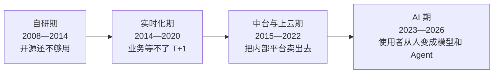
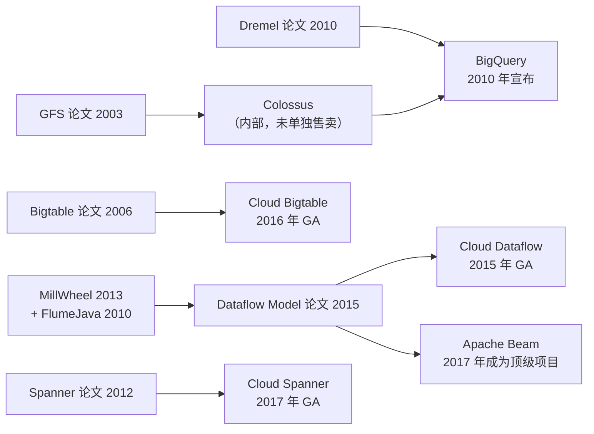
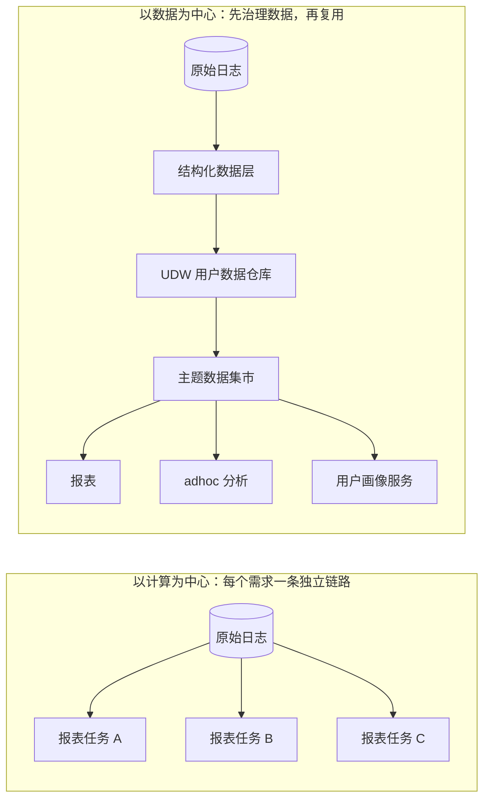
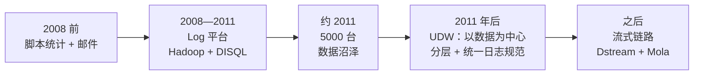
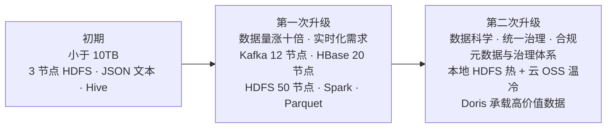

# 大厂数据平台与实践案例：业务塑造平台，平台塑造产品

Last updated: 2026-10-21

2026 年打开几家云厂商的官网，"大数据"栏目下的主角各不相同：阿里云是 MaxCompute、DataWorks 和 Hologres；火山引擎是 DataFinder、DataTester 和 Data Agent；腾讯云是 TCHouse 和 WeData；百度智能云的首屏几乎只剩文心、千帆和昆仑芯。

它们的底层技术大同小异：都用过 Hadoop，都在用 Flink、列存和湖仓。**为什么对外卖的东西差这么多？**

本文的回答是一句话：**每家公司的数据平台，都是被它的核心业务逼出来的。** 业务决定了平台最先解决什么问题；平台的形状决定了它上云之后能卖什么、卖给谁；到了 AI 时代，数据平台的使用者从"看报表的人"变成了"调用数据的模型和 Agent"，几家公司又按各自的家底押了不同的注。

前四篇讲机制，这一篇讲机制落在真实企业里的样子。上半部分横向比较五家大厂，下半部分是六个完整的企业案例，每个案例都标明它印证的是前面哪一篇的机制。

## 这篇文章怎么读

**核心问题**：中国几家大厂的数据平台各自是怎么长成今天的样子的？2026 年它们的核心差异在哪里，AI 时代又在往哪里走？

**前置知识**：最好先读完前四篇：[[数据库基础与大数据演进]]、[[数据系统的构成]]、[[数据治理]]、[[数据平台运维]]。本文会频繁用到其中的概念（数据沼泽、湖仓一体、Lambda 架构、指标口径、私有化部署），不再重新解释。

**读完之后你应该能**：

- 用"被什么业务逼出来"解释阿里、字节、腾讯、百度、华为的数据平台为什么形状不同
- 说出 2008—2026 年国内数据平台经历的四个阶段，以及每个阶段被什么问题推动
- 读懂一条市场份额新闻：它的口径是什么，为什么同一家公司在不同报告里排名完全不同
- 判断一个开源数据项目的治理结构，以及它对你的选型意味着什么
- 说清 AI 时代"数据平台"的含义在哪三个方面发生了变化

**关于数据的说明**：市场数字和产品状态截至 2026 年 10 月。来源分三类，正文里会标出：**官方**（财报、官方公告、Apache 基金会公告、厂商文档）、**媒体**（媒体报道或转引的第三方报告）、**厂商宣称**（厂商自己公布的性能和规模数字，没有第三方复核）。几家公司"基因"的判断是本文的分析，不是任何一方的结论。

---

# 上篇：五家大厂的数据平台

## 一、一张表看清五家

| | 阿里巴巴 / 阿里云 | 字节跳动 / 火山引擎 | 腾讯 / 腾讯云 | 百度 / 百度智能云 | 华为 / 华为云 |
|---|---|---|---|---|---|
| **逼出平台的业务** | 电商交易、双 11 大促 | 内容推荐、A/B 实验、广告 | 社交、游戏、广告 | 搜索、广告（凤巢） | 运营商和政企客户 |
| **第一个被逼出来的问题** | 交易数据在 Oracle 和小型机上太贵，大促峰值撑不住 | 每个产品决策都要实验，海量行为日志要能秒级查询 | 海量日志的实时接入和特征计算 | 用户日志统计和广告报表的时效 | 运营商级的数据规模，加上自主可控 |
| **代表性内部系统** | 飞天、ODPS、Blink | 超大规模 ClickHouse、Libra、TEA、风神 | TDW、TDBank、Gaia、Oceanus | Log 平台、UDW、Palo、Dstream | FusionInsight（本身就是为客户造的） |
| **留给社区的遗产** | Flink（Blink 合并）、Paimon、Celeborn、Fluss、RocketMQ | BitSail、ByConity（2026 年已归档）、对 Lance 的贡献 | InLong、OpenTenBase | Doris，以及从它分叉出的 StarRocks | openGauss |
| **2026 年对外主打** | MaxCompute、DataWorks、Hologres、实时计算 Flink 版、OpenLake | DataFinder、DataTester、ByteHouse、LAS、DataLeap、Data Agent | TCHouse（C/D/P）、WeData、DLC、流计算 Oceanus | Palo、BMR、Sugar BI 仍在售，但已退出叙事中心 | FusionInsight / MRS、GaussDB(DWS)、DataArts Studio |
| **AI 时代的押注** | 全栈：芯片、算力、通义千问、多模态湖仓 | 大模型调用（豆包）+ 面向 Agent 的数据湖 | Data + AI 湖仓 + 智能体开发平台 | 文心、千帆、昆仑芯 | 昇腾 + AI 数据湖 + 可信数据空间 |

前四家有一个共同点：**平台先自用，后外卖**。内部业务是第一个、也是最苛刻的客户，平台在内部被压到极限之后，再包装成云产品。华为是另一条路：它没有一个巨大的内部数据业务，FusionInsight 从一开始就是为运营商和政企客户造的，所以它的形状由客户的约束决定：私有化部署、软硬件一体、国产化。下篇的第二个案例会讲到，独立数据厂商走的也是这条路。

---

## 二、四个阶段：每一次都是被什么逼出来的



四个阶段有重叠，因为不同公司走到同一步的时间不同。下面每个阶段先讲推动它的问题，再看几家公司各自怎么回答。

### 1. 自研期（2008—2014）：开源还不够用，只能自己造

Google 的三篇论文发表于 2003—2006 年，Hadoop 在 2006 年诞生（见 [[数据库基础与大数据演进]]）。2008 年前后，国内几家公司的数据量先后撞上了单机和商业数据库的天花板，而当时的 Hadoop 还很粗糙。每家公司都要回答同一个问题：**用 Hadoop 改，还是自己造？**

- **百度**：约 2007—2008 年开始大规模用 Hadoop，把散落在各业务线的日志汇总到统一的 Log 平台。三年后它变成了一个"数据沼泽"，这段经历是下篇的第一个案例。
- **阿里**：选择了自己造。2008 年王坚加入阿里后推动"去 IOE"（去掉 IBM 小型机、Oracle 数据库和 EMC 存储），2009 年开始写飞天操作系统的第一行代码（媒体）。2013 年 5 月，支付宝最后一台 IBM 小型机下线（媒体）；同年 8 月，飞天单集群达到 5000 台规模（"5K"），这个目标数字对标的是 Google 当时的单集群上限（媒体）。
- **腾讯**：2009 年起以 Hadoop/Hive 为基础建设 TDW（腾讯分布式数据仓库），并兼容 Oracle 的 SQL 语法以降低业务迁移成本；到 2014 年，集群从不足百台增长到约 8800 台，配套的资源调度系统 Gaia 支持离线和在线混合部署（媒体，InfoQ 对腾讯团队的报道）。
- **字节**：2012 年才成立。起步晚反而成了优势：它不需要自己造一个 Hadoop，而是直接站在成熟的开源组件上，再把它们推到极限规模。

自研的代价在阿里体现得最清楚：内部同时存在基于 Hadoop 的"云梯"和自研的 ODPS 两套平台。2013 年起的"登月计划"花了大约一年半，把支付宝等核心业务的数仓从 Hadoop 迁到 ODPS（媒体）。两套平台并存的成本，最终只能用一次全公司的迁移来偿还。这和 [[数据系统的构成]] 里"存储一旦落地，迁移代价随时间增长"是同一个道理，只是放大到了整个集团。

**这一阶段的规律：起步时间决定路线。** 起步早的只能自研（阿里）或深度改造 Hadoop（百度、腾讯）；起步晚的（字节）直接用开源，把精力花在规模和场景上。

### 2. 实时化期（2014—2020）：业务等不了 T+1

批处理解决了"算得动"，但推荐、广告和大促都需要秒级甚至毫秒级的数据。几家公司的实时化动力各不相同，押注的引擎也不同：

| 公司 | 实时化的压力从哪来 | 押注 | 规模数字 |
|---|---|---|---|
| 阿里 | 双 11：一年一次的极端峰值 | 内部改造 Flink 为 Blink；2019 年收购 Flink 的商业公司 data Artisans（后更名 Ververica，媒体报道金额约 9000 万欧元），并把 Blink 合并回 Flink 社区 | 2020 年双 11 实时计算峰值每秒 40 亿条（厂商宣称）；此后阿里不再高调公布这一数字 |
| 字节 | 推荐和 A/B 实验：每天每分钟的持续压力 | 把 ClickHouse 改造到上万节点；Flink 作为流计算主力 | ClickHouse 超过 18000 个节点、700PB 数据；A/B 平台 Libra 在 2013—2023 年间累计运行约 240 万次实验（均为厂商宣称） |
| 腾讯 | 社交和游戏的海量日志，广告的实时特征 | 自研 TDBank 做秒级数据接入；2018 年基于 Flink 建设 Oceanus；消息中间件 TubeMQ 后来演进为 Apache InLong | Oceanus 日均处理约 20 万亿条消息（厂商宣称） |
| 百度 | 广告报表和实时点击率预估 | 自研 Dstream、TM 做流计算，Palo 做广告报表的交互式分析 | — |

最值得注意的是阿里和字节的对比。阿里面对的是**一年一次、可以提前几个月准备的极端峰值**，所以它投资于引擎本身，买下了 Flink 背后的公司；字节面对的是**每天都在发生的实验和分析需求**，所以它投资于查询速度和自助分析，把 ClickHouse 用到了别人没用过的规模。两种压力分别塑造了两家公司对外最强的产品：阿里的实时计算 Flink 版，字节的 DataFinder 和 DataTester。

Lambda 架构在这一阶段几乎是标配（机制见 [[数据系统的构成]]），批和流"两套代码、两个数字"的代价，也是在这几年被各家反复撞上的。

### 3. 中台与上云期（2015—2022）：把内部平台卖出去

内部平台成熟之后，下一个问题是：**能不能卖出去？** 这一阶段有两条交织的线。

**第一条线是"中台"。** 2015 年 12 月，阿里提出"大中台、小前台"（媒体），把数据和业务能力沉淀成共享的中台，让前台业务快速试错。2018 年前后，阿里开始对外输出数据中台，2019—2020 年"中台"成为行业热词。但随后出现反转：2020 年底起阿里内部开始让中台"变薄"；2021 年 12 月成立瓴羊，把数据中台等能力独立对外经营；2023 年 5 月，据晚点 LatePost 报道，运行了八年的阿里中台被彻底分拆（媒体）。

中台的起落说明了一件事：**组织结构不能被当作产品卖。** 数据中台的软件可以卖，但它背后的前提，即一个集团有几十个前台业务、需要共享同一套用户和商品数据，大多数客户并不具备。买了中台软件、却没有对应的组织和治理（见 [[数据治理]]），中台就会变成一个昂贵的数据湖。

**第二条线是云产品化。** 内部系统改个名，就成了云产品：

| 公司 | 内部系统 → 云产品 |
|---|---|
| 阿里 | ODPS → MaxCompute（2016）；内部的数据开发平台 → DataWorks；OneData 方法论 → Dataphin；Hologres（2020 年商业化） |
| 字节 | 火山引擎 2020 年 6 月上线：TEA → DataFinder，Libra → DataTester，风神 → DataWind，内部 ClickHouse → ByteHouse（2021） |
| 腾讯 | 2018 年 9 月成立云与智慧产业事业群（CSIG）；WeData（2020）；TCHouse 系列（2023 年统一品牌，C/D/P 分别基于 ClickHouse、Doris 和 PostgreSQL 内核） |
| 百度 | Palo 2017 年开源，2018 年进入 Apache 孵化器，2022 年 6 月成为 Apache 顶级项目 Doris |
| 华为 | FusionInsight（约 2013 年起）、GaussDB(DWS)、2020 年 6 月开源 openGauss |

产品化并不总是顺利。腾讯云在 2020—2022 年连续三年毛利率为负（券商测算，媒体转引），2022 年起转向"聚焦自研、被集成"：减少总包和集成类项目，让合作伙伴去做交付。阿里云在 2023 年 11 月提出"AI 驱动、公共云优先"，主动收缩专有云定制项目和硬件集成订单（媒体）。两家殊途同归：**项目制的私有化交付在中国市场需求很大，但利润很薄。** 这个矛盾在下篇的独立厂商案例里看得更清楚。

### 4. AI 期（2023—2026）：使用者从人变成模型和 Agent

2023 年起，大模型改变了"数据平台为谁服务"这个问题。以前，数据平台的终点是一张报表、一个看板，使用者是分析师和运营；现在，越来越多的数据被模型训练、被 RAG 检索、被 Agent 直接查询。几家公司的动作：

- **字节 / 火山引擎**：2023 年 4 月提出"数据飞轮"，明确对标"数据中台"：中台偏重存储和治理，容易变成成本中心；飞轮强调用数据反哺业务（媒体）。2024 年 12 月提出"多模态数据湖"；2025 年推出企业级 Data Agent；2026 年 6 月提出面向 Agent 的"Agent DataLake"（媒体）。底层上，火山引擎有工程师成为开源多模态格式 Lance 的维护者（LanceDB 官方博客）。另一边，豆包大模型 2024 年 5 月发起降价，此后调用量快速增长；按 IDC 的统计，2025 年火山引擎占中国公有云大模型调用量的 49.5%（媒体转引）。
- **阿里**：2025 年 2 月宣布未来三年投入超过 3800 亿元建设云和 AI 基础设施（官方，财报电话会）。数据平台层面：MaxCompute 的 MaxFrame 可以直接在表上批量调用通义千问等模型做抽取和翻译（厂商文档）；2025 年 9 月云栖大会发布开放湖仓平台 OpenLake，统一管理 Paimon、Iceberg、Lance 等多种格式的目录（厂商文档）；Hologres 4.0 把向量检索和全文检索并入同一个引擎（厂商宣称）。到 2026 年 9 月的云栖大会，叙事重心已经明显移向芯片和算力（媒体）。
- **腾讯**：2023 年 7 月发布向量数据库，9 月开放混元大模型；2024 年 ChatBI 公测，2025 年 5 月发布智能体开发平台，7 月与 Gartner 联合发布 Data+AI 白皮书；2026 年 7 月发布面向 Agent 场景的 AI DLC，把 Spark 和 Ray 放进同一个 Serverless 服务（厂商宣称）。
- **百度**：重心几乎完全转到 AI。2025 财年百度 AI 云基础设施收入约 200 亿元，同比增长 34%（官方，财报）；Palo、BMR、Sugar BI 等大数据产品仍在售，但已不在叙事中心。
- **华为**：2026 年 5 月发布面向训练和推理的多模态智能数据湖（AI DataLake）方案，同时在地方政府层面推进"可信数据空间"（厂商宣称、媒体）。

这些动作背后是三个方向一致的变化，第七节会展开。

---

## 三、产品矩阵：前四篇的机制落在哪些产品上

大厂的产品目录看起来很庞杂，但每一个产品都在回答前四篇里的某几个机制问题。把产品放回七层地图，就能看清哪些是同一件事的不同包装，哪些是真正不同的取舍。

### 1. 先把七层翻译成产品类别

| 层 | 产品类别 | 每个产品都要回答的机制问题 | 机制在哪篇 |
|---|---|---|---|
| 传输 | 消息队列 | 分区与顺序、offset、投递语义、保留与回放 | [[数据系统的构成]] 第四节 |
| 存储 | 对象存储、分布式文件系统 | 存算分离、冷热分层、请求与流量的成本 | [[数据库基础与大数据演进]] 第六代、[[数据系统的构成]] 第五节 |
| 表格式与目录 | 湖仓表格式、元数据目录 | 原子提交、快照、小文件合并、权限 | [[数据系统的构成]] 第七节、[[数据治理]] 第四节 |
| 计算：批 | Spark 类引擎、自研批处理 | shuffle、数据倾斜、可重跑与幂等 | [[数据系统的构成]] 第六节、[[数据治理]] 第三节 |
| 计算：流 | Flink 类引擎 | 事件时间、水位线、状态、检查点、端到端恰好一次 | [[数据系统的构成]] 第六节 |
| 服务：分析 | MPP 数仓、实时 OLAP | 列存、分区分桶、物化视图、并发与资源隔离 | [[数据库基础与大数据演进]]、[[数据系统的构成]] 第五、六节 |
| 服务：在线 | 宽表、OLTP、向量检索 | B+ 树与 LSM、复制与一致性、近似最近邻 | [[数据库基础与大数据演进]] |
| 开发与治理 | 开发 IDE、调度、数据目录、质量、血缘 | 分层、口径、血缘、质量、任务调度与资源调度 | [[数据治理]]、[[数据平台运维]] 第三节 |
| 应用出口 | BI、行为分析、CDP、Data Agent | 指标语义、权限、给人还是给 Agent 用 | [[数据平台]]、[[数据治理]] 第四节 |

### 2. 产品矩阵（2026）

| 层 | 开源内核 | 阿里云 | 火山引擎 | 腾讯云 | 华为云 |
|---|---|---|---|---|---|
| 传输 | Kafka、RocketMQ、Pulsar | 云消息队列 Kafka 版、RocketMQ 版 | BMQ（兼容 Kafka 协议，存算分离）、消息队列 Kafka 版、RocketMQ 版 | CKafka | 分布式消息服务 Kafka 版 |
| 存储 | HDFS、MinIO | OSS；MaxCompute 内部的盘古 | TOS | COS | OBS |
| 表格式与目录 | Iceberg、Paimon、Hudi、Hive Metastore | DLF / OpenLake（Paimon、Iceberg、Lance；托管 Iceberg 表可通过 REST Catalog 访问） | LAS 的统一元数据（支持 Hudi、Iceberg） | DLC（原生表格式为 Iceberg） | DataArts Studio 的数据目录 |
| 计算：批 | Spark、Hive | MaxCompute（自研）、EMR Serverless Spark | LAS（Spark、Presto）、EMR | DLC（Serverless Spark）、EMR | DLI（Serverless Spark）、MRS |
| 计算：流 | Flink | 实时计算 Flink 版（企业引擎 VVR） | 流式计算 Flink 版 | 流计算 Oceanus | DLI 的 Flink 作业、MRS |
| 服务：分析 | Doris、StarRocks、ClickHouse、Trino | Hologres、AnalyticDB（自研）；EMR Serverless StarRocks；云数据库 SelectDB 版（Doris） | ByteHouse（ClickHouse 系，存算分离）；EMR 的 StarRocks、Doris | TCHouse-C（ClickHouse）、TCHouse-D（Doris）、TCHouse-P（PostgreSQL 系 MPP）、TCHouse-X（2024 年发布） | GaussDB(DWS)（MPP）；MRS 的 ClickHouse、Doris；HetuEngine（基于 Presto / Trino 系内核） |
| 服务：在线 | HBase、MySQL / PostgreSQL、Milvus | Lindorm（多模）、PolarDB；Hologres 的向量检索 | VikingDB（向量） | TDSQL、TDSQL-C；向量数据库 | GaussDB；云搜索服务 CSS |
| 开发与治理 | Airflow、DolphinScheduler、OpenLineage | DataWorks、Dataphin | DataLeap | WeData；私有化套件 TBDS | DataArts Studio |
| 应用出口 | Superset 等 | Quick BI；DataWorks 的 Agent 能力 | DataWind、DataFinder、DataTester、VeCDP、Data Agent | 腾讯云 BI、ChatBI | — |

百度智能云对应的产品是 BOS（对象存储）、消息服务 for Kafka、BMR（托管 Hadoop / Spark）、数据仓库 Palo（基于 Doris）和 Sugar BI；它们仍在售，但已不是百度的重心。Google Cloud 和 AWS 的对应产品见本节第 5 小节。

（产品归属和内核以各家 2025—2026 年的官方文档为准；"—"表示没有找到可以单列的对应产品，不代表没有这个能力。）

### 3. 两个维度：内核从哪来，以怎样的方式交付

把矩阵里的产品按两个维度重新排列，比按厂商排列更有用：

| | 集群托管：你选规格，能看到节点 | Serverless：按用量计费，看不到集群 |
|---|---|---|
| **开源原版** | 各家 EMR / MRS、托管 Kafka、TCHouse-D、EMR 里的 StarRocks / Doris | EMR Serverless Spark / StarRocks、腾讯 DLC、华为 DLI |
| **开源分叉或增强** | 阿里实时计算 Flink 版（VVR）、ByteHouse、华为 HetuEngine | 火山 LAS（Spark、Presto 的增强版） |
| **自研内核** | AnalyticDB、Hologres、GaussDB(DWS) 的实例形态 | MaxCompute；Hologres、AnalyticDB 的 Serverless 形态 |

两个维度各自决定不同的事：

- **内核从哪来，决定你的知识能迁移多少、迁出要付什么代价。** 开源原版产品，参数、排障方法、源码全部通用，数据格式和 API 也是开放的，迁出最容易。开源分叉保留了大部分概念，但增强特性用得越多，越难迁走。自研内核实现的仍然是同一组机制（列存、MPP、存算分离），但参数和排障方法要重新学，数据格式往往是专有的，迁出就是一次导出和重建。
- **交付方式决定成本模型和你能调什么。** 集群托管按节点或实例计费，资源隔离和扩缩容要你自己设计（[[数据平台运维]] 第三节）；Serverless 按扫描量或计算单元计费，省掉了容量规划，但你看不到、也调不了集群，成本会直接随使用方式波动，一个没加分区条件的查询就能产生一笔可观的账单。

从数据工程师的角度看，这张表还有一个推论：**同一家云里，选左上角的产品，你学到的是可以带走的能力；选右下角的产品，你得到的是省心，代价是能力和数据都更难带走。** 两者没有对错，取决于团队规模和阶段（[[数据工程师的成长地图]] 第三节）。

### 4. 拆解一个产品的六个问题

面对任何一个陌生的数据产品，问六个问题就能把它放回机制地图：

| 问题 | 要找的答案 | 对应的机制 |
|---|---|---|
| 1. 数据存在哪里、用什么格式？ | 本地盘还是对象存储；开放格式还是专有格式 | 存储引擎、存算分离、可迁移性 |
| 2. 元数据和目录在哪里？ | 谁记录"有哪些表、每张表现在是哪个版本"；其他引擎能不能读 | 表格式、目录、权限 |
| 3. 计算内核是什么？ | 开源原版、分叉还是自研；MPP、DAG 还是树形执行 | 计算模型、存算一体还是分离 |
| 4. 写入和一致性语义是什么？ | 追加、覆盖还是主键更新；快照隔离；端到端恰好一次需要什么 | 幂等、事务、投递语义 |
| 5. 时延和并发在哪个档位？ | 分钟级批处理、秒级交互，还是毫秒级在线服务 | 响应速度的三个层次 |
| 6. 按什么计费？ | 节点·小时、计算单元·小时、扫描字节、存储、请求次数 | 总拥有成本 |

用这六个问题拆解几个典型产品：

| 产品 | 存储与格式 | 目录 | 内核 | 写入语义 | 档位 | 计费 | 一句话定位 |
|---|---|---|---|---|---|---|---|
| **阿里 MaxCompute** | 盘古上的 AliORC（基于 ORC 的列存） | 自身的项目和表元数据；托管 Iceberg 表可通过 REST Catalog 访问 | 自研批处理，另有 MaxQA 查询加速 | 以分区覆盖写为主 | 分钟级批处理，加速后可到秒级 | 按量（SQL 按扫描量与复杂度）或包年计算单元 | 自研内核的 Serverless 批处理数仓，思路和 Google BigQuery 同类 |
| **阿里 Hologres** | 盘古上的行存、列存或行列共存 | 兼容 PostgreSQL 的元数据 | 自研，HSAP：同一引擎同时服务点查和分析 | 支持主键更新，Flink 写入后即可查询 | 毫秒级点查 + 秒级分析 | 按实例计算单元，或 Serverless | 把在线服务和分析两个档位合进一个引擎；代价是两类负载的资源隔离 |
| **火山 ByteHouse** | 对象存储或 HDFS 上的 ClickHouse 系列存 | 元数据放在 FoundationDB（ByConity 架构） | ClickHouse 的向量化执行 + 可独立扩缩的虚拟仓库 | 继承 ClickHouse，以追加写入为主 | 亚秒到秒级交互 | 按计算组（虚拟仓库）规格 | 把存算一体的 ClickHouse 改造成存算分离 |
| **腾讯 DLC** | COS 上的 Iceberg | Iceberg 元数据 + DLC 目录 | Serverless Spark（Presto 引擎已不对新用户开放） | Iceberg 快照隔离 | 分钟级批处理与交互查询 | 按计算单元 | 开放格式之上的 Serverless 计算，迁出成本低 |

这张表最有用的不是每一格的答案，而是**哪一格最难回答**：答不上来的那一项，往往就是锁定或风险所在。比如一个产品说不清"其他引擎能不能读我的表"，就说明第 2 个问题背后是专有目录；说不清"一次查询大概多少钱"，就说明第 6 个问题会在月底给你惊喜。

### 5. 和 Google、AWS 简单对比

国外的两家大厂，正好代表了与国内云不同的两种思路。

**Google：论文先行，收敛成少数几个深度服务。** Google 先在内部解决自己的规模问题，发表论文，几年后把系统产品化：



BigQuery 是这条路线的代表：数据以 Capacitor 列式格式存在 Colossus 上，计算按 Dremel 的树形结构执行，从设计之初就是存算分离的 Serverless 服务，用户看不到集群（官方，Google Cloud 博客）。阿里的 MaxCompute 是国内最接近的同类：都是自研内核、都是 Serverless 批处理数仓、都把存储放在自家的分布式文件系统上。

**AWS：给原语，让客户自己拼。** AWS 把存储、计算、目录、编排拆成大量独立计价的服务：S3（2006）、EMR（2009）、Redshift（2012 年宣布，基于获得授权的 ParAccel 技术）、Kinesis（2013）、Athena（2016，基于 Presto，第三版引擎改为 Trino）、Glue 和它的数据目录（2017 年 GA，兼容 Hive Metastore）、Lake Formation（2019）、MSK（托管 Kafka，2019）。客户按需组合，代价是选型和集成的工作量落在客户身上。AWS 的零售业务也是这些服务的用户：2019 年 10 月，亚马逊消费者业务关掉了最后一个 Oracle 数据库，把约 75PB 数据迁到了 DynamoDB、Aurora、Redshift 等自家服务上（官方，AWS 博客）。这和阿里的"去 IOE"是同一类事件：平台方先在自己最核心的业务上替换掉商业数据库，再把替换的能力卖给客户。

**2024—2026 年，两家都在往同一个方向收敛：**

| 方向 | Google Cloud | AWS | 国内对应 |
|---|---|---|---|
| 开放表格式成为底座 | BigLake 支持 Iceberg REST Catalog（2025 年 10 月 GA）；2026 年 4 月 BigLake 更名为 Lakehouse | S3 Tables：对象存储里的托管 Iceberg 表（2024 年 12 月发布） | 阿里 DLF / OpenLake、腾讯 DLC 的 Iceberg |
| 目录变成"给 Agent 的上下文" | Dataplex Universal Catalog 于 2026 年 4 月更名为 Knowledge Catalog | SageMaker Unified Studio（2025 年 3 月 GA）统一数据与 AI 的开发入口 | DataWorks、DataLeap、WeData 的 Agent 能力 |
| 向量进入存储层 | BigQuery 向量检索（2024 年 9 月 GA）；AlloyDB 的 ScaNN 索引 | S3 Vectors（2025 年 12 月 GA） | Hologres、VikingDB、腾讯云向量数据库 |
| 数据 Agent | Next '25（2025 年 4 月）发布数据工程、数据科学和对话式分析 Agent | re:Invent 2025 在 SageMaker 里集成数据 Agent | 火山 Data Agent、腾讯 ChatBI、阿里 DataWorks Agent |
| 产品名回到开源名 | 2026 年 4 月 Dataproc 更名为 Managed Service for Apache Spark | — | — |

（日期以 Google Cloud 和 AWS 的官方发布记录为准；re:Invent 2025 的数据 Agent 一项来自媒体对大会的综述。）

**和国内云的三点结构差异：**

| | Google Cloud / AWS | 国内云 |
|---|---|---|
| **产品形态** | 少数深度服务（Google）或大量原语（AWS），客户自己组合 | 倾向"一站式"平台：DataWorks、DataArts Studio、WeData 把集成、开发、调度、治理、BI 打包在一起 |
| **部署方式** | 以公有云为主，私有化部署很少 | 专有云、私有化套件（TBDS、FusionInsight、阿里云专有云）是主要收入来源之一 |
| **开源关系** | AWS 既有自研内核（Redshift、DynamoDB、Aurora），也大量托管开源（EMR、MSK，Athena 的 Trino 引擎）；Google 主要输出编程模型和标准（Beam、Kubernetes） | 既托管开源，也向 Apache 捐赠大量内核（Doris、Paimon、InLong、Fluss）；信创让国产开源内核成为选型清单的常客 |

作为体量参照：按 Synergy Research 的统计，2026 年第二季度全球云基础设施市场中，AWS 占 28%、Microsoft 占 20%、Google 占 15%（Synergy 发布）。

对数据工程师来说，这一节最实用的结论是：**国内外的产品名完全不同，内核和机制却高度重合。** Iceberg、Spark、Flink、Kafka、Trino 在两边都是主角；会拆解一个 BigQuery，就会拆解 MaxCompute；会配 MSK，就会配 CKafka。

---

## 四、核心差异：五个维度

| 维度 | 阿里 | 字节 | 腾讯 | 百度 | 华为 |
|---|---|---|---|---|---|
| **内核路线** | 自研内核 + 主导开源上游（Flink 生态） | 把开源组件推到极限规模，再分叉自研（ByteHouse、ByConity） | 开源为主，同一产品线并存多个内核 | 自研后开源，主导权逐步外溢 | 软硬件协同、国产化 |
| **对外模式** | 公共云优先、一体化平台 | 场景化的 SaaS + PaaS（增长、实验、CDP）| 被集成，依靠合作伙伴交付 | AI 云优先 | 私有化、混合云、信创 |
| **最强的场景** | 大规模离线数仓、流批一体、零售和电商 | 用户增长、A/B 实验、行为分析 | 游戏、内容、社交类的实时数据 | 超大规模 OLAP（经由 Doris 生态） | 运营商、政务、国企的私有化部署 |
| **相对弱的地方** | 非结构化多模态数据处理补课较晚 | 金融级事务、传统行业的交付经验 | 企业级数据治理产品起步较晚 | 大数据产品线的投入和叙事 | 互联网级的实时推荐场景 |
| **AI 押注的重心** | 全栈自有：芯片到模型到湖仓 | 模型调用量，以及服务 Agent 的数据湖 | 智能体平台 + 湖仓 | 模型和芯片 | 算力和可信数据空间 |

表里"强"和"弱"是本文的判断，依据是各家的业务来源和公开的产品演进，不是测评结论。读这张表最重要的不是记住格子，而是两条贯穿的线索：

**线索一：有没有一个大的内部业务在"吃自己的狗粮"。** 阿里、字节、腾讯、百度都有，所以它们的平台在规模上被反复验证过，但也带着内部业务的偏好：字节的产品天然懂增长团队，不一定懂银行。华为和独立厂商没有这样的内部业务，它们的平台由客户的约束塑造，所以更擅长私有化、更适应信创，但很少有机会在自己身上验证超大规模。

**线索二：谁拥有内核。** 内核是自研闭源的（MaxCompute），迁出的代价最高；是开源项目且由基金会治理的（Flink、Doris、Paimon），可以在多家云之间迁移；是单一公司主导的开源分叉（ByConity），寿命取决于这家公司是否继续投入。对使用者来说，**开放的表格式和中立的开源内核是降低锁定的主要手段**，这与 [[数据平台运维]] 里"保持可迁移性本身就是议价筹码"是同一件事。

---

## 五、2026 年的格局：先读口径，再读排名

几乎每家云厂商都能找到一份自己"排名第一"的报告。原因不是有人造假，而是**口径不同**。下表把同一时期的几组数字放在一起：

| 统计口径 | 来源与时间 | 结果 |
|---|---|---|
| 中国云基础设施服务（IaaS + PaaS，按收入） | Omdia，2025 年第二季度（官方） | 阿里云 34%、华为云 17%、腾讯云 10%；火山引擎、百度智能云未单列 |
| 中国大数据平台，整体市场（含私有化） | IDC《中国大数据平台市场份额，2025》，经阿里云官网转引 | 阿里云 23.5%，第一；2023 年版的第一是华为（24.7%），阿里云 19.5%（媒体转引） |
| 中国大数据平台，公有云部分 | 同上 | 阿里云 48.7%，超过第二到第四名之和；2023 年版为阿里云 40.2%、腾讯云 14.4%（媒体转引） |
| 中国 AI 云（按收入） | Omdia，2025 年上半年（媒体转引） | 阿里云 35.8%、火山引擎 14.8%、华为云 13.1%、腾讯云 7.0%、百度智能云 6.1% |
| 中国公有云大模型调用量（按 token） | IDC，2025 全年（媒体转引） | 火山引擎 49.5%，阿里云、百度智能云次之；不含字节自有业务的调用 |

同一个火山引擎，按大模型调用量是第一，按 AI 云收入只有 14.8%：前者衡量"谁的模型被调用得最多"，后者衡量"谁从 AI 云上赚的钱最多"，降价能推高前者，却不一定推高后者。同样，华为在含私有化的大数据平台市场长期领先，阿里在公有云部分遥遥领先，因为**私有化和公有云几乎是两个市场**。

读一条份额新闻时，先找四件事：

1. **衡量的是什么**：收入、调用量还是节点数？
2. **范围是什么**：公有云、私有化还是整体？IaaS 还是包含 PaaS？
3. **时间段**：某个季度、半年还是全年？
4. **是否包含厂商自用**：大厂自己的业务算不算进去？

作为参照，全球市场的两家独立数据平台公司：Databricks 在 2026 年 2 月宣布年化收入超过 54 亿美元，同比增长 65%（官方）；Snowflake 截至 2026 年 1 月的财年产品收入为 44.7 亿美元，同比增长 29%（官方，SEC 文件）。国内没有体量相当的独立数据平台公司：数据平台大多作为云的一部分打包出售，这是中美市场结构最大的差别之一。

---

## 六、开源遗产：谁把内核留给了社区

| 项目 | 起源 | 现状 |
|---|---|---|
| Apache Doris | 百度 Palo（2008 年起用于广告报表） | 2022 年 6 月成为 Apache 顶级项目；社区主要由 Doris 核心团队 2022 年创立的飞轮科技（SelectDB）推动 |
| StarRocks | 2020 年从 Doris 分叉 | 2022 年改用 Apache 2.0 许可，2023 年 2 月捐给 Linux 基金会；商业公司为 CelerData 和镜舟科技 |
| Apache InLong | 腾讯 TubeMQ（2013） | 2022 年 6 月成为顶级项目 |
| Apache RocketMQ | 阿里 | 2017 年成为顶级项目 |
| Apache Paimon | 阿里，前身是 Flink Table Store | 2024 年 4 月成为顶级项目 |
| Apache Celeborn | 阿里 EMR 的远程 Shuffle 服务 | 2024 年 4 月成为顶级项目 |
| Apache Fluss | 阿里，面向湖仓的流式存储 | 2026 年 8 月成为顶级项目 |
| Apache Kylin | eBay 中国研发中心 | 2015 年成为顶级项目 |
| Apache Kyuubi | 网易 | 2022 年成为顶级项目 |
| Apache Linkis | 微众银行 | 2023 年成为顶级项目 |
| Apache ShardingSphere | 当当网 | 2020 年成为顶级项目 |
| Apache DolphinScheduler、SeaTunnel、StreamPark | 国内开发者社区 | 分别于 2021、2023、2025 年成为顶级项目 |
| ByConity | 字节，ClickHouse 的分叉 | 2023 年开源；2026 年 6 月进入退役过渡期，8 月仓库归档为只读 |
| OpenTenBase | 腾讯 TBase | 2023 年 12 月捐给开放原子开源基金会 |
| openGauss | 华为，内核源自 PostgreSQL | 2020 年 6 月开源，属开放原子开源基金会生态 |

（Apache 项目的毕业时间以 Apache 软件基金会公告为准；ByConity 的状态以其 GitHub 仓库公告为准。）

这张表里有三种不同的命运：

- **百度：技术主导权外溢。** Doris 的演进现在主要由 Doris 核心团队创立的飞轮科技推动，从它分叉的 StarRocks 由另外的商业公司主导；另一批 UDW 团队成员创立了行为分析公司神策数据。百度智能云仍然售卖 Palo，但大数据已经不在它的叙事中心。可以说，**百度的大数据遗产更多活在开源社区和前员工的创业公司里**。
- **阿里：经营开源上游。** 从 Flink 到 Paimon、Fluss、Celeborn，阿里在"流式湖仓"这条技术线上把关键组件都放进了 Apache 基金会。好处是这些组件成为行业标准，阿里云的托管服务是它们最自然的运行环境。
- **字节：分叉的寿命取决于母公司。** ByConity 是因为改动太大、无法合并回 ClickHouse 社区才独立开源的（媒体）；三年后进入归档。这对使用者是一个提醒：**选择开源项目时，要看它的治理结构**。基金会项目有多家公司参与，单一公司主导的项目，风险集中在那一家公司的战略上。

---

## 七、AI 时代：数据平台在变成什么

把第二节第 4 小节里各家的动作放在一起，可以看到三个方向一致的变化。

### 1. 使用者：从人变成模型和 Agent

[[数据平台]] 把数据系统的出口分成三类：给人用的产品界面、给系统用的 OpenAPI、给 Agent 用的 MCP 协议。2023 年以前，第一类是主角；2025—2026 年，几乎每家都推出了"Data Agent"或"智能问数"：火山引擎的 Data Agent、阿里云 DataWorks 的 Agent 能力、腾讯云的 ChatBI、百度 Sugar BI 的智能问数；国外有 Databricks 的 Genie 和 Snowflake Intelligence。

这一变化对数据工程师最重要的含义是：**AI 没有让治理过时，反而让它从"最好有"变成"必须有"。** 分析师看到两个"日活"会去问人，Agent 不会问，它会随便挑一个。指标语义、口径卡片、血缘和质量标记（见 [[数据治理]]）是 Agent 能正确回答问题的前提。按媒体的分析，Databricks 和 Snowflake 在 2026 年竞争的焦点，也已经上移到语义和上下文层。

### 2. 数据形态：从表扩展到多模态

以前，非结构化数据（图片、音频、用户评论原文）进了数据湖就很少被分析，因为没有引擎能直接理解它们。大模型让它们第一次变得"可分析"。于是各家都在湖仓的目录层加入非结构化数据：阿里的 OpenLake 同时管理 Paimon、Iceberg、Lance 和对象存储目录；火山引擎的 LAS 支持 Lance 格式；华为提出多模态智能数据湖。

机制上，这是 [[数据系统的构成]] 里湖仓一体的自然延伸：表格式负责事务和版本，目录负责"这里有什么、谁能读"；只是目录里的对象从 Parquet 文件扩展到了图片、视频和向量。Lance 这类格式解决的是 Parquet 不擅长的问题：随机读取单行、存储大的二进制对象和向量索引。

全球的开放表格式竞争在 2024 年基本有了结果：Databricks 收购 Iceberg 创始团队的公司 Tabular，Snowflake 推出并捐赠 Iceberg 目录 Polaris，Iceberg 成为事实标准。国内则是 Paimon 和 Iceberg 并存。

### 3. 计算：从 SQL 扩展到模型推理

ETL 里开始出现一种新的"函数"：调用大模型。MaxCompute 的 MaxFrame 可以在一张表上批量调用模型做抽取和翻译；腾讯的 AI DLC 把 Spark 和 Ray 放进同一个服务；MaxCompute 也开始提供 GPU 规格。

这带来两个工程问题：

- **成本模型变了**：一次 ETL 的成本不再只是 CPU 时间，还包括 token 和 GPU 时间，按行调用模型的作业可能比整条传统链路还贵；
- **模型版本成为数据的一部分**：同一段评论，换一个模型版本抽取出的情感标签可能不同。所以 AI 提取的字段要记录模型版本和处理时间，模型升级后才能有选择地重算（见 [[数据治理]] 第二节"模型会演进"）。

### 4. 三个值得观察的变量

这里不做预测，只列出三个会决定未来几年格局、而现在还没有答案的变量：

- **开放表格式能否成为国内的默认选项。** 如果 Paimon、Iceberg 成为各家云的通用底座，迁移成本会下降，竞争会转向引擎和服务；如果各家继续以专有格式为主，锁定会延续到 AI 时代。
- **信创和私有化会把多少 AI 数据需求留在客户自己的机房里。** 金融、政务、国企的数据平台大多是私有化部署，AI 时代这部分需求需要的是能私有化的模型、向量库和数据湖，而不是公有云 API。
- **数据平台会不会被当作"卖模型的入口"打包。** 大模型价格战之后，云厂商有动力用数据平台带动模型调用。数据平台是独立定价，还是成为模型调用的附属品，会影响独立数据厂商的生存空间。

---

## 八、从格局到个人：这一篇对数据工程师意味着什么

把上面七节压缩成对个人有用的三条判断：

**一、看厂商，先问它是被什么业务逼出来的。** 一个平台在和它"母业务"相似的场景里最可靠：零售大促之于阿里，增长实验之于字节，游戏和社交日志之于腾讯，私有化政企之于华为。你的业务像谁，谁的默认设计就更贴近你；不像的地方，就是你要自己补课的地方。

**二、产品是机制的组合，学机制，按需学产品。** 第三节的矩阵说明，各家产品名完全不同，内核却高度重合；第三节第 5 小节说明，国外也是同一批内核。把 Spark、Flink、Kafka、Iceberg / Paimon、一个实时 OLAP 引擎的机制学透，换一家云时要重新学的，主要是控制台、计费和托管版特有的限制。

**三、叙事会轮换，四个问题不变。** 数据中台、数据飞轮、Data Agent，每一轮叙事都在重新包装同一组问题：数据有没有 Owner，口径是否统一，质量是否可信，成本是否可控。AI 没有回答这四个问题，反而让答不上来的代价更大。

具体学什么、按场景用什么、怎样把每年几百条厂商公告变成自己的判断，以及一条 12 个月的路线，见下一篇 [[数据工程师的成长地图]]。

---

# 下篇：实践案例

下面六个案例大多来自曹犟《大数据应用实战》课程中的一线经历。案例里的数字是当事人的经验数据，不是行业统计。

| 案例 | 主角 | 印证的机制 | 机制所在的文章 |
|---|---|---|---|
| 一 | 百度：从 Log 平台到 UDW（2008—2015） | 数据沼泽、以数据为中心、分层、Transform 前置、Lambda | [[数据系统的构成]]、[[数据治理]] |
| 二 | 神策数据：一家独立厂商的十年 | 接入、存储迁移、计算选型、模型演进、湖仓、部署、质量产品化、安全合规 | 全部四篇 |
| 三 | 一家中型互联网公司：十年三次存储升级 | 存储的不可能三角、小文件、Lambda | [[数据系统的构成]] |
| 四 | 一家股份制银行：分层分级的资源调度 | 资源池、借用、分时规则 | [[数据平台运维]] |
| 五 | 一家互联网公司：僵尸资产清理 | 访问日志 + 血缘识别、渐进式清理 | [[数据平台运维]] |
| 六 | 一家海外娱乐公司：CDP 的血缘体系 | 血缘采集、影响分析 | [[数据治理]] |

## 案例一：百度，从 Log 平台到 UDW（2008—2015）

百度是国内最早一批落地 Hadoop 的公司。它的数据平台在几年里经历了几次重构，每一次都是因为上一种组织方式在更大规模下失效了。

### 1. 起点：脚本与邮件（2008 年以前）

当时百度各业务线的日志分散存放在前端服务器上。运维把日志统一下载到一台集中的日志服务器，用大量脚本做统计，再把结果用邮件发给关注数据的人。用户规模小时，这个方案完全合理：没有多余的抽象，也没有平台要维护。它的代价是开发效率低、难扩展、难维护：每多一个统计需求，就多一个脚本。

### 2. Log 平台：把计算集中起来（2008—2011）

第一次重构把日志统一汇总到 Hadoop，用 MapReduce 任务做统计。为了降低使用门槛，Log 平台把常见统计抽象成算子、提供页面配置，还发明了一种类似 Hive 的计算语言 DISQL。

Log 平台很好用，好用到 2011 年前后覆盖了百度内部所有用户日志的统计报表业务，计算资源从几十台增长到 **5000 台**。曹犟在课程中提到，当时每个季度都要申请约 **30% 的新增硬件**。

### 3. 问题：一个好用的数据湖变成了沼泽

硬件增长的原因并不是日志本身增长了这么多，而是**数据的无序管理让计算量和存储量成倍膨胀**：

- 没有 Schema 控制，同一份数据被不同任务以不同方式解析和存储，重复数据极多；
- 没有数据血缘，没人知道一个中间结果被谁用、能不能和另一个任务合并，于是重复计算也极多；
- 平台只能产出统计报表，不支持交互式的 adhoc 分析；
- 平台团队只能对数据源的质量负责，对中间数据，没人知道它的语义、下游是否还需要。

还有一个直接的业务后果：某部门自己看的报表和给领导看的报表里，"日活跃用户数"因为口径不同相差超过 4%，而这个数字直接影响该部门的绩效评估（[[数据治理]] 开头用它说明为什么需要分层）。

用今天的话说，Log 平台是一个在"数据湖"这个词出现之前就陷入沼泽的数据湖（数据沼泽的症状见 [[数据系统的构成]]）。



左边的问题不在于某个任务写得不好，而在于**数据只是任务的副产品**：没有独立的定义，没有所有者，也无法被复用。

### 4. 重构为 UDW：从以计算为中心到以数据为中心（2011 年后）

重构的核心转变是**从以计算为中心变成以数据为中心**：从 Log 平台中挑出与用户行为相关的数据，从零开始构建和治理。

**分层**。UDW 的分层基本遵循 ODS/DWD/DWS/ADS 四层模型（见 [[数据治理]]），但中间层带着用户行为数据的特点：

| 层 | 内容 | 规模 |
|---|---|---|
| 原始日志层 | 搜索、点击、展现等各产品的原始日志 | 每天百亿级 |
| E-U 模型层 | 原始日志经 Join 和 Union 后，形成统一的 Event 宽表和 User 表 | Event 每天仍是百亿级；User 表因为大量匿名用户，总量在十亿级 |
| 公共指标层 | 日活、月活、留存率等可在各产品线复用的指标 | — |
| 应用层 | 推荐系统特征表、各产品线或主题的报表数据 | 按需 |

E-U 模型层是明细层，却用了宽表建模：在分布式环境里，把行为事件放进一张稀疏宽表，比每次查询都做跨节点 Join 便宜得多（宽表的取舍见 [[数据治理]]）。新应用不能直接访问原始日志，只有上层无法满足时才向下访问。

**Transform 前置到打日志的那一刻**。UDW 要把搜索、贴吧、知道、百科等数十条产品线的日志统一入库。最初是"烟囱式"处理：每条产品线一套 ETL，任何一条产品线改了日志格式，ETL 就会失败。后来的做法是：

1. 用 Protobuf 定义全公司统一的日志 Schema，包含公司级公共字段，也允许各业务扩展；
2. 提供覆盖主流编程语言的统一 Logging SDK，业务研发像打普通日志一样传入结构化数据，由统一的 LogAgent 发到百度自研的、类似 Kafka 的数据总线；
3. 产品线变更日志 Schema 要经过评审。

效果是：Transform 只剩 ID-Mapping 和少量补充；新业务接入分析平台的周期从几周缩短到几天；时效要求高的应用可以直接订阅数据总线，延迟能降到分钟以内。

**没有被治理的数据并没有被丢掉。** 它们仍然留在统一的 HDFS 和统一的计算层上，有统一的调度和基础的血缘管理。高价值数据进入严格治理的仓，其余数据留在湖里，保持低成本、可访问。按今天的说法，这已经是一个初步的湖仓一体方案。

| 维度 | Log 平台 | UDW |
|---|---|---|
| 数据的地位 | 任务的副产品 | 有 Schema、有所有者的一等公民 |
| 质量责任 | 只能对数据源负责 | 数据仓库层和主题层的质量完全掌控 |
| 可支撑的应用 | 统计报表 | BI 分析、用户行为 adhoc 分析、用户画像服务 |
| 计算复用 | 同一份数据被反复解析和统计 | 下游共享同一份治理后的数据 |

### 5. 加入流式链路

UDW 解决了离线数据的组织问题，但广告和个性化推荐需要秒级时效。百度在批处理链路之外增加了一条流式链路：用自研的 Dstream 秒级处理用户日志，用类 Redis 的 KV 引擎 Mola 实时更新用户标签、响应下游几十万 QPS 的点查。批和流两条链路并行，同一指标两套代码，这正是 Lambda 架构的典型形态（见 [[数据系统的构成]]）。



### 6. 三条可迁移的结论

- **从以计算为中心到以数据为中心，是组织方式的转变，不是工具升级。** 把 MapReduce 换成 Spark，解决不了重复数据和口径不一致的问题。
- **数据沼泽是"好用"的副作用。** 任何门槛低的平台，如果没有 Schema、血缘和所有者这三样东西，都会走上同一条路。
- **治理是分级的，不是全有或全无。** UDW 只治理了价值最高的用户行为数据，其余数据留在湖里但保持可访问、可调度、可追溯。

这段经历还有一个后续：UDW 和 Palo 的一些工程师后来离开百度，把这些经验带进了 Doris 的开源社区和神策数据（见上篇第六节）。

---

## 案例二：神策数据，一家独立厂商的十年

神策数据由百度 UDW 团队的桑文锋等人于 2015 年创立，做用户行为分析，按曹犟在课程中的说法，十年里服务了两千多家企业。它在公开市场上的直接竞品之一，是字节内部 TEA 演化出的火山引擎 DataFinder。

把它放进这一章，是因为它代表了与大厂相反的处境：**没有一个母公司业务可以吃自己的狗粮，平台的形状完全由客户的约束决定。** 其中最重要的一条约束是私有化部署。按课程数据，它的客户中只有不到 30% 用 SaaS，约 40% 是部署在公有云上的私有化，约 30% 是物理机或客户自建虚拟化。这已经是国内数字化程度相对领先的客群，而且这个比例在过去几年没有增长，甚至因为信创要求出现了下降。

### 1. 时间线

| 时间 | 决策 | 被什么逼出来 | 对应机制 |
|---|---|---|---|
| 2015 | Nginx 收数 + 自研 LogAgent；Event-User 两张表 | 快速上线 | [[数据系统的构成]] 接入层 |
| 2016 前后 | 存储从商业 OLAP 数据库换成 HDFS + Kudu，查询引擎用 Impala 并做代码级改造 | 更大数据量、行为序列分析 | [[数据系统的构成]] 存储层与计算层 |
| 之后数年 | 引入 Flink；明细层从 Event-User 走向维度表、多实体模型 | 营销自动化、实时 CDP、更复杂的分析 | [[数据治理]] 第二节 |
| 近年 | 基于 Iceberg 从数据仓库重构为湖仓一体 | 接入客户的业务库和第三方数据；分析非结构化文本 | [[数据系统的构成]] 第七节 |
| 现在 | 考虑基于 Doris 和向量数据库重构计算引擎 | 信创、混合部署、社区活跃度、Data Agent | 本章上篇 |

### 2. 接入层：自己造轮子的代价

2015 年，神策用 Nginx 接收公网 SDK 发来的数据、以日志文件落盘，再用自研的 LogAgent 读取日志往后传。这套方案能工作，但逐渐需要补很多功能：进度保存、故障恢复；再加上私有化部署到每个客户的机房，环境千差万别，适配工作量很大。十年后，Fluentd、SeaTunnel 这类开源组件已经解决了这些共性问题。

### 3. 存储迁移：私有化把每次变更乘以客户数

2016 年前后，为了提升可扩展性，神策把存储从某个分布式 OLAP 数据库换成 HDFS + Apache Kudu。因为数据放在每个客户自己的机房里，只能提供"原地升级"：迁移工具开发完成后，所有运维和研发工程师一起动手，一个客户一个客户地操作，花了好几个月。升级要停服务，影响了客户使用，也冲击了客户关系；幸好当时客户数量只有今天的几分之一。

这次迁移代价太大，此后存储架构基本只做小修小补。要考虑面向下一个十年的存储重构时，面临的挑战和成本已经是当年的很多倍。

### 4. 2016 年的计算选型：三个问题

做计算选型要回到三个问题：应用场景期望什么？团队有什么能力？将来怎么演进？

- **场景**：给产品经理、运营和分析师提供交互式探索。响应要秒级；灵活性要在多维分析的基础上支持行为序列等时序分析；很多用户不会写 SQL，门槛要比 SQL 更低；行为数据的模型相对清晰，ETL 逻辑比较简单。
- **团队**：创始团队大多在百度做了多年大数据，有好几位是后来开源的 Doris 原始系统的核心开发者，对 Impala 这类 MPP 引擎有代码级开发经验。
- **技术生态**：2016 年，Doris、ClickHouse 要么还没开源，要么不够成熟；Impala 背靠 Cloudera，社区支持丰富、license 友好。

当年的四个决策：以 Impala 为查询引擎，并做代码级改造（比如扩展时间窗口能力）；在 SQL 之上把常见分析做成可视化配置，保留 SQL 兜底；把主要 ETL 前置到采集和接入层；热数据写 Kudu、冷数据写 HDFS，并为行为分析做精细的分区、索引和压缩。

结果是产品上手简单、响应秒级，按曹犟的说法很快在国内行为分析市场取得领先；之后扩展到营销自动化和实时 CDP 时，架构也为引入 Flink 留出了空间。

**九年后为什么又考虑换掉它**：国企、央企客户的信创要求限制了技术选型；这些客户希望和已有的大数据组件混合部署，架构需要精简；Doris 的社区远比 Impala、Kudu 活跃；部分查询需要更快；还要为 Data Agent 和下一代 AI 原生产品准备基础设施。三个问题的答案都变了，所以结论也变了。

### 5. 明细层模型的四次演进

| 阶段 | 模型 | 逼出它的需求 | 带来的新代价 |
|---|---|---|---|
| Event-User（2015） | User 表存用户属性、标签、所属分群；Event 表是一张最多几千个字段、非常稀疏的大宽表，靠列存和按列压缩提升效率 | 用户行为分析：User 与 Event 的"一大一小"关联即可 | — |
| 引入维度表 | 新增 Item 表存商品、渠道、活动等维度，表小、易更新，通过主键与 Event 关联 | 要结合商品、渠道维度分析；若写进 Event 表就要面对更新问题 | 维度数据来自客户业务系统，必须引入数据导入工具 |
| 多实体模型 | 允许在用户之外创建商品、店铺等实体，各有实体表和行为表 | 按店铺销量给店铺打标签；某商品降价时通知购物车里有它的用户 | 建模、同步、管理都更复杂 |
| 拥抱 AI | 多模态引用（只存非结构化数据的地址、类型、大小）；向量字段；AI 提取字段（情感、实体、分类），同时记录模型版本号和处理时间 | 用大模型分析用户评论 | 模型版本成为数据的一部分 |

贯穿始终的纪律是：**新增可以，修改谨慎，删除禁止。**

### 6. 从数据仓库到湖仓一体

百度的数据沼泽教训被创始团队带到了神策：从一开始就要求所有入库数据都有严格的 Schema 约束。所有应用都建在 Event、User、Item 三张核心表（EUI）之上，相当一部分 ETL 前置到客户端 SDK 里完成。

后来走向湖仓一体有两个原因：一是越来越多地要处理客户的业务数据库、数据仓库和第三方系统的数据，客户希望先把数据导进来，再在系统内完成转换；二是需要用大模型分析用户评论这类非结构化文本。最终基于 Iceberg 完成了重构。

和案例一放在一起看：百度是"数据湖 → 数据沼泽 → 初步的湖仓一体"，神策是"数据仓库 → 湖仓一体"。两条路都走得通。

### 7. 部署方式：同时服务 SaaS 和私有化

- **SaaS 客户**：最初为每个 SaaS 客户单独申请公有云虚拟机，用和私有化相同的代码单租户部署，除虚拟机外几乎不用其他云原生组件。好处是在公有云之间迁移很方便：确实因为折扣原因迁移过，与几家公有云谈判时也因此拿到了不错的折扣。近期为了降本，把存储层改为对象存储（OSS），在其上用 Alluxio 兼容 HDFS 协议并做缓存：查询速度基本不变，硬件开支节省约一半；代价是 SaaS 版和私有化版的代码产生了分支。
- **私有化客户**：客户给的是物理机，就只能人工扩缩容；给的是公有云虚拟机，就可以弹性伸缩。例如某客户每天 10 点到 12 点是查询高峰，就在这个时段弹性创建额外的 Impala 实例，高峰后自动回收；冷数据放对象存储，热数据留在 HDFS。"每天高峰低于 8 小时时弹性扩容更划算"的经验，就来自这些客户（公式见 [[数据平台运维]]）。

### 8. 把治理做成产品

独立厂商没有内部团队替它守规范，质量和语义的流程只能做进产品里：

- **埋点管理**：把埋点的需求、实现、测试、验收放进同一个协同工作流，加上可视化质量监控、远程配置下发和数据缓冲区（四个模块的设计见 [[数据治理]] 第六节）。这套方案在多个大型客户中效果明显，也为神策带来了额外的营收。
- **指标平台**：客户从中小互联网公司扩展到互联网巨头、国有大行和国际零售品牌后，使用者常达几百人，"日活、留存、转化怎么定义"成了典型问题。此前产品只有概览和报表分享，粒度太粗，于是补上了统一的指标语义、权限与分享、复用组合和变更通知（见 [[数据治理]] 第四节）。

### 9. 安全合规：卖给金融和政府的门票

客户里大量是金融、证券、保险和政府，典型要求包括等保三级、所有操作可审计、数据不出境或合规出境、渗透测试，以及 SaaS 环境下证明多租户完全隔离。对应的做法有五方面：

- **第三方攻防验证**：每年至少两次请专业安全公司做全面渗透测试，问题分级、限时修复；
- **CI/CD 中的依赖库管理**：维护一份第三方库的安全基线清单，构建时自动比对，用到有已知漏洞的版本就直接构建失败；
- **全面审计**：敏感数据访问审计独立存储、不可篡改；权限和表结构变更走审批；多租户隔离在代码层面强制每个查询带租户 ID，并定期用脚本验证有没有跨租户访问；
- **全球化部署**：按客户业务区域本地化部署，安全标准以最严格的要求（如 GDPR）为统一基线；
- **组织**：专职安全团队、入职安全培训、事件上报流程和定期演练。

按神策的自述，十年来没有发生重大数据泄露或安全事故。这些控制措施的通用版本见 [[数据平台运维]] 第五节。

### 10. 这个案例说明了什么

- **私有化把每一次架构变更乘以客户数。** 大厂改一次架构，迁一个集群；独立厂商改一次存储，要迁几百个客户的机房。这让它在技术选型上必须比大厂更保守、更有前瞻性。
- **产品化是独立厂商的护城河。** 大厂的优势是规模和自用验证；独立厂商能赢的地方，是把治理、质量和合规流程做成客户拿来就能用的产品。
- **信创和 AI 同时推动下一次重构。** 这和上篇第七节列出的变量是同一件事：私有化需求不会因为 AI 消失，反而要求 AI 能力也能私有化。

---

## 案例三：一家中型互联网公司，十年三次存储升级



**初期**：数据量不到 10TB，主要是用户行为日志、系统监控数据和业务数据库的定期导出。一个 3 节点 HDFS 集群，文件格式以 JSON 为主，计算靠 Hive。痛点有两个：每天上万个小文件，NameNode 内存压力大，于是加了定时合并任务；不复杂的计算也要 30 分钟以上，于是按日期和业务线分区。

**第一次升级**：用户活跃度激增，每天的数据量增长了十倍；同时产品经理需要秒级分析，前端需要亚秒级展示部分统计，风控需要流式告警。

| 新需求 | 引入的组件 |
|---|---|
| 部分用户属性和行为的实时吞吐 | 12 节点 Kafka 集群 |
| 统计型用户属性的毫秒级随机读写 | 20 节点 HBase 集群 |
| adhoc 查询提速 | HDFS 扩容到 50 节点；Spark 替代 MapReduce；引入 Parquet |

效果是有了实时能力，批处理和 adhoc 查询快了一个数量级。代价是架构复杂度激增、运维成本大幅上升；**批和流两条链路算出来的结果偶尔不一致**，带来了内部沟通成本（Lambda 架构的典型问题）；存储成本越来越高，却没有人下决心删除 7 年前的行为数据。

**第二次升级**：数据科学团队成立，组织上需要统一的数据治理，监管对血缘和隐私提出了更高要求。核心投入是元数据和治理体系；存储上热数据放本地 HDFS、温冷数据放公有云对象存储；把价值密度最高的数据放进专门搭建的 Doris，由 Flink 实时写入并定期淘汰旧数据，查询性能和运维负担都比"Spark + HDFS + Parquet + 自己设计的分群策略"好得多。

回头看，每一次升级都是在容量、性能、成本之间重新寻找平衡点（见 [[数据库基础与大数据演进]] 的存储不可能三角），而且每一次都是被具体的业务压力推动的，没有一次是为了追新技术。

---

## 案例四：一家股份制银行，分层分级的资源调度

**背景**：一家全国性股份制商业银行部署了私有化的用户行为分析和 CDP 系统，有零售、对公、信用卡等多个业务条线，除总行外也推广给几家主要分行。上线初期很流畅，但很快就有用户抱怨数据查不出来、任务总是延迟。诊断后发现，都是资源调度问题。

**四个痛点**：

- **例行计算与探索分析冲突**：某分析师的全表扫描打满了计算资源，导致分群标签计算延迟，影响了重要的线上营销活动；
- **总分行资源争抢**：同一套系统同时跑总行和分行的报表、分群、标签；
- **资源利用不均衡**：凌晨 2 点到 6 点是天级报表和标签计算的高峰；晚上 18 点到凌晨 2 点资源大量闲置；
- **成本持续攀升**：已经多次扩容，但行方不可能接受成本无限上升。

**方案：三个资源池 + 分时规则 + 配套管理。**

```text
核心业务池（40%）  核心报表、最重要的运营活动所依赖的任务，保障 SLA
常规业务池（40%）  日常报表、标签计算、常规分析
探索分析池（20%）  分析师即席查询；资源紧张时，前两个池可以抢占这里的资源
```

- **弹性借用**：常规业务池夜间闲置时，把资源临时借给探索分析池；
- **分时规则**：凌晨 2 点到 9 点，探索分析池最多只能用 10% 的资源；9 点到 18 点正常调度，整体使用率超过阈值时暂停接收新的探索性查询；非紧急的 ETL 和历史重跑挪到 18 点到凌晨 2 点的闲置窗口（课程原文把这一时段写成 0:00—6:00，与 2:00 开始的例行高峰重叠，这里按痛点描述取闲置窗口）；
- **配套管理**：资源大盘按部门、角色、任务排序展示占用；为各分行和部门设置每日资源配额；对队列长度和关键任务设置告警，给管理员提供"杀死任务"的功能；定期协助行方找出慢查询。

**效果**：SLA 达标率大幅提升，投诉大大减少，成本上升的趋势被止住；探索性分析受到一定限制，但用户理解并接受了"错峰使用"。

**启发**：资源调度不只是技术问题，更是业务优先级管理问题。规则必须事先讲清楚：用户能接受"错峰使用"，但不能接受系统毫无征兆地变慢。资源池、借用和分时的机制，以及一个可以运行的模拟，见 [[数据平台运维]] 第三节和练习一。

---

## 案例五：一家互联网公司，僵尸资产清理

这家公司使用行为分析系统几年后，频繁抱怨计算变慢，甚至前端页面打开都很慢。技术团队先怀疑是性能问题，优化查询、调整参数，效果都不明显；客户也不太愿意扩容硬件。

深入排查后发现，根因是大量僵尸资产：仅标签就超过 3000 个，分群也有 1500 多个，很多都设置成每天例行计算。它们既消耗计算资源，又用海量元数据拖慢了页面渲染。

真正的难题是**找谁来清理**。几年下来，客户内部有人员流动和组织调整，已经没人能说清哪些标签和分群还在用。最终的方案分三步：

1. **做一个可视化界面**：把所有标签和分群按计算资源消耗和使用频率两个维度排序，并展示每个资产的创建者和最后编辑者；
2. **交给客户的系统管理员逐一确认**，顺便理清并登记每个资产当前的 Owner；
3. **渐进式清理**：停止调度 → 隐藏展示 → 删除数据 → 归档元数据，每一步都有观察期，越不可逆的操作越往后放（四个阶段的时间表见 [[数据平台运维]] 第四节）。

**效果**：计算负载下降 40%，存储释放 30%，前端响应和查询速度明显加快。这套工具后来泛化成了产品的标准模块，客户也建立了定期巡检机制。清理不能搞运动式的一次性行动，它需要 Owner 登记、规范流程和持续巡检。

---

## 案例六：一家海外娱乐公司，CDP 的血缘体系

曹犟的团队曾为一家海外娱乐公司部署 CDP（客户数据平台），并在其上构建精细化用户运营能力。这家公司的单用户价值很高，值得精细化运营。

CDP 接入了用户行为、交易、营销活动等大量数据源，运行着数百个报表、中间表、数据同步任务、标签计算任务和智能营销画布。链路变复杂之后，出现了三个痛点：报表异常时要跨多个系统追溯根源；修改底层数据时不知道会影响哪些下游；没有全局视图，识别不出僵尸报表和无效中间表。

解决方案是构建一套覆盖 CDP 所有核心对象的血缘体系。不同对象用不同的采集手段：

| 对象 | 采集方式 |
|---|---|
| 中间表、数据同步任务 | SQL 解析，自动构建上下游链路 |
| 标签 | 从标签的计算规则中提取它依赖的事件和数据表 |
| 报表 | 建立"报表 → 图表 → 中间表"的完整链路 |

在此基础上，为报表、中间表、数据同步任务、标签、营销画布五类核心对象各建一个看板，每个看板包含三类信息：基本信息（数量趋势、分布）、运行状态（执行情况、访问热度）、完整血缘（上下游依赖）。

某个营销画布圈出的人群不准时，点开看板就能看到它依赖了哪些标签、标签又依赖了哪些事件和数据表。上线后，故障排查效率大幅提升；修改任何数据对象之前先看血缘、评估影响、提前通知业务方；通过访问热度和血缘识别出大量僵尸报表和无效中间表，节省了可观的计算和存储资源。血缘的三种粒度、采集方法和一个可运行的根因定位示例，见 [[数据治理]] 第五节。

---

## 思考题

1. 用第一节的表格，给你所在的公司（或你熟悉的一家公司）补一行：它的数据平台是被什么业务逼出来的？第一个被逼出来的问题是什么？
2. 阿里在自研期选择自研 ODPS，字节选择直接用开源组件。如果你在 2010 年负责一家电商的数据平台，你会怎么选？2026 年呢？两个答案为什么不同？
3. 找一条最近的云厂商市场份额新闻，按第五节的四个问题拆解它的口径。换一个口径，排名会变吗？
4. 你正在评估一个开源数据项目。它由一家公司主导、还没有进入任何基金会，但性能明显领先。你会用它吗？要采取哪些措施降低风险？
5. 你的团队准备让一个 Agent 直接回答业务方的数据问题。在接入之前，数据治理上哪三件事必须先做好？
6. 案例二里，独立厂商因为私有化部署，一次存储迁移花了几个月。如果你在做一个需要私有化部署的数据产品，第一天的架构设计应该为"十年后换存储"留出什么？

---

## 参考资料

**课程与书籍**

- 曹犟，《大数据应用实战》第 01、04、05、06、07、10、11–15、16、17 讲（下篇案例的主要来源）
- 阿里巴巴数据技术及产品部，《大数据之路：阿里巴巴大数据实践》

**官方公告与文档**

- Apache Software Foundation：[Doris 成为顶级项目（2022）](https://news.apache.org/foundation/entry/the-apache-software-foundation-announces81)、[InLong 成为顶级项目（2022）](https://news.apache.org/foundation/entry/the-apache-software-foundation-announces84)、[Paimon 成为顶级项目（2024）](https://news.apache.org/foundation/entry/apache-software-foundation-announces-new-top-level-project-apache-paimon)、[Celeborn 成为顶级项目（2024）](https://news.apache.org/foundation/entry/apache-software-foundation-announces-new-top-level-project-apache-celeborn)、[Fluss 成为顶级项目（2026）](https://fluss.apache.org/blog/apache-fluss-graduates-to-top-level-project/)
- [ByConity GitHub 仓库](https://github.com/ByConity/ByConity)（退役与归档公告）
- [华为：openGauss 开源社区成立（2020）](https://www.huawei.com/cn/news/2020/7/opengauss-open-source-community)
- [OpenTenBase](https://www.opentenbase.org/)
- 阿里云文档：[OpenLake](https://help.aliyun.com/zh/openlake/what-is-openlake)、[DataWorks 发布记录](https://help.aliyun.com/zh/dataworks/function-release-record)；[MaxFrame AI Function](https://www.alibabacloud.com/en/news/product/maxframe-ai-function-released-kbq)
- [阿里云：IDC《中国大数据平台市场份额，2025》](https://www.aliyun.com/analyst-reports/idc-bdp-2025)（厂商转引）
- [腾讯云 TCHouse 产品文档](https://main.qcloudimg.com/raw/document/product/pdf/1299_51819_cn.pdf)
- [Omdia：中国大陆云基础设施市场 2025 年第二季度](https://omdia.tech.informa.com/pr/2025/nov/mainland-chinas-cloud-infrastructure-market-returns-to-over-20percent-growth-in-q2-2025)
- [Baidu 2025 年第四季度及全年财报](https://ir.baidu.com/news-releases/news-release-details/baidu-announces-fourth-quarter-and-fiscal-year-2025-results)
- [Databricks：年化收入超过 54 亿美元（2026）](https://databricks.com/company/newsroom/press-releases/databricks-grows-65-yoy-surpasses-5-4-billion-revenue-run-rate)；[Snowflake 2026 财年年报](https://www.sec.gov/Archives/edgar/data/1640147/000164014726000023/snowflake2026ars.pdf)
- [LanceDB：How Volcano Engine Rebuilt Its AI Stack on Lance](https://www.lancedb.com/blog/volcano-engine-lance-agent-memory)

**产品矩阵的依据（各家官方文档）**

- 阿里云：[MaxCompute 产品概述](https://www.alibabacloud.com/help/en/maxcompute/product-overview/what-is-maxcompute)、[Hologres 是什么](https://www.alibabacloud.com/help/en/hologres/product-overview/what-is-hologres)、[Lindorm 架构](https://www.alibabacloud.com/help/en/lindorm/product-overview/architecture)、[EMR Serverless StarRocks 发布记录](https://help.aliyun.com/zh/emr/emr-serverless-starrocks/product-overview/release-notes-of-emr-serverless-starrocks)、[托管 Iceberg 表支持 REST Catalog](https://www.alibabacloud.com/en/news/product/managed-iceberg-tables-support-access-via-iceberg-rest-catalog-api-n06)
- 火山引擎：[ByConity 架构概念](https://byconity.github.io/docs/introduction/main-principle-concepts)、[BMQ 文档](https://docs.volcengine.com/docs/CloudNativeMessageEngine/Usecases)、[流式计算 Flink 版](https://www.volcengine.com/docs/6581)、[EMR 的 OLAP 组件](https://www.volcengine.com/docs/6260/1222881)
- 腾讯云：[数据湖计算 DLC](https://cloud.tencent.com/document/product/1342/50376)、[流计算 Oceanus](https://cloud.tencent.com/document/product/849/16784)、[TCHouse-D](https://cloud.tencent.com/product/tchoused)、[WeData](https://cloud.tencent.com/document/product/1267/71927)
- 华为云：[MapReduce 服务 MRS](https://www.huaweicloud.com/product/mrs.html)、[数据湖探索 DLI](https://support.huaweicloud.com/productdesc-dli/dli_01_0378.html)、[DataArts Studio](https://support.huaweicloud.com/productdesc-dataartsstudio/dataartsstudio_07_001.html)
- 百度智能云：[BMR](https://cloud.baidu.com/product/bmr.html)、[数据仓库 Palo](https://cloud.baidu.com/product/palo.html)

**Google Cloud 与 AWS**

- Google：[Dremel 论文回顾（VLDB 2020）](https://www.vldb.org/pvldb/vol13/p3461-melnik.pdf)、[BigQuery 的存算分离](https://cloud.google.com/blog/products/bigquery/separation-of-storage-and-compute-in-bigquery)、[Apache Beam 成为顶级项目](https://opensource.googleblog.com/2017/01/apache-beam-graduates.html)、[BigLake metastore 支持 Iceberg REST Catalog](https://cloud.google.com/blog/products/data-analytics/biglake-metastore-now-supports-iceberg-rest-catalog/)、[Lakehouse 发布记录](https://docs.cloud.google.com/lakehouse/docs/release-notes)、[Knowledge Catalog 发布记录](https://docs.cloud.google.com/dataplex/docs/release-notes)、[Managed Service for Apache Spark（原 Dataproc）](https://cloud.google.com/products/managed-service-for-apache-spark)、[BigQuery 向量检索 GA](https://cloud.google.com/blog/products/data-analytics/bigquery-vector-search-is-now-ga)
- AWS：[Redshift 十年](https://www.amazon.science/latest-news/amazon-redshift-ten-years-of-continuous-reinvention)、[The Story of AWS Glue（VLDB 2023）](https://www.vldb.org/pvldb/vol16/p3557-saxena.pdf)、[Athena 引擎第三版](https://aws.amazon.com/about-aws/whats-new/2022/10/amazon-athena-announces-upgraded-query-engine/)、[S3 Vectors GA](https://aws.amazon.com/about-aws/whats-new/2025/12/amazon-s3-vectors-generally-available/)、[SageMaker Unified Studio GA](https://aws.amazon.com/about-aws/whats-new/2025/03/amazon-sagemaker-unified-studio-generally-available/)、[亚马逊消费者业务关掉最后一个 Oracle 数据库](https://aws.amazon.com/blogs/aws/migration-complete-amazons-consumer-business-just-turned-off-its-final-oracle-database)
- [Synergy Research：Q2 Cloud Market Passes $143 Billion（2026 年 7 月）](https://www.srgresearch.com/articles/q2-cloud-market-passes-143-billion-highest-growth-rate-in-eight-years)

**媒体报道与厂商技术分享**

- InfoQ，[腾讯大数据平台纵览](https://www.infoq.cn/article/tecent-bigdata-architecture)
- 火山引擎开发者社区，[ClickHouse 在字节跳动的实践](https://developer.volcengine.com/articles/7316454467951165491)、[A/B 测试平台](https://developer.volcengine.com/articles/7317471027758366757)
- 阿里云开发者社区，[2020 双 11 Flink 实时计算](https://developer.aliyun.com/article/778667)
- 至顶网，[飞天 5K 集群（2013）](https://soft.zhiding.cn/software_zone/2013/1025/2993572.shtml)
- 21 世纪经济报道，[阿里收购 data Artisans（2019）](https://m.21jingji.com/article/20190114/cd3827cca9361a68164cbefef224aa02.html)、[阿里中台的拆分（2023）](https://www.21jingji.com/article/20230517/herald/a1cb38ad846d11747cb3db8afee16937.html)
- 界面新闻，[腾讯云的利润转向](https://www.jiemian.com/article/9820009.html)
- 每日经济新闻，[IDC：2025 年中国公有云大模型调用量份额](https://www.nbd.com.cn/articles/2026-05-07/4382165.html)
- 中国日报网，[火山引擎升级数据基础设施（2026）](https://cn.chinadaily.com.cn/a/202606/24/WS6a3b797fa310d709c2fb9d02.html)
- 新华网，[阿里巴巴宣布未来三年投入超 3800 亿元（2025）](http://www.news.cn/fortune/20250224/db3fbe77c382452f82204809b7183283/c.html)
- 福布斯中国，[神策数据 D 轮融资](https://www.forbeschina.com/investment/60566)

---

*本文是数据系统系列的第五篇。前四篇：[[数据库基础与大数据演进]]、[[数据系统的构成]]、[[数据治理]]、[[数据平台运维]]。下一篇：[[数据工程师的成长地图]]。系列导读见 [[数据平台]]。*
